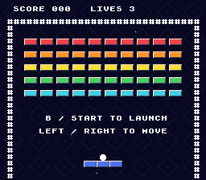
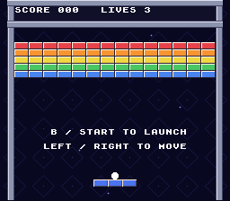
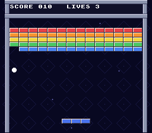
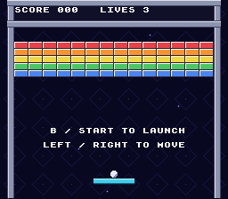

# Part 2: Backgrounds, dynamic sprites, and sound

This is **Part 2** of the build-it-yourself Breakout tutorial. It starts from the
game you finished in [Part 1](README.md) and changes it one feature at a time.
Build and run each checkpoint before moving on.

<div class="rom-download-panel" data-part="2">
  <p class="rom-download-heading"><strong>Try the completed Part 2 game!</strong></p>
  <a class="rom-download-button" href="part2/breakout.sfc" download>Download the Part 2 ROM</a>
</div>

By the end of this part your game will:

- paint a starfield **backdrop** on a second background layer;
- draw the **walls, HUD frame, and bricks** as background tiles instead of
  `#` characters and sprites, erasing a brick's tiles when it breaks;
- use PVSnesLib's **dynamic sprite** engine for the paddle and ball, with a
  short **glimmer animation** when they hit something;
- play **music and sound effects** through the SDK's sound driver.


## Before you start

Part 2 builds on Part 1. Start with a finished, working Part 1 project.

### Get the new artwork

Download these four files into your `breakout` project folder, next to `sprites.png`:

| File | Size | Contents |
|---|---|---|
| [backdrop.png](part2/backdrop.png) | 256 x 256 | Four-color diamond pattern with a few stars |
| [playfield.png](part2/playfield.png) | 256 x 256 | HUD frame, side walls, and a gapless 14 x 5 wall of bricks |
| [paddle.png](part2/paddle.png) | 128 x 48 | Left, middle, and right paddle pieces, each with 6 animation frames |
| [ball.png](part2/ball.png) | 128 x 8 | Sixteen 8 x 8 ball frames (6 used) |

Keep `sprites.png` for now; section 4 stops using it.

### Check the audio files

The music and sound effects come from the SDK's own sound example, so they are
not included in this repository. Check that these two files exist:

```text
<SDK root>\snes-examples\audio\effectsandmusic\res\effectssfx.it
<SDK root>\snes-examples\audio\effectsandmusic\res\pollen8.it
```

You do not need to copy them. In section 6, your Makefile copies them into
your project automatically.

## Contents

1. [Paint a backdrop on background 3](#1-paint-a-backdrop-on-background-3)
2. [Draw the walls, HUD, and bricks on background 2](#2-draw-the-walls-hud-and-bricks-on-background-2)
3. [Erase and restore bricks in the tile map](#3-erase-and-restore-bricks-in-the-tile-map)
4. [Switch the paddle and ball to dynamic sprites](#4-switch-the-paddle-and-ball-to-dynamic-sprites)
5. [Make the paddle and ball glimmer](#5-make-the-paddle-and-ball-glimmer)
6. [Play music](#6-play-music)
7. [Add sound effects](#7-add-sound-effects)

See also [troubleshooting](#troubleshooting) and
[official references](#official-references).

---

## 1. Paint a backdrop on background 3

### How the Mode 1 layers fit together

Part 1 called `setMode(BG_MODE1, 0)` but used only background 1 (`BG1`) for
text and disabled the other two layers. Mode 1 gives you three background
layers:

| Layer | Colors per tile | Front-to-back order |
|---|---|---|
| BG1 | 16 (4 bits per pixel) | In front |
| BG2 | 16 (4 bits per pixel) | Middle |
| BG3 | 4 (2 bits per pixel) | Behind |

Sprites with priority 3, like ours, appear in front of all three. In
PVSnesLib, the layers are numbered from zero: `0` is BG1, `1` is BG2, and `2`
is BG3.

A background is made of two pieces of data in video memory (VRAM):

- **tiles** (character data): 8 x 8 pixel images, with no position;
- a **map**: a 32 x 32 grid of 16-bit entries, each choosing a tile number and
  a palette for one 8 x 8 cell of the screen.

By the end of this part, VRAM will hold this data:

| Data | VRAM address (16-bit words) |
|---|---|
| 16 x 16 sprite frames | `0x0000` |
| 8 x 8 sprite frames | `0x1000` |
| Font tiles (BG1) | `0x3000` |
| Playfield tiles (BG2) | `0x4000` |
| Backdrop tiles (BG3) | `0x5000` |
| Text map (BG1) | `0x6800` |
| Playfield map (BG2) | `0x6C00` |
| Backdrop map (BG3) | `0x7000` |

Tile addresses must be multiples of `0x1000`. Each 32 x 32 map takes `0x400`
words, so the three maps sit side by side without overlapping.

Colors live in **CGRAM** (Color Generator RAM), a 256-entry (512 bytes) section of memory used for storing color palettes. In Mode 1, BG3's 4-color
palette 0 uses colors 0 to 3, which are also the first colors of BG1's palette
0. Part 1's font used palette 0. If it kept doing so, the backdrop and the
font would overwrite each other's colors. So the font moves to palette 1
(colors 16 to 31). Our layers will use these palettes:

| User | Palette | CGRAM colors |
|---|---|---|
| Backdrop (BG3) | 0 | 0-3 |
| Font (BG1) | 1 | 16-31 |
| Playfield (BG2) | 2 | 32-47 |
| Sprites | sprite palette 0 | 128-143 |

### Convert the backdrop

---

### Open `Makefile`

Add a conversion rule for the backdrop to your `Makefile`, after the
`sprites.pic` rule:

**Goal:** Convert the backdrop into four-color BG3 tiles and a map.

<!-- tutorial-edit: {"file":"Makefile","op":"diff-region","context":3} -->
**`Makefile` — in the file, apply these changes:**

```make
sprites.pic: sprites.png
	$(GFXCONV) -s 8 -R -o 16 -u 16 -p -t png -i $<

backdrop.pic: backdrop.png # [!code ++]
	$(GFXCONV) -s 8 -o 4 -u 4 -e 0 -p -m -t png -i $< # [!code ++]
 # [!code ++]
src/data.obj: sprites.pic # [!code --]
src/data.obj: sprites.pic backdrop.pic # [!code ++]
src/main.obj src/game.obj: src/game.h

clean: cleanBuildRes cleanRom cleanGfx
```

The options mean:

- `-s 8`: cut the picture into 8 x 8 tiles;
- `-u 4` and `-o 4`: use four colors (2 bits per pixel) and write four palette
  colors;
- `-e 0`: store palette number 0 in every map entry;
- `-p` and `-m`: also write a palette (`backdrop.pal`) and a map
  (`backdrop.map`).

Unlike `sprites.pic`, there is no `-R`, so `gfx4snes` removes duplicate tiles.
The 256 x 256 picture has 1,024 cells but only 18 different tiles. The map
records which tile goes in each cell, so `backdrop.pic` stays tiny (288 bytes).

---

### Open `src\data.asm`

Add the converted files to the end of `src\data.asm`:

**Goal:** Store the backdrop tiles, map, and palette in the ROM.

<!-- tutorial-edit: {"file":"src/data.asm","op":"diff-region","context":3} -->
**`src\data.asm` — in the file, apply these changes:**

```asm
sprite_palette:
.incbin "sprites.pal"

backdrop_tiles: ; [!code ++]
.incbin "backdrop.pic" ; [!code ++]
backdrop_tiles_end: ; [!code ++]
 ; [!code ++]
backdrop_map: ; [!code ++]
.incbin "backdrop.map" ; [!code ++]
 ; [!code ++]
backdrop_palette: ; [!code ++]
.incbin "backdrop.pal" ; [!code ++]
 ; [!code ++]
.ends
```

The `backdrop_tiles_end` label marks the end of the tile data. C can subtract
the two addresses to get the size, so you do not have to hard-code a number
that changes whenever the artwork does.

### Load the backdrop

---

### Open `src\main.c`

In `src\main.c`, name the backdrop map address and declare the new labels:

**Goal:** Make the backdrop assets and map address available to video initialization.

<!-- tutorial-edit: {"file":"src/main.c","op":"diff-region","scope_before":"draw_bricks","context":3} -->
**`src\main.c` — in file-scope declarations before `draw_bricks`, apply these changes:**

```c
#include <snes.h>
#include "game.h"

#define BACKDROP_MAP 0x7000 // [!code ++]
 // [!code ++]
extern u8 sprite_tiles[];
extern u8 sprite_palette[];
extern u8 backdrop_tiles[], backdrop_tiles_end[]; // [!code ++]
extern u8 backdrop_map[]; // [!code ++]
extern u8 backdrop_palette[]; // [!code ++]

Game game;

```

The declarations refer to assembly labels; `BACKDROP_MAP` reserves space apart
from the text map.

Then, in `init_video`, move the font to palette 1, load the backdrop, and stop
disabling BG3:

**Goal:** Keep the font palette from overwriting BG3's colors.

<!-- tutorial-edit: {"file":"src/main.c","op":"diff-region","function":"init_video","context":3} -->
**`src\main.c` — in `init_video`, apply these changes:**

```c
    int i;

    setScreenOff();
    consoleInitDefaultText(0); // [!code --]
    consoleInitDefaultText(1); // [!code ++]
    bgSetGfxPtr(0, 0x3000);
    bgSetMapPtr(0, 0x6800, SC_32x32);
    oamInitGfxSet(sprite_tiles, 1024, sprite_palette, 32, 0, 0x0000,
```

Font palette 1 starts at CGRAM color 16, leaving colors 0–3 for BG3.

**Goal:** Upload the backdrop's tiles, colors, and map while the screen is off.

<!-- tutorial-edit: {"file":"src/main.c","op":"diff-region","function":"init_video","context":3} -->
**`src\main.c` — in `init_video`, apply these changes:**

```c
    consoleInitDefaultText(1);
    bgSetGfxPtr(0, 0x3000);
    bgSetMapPtr(0, 0x6800, SC_32x32);
    bgInitTileSet(2, backdrop_tiles, backdrop_palette, 0, // [!code ++]
                  backdrop_tiles_end - backdrop_tiles, 4 * 2, BG_4COLORS, // [!code ++]
                  0x5000); // [!code ++]
    bgInitMapSet(2, backdrop_map, 32 * 32 * 2, SC_32x32, BACKDROP_MAP); // [!code ++]
    oamInitGfxSet(sprite_tiles, 1024, sprite_palette, 32, 0, 0x0000,
                  OBJ_SIZE8_L16);

```

The initialization calls load BG3's four-color tiles at `0x5000` and its map at
`BACKDROP_MAP`.

**Goal:** Allow BG3 to appear behind the existing text and sprites.

<!-- tutorial-edit: {"file":"src/main.c","op":"diff-region","function":"init_video","context":3} -->
**`src\main.c` — in `init_video`, apply these changes:**

```c

    setMode(BG_MODE1, 0);
    bgSetDisable(1);
    bgSetDisable(2); // [!code --]
    oamClear(0, 0);
    for (i = 0; i < BRICK_COUNT; ++i)
    {
```

`bgInitTileSet` copies the tiles to VRAM `0x5000` and the palette to CGRAM. Its
arguments are:

1. the layer (`2`, which is BG3);
2. the tiles;
3. the palette;
4. the palette number (`0`);
5. the tile data size;
6. the palette size in bytes (4 colors x 2 bytes each);
7. the color mode;
8. the VRAM address.

`bgInitMapSet` copies the 2,048-byte map (32 x 32 entries x 2 bytes each) to
`BACKDROP_MAP` and points BG3 at it. Both functions write to VRAM, which is
safe here because the screen is off.

**Checkpoint:** Build and run. A dark blue diamond pattern with a few stars now
fills the screen behind everything else. The text is still white and readable,
and the `#` walls, bricks, paddle, and ball look and play exactly as before.



---

## 2. Draw the walls, HUD, and bricks on background 2

### Why move bricks to a background

In Part 1, every brick was a 16 x 16 sprite. The SNES can show 128 sprites in
total and only 32 on one scanline, so a wall of sprites cannot grow much. A
background has neither limit: every 8 x 8 cell of the screen is a map entry. A
16 x 8 brick is just two map entries, and erasing it means writing two "empty"
entries.

`playfield.png` is a full 256 x 224 screen (plus unused rows) drawn on an 8 x 8
grid:

- a HUD frame on tile rows 0 to 3, around the score and lives text;
- side walls on tile columns 1 and 30;
- 70 bricks in 5 rows of 14, with no gaps, starting at pixel (16, 48).

Gameplay already treats pixels 16 to 239 as the field, and 14 bricks x 16
pixels fills exactly that width.

### Convert the playfield

---

### Open `Makefile`

Add another rule to the `Makefile`:

**Goal:** Convert the playfield into sixteen-color BG2 tiles and a map.

<!-- tutorial-edit: {"file":"Makefile","op":"diff-region","context":3} -->
**`Makefile` — in the file, apply these changes:**

```make
sprites.pic: sprites.png
	$(GFXCONV) -s 8 -R -o 16 -u 16 -p -t png -i $<

playfield.pic: playfield.png # [!code ++]
	$(GFXCONV) -s 8 -o 16 -u 16 -e 2 -p -m -t png -i $< # [!code ++]
 # [!code ++]
backdrop.pic: backdrop.png
	$(GFXCONV) -s 8 -o 4 -u 4 -e 0 -p -m -t png -i $<

```

The converter stores palette 2 in map entries and removes duplicate tiles.

**Goal:** Generate the playfield data before its assembly object is built.

<!-- tutorial-edit: {"file":"Makefile","op":"diff-region","context":3} -->
**`Makefile` — in the file, apply these changes:**

```make
backdrop.pic: backdrop.png
	$(GFXCONV) -s 8 -o 4 -u 4 -e 0 -p -m -t png -i $<

src/data.obj: sprites.pic backdrop.pic # [!code --]
src/data.obj: sprites.pic playfield.pic backdrop.pic # [!code ++]
src/main.obj src/game.obj: src/game.h

clean: cleanBuildRes cleanRom cleanGfx
```

---

### Open `src\data.asm`

This time the tiles use 16 colors, and `-e 2` stores palette number 2 in each
map entry. Add the labels to the end of `src\data.asm`:

**Goal:** Include the playfield tiles, map, and palette in the ROM.

<!-- tutorial-edit: {"file":"src/data.asm","op":"diff-region","context":3} -->
**`src\data.asm` — in the file, apply these changes:**

```asm
backdrop_palette:
.incbin "backdrop.pal"

playfield_tiles: ; [!code ++]
.incbin "playfield.pic" ; [!code ++]
playfield_tiles_end: ; [!code ++]
 ; [!code ++]
playfield_map: ; [!code ++]
.incbin "playfield.map" ; [!code ++]
 ; [!code ++]
playfield_palette: ; [!code ++]
.incbin "playfield.pal" ; [!code ++]
 ; [!code ++]
.ends
```

The labels expose each binary asset to C; the end label supplies the tile-data size.

### Close the gaps in the brick grid

---

### Open `src\game.h`

Change the brick layout in `src\game.h`. The pitch macros go away, because
bricks now touch: the distance from one brick to the next is just its width or
height.

**Goal:** Align collision geometry with the artwork's gapless fourteen-column wall.

<!-- tutorial-edit: {"file":"src/game.h","op":"diff-region","context":3} -->
**`src\game.h` — in the file, apply these changes:**

```c
#define PADDLE_Y      200
#define PADDLE_SPEED  3

#define BRICK_COLS    10 // [!code --]
#define BRICK_COLS   14 // [!code ++]
#define BRICK_ROWS    5 // [!code --]
#define BRICK_ROWS   5 // [!code ++]
#define BRICK_COUNT   (BRICK_COLS * BRICK_ROWS) // [!code --]
#define BRICK_COUNT  (BRICK_COLS * BRICK_ROWS) // [!code ++]
#define BRICK_X       30 // [!code --]
#define BRICK_X      16 // [!code ++]
#define BRICK_Y       48 // [!code --]
#define BRICK_Y      48 // [!code ++]
#define BRICK_WIDTH   16 // [!code --]
#define BRICK_WIDTH  16 // [!code ++]
#define BRICK_HEIGHT  8 // [!code --]
#define BRICK_HEIGHT 8 // [!code ++]
#define BRICK_PITCH_X 20 // [!code --]
#define BRICK_PITCH_Y 16 // [!code --]

enum GameState
{
```

`BRICK_X` and `BRICK_Y` must match where the bricks are painted in
`playfield.png`. Both are multiples of 8, so every brick lines up with the tile
grid.

### Find bricks with arithmetic instead of a search

Part 1's `hit_brick` checked every live brick in the touched rows. With 14
columns that loop gets expensive. The 65816 CPU has no instruction to multiply
or divide 16-bit numbers, so the compiler turns `col * BRICK_PITCH_X` into a
call to a slow library routine. `hit_brick` runs up to six times per frame
(three substeps, for both X and Y), and when a frame's work takes too long,
the game visibly slows down.

---

### Open `src\game.c`

With no gaps, there is a shortcut: the ball (8 x 8) can only touch the bricks
under its corners. Divide its position by the brick size to get at most two
rows and two columns. In `src\game.c`, apply these focused edits to `hit_brick`:

**Goal:** Track the small row and column ranges touched by the ball.

<!-- tutorial-edit: {"file":"src/game.c","op":"diff-region","function":"hit_brick","context":3} -->
**`src\game.c` — in `hit_brick`, apply these changes:**

```c
static int hit_brick(Game *game, int x, int y)
{
    int first_row; // [!code ++]
    int last_row; // [!code ++]
    int first_col; // [!code ++]
    int last_col; // [!code ++]
    int row;
    int col;
    int brick_x; // [!code --]
    int brick_y; // [!code --]
    int index;

    if (y + BALL_SIZE <= BRICK_Y ||
```

Four range endpoints replace the individual brick coordinates used by the old scan.

**Goal:** Reject ball rectangles entirely outside any edge of the brick wall.

<!-- tutorial-edit: {"file":"src/game.c","op":"diff-region","function":"hit_brick","context":3} -->
**`src\game.c` — in `hit_brick`, apply these changes:**

```c
    int col;
    int index;

    if (y + BALL_SIZE <= BRICK_Y || // [!code --]
        y >= BRICK_Y + (BRICK_ROWS - 1) * BRICK_PITCH_Y + BRICK_HEIGHT) // [!code --]
    if (y + BALL_SIZE <= BRICK_Y || y >= BRICK_Y + BRICK_ROWS * BRICK_HEIGHT || // [!code ++]
        x + BALL_SIZE <= BRICK_X || x >= BRICK_X + BRICK_COLS * BRICK_WIDTH) // [!code ++]
    {
        return 0;
    }
```

The early return ensures the subsequent arithmetic only handles overlapping ranges.

**Goal:** Test only the one to four brick cells underneath the ball's corners.

<!-- tutorial-edit: {"file":"src/game.c","op":"diff-region","function":"hit_brick","context":3} -->
**`src\game.c` — in `hit_brick`, apply these changes:**

```c
        return 0;
    }

    for (row = 0; row < BRICK_ROWS; ++row) // [!code --]
    /* The grid has no gaps, so only the bricks under the ball's corners can // [!code ++]
       be hit. Working them out directly is much cheaper than a full scan. */ // [!code ++]
    first_row = y < BRICK_Y ? 0 : (unsigned int)(y - BRICK_Y) / BRICK_HEIGHT; // [!code ++]
    last_row = (unsigned int)(y + BALL_SIZE - 1 - BRICK_Y) / BRICK_HEIGHT; // [!code ++]
    if (last_row >= BRICK_ROWS) // [!code ++]
    {
        brick_y = BRICK_Y + row * BRICK_PITCH_Y; // [!code --]
        if (y + BALL_SIZE <= brick_y || y >= brick_y + BRICK_HEIGHT) // [!code --]
        { // [!code --]
            continue; // [!code --]
        } // [!code --]
        last_row = BRICK_ROWS - 1; // [!code ++]
    } // [!code ++]
    first_col = x < BRICK_X ? 0 : (unsigned int)(x - BRICK_X) / BRICK_WIDTH; // [!code ++]
    last_col = (unsigned int)(x + BALL_SIZE - 1 - BRICK_X) / BRICK_WIDTH; // [!code ++]
    if (last_col >= BRICK_COLS) // [!code ++]
    { // [!code ++]
        last_col = BRICK_COLS - 1; // [!code ++]
    } // [!code ++]

        for (col = 0; col < BRICK_COLS; ++col) // [!code --]
    for (row = first_row; row <= last_row; ++row) // [!code ++]
    { // [!code ++]
        for (col = first_col; col <= last_col; ++col) // [!code ++]
        {
            index = row * BRICK_COLS + col;
            if (!game->bricks[index]) // [!code --]
            if (game->bricks[index]) // [!code ++]
            { // [!code --]
                continue; // [!code --]
            } // [!code --]
            brick_x = BRICK_X + col * BRICK_PITCH_X; // [!code --]
            if (x + BALL_SIZE > brick_x && x < brick_x + BRICK_WIDTH) // [!code --]
            {
                game->bricks[index] = 0;
                game->score += 10;
                --game->bricks_left;
                if (game->bricks_left == 0)
                {
                    game->state = STATE_WON;
                }
                return 1;
            }
        }
    }
```

The early `return 0` handles a ball that is entirely outside the wall. After
that, at least one row and column overlap, so the clamped ranges are never
empty. The `(unsigned int)` casts matter: dividing an unsigned value by 8 or 16
compiles to quick bit shifts, while signed division has to round negative
numbers toward zero and needs the slow routine. Only one multiplication,
`row * BRICK_COLS`, remains, and it runs only for the one to four candidate
bricks. Checking rows top to bottom and columns left to right keeps the same
"first hit wins" behavior as Part 1.

### Show the playfield

---

### Open `src\main.c`

In `src\main.c`, add the playfield's map address and labels. `playfield_map`
is declared as `u16`, because each map entry is a 16-bit value; section 3 reads
individual entries from it.

**Goal:** Reserve a separate VRAM map address for BG2.

<!-- tutorial-edit: {"file":"src/main.c","op":"diff-region","scope_before":"draw_bricks","context":3} -->
**`src\main.c` — in file-scope declarations before `draw_bricks`, apply these changes:**

```c
#include <snes.h>
#include "game.h"

#define PLAYFIELD_MAP 0x6C00 // [!code ++]
#define BACKDROP_MAP 0x7000 // [!code --]
#define BACKDROP_MAP  0x7000 // [!code ++]

extern u8 sprite_tiles[];
extern u8 sprite_palette[];
```

The two map constants keep BG2 and BG3 from sharing the same VRAM region.

**Goal:** Expose the playfield assets, including individually readable map entries.

<!-- tutorial-edit: {"file":"src/main.c","op":"diff-region","scope_before":"draw_bricks","context":3} -->
**`src\main.c` — in file-scope declarations before `draw_bricks`, apply these changes:**

```c
extern u8 backdrop_tiles[], backdrop_tiles_end[];
extern u8 backdrop_map[];
extern u8 backdrop_palette[];
extern u8 playfield_tiles[], playfield_tiles_end[]; // [!code ++]
extern u16 playfield_map[]; // [!code ++]
extern u8 playfield_palette[]; // [!code ++]

Game game;

```

The map uses `u16` entries, unlike the byte arrays used for tiles and palettes.

The bricks are now part of the background, so **delete the whole
`draw_bricks` function**, from `static void draw_bricks(void)` to its closing
brace. Leave the `shown_alive` and `shown_bricks` variables above it; section 3
uses them again. Then remove the call to it:

**Goal:** Stop drawing sprite bricks now that BG2 supplies their artwork.

<!-- tutorial-edit: {"file":"src/main.c","op":"delete-function","name":"draw_bricks"} -->
**`src\main.c` — remove the entire `draw_bricks` function shown below:**

```c
static void draw_bricks(void) // [!code --]
{ // [!code --]
    int index; // [!code --]
    int id; // [!code --]
 // [!code --]
    if (shown_bricks == game.bricks_left) // [!code --]
    { // [!code --]
        return; // [!code --]
    } // [!code --]
 // [!code --]
    for (index = 0; index < BRICK_COUNT; ++index) // [!code --]
    { // [!code --]
        if (shown_alive[index] == game.bricks[index]) // [!code --]
        { // [!code --]
            continue; // [!code --]
        } // [!code --]
 // [!code --]
        id = (index + 4) * 4; // [!code --]
        if (game.bricks[index]) // [!code --]
        { // [!code --]
            oamSet(id, BRICK_X + (index % BRICK_COLS) * BRICK_PITCH_X, // [!code --]
                   BRICK_Y + (index / BRICK_COLS) * BRICK_PITCH_Y, 3, 0, 0, // [!code --]
                   (index / BRICK_COLS) * 2, 0); // [!code --]
            oamSetEx(id, OBJ_LARGE, OBJ_SHOW); // [!code --]
        } // [!code --]
        else // [!code --]
        { // [!code --]
            oamSetVisible(id, OBJ_HIDE); // [!code --]
        } // [!code --]
        shown_alive[index] = game.bricks[index]; // [!code --]
    } // [!code --]
    shown_bricks = game.bricks_left; // [!code --]
} // [!code --]
```

Removing this renderer releases the brick sprite slots; its state cache will
be reused for tile-map updates.

**Goal:** Remove the call to the deleted sprite-brick renderer.

<!-- tutorial-edit: {"file":"src/main.c","op":"diff-region","function":"draw_game","context":3} -->
**`src\main.c` — in `draw_game`, apply these changes:**

```c
    for (i = 0; i < 3; ++i)
    {
        oamSetXY((i + 1) * 4, game.paddle_x + i * 16, PADDLE_Y);
    }
    draw_bricks(); // [!code --]
    draw_text();
}
```

`draw_game` now handles only the paddle, ball, and text.

Finally, update `init_video`. Load BG2, stop disabling it, and delete the old
brick reset loop and the `#` walls:

**Goal:** Remove the row variable used only to draw the old text border.

<!-- tutorial-edit: {"file":"src/main.c","op":"diff-region","function":"init_video","context":3} -->
**`src\main.c` — in `init_video`, apply these changes:**

```c
static void init_video(void)
{
    int row; // [!code --]
    int i;

    setScreenOff();
```

The upcoming BG2 artwork replaces that border loop.

**Goal:** Upload BG2's playfield tiles, palette, and map.

<!-- tutorial-edit: {"file":"src/main.c","op":"diff-region","function":"init_video","context":3} -->
**`src\main.c` — in `init_video`, apply these changes:**

```c
    consoleInitDefaultText(1);
    bgSetGfxPtr(0, 0x3000);
    bgSetMapPtr(0, 0x6800, SC_32x32);
    bgInitTileSet(1, playfield_tiles, playfield_palette, 2, // [!code ++]
                  playfield_tiles_end - playfield_tiles, 16 * 2, BG_16COLORS, // [!code ++]
                  0x4000); // [!code ++]
    bgInitMapSet(1, (u8 *)playfield_map, 32 * 32 * 2, SC_32x32, PLAYFIELD_MAP); // [!code ++]
    bgInitTileSet(2, backdrop_tiles, backdrop_palette, 0,
                  backdrop_tiles_end - backdrop_tiles, 4 * 2, BG_4COLORS,
                  0x5000);
```

BG2 uses tile address `0x4000`, its reserved map address, and palette 2.

**Goal:** Leave BG2 enabled and remove obsolete sprite-brick initialization.

<!-- tutorial-edit: {"file":"src/main.c","op":"diff-region","function":"init_video","context":3} -->
**`src\main.c` — in `init_video`, apply these changes:**

```c
                  OBJ_SIZE8_L16);

    setMode(BG_MODE1, 0);
    bgSetDisable(1); // [!code --]
    oamClear(0, 0);
    for (i = 0; i < BRICK_COUNT; ++i) // [!code --]
    { // [!code --]
        shown_alive[i] = 0; // [!code --]
    } // [!code --]

    oamSet(0, game.ball_x, game.ball_y, 3, 0, 0, 12, 0);
    oamSetEx(0, OBJ_SMALL, OBJ_SHOW);
```

BG2 now displays the bricks directly from its map, without per-brick OAM setup.

**Goal:** Replace the text-character border with the playfield's drawn walls.

<!-- tutorial-edit: {"file":"src/main.c","op":"diff-region","function":"init_video","context":3} -->
**`src\main.c` — in `init_video`, apply these changes:**

```c
    }

    consoleDrawText(2, 1, "SCORE       LIVES");
    consoleDrawText(1, 3, "##############################"); // [!code --]
    for (row = 4; row < 28; ++row) // [!code --]
    { // [!code --]
        consoleDrawText(1, row, "#"); // [!code --]
        consoleDrawText(30, row, "#"); // [!code --]
    } // [!code --]
    draw_game();
    setScreenOn();
}
```

The `(u8 *)` cast is needed because `bgInitMapSet` takes a byte pointer.
Palette number `2` matches the `-e 2` used in conversion, and `16 * 2` is the
palette size in bytes.

**Checkpoint:** Build and run. Metal walls frame the field and the HUD, the
score and lives sit inside the HUD frame, and a gapless wall of 70 bricks in
five colors fills the top. The ball and paddle still use Part 1's sprites. Play
for a moment: the ball bounces off bricks and the score goes up, but **the
bricks do not disappear yet**. Section 3 fixes that.



---

## 3. Erase and restore bricks in the tile map

### Change VRAM only during vertical blank

The SNES video chip reads VRAM constantly while it draws the screen. Your code
may write to VRAM only during **forced blank** (screen off, as in
`init_video`) or **vertical blank** (vblank), the short pause after each frame
is drawn. `WaitForVBlank()` returns at the start of vblank, so VRAM writes
belong right after it.

Vblank is short: only a few kilobytes can be copied by DMA in one NTSC
vblank, and the library already uses some of that time. The text console
copies its whole 2 KB map to VRAM in any frame where text changed. A copy that
runs past the end of vblank does not crash. It silently drops data, so some
bricks just stay on screen.

So the plan is:

1. keep a RAM copy of the five brick rows of the map (`brick_map`);
2. when bricks change, update that copy and flag the changed rows;
3. after `WaitForVBlank()`, copy **at most one** flagged row to VRAM.

One row is 14 bricks x 2 tiles x 2 bytes = 56 bytes, which easily fits. A
restart redraws all five rows over five frames, about a twelfth of a second.

### Track and upload changed rows

---

### Open `src\main.c`

Add these definitions to `src\main.c`:

**Goal:** Name the blank map entry and the grid's tile-map origin.

<!-- tutorial-edit: {"file":"src/main.c","op":"diff-region","scope_before":"draw_text","context":3} -->
**`src\main.c` — in file-scope declarations before `draw_text`, apply these changes:**

```c

#define PLAYFIELD_MAP 0x6C00
#define BACKDROP_MAP  0x7000
#define EMPTY_TILE    0x0800 // [!code ++]
#define BRICK_TILE_X  (BRICK_X / 8) // [!code ++]
#define BRICK_TILE_Y  (BRICK_Y / 8) // [!code ++]

extern u8 sprite_tiles[];
extern u8 sprite_palette[];
```

`BRICK_TILE_X` and `BRICK_TILE_Y` are the bricks' map column (2) and row (6).
`EMPTY_TILE` is the map entry `gfx4snes` wrote for empty areas of
`playfield.png`: tile 0, which is fully transparent, with palette 2 in bits 10
to 12 (`2 << 10 = 0x0800`).

Add the RAM copy and the row flags, then the two new functions, between the
variables and `draw_text`:

**Goal:** Stage changed brick tiles in RAM and track rows awaiting upload.

<!-- tutorial-edit: {"file":"src/main.c","op":"diff-region","scope_before":"draw_text","context":3} -->
**`src\main.c` — in file-scope declarations before `draw_text`, apply these changes:**

```c

Game game;

static u16 brick_map[BRICK_ROWS][BRICK_COLS * 2]; // [!code ++]
static unsigned char row_changed[BRICK_ROWS]; // [!code ++]
static unsigned char shown_alive[BRICK_COUNT];
static char score_text[] = "000";
static char lives_text[] = "3";
```

Each brick occupies two `u16` entries; one dirty flag covers a whole brick row.

**Goal:** Update the RAM map when bricks break or return.

<!-- tutorial-edit: {"file":"src/main.c","op":"add-function","name":"prepare_bricks","before":"draw_text"} -->
**`src\main.c` — add this complete `prepare_bricks` function immediately before `draw_text`:**

```c
static void prepare_bricks(void) // [!code ++]
{ // [!code ++]
    int index; // [!code ++]
    int row; // [!code ++]
    int col; // [!code ++]
    int tile; // [!code ++]
 // [!code ++]
    if (shown_bricks == game.bricks_left) // [!code ++]
    { // [!code ++]
        return; // [!code ++]
    } // [!code ++]
 // [!code ++]
    index = 0; // [!code ++]
    for (row = 0; row < BRICK_ROWS; ++row) // [!code ++]
    { // [!code ++]
        tile = (BRICK_TILE_Y + row) * 32 + BRICK_TILE_X; // [!code ++]
        for (col = 0; col < BRICK_COLS * 2; col += 2) // [!code ++]
        { // [!code ++]
            if (shown_alive[index] != game.bricks[index]) // [!code ++]
            { // [!code ++]
                shown_alive[index] = game.bricks[index]; // [!code ++]
                if (game.bricks[index]) // [!code ++]
                { // [!code ++]
                    brick_map[row][col] = playfield_map[tile + col]; // [!code ++]
                    brick_map[row][col + 1] = playfield_map[tile + col + 1]; // [!code ++]
                } // [!code ++]
                else // [!code ++]
                { // [!code ++]
                    brick_map[row][col] = EMPTY_TILE; // [!code ++]
                    brick_map[row][col + 1] = EMPTY_TILE; // [!code ++]
                } // [!code ++]
                row_changed[row] = 1; // [!code ++]
            } // [!code ++]
            ++index; // [!code ++]
        } // [!code ++]
    } // [!code ++]
    shown_bricks = game.bricks_left; // [!code ++]
} // [!code ++]
```

Changed cells receive either their original ROM entries or two transparent entries.
The containing row is marked for transfer.

**Goal:** Upload at most one changed row per VBlank.

<!-- tutorial-edit: {"file":"src/main.c","op":"add-function","name":"upload_bricks","before":"draw_text"} -->
**`src\main.c` — add this complete `upload_bricks` function immediately before `draw_text`:**

```c
static void upload_bricks(void) // [!code ++]
{ // [!code ++]
    int row; // [!code ++]
 // [!code ++]
    /* One row per frame keeps the copy inside vblank. */ // [!code ++]
    for (row = 0; row < BRICK_ROWS; ++row) // [!code ++]
    { // [!code ++]
        if (row_changed[row]) // [!code ++]
        { // [!code ++]
            dmaCopyVram((u8 *)brick_map[row], // [!code ++]
                        PLAYFIELD_MAP + (BRICK_TILE_Y + row) * 32 + // [!code ++]
                            BRICK_TILE_X, // [!code ++]
                        BRICK_COLS * 4); // [!code ++]
            row_changed[row] = 0; // [!code ++]
            return; // [!code ++]
        } // [!code ++]
    } // [!code ++]
} // [!code ++]
```

`prepare_bricks` works like Part 1's `draw_bricks`. It does nothing unless the
brick count changed, then compares each brick with what is on screen. Here,
`col` counts map entries, two per brick. A broken brick gets two `EMPTY_TILE`
entries. A restored brick gets its original two entries back, read from
`playfield_map` in ROM, so the colors always match the artwork.

`dmaCopyVram(source, address, size)` copies `size` bytes to a VRAM word
address. A row's address is the map's base address, plus 32 entries per map
row, plus the bricks' starting column.

### Initialize everything explicitly

`init_video` must fill `brick_map` from the artwork and clear `row_changed`.
Do not rely on C's rule that global variables start at zero: the PVSnesLib
toolchain does **not** clear uninitialized globals and statics. On real
hardware (and in accurate emulators) they start with leftover values, so a
"zero" flag might start as `1`. Variables with an initializer, like
`shown_score = -1`, are set correctly.

**Goal:** Prepare brick-map changes alongside the other frame's drawing work.

<!-- tutorial-edit: {"file":"src/main.c","op":"diff-region","function":"draw_game","context":3} -->
**`src\main.c` — in `draw_game`, apply these changes:**

```c
    for (i = 0; i < 3; ++i)
    {
        oamSetXY((i + 1) * 4, game.paddle_x + i * 16, PADDLE_Y);
    }
    prepare_bricks(); // [!code ++]
    draw_text();
}
```

Preparation modifies RAM only; `upload_bricks` will perform the later VRAM transfer.

**Goal:** Iterate through brick rows and map columns during initialization.

<!-- tutorial-edit: {"file":"src/main.c","op":"diff-region","function":"init_video","context":3} -->
**`src\main.c` — in `init_video`, apply these changes:**

```c
static void init_video(void)
{
    int row; // [!code ++]
    int col; // [!code ++]
    int i;

    setScreenOff();
```

The new loop variables address rows and their two entries per brick.

**Goal:** Initialize the RAM map and cache to match the full wall already in VRAM.

<!-- tutorial-edit: {"file":"src/main.c","op":"diff-region","function":"init_video","context":3} -->
**`src\main.c` — in `init_video`, apply these changes:**

```c
        oamSetEx((i + 1) * 4, OBJ_LARGE, OBJ_SHOW);
    }

    for (row = 0; row < BRICK_ROWS; ++row) // [!code ++]
    { // [!code ++]
        row_changed[row] = 0; // [!code ++]
        for (col = 0; col < BRICK_COLS * 2; ++col) // [!code ++]
        { // [!code ++]
            brick_map[row][col] = // [!code ++]
                playfield_map[(BRICK_TILE_Y + row) * 32 + BRICK_TILE_X + col]; // [!code ++]
        } // [!code ++]
    } // [!code ++]
    for (i = 0; i < BRICK_COUNT; ++i) // [!code ++]
    { // [!code ++]
        shown_alive[i] = 1; // [!code ++]
    } // [!code ++]
    shown_bricks = BRICK_COUNT; // [!code ++]
 // [!code ++]
    consoleDrawText(2, 1, "SCORE       LIVES");
    draw_game();
    setScreenOn();
```

The map loaded by `bgInitMapSet` already shows all 70 bricks, so the startup
state says exactly that: every brick shown, nothing to upload.

Finally, upload a row right after waiting for vblank in `main`:

**Goal:** Transfer pending brick changes during the next VBlank.

<!-- tutorial-edit: {"file":"src/main.c","op":"diff-region","function":"main","context":3} -->
**`src\main.c` — in `main`, apply these changes:**

```c
    while (1)
    {
        WaitForVBlank();
        upload_bricks(); // [!code ++]
        held = padsCurrent(0);
        pressed = padsDown(0);
        movement = 0;
```

The call follows `WaitForVBlank`, keeping the row DMA within the permitted
VRAM-write window.

**Checkpoint:** Build and run. Hit bricks: each one vanishes, showing the
backdrop behind it, and adds ten points. Lose all three lives and restart: all
70 bricks return. Clear the wall (it takes a while) and check for
`YOU WIN!` and a score of `700`, then restart. Nothing should flicker, and no
brick should be left behind.



---

## 4. Switch the paddle and ball to dynamic sprites

### What dynamic sprites do

With `oamInitGfxSet`, Part 1 copied the whole sprite sheet into VRAM once and
picked tiles by number. That works for a small sheet. But a game with many
animation frames quickly runs out of sprite VRAM, which holds only 16 KB.

PVSnesLib's **dynamic sprite** engine keeps all frames in ROM. Each frame it
copies **only the frames currently on screen** into VRAM. You describe each
sprite in the `oambuffer` array: position, frame number, attributes, and a
pointer to its graphics in ROM. Then each frame you:

1. set positions and frames, and call `oamDynamic16Draw(id)` or
   `oamDynamic8Draw(id)` for each visible sprite;
2. call `oamInitDynamicSpriteEndFrame()` to finish the frame's sprite list;
3. call `WaitForVBlank()`;
4. call `oamVramQueueUpdate()` to copy the queued frames into VRAM, during
   vblank.

Steps 1 and 2 must happen **before** the vblank wait and step 4 right after
it, so the game loop changes shape. All game logic now runs first, and the
loop ends by waiting for vblank and then doing the VRAM copies.

### Convert the new sprite sheets

The sprite sheets are laid out for the engine. Frames are numbered left to
right, then top to bottom, 128 pixels per row:

- `paddle.png` has one row of eight 16 x 16 frames for each paddle piece (left,
  middle, right). The pieces use only the top 8 pixel rows of each frame. So
  frame `0` is the left piece, `8` the middle, and `16` the right; the next five
  frames of each row are its glimmer animation.
- `ball.png` has sixteen 8 x 8 frames; frame `0` is the normal ball.

---

### Open `Makefile`

Replace the `sprites.pic` rule in the `Makefile`:

**Goal:** Convert separate paddle and ball frame sheets for dynamic sprites.

<!-- tutorial-edit: {"file":"Makefile","op":"diff-region","context":3} -->
**`Makefile` — in the file, apply these changes:**

```make

all: $(ROMNAME).sfc

sprites.pic: sprites.png # [!code --]
paddle.pic: paddle.png # [!code ++]
	$(GFXCONV) -s 16 -o 16 -u 16 -p -t png -i $< # [!code ++]
 # [!code ++]
ball.pic: ball.png # [!code ++]
	$(GFXCONV) -s 8 -R -o 16 -u 16 -p -t png -i $<

playfield.pic: playfield.png
```

The paddle uses 16-by-16 blocks; the ball keeps 8-by-8 tiles in sheet order.

**Goal:** Build the new sheets instead of the old combined sprite sheet.

<!-- tutorial-edit: {"file":"Makefile","op":"diff-region","context":3} -->
**`Makefile` — in the file, apply these changes:**

```make
backdrop.pic: backdrop.png
	$(GFXCONV) -s 8 -o 4 -u 4 -e 0 -p -m -t png -i $<

src/data.obj: sprites.pic playfield.pic backdrop.pic # [!code --]
src/data.obj: paddle.pic ball.pic playfield.pic backdrop.pic # [!code ++]
src/main.obj src/game.obj: src/game.h

clean: cleanBuildRes cleanRom cleanGfx
```

`-s 16` cuts the paddle sheet into 16 x 16 blocks. Without `-m`, `gfx4snes`
keeps every block in order, so `paddle.pic` is 24 frames x 128 bytes. The ball
keeps Part 1's `-R` option. Both sheets share one 16-color palette, so we load
only `paddle.pal`.

---

### Open `src\data.asm`

Update the start of `src\data.asm`:

**Goal:** Store the paddle and ball frame data under separate ROM labels.

<!-- tutorial-edit: {"file":"src/data.asm","op":"diff-region","context":3} -->
**`src\data.asm` — in the file, apply these changes:**

```asm

.section ".breakout_assets" superfree

sprite_tiles: ; [!code --]
paddle_tiles: ; [!code ++]
.incbin "sprites.pic" ; [!code --]
.incbin "paddle.pic" ; [!code ++]
 ; [!code ++]
ball_tiles: ; [!code ++]
.incbin "ball.pic" ; [!code ++]

sprite_palette:
.incbin "sprites.pal"
```

Separate labels let each dynamic sprite point at its own animation sheet.

**Goal:** Use the shared palette supplied with the new paddle artwork.

<!-- tutorial-edit: {"file":"src/data.asm","op":"diff-region","context":3} -->
**`src\data.asm` — in the file, apply these changes:**

```asm
.incbin "ball.pic"

sprite_palette:
.incbin "sprites.pal" ; [!code --]
.incbin "paddle.pal" ; [!code ++]

backdrop_tiles:
.incbin "backdrop.pic"
```

Both sheets use the paddle palette, so no separate ball-palette upload is needed.

You can run `make clean` and then delete `sprites.png` from your project;
nothing uses it now. (`make clean` removes the generated `sprites.pic`,
`sprites.pal`, and `sprites_data.as` files.)

### Set up and draw dynamic sprites

---

### Open `src\main.c`

In `src\main.c`, replace the old sprite label:

**Goal:** Point C's sprite declarations at the new frame data.

<!-- tutorial-edit: {"file":"src/main.c","op":"diff-region","scope_before":"prepare_bricks","context":3} -->
**`src\main.c` — in file-scope declarations before `prepare_bricks`, apply these changes:**

```c
#define BRICK_TILE_X  (BRICK_X / 8)
#define BRICK_TILE_Y  (BRICK_Y / 8)

extern u8 sprite_tiles[]; // [!code --]
extern u8 paddle_tiles[]; // [!code ++]
extern u8 ball_tiles[]; // [!code ++]
extern u8 sprite_palette[];
extern u8 backdrop_tiles[], backdrop_tiles_end[];
extern u8 backdrop_map[];
```

The declarations match the new assembly labels rather than the removed combined sheet.

Replace the whole `draw_game` function with `draw_sprites` and a small helper,
`init_sprite`. `prepare_bricks` and `draw_text` move into the main loop.

**Goal:** Submit the ball and paddle positions to the dynamic sprite engine.

<!-- tutorial-edit: {"file":"src/main.c","op":"add-function","name":"draw_sprites","before":"init_video"} -->
**`src\main.c` — add this complete `draw_sprites` function immediately before `init_video`:**

```c
static void draw_sprites(void) // [!code ++]
{ // [!code ++]
    int i; // [!code ++]
 // [!code ++]
    oambuffer[0].oamx = game.ball_x; // [!code ++]
    oambuffer[0].oamy = game.ball_y; // [!code ++]
    oamDynamic8Draw(0); // [!code ++]
 // [!code ++]
    for (i = 0; i < 3; ++i) // [!code ++]
    { // [!code ++]
        oambuffer[i + 1].oamx = game.paddle_x + i * 16; // [!code ++]
        oambuffer[i + 1].oamy = PADDLE_Y; // [!code ++]
        oamDynamic16Draw(i + 1); // [!code ++]
    } // [!code ++]
} // [!code ++]
```

The ball uses slot 0; the paddle uses slots 1–3 with sixteen-pixel X offsets.

**Goal:** Initialize each sprite's frame, attributes, graphics pointer, and refresh flag.

<!-- tutorial-edit: {"file":"src/main.c","op":"add-function","name":"init_sprite","before":"init_video"} -->
**`src\main.c` — add this complete `init_sprite` function immediately before `init_video`:**

```c
static void init_sprite(int id, u8 *graphics, int frame, int size) // [!code ++]
{ // [!code ++]
    oambuffer[id].oamframeid = frame; // [!code ++]
    oambuffer[id].oamattribute = OBJ_PAL(0) | OBJ_PRIO(3) | size; // [!code ++]
    oambuffer[id].oamgraphics = graphics; // [!code ++]
    oambuffer[id].oamrefresh = 1; // [!code ++]
} // [!code ++]
```

The initial refresh flag queues a graphics upload before the sprite's first display.

**Goal:** Remove the fixed-OAM renderer now replaced by dynamic drawing.

<!-- tutorial-edit: {"file":"src/main.c","op":"delete-function","name":"draw_game"} -->
**`src\main.c` — remove the entire `draw_game` function shown below:**

```c
static void draw_game(void) // [!code --]
{ // [!code --]
    int i; // [!code --]
 // [!code --]
    oamSetXY(0, game.ball_x, game.ball_y); // [!code --]
    for (i = 0; i < 3; ++i) // [!code --]
    { // [!code --]
        oamSetXY((i + 1) * 4, game.paddle_x + i * 16, PADDLE_Y); // [!code --]
    } // [!code --]
    prepare_bricks(); // [!code --]
    draw_text(); // [!code --]
} // [!code --]
```

Sprite `0` is the ball and sprites `1` to `3` are the paddle pieces. Note the
plain sprite numbers: dynamic sprites index `oambuffer` directly, unlike
Part 1's `oamSet`, which used multiples of 4.

`init_sprite` fills in what never changes:

- `oamgraphics` points at the sheet in ROM, and `oamframeid` selects a frame in
  it;
- `oamattribute` holds the sprite palette, priority, and the **size bit**;
- `oamrefresh = 1` tells the engine to copy the frame's graphics into VRAM.

The size bit matters. `OBJ_SIZES` marks a small (8 x 8) sprite and
`OBJ_SIZEL` a large (16 x 16) one. The engine stores small frames at the second
VRAM address given to `oamInitDynamicSprite`, and this bit makes the hardware
look there. If the ball uses `OBJ_SIZEL`, it shows part of the paddle instead.

In `init_video`, replace the `oamInitGfxSet`, `oamClear`, `oamSet`, and
`oamSetEx` calls:

**Goal:** Allocate dynamic frame regions and initialize the ball and paddle slots.

<!-- tutorial-edit: {"file":"src/main.c","op":"diff-region","function":"init_video","context":3} -->
**`src\main.c` — in `init_video`, apply these changes:**

```c
                  backdrop_tiles_end - backdrop_tiles, 4 * 2, BG_4COLORS,
                  0x5000);
    bgInitMapSet(2, backdrop_map, 32 * 32 * 2, SC_32x32, BACKDROP_MAP);
    oamInitGfxSet(sprite_tiles, 1024, sprite_palette, 32, 0, 0x0000, // [!code --]
                  OBJ_SIZE8_L16); // [!code --]
 // [!code ++]
    oamInitDynamicSprite(0x0000, 0x1000, 0, 0, OBJ_SIZE8_L16); // [!code ++]
    setPalette(sprite_palette, 128, 16 * 2); // [!code ++]
    init_sprite(0, ball_tiles, 0, OBJ_SIZES); // [!code ++]
    for (i = 0; i < 3; ++i) // [!code ++]
    { // [!code ++]
        init_sprite(i + 1, paddle_tiles, i * 8, OBJ_SIZEL); // [!code ++]
    } // [!code ++]

    setMode(BG_MODE1, 0);
    oamClear(0, 0);
```

The engine separates large and small frames at `0x0000` and `0x1000`; sprite
palette 0 remains at CGRAM color 128.

**Goal:** Remove the old fixed-sprite setup that would overwrite dynamic state.

<!-- tutorial-edit: {"file":"src/main.c","op":"diff-region","function":"init_video","context":3} -->
**`src\main.c` — in `init_video`, apply these changes:**

```c
    }

    setMode(BG_MODE1, 0);
    oamClear(0, 0); // [!code --]
 // [!code --]
    oamSet(0, game.ball_x, game.ball_y, 3, 0, 0, 12, 0); // [!code --]
    oamSetEx(0, OBJ_SMALL, OBJ_SHOW); // [!code --]
    for (i = 0; i < 3; ++i) // [!code --]
    { // [!code --]
        oamSet((i + 1) * 4, game.paddle_x + i * 16, PADDLE_Y, 3, 0, 0, 10, 0); // [!code --]
        oamSetEx((i + 1) * 4, OBJ_LARGE, OBJ_SHOW); // [!code --]
    } // [!code --]

    for (row = 0; row < BRICK_ROWS; ++row)
    {
```

`oamInitDynamicSprite(0x0000, 0x1000, 0, 0, OBJ_SIZE8_L16)` puts large frames
at VRAM `0x0000` and small frames at `0x1000`, starts both sprite lists at
entry 0, and keeps Part 1's 8 x 8 small / 16 x 16 large sizes. It also resets
the sprite table, so `oamClear` is no longer needed. `setPalette` copies the 16
sprite colors to CGRAM 128, where sprite palette 0 begins.

At the end of `init_video`, `draw_game` no longer exists. Draw the text
instead; the sprites appear on the first pass through the loop:

**Goal:** Draw the initial HUD without calling the deleted fixed-sprite renderer.

<!-- tutorial-edit: {"file":"src/main.c","op":"diff-region","function":"init_video","context":3} -->
**`src\main.c` — in `init_video`, apply these changes:**

```c
    shown_bricks = BRICK_COUNT;

    consoleDrawText(2, 1, "SCORE       LIVES");
    draw_game(); // [!code --]
    draw_text(); // [!code ++]
    setScreenOn();
}
```

The HUD appears before the screen turns on; dynamic sprites are submitted by
the first frame of the main loop.

Now reshape the main loop:

**Goal:** Move the frame wait out of the beginning of the loop.

<!-- tutorial-edit: {"file":"src/main.c","op":"diff-region","function":"main","context":3} -->
**`src\main.c` — in `main`, apply these changes:**

```c

    while (1)
    {
        WaitForVBlank(); // [!code --]
        upload_bricks(); // [!code --]
        held = padsCurrent(0);
        pressed = padsDown(0);
        movement = 0;
```

Dynamic sprites must be prepared before the wait, then uploaded during VBlank.

**Goal:** Finish RAM preparation before waiting, then upload sprites and one brick row.

<!-- tutorial-edit: {"file":"src/main.c","op":"diff-region","function":"main","context":3} -->
**`src\main.c` — in `main`, apply these changes:**

```c
            ++movement;
        }
        game_tick(&game, movement, pressed & (KEY_B | KEY_START));
 // [!code ++]
        draw_game(); // [!code --]
        draw_sprites(); // [!code ++]
        prepare_bricks(); // [!code ++]
        draw_text(); // [!code ++]
 // [!code ++]
        oamInitDynamicSpriteEndFrame(); // [!code ++]
        WaitForVBlank(); // [!code ++]
        oamVramQueueUpdate(); // [!code ++]
        upload_bricks(); // [!code ++]
    }
    return 0;
}
```

Everything that only prepares data in RAM happens first. The vblank wait
comes next, and both VRAM copies (sprite frames and brick row) come right
after it, while vblank is still going.

**Checkpoint:** Build and run. The paddle is now a cyan bar with rounded ends,
and the ball is a small silver ball. Both move and collide exactly as before,
and bricks still disappear and come back on restart. If the ball looks like a
piece of the paddle, check its `OBJ_SIZES` attribute.



---

## 5. Make the paddle and ball glimmer

### Report hits from the game logic

The glimmer should start when the ball hits something. Only `game.c` knows
when that happens, but `game.c` must not know about sprites. So the game
records **what** was hit during the current tick in a set of bit flags, and
`main.c` decides how to show it.

---

### Open `src\game.h`

In `src\game.h`, add the flags and a field. Put `hits` before the `bricks`
array:

**Goal:** Describe collision events with independent bit flags.

<!-- tutorial-edit: {"file":"src/game.h","op":"diff-region","context":3} -->
**`src\game.h` — in the file, apply these changes:**

```c
#define BRICK_WIDTH  16
#define BRICK_HEIGHT 8

#define HIT_WALL   1 // [!code ++]
#define HIT_PADDLE 2 // [!code ++]
#define HIT_BRICK  4 // [!code ++]
 // [!code ++]
enum GameState
{
    STATE_READY,
```

Values 1, 2, and 4 use different bits, allowing several events in one tick.

**Goal:** Carry the current tick's collision events in the gameplay state.

<!-- tutorial-edit: {"file":"src/game.h","op":"diff-region","context":3} -->
**`src\game.h` — in the file, apply these changes:**

```c
    int lives;
    int bricks_left;
    int state;
    int hits; // [!code ++]
    unsigned char bricks[BRICK_COUNT];
} Game;

```

`hits` reports events to the renderer without introducing SNES APIs into `game.c`.

---

### Open `src\game.c`

In `src\game.c`, clear the flags in `game_reset` and at the start of every
tick, and set one at each kind of bounce:

**Goal:** Begin a new game without pending collision events.

<!-- tutorial-edit: {"file":"src/game.c","op":"diff-region","function":"game_reset","context":3} -->
**`src\game.c` — in `game_reset`, apply these changes:**

```c
    game->lives = 3;
    game->bricks_left = BRICK_COUNT;
    game->state = STATE_READY;
    game->hits = 0; // [!code ++]
    for (i = 0; i < BRICK_COUNT; ++i)
    {
        game->bricks[i] = 1;
```

Clearing `hits` prevents stale events from triggering effects after a restart.

**Goal:** Report brick impacts when the collision helper removes a brick.

<!-- tutorial-edit: {"file":"src/game.c","op":"diff-region","function":"hit_brick","context":3} -->
**`src\game.c` — in `hit_brick`, apply these changes:**

```c
            index = row * BRICK_COLS + col;
            if (game->bricks[index])
            {
                game->hits |= HIT_BRICK; // [!code ++]
                game->bricks[index] = 0;
                game->score += 10;
                --game->bricks_left;
```

Bitwise OR preserves any other collisions already recorded during the tick.

**Goal:** Report impacts against either side wall.

<!-- tutorial-edit: {"file":"src/game.c","op":"diff-region","function":"move_ball_x","context":3} -->
**`src\game.c` — in `move_ball_x`, apply these changes:**

```c
    next_x = game->ball_x + (game->vx > 0 ? 1 : -1);
    if (next_x < FIELD_LEFT || next_x + BALL_SIZE > FIELD_RIGHT)
    {
        game->hits |= HIT_WALL; // [!code ++]
        game->vx = -game->vx;
    }
    else if (hit_brick(game, next_x, game->ball_y))
```

The wall event accompanies the existing horizontal velocity reversal.

**Goal:** Report ceiling impacts as wall events.

<!-- tutorial-edit: {"file":"src/game.c","op":"diff-region","function":"move_ball_y","context":3} -->
**`src\game.c` — in `move_ball_y`, apply these changes:**

```c
    next_y = game->ball_y + (game->vy > 0 ? 1 : -1);
    if (next_y < FIELD_TOP)
    {
        game->hits |= HIT_WALL; // [!code ++]
        game->vy = -game->vy;
    }
    else if (game->vy > 0 && game->ball_y + BALL_SIZE <= PADDLE_Y &&
```

The same flag represents horizontal and vertical field boundaries.

**Goal:** Distinguish paddle impacts from walls and bricks.

<!-- tutorial-edit: {"file":"src/game.c","op":"diff-region","function":"move_ball_y","context":3} -->
**`src\game.c` — in `move_ball_y`, apply these changes:**

```c
             game->ball_x + BALL_SIZE > game->paddle_x &&
             game->ball_x < game->paddle_x + PADDLE_WIDTH)
    {
        game->hits |= HIT_PADDLE; // [!code ++]
        game->ball_y = PADDLE_Y - BALL_SIZE;
        paddle_bounce(game);
    }
```

The paddle flag is recorded when the existing contact test selects a rebound.

**Goal:** Restrict collision flags to events from the current tick.

<!-- tutorial-edit: {"file":"src/game.c","op":"diff-region","function":"game_tick","context":3} -->
**`src\game.c` — in `game_tick`, apply these changes:**

```c
{
    int step;

    game->hits = 0; // [!code ++]
    if (game->state == STATE_GAME_OVER || game->state == STATE_WON)
    {
        if (action_pressed)
        {
            game_reset(game);
        }
        return;
    }
```

`|=` sets a bit without clearing the others, so one tick can report a wall
**and** a brick.

### Play the animation

---

### Open `src\main.c`

Each glimmer is five frames (1 to 5) shown for three video frames each, then
back to frame 0. In `src\main.c`, add the timing constants and two timers:

**Goal:** Set a five-frame glimmer animation with three ticks per frame.

<!-- tutorial-edit: {"file":"src/main.c","op":"diff-region","scope_before":"prepare_bricks","context":3} -->
**`src\main.c` — in file-scope declarations before `prepare_bricks`, apply these changes:**

```c
#define BRICK_TILE_X  (BRICK_X / 8)
#define BRICK_TILE_Y  (BRICK_Y / 8)

#define GLIMMER_FRAMES 5 // [!code ++]
#define GLIMMER_TICKS  3 // [!code ++]
 // [!code ++]
extern u8 paddle_tiles[];
extern u8 ball_tiles[];
extern u8 sprite_palette[];
```

These constants make each complete glimmer last fifteen video frames.

**Goal:** Track the paddle and ball animations independently.

<!-- tutorial-edit: {"file":"src/main.c","op":"diff-region","scope_before":"prepare_bricks","context":3} -->
**`src\main.c` — in file-scope declarations before `prepare_bricks`, apply these changes:**

```c
static int shown_score = -1;
static int shown_lives = -1;
static int shown_state = -1;
static int paddle_glimmer; // [!code ++]
static int ball_glimmer; // [!code ++]

```

Each timer holds the remaining animation ticks for one object.

Add two helpers above `draw_sprites`, and make `draw_sprites` start the timers
and pick frames:

**Goal:** Convert a remaining glimmer duration into its sprite-frame number.

<!-- tutorial-edit: {"file":"src/main.c","op":"add-function","name":"glimmer_frame","before":"draw_sprites"} -->
**`src\main.c` — add this complete `glimmer_frame` function immediately before `draw_sprites`:**

```c
static int glimmer_frame(int *timer) // [!code ++]
{ // [!code ++]
    if (*timer == 0) // [!code ++]
    { // [!code ++]
        return 0; // [!code ++]
    } // [!code ++]
    --*timer; // [!code ++]
    return GLIMMER_FRAMES - *timer / GLIMMER_TICKS; // [!code ++]
} // [!code ++]
```

A zero timer selects normal frame 0; otherwise the countdown selects frames 1–5.

**Goal:** Upload new sprite artwork only when the animation frame changes.

<!-- tutorial-edit: {"file":"src/main.c","op":"add-function","name":"show_frame","before":"draw_sprites"} -->
**`src\main.c` — add this complete `show_frame` function immediately before `draw_sprites`:**

```c
static void show_frame(int id, int frame) // [!code ++]
{ // [!code ++]
    if (oambuffer[id].oamframeid != frame) // [!code ++]
    { // [!code ++]
        oambuffer[id].oamframeid = frame; // [!code ++]
        oambuffer[id].oamrefresh = 1; // [!code ++]
    } // [!code ++]
} // [!code ++]
```

`oamrefresh` is set only when the requested frame differs from the current one.

**Goal:** Restart glimmers on impacts and choose the current frame for each object.

<!-- tutorial-edit: {"file":"src/main.c","op":"diff-region","function":"draw_sprites","context":3} -->
**`src\main.c` — in `draw_sprites`, apply these changes:**

```c
static void draw_sprites(void)
{
    int i;
    int paddle_frame; // [!code ++]
    int ball_frame; // [!code ++]
 // [!code ++]
    if (game.hits & HIT_PADDLE) // [!code ++]
    { // [!code ++]
        paddle_glimmer = GLIMMER_FRAMES * GLIMMER_TICKS; // [!code ++]
    } // [!code ++]
    if (game.hits) // [!code ++]
    { // [!code ++]
        ball_glimmer = GLIMMER_FRAMES * GLIMMER_TICKS; // [!code ++]
    } // [!code ++]
    paddle_frame = glimmer_frame(&paddle_glimmer); // [!code ++]
    ball_frame = glimmer_frame(&ball_glimmer); // [!code ++]

    oambuffer[0].oamx = game.ball_x;
    oambuffer[0].oamy = game.ball_y;
```

Every collision restarts the ball timer; only paddle impacts restart the paddle timer.

**Goal:** Apply the selected glimmer frame to the ball.

<!-- tutorial-edit: {"file":"src/main.c","op":"diff-region","function":"draw_sprites","context":3} -->
**`src\main.c` — in `draw_sprites`, apply these changes:**

```c

    oambuffer[0].oamx = game.ball_x;
    oambuffer[0].oamy = game.ball_y;
    show_frame(0, ball_frame); // [!code ++]
    oamDynamic8Draw(0);

    for (i = 0; i < 3; ++i)
```

The frame is set before the dynamic draw call queues the ball's graphics.

**Goal:** Animate all three paddle pieces in the same glimmer phase.

<!-- tutorial-edit: {"file":"src/main.c","op":"diff-region","function":"draw_sprites","context":3} -->
**`src\main.c` — in `draw_sprites`, apply these changes:**

```c
    {
        oambuffer[i + 1].oamx = game.paddle_x + i * 16;
        oambuffer[i + 1].oamy = PADDLE_Y;
        show_frame(i + 1, i * 8 + paddle_frame); // [!code ++]
        oamDynamic16Draw(i + 1);
    }
}
```

A hit sets a timer to 15. `glimmer_frame` counts it down and turns 14...0 into
frames 1, 1, 1, 2, 2, 2, ... 5, 5, 5; at zero it returns frame 0. Another hit
restarts the animation. Every hit makes the ball glimmer; only paddle hits make
the paddle glimmer. Each paddle piece adds its row's first frame (`i * 8`).

`show_frame` sets `oamrefresh` only when the frame actually changes, so the
engine copies new graphics to VRAM only when needed.

Remember the uninitialized-globals rule from section 3. Set both timers in
`init_video`:

**Goal:** Start both animation timers at zero rather than relying on startup RAM.

<!-- tutorial-edit: {"file":"src/main.c","op":"diff-region","function":"init_video","context":3} -->
**`src\main.c` — in `init_video`, apply these changes:**

```c

    oamInitDynamicSprite(0x0000, 0x1000, 0, 0, OBJ_SIZE8_L16);
    setPalette(sprite_palette, 128, 16 * 2);
    paddle_glimmer = 0; // [!code ++]
    ball_glimmer = 0; // [!code ++]
    init_sprite(0, ball_tiles, 0, OBJ_SIZES);
    for (i = 0; i < 3; ++i)
    {
```

The explicit assignments prevent random glimmers at power-on.

**Checkpoint:** Build and run. Launch the ball. A white and yellow flash sweeps
across the ball whenever it touches a wall, brick, or the paddle, and a shine
runs along the paddle from left to right when the ball lands on it. Between
hits, both look normal. The glimmer never starts on its own when the game
boots.


---

## 6. Play music

### How SNES sound works

The SNES has a separate sound CPU, the SPC700, with its own 64 KB of RAM.
PVSnesLib includes **snesmod**, a sound driver for that CPU:

- `spcBoot()` uploads the driver;
- `spcSetBank()` tells it where the sound data is in ROM;
- `spcLoad()` copies a song into the sound RAM;
- `spcPlay()` starts the song, and `spcStop()` stops it.

From then on, the main CPU must call `spcProcess()` once per frame to keep the
driver fed.

Songs and sound effects start as Impulse Tracker (`.it`) modules. The SDK's
`smconv` tool converts a list of modules into a **soundbank**: an assembly file
and a header with an ID for each module. The PVSnesLib build rules already
know how to run it; you just list the files.

### Build a soundbank

---

### Open `Makefile`

Update your `Makefile`. The new lines go in two places: the audio variables
**before** the `include` line, and everything else after it.

**Goal:** Tell the SDK which modules belong in the soundbank and where to generate it.

<!-- tutorial-edit: {"file":"Makefile","op":"diff-region","context":3} -->
**`Makefile` — in the file, apply these changes:**

```make
$(error PVSnesLib not found at $(PVSNESLIB_HOME). Place this project in snes-examples/breakout or set PVSNESLIB_HOME)
endif

AUDIOFILES := res/effectssfx.it res/pollen8.it # [!code ++]
export SOUNDBANK := res/soundbank # [!code ++]
 # [!code ++]
export ROMNAME := breakout
export ROMTITLE := BREAKOUT TUTORIAL

```

The effects module is first because snesmod reads effects from that bank entry.

**Goal:** Configure soundbank conversion in ROM bank 5.

<!-- tutorial-edit: {"file":"Makefile","op":"diff-region","context":3} -->
**`Makefile` — in the file, apply these changes:**

```make

include $(PVSNESLIB_HOME)/devkitsnes/snes_rules

.PHONY: all clean # [!code --]
SMCONVFLAGS := -s -o $(SOUNDBANK) -V -b 5 -f # [!code ++]

all: $(ROMNAME).sfc

```

`SMCONVFLAGS` requests a bank, fixes its ROM location, and enables size reporting.

**Goal:** Copy the SDK modules on demand and build audio before linking the ROM.

<!-- tutorial-edit: {"file":"Makefile","op":"diff-region","context":3} -->
**`Makefile` — in the file, apply these changes:**

```make

SMCONVFLAGS := -s -o $(SOUNDBANK) -V -b 5 -f

.PHONY: all clean musics # [!code ++]
 # [!code ++]
all: $(ROMNAME).sfc # [!code --]
all: musics $(ROMNAME).sfc # [!code ++]
 # [!code ++]
musics: $(SOUNDBANK).obj # [!code ++]
 # [!code ++]
res/%.it: $(PVSNESLIB_HOME)/snes-examples/audio/effectsandmusic/res/%.it # [!code ++]
	mkdir -p res # [!code ++]
	cp $< $@ # [!code ++]

paddle.pic: paddle.png
	$(GFXCONV) -s 16 -o 16 -u 16 -p -t png -i $<
```

The pattern rule fills `res`; the `musics` prerequisite builds the soundbank object.

**Goal:** Remove generated soundbank files during a clean rebuild.

<!-- tutorial-edit: {"file":"Makefile","op":"diff-region","context":3} -->
**`Makefile` — in the file, apply these changes:**

```make
src/data.obj: paddle.pic ball.pic playfield.pic backdrop.pic
src/main.obj src/game.obj: src/game.h

clean: cleanBuildRes cleanRom cleanGfx # [!code --]
clean: cleanBuildRes cleanRom cleanGfx cleanAudio # [!code ++]
```

What each part does:

- `AUDIOFILES` lists the modules. **The effects module must be first**:
  snesmod takes sound effects from the first module in the bank.
- `SOUNDBANK` is where the generated files go: `res/soundbank.asm`,
  `res/soundbank.h`, and `res/soundbank.bnk`.
- `SMCONVFLAGS` makes a soundbank (`-s`) in ROM bank 5 (`-b 5`), checks module
  sizes against the effects module (`-f`), and prints memory use (`-V`).
  Part 1's `hdr.asm` has 8 banks of 32 KB, so bank 5 exists.
- `musics` builds the soundbank before the ROM.
- The `res/%.it` rule copies each module from the SDK's sound example the first
  time it is needed. `$<` is the SDK file and `$@` is the file in your `res`
  folder. The `mkdir -p` and `cp` lines start with a **tab**.
- `cleanAudio` deletes the generated soundbank on `make clean`.

### Start the music

---

### Open `src\main.c`

At the top of `src\main.c`, include the generated header and declare the
soundbank label. `smconv` creates `SOUNDBANK__` in `soundbank.asm`:

**Goal:** Use the module IDs generated by the audio converter.

<!-- tutorial-edit: {"file":"src/main.c","op":"diff-region","scope_before":"prepare_bricks","context":3} -->
**`src\main.c` — in file-scope declarations before `prepare_bricks`, apply these changes:**

```c
#include <snes.h>
#include "game.h"
#include "res/soundbank.h" // [!code ++]

#define PLAYFIELD_MAP 0x6C00
#define BACKDROP_MAP  0x7000
```

The generated header names each module's index in the soundbank.

**Goal:** Give the sound driver access to the soundbank's ROM address.

<!-- tutorial-edit: {"file":"src/main.c","op":"diff-region","scope_before":"prepare_bricks","context":3} -->
**`src\main.c` — in file-scope declarations before `prepare_bricks`, apply these changes:**

```c
#define GLIMMER_FRAMES 5
#define GLIMMER_TICKS  3

extern char SOUNDBANK__; // [!code ++]
 // [!code ++]
extern u8 paddle_tiles[];
extern u8 ball_tiles[];
extern u8 sprite_palette[];
```

`SOUNDBANK__` is an assembly label whose address is passed to `spcSetBank`.

Add `start_music` above `init_sprite`:

**Goal:** Load the song and start it from its first pattern.

<!-- tutorial-edit: {"file":"src/main.c","op":"add-function","name":"start_music","before":"init_sprite"} -->
**`src\main.c` — add this complete `start_music` function immediately before `init_sprite`:**

```c
static void start_music(void) // [!code ++]
{ // [!code ++]
    spcStop(); // [!code ++]
    spcLoad(MOD_POLLEN8); // [!code ++]
    spcPlay(0); // [!code ++]
} // [!code ++]
```

`MOD_POLLEN8` comes from `res/soundbank.h`; `MOD_EFFECTSSFX` is the effects
module. `spcPlay(0)` starts from the song's first pattern.

In `main`, boot the driver before anything else, start the music after the
screen is set up, and call `spcProcess` every frame before waiting for vblank:

**Goal:** Boot the sound CPU, select the soundbank, and start music after video setup.

<!-- tutorial-edit: {"file":"src/main.c","op":"diff-region","function":"main","context":3} -->
**`src\main.c` — in `main`, apply these changes:**

```c
    u16 pressed;
    int movement;

    spcBoot(); // [!code ++]
    spcSetBank(&SOUNDBANK__); // [!code ++]
 // [!code ++]
    game_reset(&game);
    init_video();
    start_music(); // [!code ++]

    while (1)
    {
```

The driver must be booted and given its bank before loading any module.

**Goal:** Service the sound driver once per frame without blocking graphics updates.

<!-- tutorial-edit: {"file":"src/main.c","op":"diff-region","function":"main","context":3} -->
**`src\main.c` — in `main`, apply these changes:**

```c
        prepare_bricks();
        draw_text();

        spcProcess(); // [!code ++]
        oamInitDynamicSpriteEndFrame();
        WaitForVBlank();
        oamVramQueueUpdate();
```

Uploading the song takes most of a second, so the game appears and then
responds to the controller a moment later. This happens once, at power-on.

<video controls width="640" src="videos/part2-section6-music.mp4">Your browser does not support video playback. [Download the music demo](videos/part2-section6-music.mp4).</video>

**Checkpoint:** Run `make`. The build now prints
`Compiling Soundbank ...` and `smconv`'s memory report, and your project has a
`res` folder with the two `.it` files and the generated soundbank. Run the
ROM: music starts shortly after the game appears and keeps looping while you
play. The game, glimmer, and bricks still work as in section 5.


---

## 7. Add sound effects

### Load and trigger effects

The effects module contains five samples:

| Index | Sound |
|---|---|
| 0 | Tada |
| 1 | Hall strings |
| 2 | Honky-tonk piano |
| 3 | Marimba |
| 4 | Cowbell |

`spcLoadEffect(index)` copies one into sound RAM. Loading a song with
`spcLoad` replaces the loaded effects, so they must be loaded again **after**
every `spcLoad`. `spcEffect(pitch, index, volpan)` plays one:

- `pitch`: 4 is the sample's natural pitch (16 kHz), 2 is an octave lower,
  and higher numbers are higher;
- `volpan`: the volume (0 to 15) times 16, plus the pan position (0 left, 8
  center, 15 right).

The game uses eight sounds:

| Event | Sound |
|---|---|
| Launch | Piano |
| Ball hits a brick | Cowbell |
| Ball hits the paddle | Marimba |
| Ball hits a wall | Marimba, higher |
| Life lost | Strings |
| Game over | Music stops; low strings |
| Win | Music stops; tada |
| New game after game over or a win | Music restarts |

### Name the effects and load them

---

### Open `src\main.c`

Add names for the indexes in `src\main.c`:

**Goal:** Name the effects module's five sample indices.

<!-- tutorial-edit: {"file":"src/main.c","op":"diff-region","scope_before":"prepare_bricks","context":3} -->
**`src\main.c` — in file-scope declarations before `prepare_bricks`, apply these changes:**

```c
#define GLIMMER_FRAMES 5
#define GLIMMER_TICKS  3

#define SFX_TADA    0 // [!code ++]
#define SFX_STRINGS 1 // [!code ++]
#define SFX_PIANO   2 // [!code ++]
#define SFX_MARIMBA 3 // [!code ++]
#define SFX_COWBELL 4 // [!code ++]
 // [!code ++]
extern char SOUNDBANK__;

extern u8 paddle_tiles[];
```

The constants match the sample order in the effects module.

Add `play_effect` above `start_music`, and load the effects after the song:

**Goal:** Play any named effect at a chosen pitch with consistent volume and pan.

<!-- tutorial-edit: {"file":"src/main.c","op":"add-function","name":"play_effect","before":"start_music"} -->
**`src\main.c` — add this complete `play_effect` function immediately before `start_music`:**

```c
static void play_effect(int sound, int pitch) // [!code ++]
{ // [!code ++]
    spcEffect(pitch, sound, 15 * 16 + 8); // [!code ++]
} // [!code ++]
```

The packed volume/pan value selects full volume and the center position.

**Goal:** Reload all effects after the song replaces the SPC's loaded data.

<!-- tutorial-edit: {"file":"src/main.c","op":"diff-region","function":"start_music","context":3} -->
**`src\main.c` — in `start_music`, apply these changes:**

```c
static void start_music(void)
{
    int i; // [!code ++]
 // [!code ++]
    spcStop();
    spcLoad(MOD_POLLEN8);
    for (i = 0; i < 5; ++i) // [!code ++]
    { // [!code ++]
        spcLoadEffect(i); // [!code ++]
    } // [!code ++]
    spcPlay(0);
}
```

Every effect plays at full volume (15), centered (8).

### Choose a sound for each event

State changes are the most important events, so `play_sounds` checks them
first. It compares the state before and after the tick, then falls back to the
hit flags from section 5. Add it after `start_music`:

**Goal:** Choose sounds from state transitions first, then from collision events.

<!-- tutorial-edit: {"file":"src/main.c","op":"add-function","name":"play_sounds","before":"init_sprite"} -->
**`src\main.c` — add this complete `play_sounds` function immediately before `init_sprite`:**

```c
static void play_sounds(int old_state) // [!code ++]
{ // [!code ++]
    if (game.state != old_state) // [!code ++]
    { // [!code ++]
        if (game.state == STATE_PLAYING) // [!code ++]
        { // [!code ++]
            play_effect(SFX_PIANO, 4); // [!code ++]
        } // [!code ++]
        else if (game.state == STATE_GAME_OVER) // [!code ++]
        { // [!code ++]
            spcStop(); // [!code ++]
            play_effect(SFX_STRINGS, 2); // [!code ++]
        } // [!code ++]
        else if (game.state == STATE_WON) // [!code ++]
        { // [!code ++]
            spcStop(); // [!code ++]
            play_effect(SFX_TADA, 4); // [!code ++]
        } // [!code ++]
        else if (old_state == STATE_PLAYING) // [!code ++]
        { // [!code ++]
            play_effect(SFX_STRINGS, 3); // [!code ++]
        } // [!code ++]
        else // [!code ++]
        { // [!code ++]
            start_music(); // [!code ++]
        } // [!code ++]
    } // [!code ++]
    else if (game.hits & HIT_BRICK) // [!code ++]
    { // [!code ++]
        play_effect(SFX_COWBELL, 4); // [!code ++]
    } // [!code ++]
    else if (game.hits & HIT_PADDLE) // [!code ++]
    { // [!code ++]
        play_effect(SFX_MARIMBA, 4); // [!code ++]
    } // [!code ++]
    else if (game.hits & HIT_WALL) // [!code ++]
    { // [!code ++]
        play_effect(SFX_MARIMBA, 6); // [!code ++]
    } // [!code ++]
} // [!code ++]
```

The game enters `STATE_READY` in two ways. Coming from `STATE_PLAYING` means
a life was lost. Coming from game over or a win means a new game, so the music
starts again. `spcStop` only stops the song; an effect started right after it
still plays. Only one hit sound plays per tick, chosen in the order brick,
paddle, wall.

Finally, remember the state before each tick in `main` and play the sounds
after it:

**Goal:** Retain the previous game state for detecting audio events.

<!-- tutorial-edit: {"file":"src/main.c","op":"diff-region","function":"main","context":3} -->
**`src\main.c` — in `main`, apply these changes:**

```c
    u16 held;
    u16 pressed;
    int movement;
    int old_state; // [!code ++]

    spcBoot();
    spcSetBank(&SOUNDBANK__);
```

The local variable holds the state from immediately before a tick.

**Goal:** Capture the state before gameplay can change it.

<!-- tutorial-edit: {"file":"src/main.c","op":"diff-region","function":"main","context":3} -->
**`src\main.c` — in `main`, apply these changes:**

```c
        if (held & KEY_RIGHT)
        {
            ++movement;
        }
        old_state = game.state; // [!code ++]
        game_tick(&game, movement, pressed & (KEY_B | KEY_START));

        draw_sprites();
```

Comparing this snapshot with the post-tick state distinguishes launch, loss,
win, and restart events.

**Goal:** Trigger the appropriate sound after the tick's state and hit flags are known.

<!-- tutorial-edit: {"file":"src/main.c","op":"diff-region","function":"main","context":3} -->
**`src\main.c` — in `main`, apply these changes:**

```c
        old_state = game.state;
        game_tick(&game, movement, pressed & (KEY_B | KEY_START));

        play_sounds(old_state); // [!code ++]
        draw_sprites();
        prepare_bricks();
        draw_text();
```

Calling `play_sounds` here uses the completed tick before drawing and servicing audio.

<video controls width="640" src="videos/part2-section7-sound-effects.mp4">Your browser does not support video playback. [Download the sound-effects demo](videos/part2-section7-sound-effects.mp4).</video>

**Checkpoint:** Build and run. Launching plays a piano note. The ball makes a
marimba sound on the paddle, a higher marimba on walls, and a cowbell on
bricks, all over the music. Losing a life plays strings. Losing the last life
stops the music with low strings. A new game brings the music back.


<details class="troubleshooting">
<summary><h2 id="troubleshooting">Troubleshooting</h2></summary>

| Symptom | Check |
|---|---|
| `No rule to make target 'backdrop.png'` (or another PNG) | Copy the four PNG files from the repository's `part2` folder into your project root. |
| `No rule to make target 'res/effectssfx.it'` | Check that both `.it` files exist in `<SDK root>\snes-examples\audio\effectsandmusic\res`, and that the `res/%.it` rule is spelled exactly as shown. |
| `missing separator` | Makefile command lines need a real tab. |
| `res/soundbank.h: No such file` | Add `musics` before `$(ROMNAME).sfc` in `all`, and put `AUDIOFILES`/`SOUNDBANK` **before** the `include` line. |
| Font text invisible or wrong colors after section 1 | Use `consoleInitDefaultText(1)`, not `0`. |
| Backdrop or playfield missing | Remove the matching `bgSetDisable` call, and check the layer numbers (`1` is BG2, `2` is BG3). |
| Garbage tiles on a background | Check that the VRAM addresses in the table in section 1 do not overlap. |
| Bricks bounce the ball but stay visible | Expected after section 2; section 3 erases them. Afterwards, check that `upload_bricks` runs right after `WaitForVBlank`. |
| Some bricks stay visible or do not come back | `upload_bricks` must copy only one row and then `return`. Check `row_changed` is cleared in `init_video`. |
| The game slows down near bricks | Use the arithmetic `hit_brick` from section 2, with the `unsigned int` casts. |
| Ball looks like part of the paddle | The ball's `init_sprite` call needs `OBJ_SIZES`; the paddle uses `OBJ_SIZEL`. |
| Paddle or ball missing | Call `oamInitDynamicSpriteEndFrame()` before `WaitForVBlank()` and `oamVramQueueUpdate()` after it. |
| Wrong paddle pieces | Each piece's base frame is `i * 8`: 0, 8, and 16. |
| Glimmer at power-on, or a random first sound | Set `paddle_glimmer`, `ball_glimmer`, and `row_changed` to 0 in `init_video`; uninitialized globals are not zeroed. |
| No sound at all | Call `spcBoot` and `spcSetBank` before `start_music`, and `spcProcess` every frame. |
| Music plays but no effects | Load the effects with `spcLoadEffect` **after** `spcLoad`, and keep `effectssfx.it` first in `AUDIOFILES`. |
| Other problems | See the [Part 1 troubleshooting table](README.md#troubleshooting). |

</details>

## Official references

- [Dynamic sprites (wiki)][dynamic-wiki]
- [Backgrounds (wiki)][backgrounds-wiki]
- [Sounds and musics (wiki)][sound-wiki]
- [Sprite and OAM API (`sprite.h`)][sprites]
- [Background API (`background.h`)][backgrounds]
- [DMA API (`dma.h`)][dma]
- [Sound API (`sound.h`)][sound]
- [gfx4snes options, pinned to 4.6.0][gfx]
- [Effects and music example, pinned to 4.6.0][sound-example]

The header links are pinned to PVSnesLib 4.6.0; the same headers are in
`pvsneslib\include\snes` inside your SDK root. The wiki describes the latest
release, which may differ slightly from 4.6.0.

[dynamic-wiki]: https://github.com/alekmaul/pvsneslib/wiki/Dynamic-Sprites
[backgrounds-wiki]: https://github.com/alekmaul/pvsneslib/wiki/Backgrounds
[sound-wiki]: https://github.com/alekmaul/pvsneslib/wiki/Sounds-and-Musics
[sprites]: https://github.com/alekmaul/pvsneslib/blob/4.6.0/pvsneslib/include/snes/sprite.h
[backgrounds]: https://github.com/alekmaul/pvsneslib/blob/4.6.0/pvsneslib/include/snes/background.h
[dma]: https://github.com/alekmaul/pvsneslib/blob/4.6.0/pvsneslib/include/snes/dma.h
[sound]: https://github.com/alekmaul/pvsneslib/blob/4.6.0/pvsneslib/include/snes/sound.h
[gfx]: https://github.com/alekmaul/pvsneslib/blob/4.6.0/tools/gfx4snes/readme.md
[sound-example]: https://github.com/alekmaul/pvsneslib/tree/4.6.0/snes-examples/audio/effectsandmusic

**Previous:** [Part 1 — The Core Mechanics](README.md)
· **Next:** [Part 3 — screens, effects, saving, and the mouse](README-part3.md)
