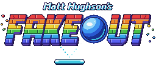
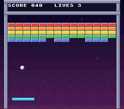
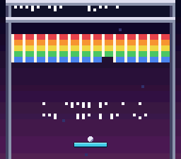
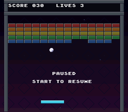
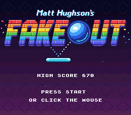

# Part 3: Screens, effects, saving, and the mouse

This is **Part 3** of the build-it-yourself Breakout tutorial. It starts from the
game you finished in [Part 2](README-part2.md) and changes it one feature at a
time. As before, you write every line yourself, build it, and test a checkpoint
before moving on.

**Want to see where you're going first?** Download the finished ROM,
[part3/breakout.sfc](part3/breakout.sfc), and open it in your emulator. To try
the mouse, connect a SNES Mouse to port 2 in your emulator's input settings
(see [section 8](#8-steer-with-the-snes-mouse)).

By the end of this part your game will:

- draw the three-piece paddle with a single **metasprite** call;
- start on a **title screen** and return to it after each game;
- **fade** to and from black between screens;
- paint a **sky gradient** with HDMA, changing the background color down the
  screen;
- **pixelate** the screen with the mosaic effect when you lose a life;
- **pause** with Start, dimming the playfield behind a "PAUSED" message;
- **save the high score** in battery-backed cartridge RAM;
- let you steer with the **SNES Mouse**.


## Before you start

You need the finished Part 2 project at `<SDK root>\snes-examples\breakout`. It
should build, and every Part 2 checkpoint should pass. The diffs below assume
your code matches the end of Part 2. If you changed things, adapt each edit to
your version.

Save a copy of your Part 2 project first, either by committing it to Git or by
copying the `breakout` folder somewhere **outside** the SDK.

Part 3 adds the FAKEOUT title logo. It reuses the four gameplay PNG files and
the two `.it` modules from Part 2.

## Tutorial versus finished reference

**Do not copy this repository's `part3\src` folder into your project.** It is
the finished result of this part, for comparison **after** you complete the
steps. The reference [part3 Makefile](part3/Makefile) builds it with a local SDK
under `vendor/pvsneslib`; your learner Makefile keeps its Part 1 SDK default.

## How to follow the code edits

The edits use the same diff blocks as Parts 1 and 2, with surrounding unchanged
code so you can see where each change belongs:

```diff
 int existing_line;
-old_line();
+new_line();
 next_existing_line();
```

Keep the unmarked lines, remove `-` lines, and add `+` lines. Do not type the
markers, the `---`/`+++` file names, or the `@@` separators. Separate `@@`
sections are separate edits in the same file, in top-to-bottom order. Text after
`@@` names the function the change is in.

Almost every change in this part is in `src\main.c`. Build each checkpoint from
your project folder in the MSYS2 UCRT64 terminal:

```sh
make
```

Then open or reload `breakout.sfc` in your emulator. If a build behaves
strangely after you edit the Makefile, run `make clean`, then `make`.

## Contents

1. [Draw the paddle as one metasprite](#1-draw-the-paddle-as-one-metasprite)
2. [Add a title screen](#2-add-a-title-screen)
3. [Fade between screens](#3-fade-between-screens)
4. [Paint a sky gradient with HDMA](#4-paint-a-sky-gradient-with-hdma)
5. [Pixelate the screen when a life is lost](#5-pixelate-the-screen-when-a-life-is-lost)
6. [Pause with a dimmed overlay](#6-pause-with-a-dimmed-overlay)
7. [Save the high score](#7-save-the-high-score)
8. [Steer with the SNES Mouse](#8-steer-with-the-snes-mouse)
9. [Test the finished game](#9-test-the-finished-game)

See also [troubleshooting](#troubleshooting),
[gameplay tests](#running-the-gameplay-tests), [licensing](#licensing), and
[official references](#official-references).

---

## 1. Draw the paddle as one metasprite

### What a metasprite is

In Part 2 the paddle is three 16 x 16 dynamic sprites. `draw_sprites` loops
over them, places each one 16 pixels further right, and picks each piece's
frame by hand. That works, but the paddle's **shape** (three pieces side by
side) is hidden inside a loop.

A **metasprite** describes a group of sprites as data: a list of pieces, each
with an offset from the group's position, a frame number, and attributes. One
call draws the whole list. PVSnesLib's `oamMetaDrawDyn16` does this for 16 x 16
dynamic sprites, so the dynamic engine still copies each piece's graphics to
VRAM for you, as in Part 2.

Each piece is a `t_metasprite` written with `METASPR_ITEM(dx, dy, frame,
attributes)`, and every list ends with `METASPR_TERM`. The frame number counts
16 x 16 frames in `paddle.png`, eight per row: the left pieces are frames 0 to
5, the middle pieces 8 to 13, and the right pieces 16 to 21. So glimmer frame
`f` uses frames `f`, `8 + f`, and `16 + f`.

### Describe the paddle

In `src\main.c`, add a macro that builds one paddle frame. `PADDLE_ATTR` is the
same palette and priority that `init_sprite` gave the paddle in Part 2:

```diff
--- a/src/main.c
+++ b/src/main.c
@@
 #define GLIMMER_FRAMES 5
 #define GLIMMER_TICKS 3
 
+#define PADDLE_ATTR (OBJ_PAL(0) | OBJ_PRIO(3))
+#define PADDLE_PIECES(frame)                       \
+    METASPR_ITEM(0, 0, (frame), PADDLE_ATTR),      \
+    METASPR_ITEM(16, 0, 8 + (frame), PADDLE_ATTR), \
+    METASPR_ITEM(32, 0, 16 + (frame), PADDLE_ATTR), \
+    METASPR_TERM
+
 #define SFX_TADA 0
```

The `\` at the end of a line continues the macro on the next line. It must be
the **last** character on the line, with no spaces after it.

Below the `extern` lines, add one list per glimmer frame and a table that picks
a list by frame number. They are `const`, so they stay in ROM:

```diff
--- a/src/main.c
+++ b/src/main.c
@@
 extern u16 playfield_map[];
 extern u8 playfield_palette[];
 
+const t_metasprite paddle_frame0[] = { PADDLE_PIECES(0) };
+const t_metasprite paddle_frame1[] = { PADDLE_PIECES(1) };
+const t_metasprite paddle_frame2[] = { PADDLE_PIECES(2) };
+const t_metasprite paddle_frame3[] = { PADDLE_PIECES(3) };
+const t_metasprite paddle_frame4[] = { PADDLE_PIECES(4) };
+const t_metasprite paddle_frame5[] = { PADDLE_PIECES(5) };
+
+const t_metasprite *paddle_frames[GLIMMER_FRAMES + 1] = {
+    paddle_frame0, paddle_frame1, paddle_frame2,
+    paddle_frame3, paddle_frame4, paddle_frame5
+};
+
 Game game;
```

### Draw it

The dynamic engine copies new graphics only when a sprite's `oamrefresh` is
set. `oamMetaDrawDyn16` copies the **first** piece's `oamrefresh` to every
piece, so setting it on sprite 1 refreshes the whole paddle. Track the frame
that is on screen:

```diff
--- a/src/main.c
+++ b/src/main.c
@@
 static int paddle_glimmer;
 static int ball_glimmer;
+static int shown_paddle_frame;
```

Replace the paddle loop in `draw_sprites`:

```diff
--- a/src/main.c
+++ b/src/main.c
@@ static void draw_sprites(void)
 {
-    int i;
     int paddle_frame;
     int ball_frame;
 
@@ static void draw_sprites(void)
     show_frame(0, ball_frame);
     oamDynamic8Draw(0);
 
-    for (i = 0; i < 3; ++i) {
-        oambuffer[i + 1].oamx = game.paddle_x + i * 16;
-        oambuffer[i + 1].oamy = PADDLE_Y;
-        show_frame(i + 1, i * 8 + paddle_frame);
-        oamDynamic16Draw(i + 1);
+    if (shown_paddle_frame != paddle_frame) {
+        shown_paddle_frame = paddle_frame;
+        oambuffer[1].oamrefresh = 1;
     }
+    oamMetaDrawDyn16(1, game.paddle_x, PADDLE_Y,
+                     (u8 *)paddle_frames[paddle_frame], paddle_tiles,
+                     OBJ_LARGE);
 }
```

The first argument, `1`, is the first sprite slot. The paddle has three pieces,
so it uses slots 1, 2, and 3, the same slots as in Part 2. `OBJ_LARGE` selects
the large size, which is 16 x 16 because of `OBJ_SIZE8_L16`.

`oamMetaDrawDyn16` fills in each piece's frame, attributes, and graphics
pointer itself, so the paddle no longer needs `init_sprite`. In `init_video`,
remove those calls and set the new variable (remember: globals without a value
are **not** zeroed):

```diff
--- a/src/main.c
+++ b/src/main.c
@@ static void init_video(void)
     paddle_glimmer = 0;
     ball_glimmer = 0;
+    shown_paddle_frame = -1;
     init_sprite(0, ball_tiles, 0, OBJ_SIZES);
-    for (i = 0; i < 3; ++i)
-        init_sprite(i + 1, paddle_tiles, i * 8, OBJ_SIZEL);
 
     setMode(BG_MODE1, 0);
```

Keep `int i;` in `init_video`; a later loop still uses it.

**Checkpoint:** Build and run. The game looks and plays **exactly** as at the
end of Part 2: the paddle is in one piece, follows the D-pad, and still shines
from left to right when the ball lands on it. If any piece is missing or wrong,
check the frame numbers in `PADDLE_PIECES`.


---

## 2. Add a title screen

### Screens and states

`game.state` already tracks READY, PLAYING, GAME_OVER, and WON. Those are
states **inside** a game. A title screen sits **outside** the game, so
`main.c` gets its own, higher-level variable: which **screen** is showing.
Each screen has three parts:

- a `show_` function that draws it once, when you switch to it;
- an `update_` function that runs every frame while it is showing;
- a value in `enum Screen`.

### Add the screen variable

In `src\main.c`, add the enum after the sound-effect names and a variable after
the others:

```diff
--- a/src/main.c
+++ b/src/main.c
@@
 #define SFX_MARIMBA 3
 #define SFX_COWBELL 4
 
+enum Screen {
+    SCREEN_TITLE,
+    SCREEN_GAME
+};
+
 extern char SOUNDBANK__;
@@
 static int shown_paddle_frame;
+static int screen;
```

Game over and victory now return to the title, so change their prompts in
`draw_text`:

```diff
--- a/src/main.c
+++ b/src/main.c
@@ static void draw_text(void)
     } else if (game.state == STATE_GAME_OVER) {
         consoleDrawText(11, 18, "GAME OVER");
-        consoleDrawText(7, 20, "B / START: NEW GAME");
+        consoleDrawText(7, 20, "B / START: CONTINUE");
     } else if (game.state == STATE_WON) {
         consoleDrawText(12, 18, "YOU WIN!");
-        consoleDrawText(7, 20, "B / START: NEW GAME");
+        consoleDrawText(7, 20, "B / START: CONTINUE");
     }
```

In Part 2, `play_sounds` restarted the music when a new game began. The title
screen will start the music instead, so remove that branch:

```diff
--- a/src/main.c
+++ b/src/main.c
@@ static void play_sounds(int old_state)
         } else if (old_state == STATE_PLAYING) {
             play_effect(SFX_STRINGS, 3);
-        } else {
-            start_music();
         }
     } else if (game.hits & HIT_BRICK) {
```

### Show each screen

`init_video` should now only set up the hardware. The HUD label moves into
`show_game`, and `main` will turn the screen on once the title is drawn.
Change the end of `init_video` and add the new functions right after it:

```diff
--- a/src/main.c
+++ b/src/main.c
@@ static void init_video(void)
     for (i = 0; i < BRICK_COUNT; ++i)
         shown_alive[i] = 1;
     shown_bricks = BRICK_COUNT;
+}
 
-    consoleDrawText(2, 1, "SCORE       LIVES");
-    draw_text();
-    setScreenOn();
+static void clear_text(void)
+{
+    int row;
+
+    /* consoleDrawText is slow, so only clear the rows we write to. */
+    consoleDrawText(0, 1, "                                ");
+    for (row = 8; row <= 22; row += 2)
+        consoleDrawText(0, row, "                                ");
+}
+
+static void show_title(void)
+{
+    screen = SCREEN_TITLE;
+    clear_text();
+    bgSetDisable(1);
+    consoleDrawText(12, 8, "BREAKOUT");
+    consoleDrawText(10, 16, "PRESS START");
+    start_music();
+}
+
+static void show_game(void)
+{
+    screen = SCREEN_GAME;
+    clear_text();
+    bgSetEnable(1);
+    game_reset(&game);
+    shown_score = -1;
+    shown_lives = -1;
+    shown_state = -1;
+    consoleDrawText(2, 1, "SCORE       LIVES");
+    draw_text();
 }
```

(The diff moves the closing `}` of `init_video` up; the old one now closes
`show_game`.)

### Put the FAKEOUT logo on the title

The logo uses 254 8 x 8 tiles and four 16-color SNES palettes. Copy
[title-logo.png](part3/title-logo.png) into your project root. It is a
transparent 256 x 224 indexed image, with the 256 x 112 logo positioned 16
pixels from the top. The standalone
[fakeout-logo.png](part3/fakeout-logo.png) is available if you want to use the
art outside the game.



Convert the full-screen image into tiles, a map, and palettes. Add this rule
to your Makefile and make the data object depend on the result:

```diff
--- a/Makefile
+++ b/Makefile
@@
 backdrop.pic: backdrop.png
 	$(GFXCONV) -s 8 -o 4 -u 4 -e 0 -p -m -t png -i $<
 
-src/data.obj: paddle.pic ball.pic playfield.pic backdrop.pic
+title-logo.pic: title-logo.png
+	$(GFXCONV) -s 8 -o 64 -u 16 -e 3 -p -m -t png -i $<
+
+src/data.obj: paddle.pic ball.pic playfield.pic backdrop.pic title-logo.pic
```

In `src\data.asm`, add a separate asset section:

```diff
--- a/src/data.asm
+++ b/src/data.asm
@@
 .incbin "playfield.pal"
 
 .ends
+
+.section ".title_logo_assets" superfree
+
+title_logo_tiles:
+.incbin "title-logo.pic"
+title_logo_tiles_end:
+
+title_logo_map:
+.incbin "title-logo.map"
+
+title_logo_palette:
+.incbin "title-logo.pal"
+
+.ends
```

Declare the assets in `src\main.c`:

```diff
--- a/src/main.c
+++ b/src/main.c
@@
 extern u8 playfield_tiles[], playfield_tiles_end[];
 extern u16 playfield_map[];
 extern u8 playfield_palette[];
+extern u8 title_logo_tiles[], title_logo_tiles_end[];
+extern u8 title_logo_map[], title_logo_palette[];
```

Upload the logo tiles and palettes, and put its 32 x 28 tile map at `0x7400`,
while the screen is off in `init_video`:

```diff
--- a/src/main.c
+++ b/src/main.c
@@ static void init_video(void)
     bgSetGfxPtr(0, 0x3000);
     bgSetMapPtr(0, 0x6800, SC_32x32);
+    bgInitTileSet(1, title_logo_tiles, title_logo_palette, 3,
+                  title_logo_tiles_end - title_logo_tiles, 64 * 2,
+                  BG_16COLORS, 0x2000);
+    dmaCopyVram(title_logo_map, 0x7400, 32 * 28 * 2);
     bgInitTileSet(1, playfield_tiles, playfield_palette, 2,
                   playfield_tiles_end - playfield_tiles, 16 * 2,
                   BG_16COLORS, 0x4000);
```

The logo uses BG2's graphics base `0x2000`; palettes 3 through 6 are reserved
for it. Switch BG2 to the logo on the title and restore the playfield when a
game starts:

```diff
--- a/src/main.c
+++ b/src/main.c
@@ static void clear_text(void)
-    for (row = 8; row <= 22; row += 2)
+    for (row = 8; row <= 24; row += 2)
@@ static void show_title(void)
     screen = SCREEN_TITLE;
     clear_text();
-    bgSetDisable(1);
-    consoleDrawText(12, 8, "BREAKOUT");
+    bgSetGfxPtr(1, 0x2000);
+    bgSetMapPtr(1, 0x7400, SC_32x32);
+    bgSetEnable(1);
-    consoleDrawText(10, 16, "PRESS START");
+    consoleDrawText(10, 22, "PRESS START");
     start_music();
@@ static void show_game(void)
     screen = SCREEN_GAME;
     clear_text();
+    bgSetGfxPtr(1, 0x4000);
+    bgSetMapPtr(1, PLAYFIELD_MAP, SC_32x32);
     bgSetEnable(1);
```
- `clear_text` erases the old screen's text. The text layer has 28 rows, but
  clearing them all takes `consoleDrawText` several frames, so it only clears
  row 1 (the HUD) and the even rows from 8 to 24, which are the only rows this
  game writes to.
- `show_title` points background 2 at the logo, leaving the backdrop behind it,
  and moves `PRESS START` below the logo.
- `show_game` restores background 2's playfield tiles and map, then starts a
  fresh game. Setting the `shown_` values to -1 forces `draw_text` to redraw
  everything.

The title draws no sprites. The dynamic sprite engine hides any sprite you do
not draw in a frame, so the paddle and ball disappear on their own.

### Update each screen

Add the two update functions after `show_game`. `update_game` is the body of
Part 2's main loop, plus a way back to the title:

```diff
--- a/src/main.c
+++ b/src/main.c
@@
     consoleDrawText(2, 1, "SCORE       LIVES");
     draw_text();
 }
+
+static void update_title(u16 pressed)
+{
+    if (pressed & KEY_START)
+        show_game();
+}
+
+static void update_game(u16 held, u16 pressed)
+{
+    int movement;
+    int old_state;
+
+    if ((game.state == STATE_GAME_OVER || game.state == STATE_WON) &&
+        (pressed & (KEY_B | KEY_START))) {
+        show_title();
+        return;
+    }
+
+    movement = 0;
+    if (held & KEY_LEFT)
+        --movement;
+    if (held & KEY_RIGHT)
+        ++movement;
+    old_state = game.state;
+    game_tick(&game, movement, pressed & (KEY_B | KEY_START));
+
+    play_sounds(old_state);
+    draw_sprites();
+    prepare_bricks();
+    draw_text();
+}
```

Then make `main` start on the title and call the right update each frame:

```diff
--- a/src/main.c
+++ b/src/main.c
@@ int main(void)
 {
     u16 held;
     u16 pressed;
-    int movement;
-    int old_state;
 
     spcBoot();
     spcSetBank(&SOUNDBANK__);
 
-    game_reset(&game);
     init_video();
-    start_music();
+    show_title();
+    setScreenOn();
 
     while (1) {
         held = padsCurrent(0);
         pressed = padsDown(0);
-        movement = 0;
-        if (held & KEY_LEFT)
-            --movement;
-        if (held & KEY_RIGHT)
-            ++movement;
-        old_state = game.state;
-        game_tick(&game, movement, pressed & (KEY_B | KEY_START));
-
-        play_sounds(old_state);
-        draw_sprites();
-        prepare_bricks();
-        draw_text();
+        if (screen == SCREEN_TITLE)
+            update_title(pressed);
+        else
+            update_game(held, pressed);
 
         spcProcess();
         oamInitDynamicSpriteEndFrame();
```

`show_title` now starts the music, and `show_game` resets the game when you
press Start. `init_video` no longer turns the screen on, so `main` must call
`setScreenOn` after `show_title`. If you miss it, the screen stays black.

**Checkpoint:** Build and run. The game boots to the starfield backdrop with
the FAKEOUT logo and `PRESS START`, no walls, no bricks, no sprites, and music.
Press Start: the playfield, HUD, paddle, and ball appear, ready to launch. Lose
all lives (or win): `GAME OVER` / `B / START: CONTINUE`. Press B or Start to go
back to the logo, and Start again for a fresh game with all 70 bricks.


---

## 3. Fade between screens

### Brightness and forced blank

The SNES has a master brightness from 0 (black) to 15 (full). PVSnesLib's
`setBrightness(level)` sets it. Level 0 also turns on **forced blank**: the
picture is off, so you cannot see anything being redrawn. That makes black the
perfect moment to switch screens.

PVSnesLib also has `setFadeEffect`, but it runs the whole fade inside one call,
waiting for 16 frames before it returns. During that time your loop does not
run: no sprite updates, no `spcProcess`, no input. Instead, this game changes
the brightness by **one step per frame** and keeps its loop running.

Like VRAM uploads, display registers should change during vertical blank, right
after `WaitForVBlank`. Changing them in the middle of a frame can change the top
and bottom of the picture differently.

### Fade one step per frame

Add three variables:

```diff
--- a/src/main.c
+++ b/src/main.c
@@
 static int shown_paddle_frame;
 static int screen;
+static int next_screen;
+static int brightness;
+static int fade_step;
```

`fade_step` is -1 while fading out, 1 while fading in, and 0 when no fade is
running. Add `fade_to` and `update_fade` before `update_title`, and use
`fade_to` instead of switching screens directly:

```diff
--- a/src/main.c
+++ b/src/main.c
@@
     draw_text();
 }
 
+static void fade_to(int target)
+{
+    next_screen = target;
+    fade_step = -1;
+}
+
+static void update_fade(void)
+{
+    if (fade_step < 0 && brightness == 0) {
+        /* The screen is black, so it is safe to rebuild it. */
+        if (next_screen == SCREEN_TITLE)
+            show_title();
+        else
+            show_game();
+        fade_step = 1;
+    } else if (fade_step != 0) {
+        brightness += fade_step;
+        if (brightness == 15)
+            fade_step = 0;
+    }
+}
+
 static void update_title(u16 pressed)
 {
     if (pressed & KEY_START)
-        show_game();
+        fade_to(SCREEN_GAME);
 }
 
 static void update_game(u16 held, u16 pressed)
@@ static void update_game(u16 held, u16 pressed)
 
     if ((game.state == STATE_GAME_OVER || game.state == STATE_WON) &&
         (pressed & (KEY_B | KEY_START))) {
-        show_title();
-        return;
+        fade_to(SCREEN_TITLE);
+        pressed = 0;
     }
```

`update_game` no longer returns early. It keeps drawing the paddle and ball
while the screen fades, and `pressed = 0` stops the same press from starting a
new game.

### Run the fade from the main loop

The game now fades in from black when it boots, so it no longer calls
`setScreenOn`. Ignore the controller while a fade runs, so a second press
cannot start another one, and apply the brightness after `WaitForVBlank`:

```diff
--- a/src/main.c
+++ b/src/main.c
@@ int main(void)
     init_video();
     show_title();
-    setScreenOn();
+    brightness = 0;
+    fade_step = 1;
 
     while (1) {
         held = padsCurrent(0);
         pressed = padsDown(0);
+        if (fade_step != 0) {
+            held = 0;
+            pressed = 0;
+        }
+        update_fade();
         if (screen == SCREEN_TITLE)
             update_title(pressed);
         else
@@ int main(void)
         spcProcess();
         oamInitDynamicSpriteEndFrame();
         WaitForVBlank();
+        setBrightness(brightness);
         oamVramQueueUpdate();
         upload_bricks();
     }
```

A full fade takes 15 frames out and 15 frames in, about half a second at 60
frames per second.

**Checkpoint:** Build and run. The title fades in from black. Press Start: the
title fades out, and the game fades in. When the game is over, press B or
Start: the paddle and ball stay visible while the screen fades out, then the
title fades in. Pressing buttons during a fade does nothing.


---

## 4. Paint a sky gradient with HDMA

### What HDMA does

The TV draws the picture one line at a time, top to bottom, with a short pause
(**horizontal blank**) after each line. **HDMA** (horizontal-blank DMA) copies
a few bytes into hardware registers during those pauses, following a table you
prepare. That lets you change a setting partway down the screen without any
CPU work while the frame draws.

Color 0 is the **backdrop color**: the SNES shows it wherever every layer is
transparent, such as between the stars of the backdrop pattern. Changing color
0 every few lines turns that solid color into a vertical gradient.

PVSnesLib's `setModeHdmaColor(channel, table)` sets up an HDMA channel to write
color 0 from your table. Each table entry is five bytes:

| Byte | Meaning |
|---|---|
| 0 | Number of lines to draw before the next entry |
| 1, 2 | Color number to change (0), written twice |
| 3, 4 | The new color, low byte then high byte |

A line count of 0 ends the table. The screen is 224 lines tall, so 28 entries
of 8 lines cover all of it.

### Build the table

In `src\main.c`, add the sizes and the table. HDMA reads the table again every
frame, so it must be a global (or `static`) array that stays valid, not a local
variable:

```diff
--- a/src/main.c
+++ b/src/main.c
@@
 #define GLIMMER_FRAMES 5
 #define GLIMMER_TICKS 3
 
+#define GRADIENT_BANDS 28
+#define GRADIENT_LINES 8
+
 #define PADDLE_ATTR (OBJ_PAL(0) | OBJ_PRIO(3))
@@
 static unsigned char shown_alive[BRICK_COUNT];
+static u8 gradient_table[GRADIENT_BANDS * 5 + 1];
 static char score_text[] = "000";
```

Add `init_gradient` above `init_video`, and call it after `setMode`:

```diff
--- a/src/main.c
+++ b/src/main.c
@@
     oambuffer[id].oamrefresh = 1;
 }
 
+static void init_gradient(void)
+{
+    int band;
+    u16 color;
+    u8 *entry;
+
+    entry = gradient_table;
+    for (band = 0; band < GRADIENT_BANDS; ++band) {
+        color = RGB5(1 + band / 3, 1 + band / 9, 4 + band / 4);
+        entry[0] = GRADIENT_LINES;
+        entry[1] = 0;
+        entry[2] = 0;
+        entry[3] = color & 0xFF;
+        entry[4] = color >> 8;
+        entry += 5;
+    }
+    entry[0] = 0;
+    setModeHdmaColor(HDMA_CHANNEL6, gradient_table);
+}
+
 static void init_video(void)
 {
@@ static void init_video(void)
     init_sprite(0, ball_tiles, 0, OBJ_SIZES);
 
     setMode(BG_MODE1, 0);
+    init_gradient();
 
     for (row = 0; row < BRICK_ROWS; ++row) {
```

`RGB5(r, g, b)` packs three 0-31 values into one SNES color. From top to
bottom, red rises from 1 to 10, green from 1 to 4, and blue from 4 to 10: deep
navy at the top, purple at the bottom. Try other formulas to change the sky.

`setModeHdmaColor` always uses HDMA channel 6, so pass `HDMA_CHANNEL6`. If you
add other HDMA effects later, give them a different channel.

**Checkpoint:** Build and run. The backdrop color is no longer flat: the space
behind the diamond pattern and stars is dark navy at the top and fades to
purple at the bottom, on both the title and the game screen. The fades from
section 3 darken the gradient too.



---

## 5. Pixelate the screen when a life is lost

### The mosaic register

The SNES can draw background layers as big blocks of pixels, from 1 x 1
(normal) to 16 x 16. One register, `REG_MOSAIC`, controls it:

- the top four bits are the block size minus 1 (0 to 15);
- the bottom four bits choose the layers (`MOSAIC_BG1` to `MOSAIC_BG4`).

Mosaic affects backgrounds only, not sprites. As with fades, PVSnesLib's
`setMosaicEffect` waits inside the call, so this game changes the size one
step per frame instead.

### Swell and shrink

In `src\main.c`, add a length and a timer:

```diff
--- a/src/main.c
+++ b/src/main.c
@@
 #define GRADIENT_BANDS 28
 #define GRADIENT_LINES 8
 
+#define MOSAIC_FRAMES 30
+
 #define PADDLE_ATTR (OBJ_PAL(0) | OBJ_PRIO(3))
@@
 static int brightness;
 static int fade_step;
+static int mosaic_timer;
```

Add `update_mosaic` above `update_title`:

```diff
--- a/src/main.c
+++ b/src/main.c
@@
     }
 }
 
+static void update_mosaic(void)
+{
+    int size;
+
+    if (mosaic_timer == 0)
+        return;
+    --mosaic_timer;
+    /* Grow to the biggest block size, then shrink back to normal. */
+    size = mosaic_timer;
+    if (size > MOSAIC_FRAMES / 2)
+        size = MOSAIC_FRAMES - size;
+    REG_MOSAIC = (size << 4) | MOSAIC_BG1 | MOSAIC_BG2 | MOSAIC_BG3;
+}
+
 static void update_title(u16 pressed)
```

As the timer counts from 29 down to 0, `size` goes 1, 2, ... 15, then 14, 13,
... 0. The last write has size 0, so the screen ends up normal again.

Start the effect when the ball is lost: the state changes from PLAYING to READY
(lives left) or to GAME_OVER (no lives left):

```diff
--- a/src/main.c
+++ b/src/main.c
@@ static void update_game(u16 held, u16 pressed)
     old_state = game.state;
     game_tick(&game, movement, pressed & (KEY_B | KEY_START));
+    if (old_state == STATE_PLAYING &&
+        (game.state == STATE_READY || game.state == STATE_GAME_OVER))
+        mosaic_timer = MOSAIC_FRAMES;
 
     play_sounds(old_state);
```

Set the timer at boot, and apply the mosaic after `WaitForVBlank`:

```diff
--- a/src/main.c
+++ b/src/main.c
@@ int main(void)
     show_title();
     brightness = 0;
     fade_step = 1;
+    mosaic_timer = 0;
 
     while (1) {
@@ int main(void)
         oamInitDynamicSpriteEndFrame();
         WaitForVBlank();
         setBrightness(brightness);
+        update_mosaic();
         oamVramQueueUpdate();
         upload_bricks();
     }
```

**Checkpoint:** Build and run. Launch the ball and miss it. The walls, bricks,
backdrop, and text break up into growing blocks for a quarter of a second, then
sharpen back to normal over the next quarter second. The paddle and ball stay
sharp. The same happens when the last life is lost, behind `GAME OVER`.
Nothing pixelates when the ball hits a wall, brick, or the paddle.



---

## 6. Pause with a dimmed overlay

### Color math

The SNES can combine each pixel with a second color before showing it. This is
called **color math**, and it is how SNES games make shadows, glass, water,
and darkened screens. Two registers control it, and PVSnesLib sets both with
`setColorEffect(a, b)`:

- the first value (here 0) says to combine with the **fixed color**, a single
  color you set with `setColorIntensity`;
- the second value chooses **subtract** or add (`CM_SUB_MAINSUB`), whether to
  **halve** the result (`CM_DIV2_DIVIDE`), and which layers it affects
  (`CM_MSCR_...`).

With a black fixed color, "subtract black, then halve" simply halves every
affected pixel: a half-transparent black layer. This game affects the backdrop
color (`CM_MSCR_BACK`), BG2 (walls and bricks), and BG3 (stars) but **not** BG1,
so the text stays bright. Sprites that use palettes 0 to 3, like the paddle and
ball, are never affected by color math, so they stay bright too.

### Pause and resume

In `src\main.c`, add a `paused` flag and a matching `shown_paused` so
`draw_text` knows when to redraw:

```diff
--- a/src/main.c
+++ b/src/main.c
@@
 static int shown_state = -1;
+static int shown_paused = -1;
 static int paddle_glimmer;
@@
 static int mosaic_timer;
+static int paused;
```

Show the pause message in `draw_text`:

```diff
--- a/src/main.c
+++ b/src/main.c
@@ static void draw_text(void)
-    if (shown_state == game.state)
+    if (shown_state == game.state && shown_paused == paused)
         return;
 
     consoleDrawText(3, 18, "                          ");
     consoleDrawText(3, 20, "                          ");
-    if (game.state == STATE_READY) {
+    if (paused) {
+        consoleDrawText(13, 18, "PAUSED");
+        consoleDrawText(8, 20, "START TO RESUME");
+    } else if (game.state == STATE_READY) {
         consoleDrawText(7, 18, "B / START TO LAUNCH");
@@ static void draw_text(void)
     shown_state = game.state;
+    shown_paused = paused;
 }
```

A new game is never paused:

```diff
--- a/src/main.c
+++ b/src/main.c
@@ static void show_game(void)
     bgSetEnable(1);
     game_reset(&game);
+    paused = 0;
     shown_score = -1;
```

Add `set_paused` above `update_title`. It also pauses the music:

```diff
--- a/src/main.c
+++ b/src/main.c
@@
     REG_MOSAIC = (size << 4) | MOSAIC_BG1 | MOSAIC_BG2 | MOSAIC_BG3;
 }
 
+static void set_paused(int on)
+{
+    paused = on;
+    if (paused) {
+        /* Don't replay the last hit's glimmer on every paused frame. */
+        game.hits = 0;
+        spcPauseMusic();
+        /* Halve the backdrop and BG2/BG3; BG1 text and sprites stay bright. */
+        setColorIntensity(CM_APPLY_RED | CM_APPLY_GREEN | CM_APPLY_BLUE, 0);
+        setColorEffect(0, CM_SUB_MAINSUB | CM_DIV2_DIVIDE | CM_MSCR_BACK |
+                              CM_MSCR_BG2 | CM_MSCR_BG3);
+    } else {
+        spcResumeMusic();
+        setColorEffect(0, 0);
+    }
+}
+
 static void update_title(u16 pressed)
```

`draw_sprites` keeps running while paused, and it starts a glimmer whenever
`game.hits` is set. Clearing `hits` stops the last tick's hit from restarting
the glimmer every frame. `setColorEffect(0, 0)` turns color math off again.

### Freeze the game

In `update_game`, Start toggles the pause during play. While paused, skip the
game tick, the mosaic trigger, and the sounds, but keep drawing:

```diff
--- a/src/main.c
+++ b/src/main.c
@@ static void update_game(u16 held, u16 pressed)
         fade_to(SCREEN_TITLE);
         pressed = 0;
     }
+    if (game.state == STATE_PLAYING && (pressed & KEY_START)) {
+        set_paused(!paused);
+        pressed = 0;
+    }
+
+    if (!paused) {
+        movement = 0;
+        if (held & KEY_LEFT)
+            --movement;
+        if (held & KEY_RIGHT)
+            ++movement;
+        old_state = game.state;
+        game_tick(&game, movement, pressed & (KEY_B | KEY_START));
+        if (old_state == STATE_PLAYING &&
+            (game.state == STATE_READY || game.state == STATE_GAME_OVER))
+            mosaic_timer = MOSAIC_FRAMES;
+        play_sounds(old_state);
+    }
 
-    movement = 0;
-    if (held & KEY_LEFT)
-        --movement;
-    if (held & KEY_RIGHT)
-        ++movement;
-    old_state = game.state;
-    game_tick(&game, movement, pressed & (KEY_B | KEY_START));
-    if (old_state == STATE_PLAYING &&
-        (game.state == STATE_READY || game.state == STATE_GAME_OVER))
-        mosaic_timer = MOSAIC_FRAMES;
-
-    play_sounds(old_state);
     draw_sprites();
     prepare_bricks();
     draw_text();
```

Pausing only works while the ball is in play. In the READY state, Start still
launches the ball.

**Checkpoint:** Build and run. Launch the ball, then press Start. The ball
stops, the music stops, the walls, bricks, and sky darken to half brightness,
and `PAUSED` / `START TO RESUME` appear in full brightness. The score, paddle,
and ball stay bright. The D-pad does nothing. Press Start again: the screen
brightens, the music continues where it stopped, and the ball carries on from
the same place.



---

## 7. Save the high score

### Battery-backed save RAM

Many SNES cartridges have a small RAM chip powered by a battery, so it keeps
its contents when the console is off. This is **SRAM** (save RAM). A ROM's
header tells the console and emulators whether the cartridge has it, and how
big it is.

PVSnesLib's build fills in the header from Makefile variables. Set them in your
`Makefile` **before** the `include` line, after `ROMTITLE`:

```diff
--- a/Makefile
+++ b/Makefile
@@
 export ROMNAME := breakout
 export ROMTITLE := BREAKOUT TUTORIAL
+# ROM + save RAM + battery, with 2 KB of save RAM for the high score.
+export CARTRIDGETYPE := 02
+export SRAMSIZE := 01
 
 include $(PVSNESLIB_HOME)/devkitsnes/snes_rules
```

The header is built once, so after changing these values run `make clean`
before `make`.

`consoleCopySram(data, size)` copies bytes from RAM into SRAM, and
`consoleLoadSram(data, size)` copies them back. Both start at the beginning of
SRAM.

### Check before you trust it

SRAM that has never been written holds whatever it powered up with, which
might be random bytes. So the save stores three values:

- a **magic number**, `0x4B42` (the letters `KB`), that says "this game wrote
  this";
- the high score;
- a **check value**, the high score with every bit flipped.

If the magic number or the check value is wrong, the game ignores the save and
starts from 0.

### Load, record, and save

In `src\main.c`, add the magic number and the save layout:

```diff
--- a/src/main.c
+++ b/src/main.c
@@
 #define MOSAIC_FRAMES 30
 
+#define SAVE_MAGIC 0x4B42
+
 #define PADDLE_ATTR (OBJ_PAL(0) | OBJ_PRIO(3))
@@
     SCREEN_GAME
 };
 
+typedef struct SaveData {
+    u16 magic;
+    u16 high_score;
+    u16 check;
+} SaveData;
+
 extern char SOUNDBANK__;
```

Add the title-screen text and the variables:

```diff
--- a/src/main.c
+++ b/src/main.c
@@
 static char lives_text[] = "3";
+static char high_score_text[] = "HIGH SCORE 000";
 static int shown_bricks = -1;
@@
 static int paused;
+static SaveData save;
+static unsigned int high_score;
+static int new_high_score;
```

Both the HUD and the title now print three-digit scores, so move the digit
code from `draw_text` into a helper. Also show `NEW HIGH SCORE!` under the
end-of-game message:

```diff
--- a/src/main.c
+++ b/src/main.c
@@
     }
 }
 
+static void format_score(char *text, unsigned int score)
+{
+    text[0] = '0' + score / 100;
+    text[1] = '0' + (score / 10) % 10;
+    text[2] = '0' + score % 10;
+}
+
 static void draw_text(void)
 {
     if (shown_score != game.score) {
-        score_text[0] = '0' + game.score / 100;
-        score_text[1] = '0' + (game.score / 10) % 10;
-        score_text[2] = '0' + game.score % 10;
+        format_score(score_text, game.score);
         consoleDrawText(8, 1, score_text);
         shown_score = game.score;
     }
@@ static void draw_text(void)
         consoleDrawText(12, 18, "YOU WIN!");
         consoleDrawText(7, 20, "B / START: CONTINUE");
     }
+    if (new_high_score)
+        consoleDrawText(8, 22, "NEW HIGH SCORE!");
     shown_state = game.state;
     shown_paused = paused;
 }
```

Add the save functions after `play_sounds`:

```diff
--- a/src/main.c
+++ b/src/main.c
@@
     }
 }
 
+static void load_high_score(void)
+{
+    consoleLoadSram((u8 *)&save, sizeof(save));
+    /* New or corrupt save RAM holds random bytes, so check it first. */
+    if (save.magic == SAVE_MAGIC && save.check == (save.high_score ^ 0xFFFF))
+        high_score = save.high_score;
+    else
+        high_score = 0;
+}
+
+static void save_high_score(void)
+{
+    save.magic = SAVE_MAGIC;
+    save.high_score = high_score;
+    save.check = high_score ^ 0xFFFF;
+    consoleCopySram((u8 *)&save, sizeof(save));
+}
+
+static void record_score(int old_state)
+{
+    if (game.state == old_state || game.score <= high_score)
+        return;
+    if (game.state == STATE_GAME_OVER || game.state == STATE_WON) {
+        high_score = game.score;
+        new_high_score = 1;
+        save_high_score();
+    }
+}
+
 static void init_sprite(int id, u8 *graphics, int frame, int size)
```

`record_score` saves only once per game, on the frame the game ends, and only
if the score beats the record. Writing SRAM on every frame would be slow and
pointless.

Show the record on the title, and reset the message for each new game:

```diff
--- a/src/main.c
+++ b/src/main.c
@@ static void show_title(void)
     bgSetGfxPtr(1, 0x2000);
     bgSetMapPtr(1, 0x7400, SC_32x32);
     bgSetEnable(1);
+    format_score(high_score_text + 11, high_score);
+    consoleDrawText(9, 18, high_score_text);
     consoleDrawText(10, 22, "PRESS START");
     start_music();
 }
@@ static void show_game(void)
     game_reset(&game);
     paused = 0;
+    new_high_score = 0;
     shown_score = -1;
```

`high_score_text + 11` points at the `000` part of the text.

Call `record_score` after the sounds in `update_game`, and load the save at
boot, before the title is drawn:

```diff
--- a/src/main.c
+++ b/src/main.c
@@ static void update_game(u16 held, u16 pressed)
             mosaic_timer = MOSAIC_FRAMES;
         play_sounds(old_state);
+        record_score(old_state);
     }
 
     draw_sprites();
@@ int main(void)
     spcSetBank(&SOUNDBANK__);
 
     init_video();
+    load_high_score();
     show_title();
```

**Checkpoint:** Run `make clean`, then `make`, then run the game. The title
shows `HIGH SCORE 000`. Score some points and lose all your lives: `NEW HIGH
SCORE!` appears under `GAME OVER`. Continue: the title shows your score. Close
the emulator completely and open the ROM again: the high score is still there.
Play a worse game: no `NEW HIGH SCORE!`, and the record stays.

Emulators keep save RAM in a file, usually with the extension `.srm`. Most
write it when you close the game or the emulator. To reset the high score,
delete that file while the game is closed.


---

## 8. Steer with the SNES Mouse

### How the mouse is read

The SNES Mouse plugs into a controller port, usually port 2 so a controller
can stay in port 1. It does not report a position. Each frame it reports how
far it moved since the last frame, plus its two buttons.

Call `initMouse(sensitivity)` once. PVSnesLib then reads the mouse every frame
and fills these arrays, one entry per port:

| Array | Meaning |
|---|---|
| `mouseConnect[port]` | 1 if a mouse is in that port |
| `mouse_x[port]` | Horizontal movement: bit 7 is the direction (1 = left), bits 0 to 6 the distance |
| `mouseButton[port]` | Buttons pressed **this** frame (`mouse_L`, `mouse_R`), like `padsDown` |

This game uses the mouse's horizontal movement as a direct paddle movement, so
moving the mouse 10 units right moves the paddle 10 pixels right. The left
button launches (like B) and the right button pauses (like Start).

### Move the paddle by any amount

The D-pad moves the paddle by a fixed `PADDLE_SPEED`, but the mouse can move it
by any amount. That clamp to the walls belongs in the game logic. In
`src\game.h`, declare a new function:

```diff
--- a/src/game.h
+++ b/src/game.h
@@
 void game_reset(Game *game);
+void game_move_paddle(Game *game, int dx);
 void game_tick(Game *game, int movement, int action_pressed);
```

In `src\game.c`, move the paddle code from `game_tick` into it:

```diff
--- a/src/game.c
+++ b/src/game.c
@@
     }
 }
 
+void game_move_paddle(Game *game, int dx)
+{
+    if (game->state == STATE_GAME_OVER || game->state == STATE_WON)
+        return;
+    game->paddle_x += dx;
+    if (game->paddle_x < FIELD_LEFT)
+        game->paddle_x = FIELD_LEFT;
+    if (game->paddle_x + PADDLE_WIDTH > FIELD_RIGHT)
+        game->paddle_x = FIELD_RIGHT - PADDLE_WIDTH;
+}
+
 void game_tick(Game *game, int movement, int action_pressed)
 {
     int step;
@@ void game_tick(Game *game, int movement, int action_pressed)
         return;
     }
 
-    game->paddle_x += movement * PADDLE_SPEED;
-    if (game->paddle_x < FIELD_LEFT)
-        game->paddle_x = FIELD_LEFT;
-    if (game->paddle_x + PADDLE_WIDTH > FIELD_RIGHT)
-        game->paddle_x = FIELD_RIGHT - PADDLE_WIDTH;
+    game_move_paddle(game, movement * PADDLE_SPEED);
 
     if (game->state == STATE_READY) {
```

Add it right after `lose_life`, above `game_tick`.

### Read the mouse

In `src\main.c`, add three variables:

```diff
--- a/src/main.c
+++ b/src/main.c
@@
 static unsigned int high_score;
 static int new_high_score;
+static int mouse_port;
+static int mouse_dx;
+static int shown_mouse;
```

Add `read_mouse` above `update_title`. It uses the first port with a mouse,
turns the movement into a signed number, and adds the buttons to `pressed`.
Then make the title mention the mouse when one is connected, and accept B
(the left button) as well as Start:

```diff
--- a/src/main.c
+++ b/src/main.c
@@
     }
 }
 
+static void read_mouse(u16 *pressed)
+{
+    mouse_dx = 0;
+    if (mouseConnect[0])
+        mouse_port = 0;
+    else if (mouseConnect[1])
+        mouse_port = 1;
+    else {
+        mouse_port = -1;
+        return;
+    }
+
+    /* Bit 7 is the direction (1 = left) and bits 0-6 are the distance. */
+    mouse_dx = mouse_x[mouse_port] & 0x7F;
+    if (mouse_x[mouse_port] & 0x80)
+        mouse_dx = -mouse_dx;
+    if (mouseButton[mouse_port] & mouse_L)
+        *pressed |= KEY_B;
+    if (mouseButton[mouse_port] & mouse_R)
+        *pressed |= KEY_START;
+}
+
 static void update_title(u16 pressed)
 {
-    if (pressed & KEY_START)
+    int connected;
+
+    connected = mouse_port >= 0;
+    if (shown_mouse != connected) {
+        if (connected)
+            consoleDrawText(7, 24, "OR CLICK THE MOUSE");
+        else
+            consoleDrawText(7, 24, "                  ");
+        shown_mouse = connected;
+    }
+
+    if (pressed & (KEY_B | KEY_START))
         fade_to(SCREEN_GAME);
 }
```

Make `show_title` redraw that line:

```diff
--- a/src/main.c
+++ b/src/main.c
@@ static void show_title(void)
     consoleDrawText(10, 22, "PRESS START");
+    shown_mouse = -1;
     start_music();
 }
```

Move the paddle by the mouse before the normal game tick:

```diff
--- a/src/main.c
+++ b/src/main.c
@@ static void update_game(u16 held, u16 pressed)
 
     if (!paused) {
+        game_move_paddle(&game, mouse_dx);
         movement = 0;
```

Finally, turn the mouse on at boot, read it each frame after the controller,
and ignore its movement during fades too:

```diff
--- a/src/main.c
+++ b/src/main.c
@@ int main(void)
     init_video();
+    initMouse(MOUSE_SLOW);
     load_high_score();
     show_title();
@@ int main(void)
         held = padsCurrent(0);
         pressed = padsDown(0);
+        read_mouse(&pressed);
         if (fade_step != 0) {
             held = 0;
             pressed = 0;
+            mouse_dx = 0;
         }
```

`MOUSE_SLOW` is the mouse's lowest sensitivity, which gives the finest
control. Try `MOUSE_MEDIUM` or `MOUSE_FAST` if the paddle feels too slow.

### Connect a mouse in your emulator

Leave the controller on port 1 and set port 2 to **SNES Mouse** in your
emulator's input settings. In Mesen 2, this is **Settings > Input**, then the
**SNES** tab, then **Player 2**. While the game window has focus, the emulator
sends your PC mouse movements to the game. Some emulators only start this after
you click inside the game window. Check your emulator's documentation for how
to release the mouse again.

The controller still works with a mouse connected, and the game works without
a mouse.

**Checkpoint:** Build and run with **no** mouse connected. Everything works as
in section 7, and the title does not mention the mouse. Connect a mouse to port
2: the title shows `OR CLICK THE MOUSE`. Left-click to start, move the mouse to
steer the paddle (it stops at both walls), left-click to launch, and
right-click to pause and resume. The D-pad still works too.



If you set up the gameplay tests, add a test for the new function to
`tests\test_game.c`:

```diff
--- a/tests/test_game.c
+++ b/tests/test_game.c
@@
     assert(game.bricks_left == BRICK_COUNT);
 }
 
+static void test_mouse_paddle(void)
+{
+    Game game;
+
+    game_reset(&game);
+    game_move_paddle(&game, 10);
+    assert(game.paddle_x == 114);
+    game_move_paddle(&game, -127);
+    assert(game.paddle_x == FIELD_LEFT);
+    game_move_paddle(&game, 127);
+    game_move_paddle(&game, 127);
+    assert(game.paddle_x == FIELD_RIGHT - PADDLE_WIDTH);
+
+    game.state = STATE_GAME_OVER;
+    game_move_paddle(&game, -20);
+    assert(game.paddle_x == FIELD_RIGHT - PADDLE_WIDTH);
+}
+
 int main(void)
 {
@@ int main(void)
     test_win();
-    puts("PASS: 8 gameplay test groups");
+    test_mouse_paddle();
+    puts("PASS: 9 gameplay test groups");
     return 0;
 }
```

---

## 9. Test the finished game

Your project folder has the same files as at the end of
[Part 2](README-part2.md#8-test-the-finished-game). Your emulator may also
create a save file for the high score. For a clean rebuild:

```sh
make clean
make
```

First delete your emulator's save file for `breakout`, so the high score starts
at 0. Then test in this order:

1. At power-on: the title fades in over the sky gradient, with the FAKEOUT logo,
   `HIGH SCORE 000`, `PRESS START`, and music. No walls, bricks, or sprites.
2. Start: the title fades out and the game fades in with all 70 bricks, score
   `000`, and lives `3`. Buttons do nothing during the fade.
3. The paddle moves to both walls, launches with B or Start, and shines on
   paddle hits. All Part 2 sounds still play.
4. During play, Start: the ball and music stop, the playfield dims, and
   `PAUSED` appears. Start again: everything continues from the same place.
5. Miss the ball: strings, a mosaic swells and clears, one life is lost.
6. Lose the last life: mosaic, `GAME OVER`, and `NEW HIGH SCORE!`.
7. B or Start: the screen fades to the title, which shows your score as the
   high score.
8. Close the emulator and open the ROM again: the high score is still there.
9. Play a lower-scoring game: no `NEW HIGH SCORE!`, and the record stays.
10. Connect a mouse to port 2: `OR CLICK THE MOUSE` appears on the title. Left
    click starts and launches, the mouse steers, and right click pauses.
11. Clear the wall: tada, `YOU WIN!`, score `700`, and a new high score of
    `700`.

Only **now**, if you want to compare your work, open the finished reference
[main.c](part3/src/main.c), [game.h](part3/src/game.h),
[game.c](part3/src/game.c), and [Makefile](part3/Makefile).

Emulator testing is not proof of correct behavior on a physical SNES. Test with
accurate emulators and real hardware before publishing a game.

## Troubleshooting

| Symptom | Check |
|---|---|
| Paddle missing or in the wrong pieces after section 1 | Call `oamMetaDrawDyn16` every frame with sprite slot `1`. Check the frame numbers `f`, `8 + f`, and `16 + f`, and that each list ends with `METASPR_TERM`. |
| `PADDLE_PIECES` compile errors | Every line of the macro except the last must end with `\`, with nothing after it. |
| Paddle does not glimmer | Set `oambuffer[1].oamrefresh = 1` when the frame changes, and `shown_paddle_frame = -1` in `init_video`. |
| Old text left on the title or game screen | Check `clear_text` clears row 1 and every even row from 8 to 24. |
| Screen stays black (section 2) | In `main`, call `show_title()` and then `setScreenOn()` after `init_video()`. Section 2 removes `setScreenOn` from `init_video`. |
| Screen stays black (section 3 onward) | Call `update_fade` every frame and `setBrightness(brightness)` right after `WaitForVBlank`. Set `brightness = 0` and `fade_step = 1` in `main`. |
| A game starts immediately after returning to the title | Zero `held` and `pressed` while `fade_step` is not 0, and set `pressed = 0` after `fade_to(SCREEN_TITLE)`. |
| No gradient | Call `init_gradient` after `setMode`. Check each entry is 5 bytes and the table ends with a 0. |
| Gradient shows garbage colors or stripes | `gradient_table` must be a global or `static` array, not a local variable. |
| Screen stays pixelated | Set `mosaic_timer = 0` in `main`, and call `update_mosaic` every frame after `WaitForVBlank`. |
| Mosaic when the ball hits something | Start the mosaic only when the state changes **from** `STATE_PLAYING`. |
| Pause does not dim the screen | Call `setColorIntensity` and `setColorEffect` exactly as shown; the first argument of `setColorEffect` is `0`. |
| Pause text is dim too | Do not include `CM_MSCR_BG1` in the color effect. |
| The paddle or ball keeps glimmering while paused | Set `game.hits = 0` in `set_paused`. |
| High score lost after closing the emulator | Put `CARTRIDGETYPE` and `SRAMSIZE` **before** the `include` line, then run `make clean` and `make`. Close the game normally so the emulator writes its save file. |
| High score shows strange digits | `load_high_score` must check `SAVE_MAGIC` and the check value before trusting the save. |
| Title never mentions the mouse | Set port 2 to SNES Mouse in your emulator, and call `initMouse` in `main`. |
| Mouse moves the paddle the wrong way | Bit 7 of `mouse_x` means **left**: negate the distance when it is set. |
| Other problems | See the [Part 2 troubleshooting table](README-part2.md#troubleshooting). |

## Running the gameplay tests

If you added the test in section 8, run exactly the commands from
[Running the gameplay tests](README.md#running-the-gameplay-tests) in Part 1.
You can also copy [part3/tests/test_game.c](part3/tests/test_game.c) from your
copy of this repository over your project's `tests\test_game.c`. The expected
output is now:

```text
PASS: 9 gameplay test groups
```

The new test checks that `game_move_paddle` moves the paddle by any amount,
stops at both walls, and does nothing after the game ends. The tests do not
cover screens, effects, saving, or the mouse hardware; the emulator checkpoints
do.

## Licensing

[THIRD_PARTY_NOTICES.txt](THIRD_PARTY_NOTICES.txt) preserves the PVSnesLib
notice for the library code and font linked into the ROM. Part 3 reuses the
Part 2 artwork, which is original to this tutorial. No project-wide license has
been selected for the tutorial, source, or artwork.

The music and effects modules come from the PVSnesLib SDK's sound example. The
finished ROM in [part3/breakout.sfc](part3/breakout.sfc) contains them. Check
their terms before you distribute a ROM that contains them.

## Official references

- [Video and effects API (`video.h`)][video]
- [HDMA API (`dma.h`)][dma]
- [Mosaic register (`background.h`)][backgrounds]
- [Sprite and metasprite API (`sprite.h`)][sprites]
- [SRAM API (`console.h`)][console]
- [Mouse API (`input.h`)][input]
- [Sound API (`sound.h`)][sound]
- Examples, pinned to 4.6.0: [dynamic metasprites][ex-meta],
  [fading][ex-fade], [HDMA gradient][ex-gradient], [mosaic][ex-mosaic],
  [transparency][ex-transparency], [SRAM][ex-sram], and [mouse][ex-mouse]

The links are pinned to PVSnesLib 4.6.0; the same headers are in
`pvsneslib\include\snes` inside your SDK root, and the examples are in its
`snes-examples` folder.

[video]: https://github.com/alekmaul/pvsneslib/blob/4.6.0/pvsneslib/include/snes/video.h
[dma]: https://github.com/alekmaul/pvsneslib/blob/4.6.0/pvsneslib/include/snes/dma.h
[backgrounds]: https://github.com/alekmaul/pvsneslib/blob/4.6.0/pvsneslib/include/snes/background.h
[sprites]: https://github.com/alekmaul/pvsneslib/blob/4.6.0/pvsneslib/include/snes/sprite.h
[console]: https://github.com/alekmaul/pvsneslib/blob/4.6.0/pvsneslib/include/snes/console.h
[input]: https://github.com/alekmaul/pvsneslib/blob/4.6.0/pvsneslib/include/snes/input.h
[sound]: https://github.com/alekmaul/pvsneslib/blob/4.6.0/pvsneslib/include/snes/sound.h
[ex-meta]: https://github.com/alekmaul/pvsneslib/tree/4.6.0/snes-examples/graphics/Sprites/DynamicEngineMetaSprite
[ex-fade]: https://github.com/alekmaul/pvsneslib/tree/4.6.0/snes-examples/graphics/Effects/Fading
[ex-gradient]: https://github.com/alekmaul/pvsneslib/tree/4.6.0/snes-examples/graphics/Effects/GradientColors
[ex-mosaic]: https://github.com/alekmaul/pvsneslib/tree/4.6.0/snes-examples/graphics/Effects/Mosaic
[ex-transparency]: https://github.com/alekmaul/pvsneslib/tree/4.6.0/snes-examples/graphics/Effects/Transparency
[ex-sram]: https://github.com/alekmaul/pvsneslib/tree/4.6.0/snes-examples/systems/sram/sramsimple
[ex-mouse]: https://github.com/alekmaul/pvsneslib/tree/4.6.0/snes-examples/input/mouse
