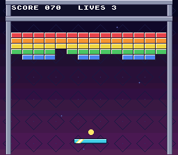
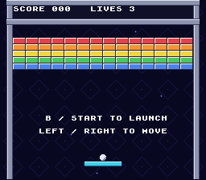
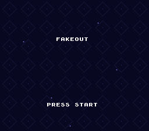
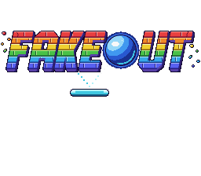
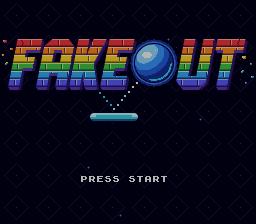
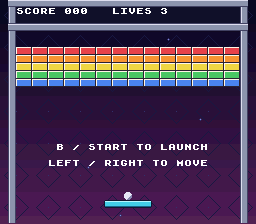
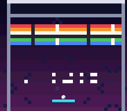
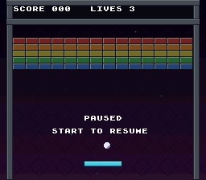
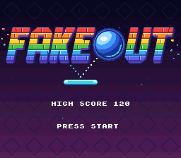
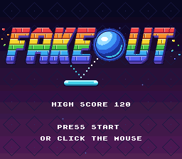

# Part 3: Screens, effects, saving, and the mouse

This is **Part 3** of the build-it-yourself Breakout tutorial. It starts from the
game you finished in [Part 2](README-part2.md) and changes it one feature at a
time. Build and run each checkpoint before moving on.

<div class="rom-download-panel" data-part="3">
  <p class="rom-download-heading"><strong>Try the completed Part 3 game!</strong></p>
  <a class="rom-download-button" href="part3/breakout.sfc" download>Download the Part 3 ROM</a>
</div>

To try
the mouse, connect a SNES Mouse to port 2 in your emulator's input settings
(see [section 9](#9-steer-with-the-snes-mouse)).

By the end of this part your game will:

- draw the three-piece paddle with a single **metasprite** call;
- start on a **title screen** and return to it after each game;
- show the **FAKEOUT logo** on the title;
- **fade** to and from black between screens;
- paint a **sky gradient** with HDMA, changing the background color down the
  screen;
- **pixelate** the screen with the mosaic effect when you lose a life;
- **pause** with Start, dimming the playfield behind a "PAUSED" message;
- **save the high score** in battery-backed cartridge RAM;
- let you steer with the **SNES Mouse**.



## Before you start

You need the finished Part 2 project at `<SDK root>\snes-examples\breakout`. It
should build, and every Part 2 checkpoint should pass. The diffs below assume
your code matches the end of Part 2. If you changed things, adapt each edit to
your version.

Save a copy of your Part 2 project first, either by committing it to Git or by
copying the `breakout` folder somewhere **outside** the SDK.

Part 3 adds the FAKEOUT title logo. It reuses the four gameplay PNG files and
the two `.it` modules from Part 2.

## Contents

1. [Draw the paddle as one metasprite](#1-draw-the-paddle-as-one-metasprite)
2. [Add a title screen](#2-add-a-title-screen)
3. [Put the FAKEOUT logo on the title](#3-put-the-fakeout-logo-on-the-title)
4. [Fade between screens](#4-fade-between-screens)
5. [Paint a sky gradient with HDMA](#5-paint-a-sky-gradient-with-hdma)
6. [Pixelate the screen when a life is lost](#6-pixelate-the-screen-when-a-life-is-lost)
7. [Pause with a dimmed overlay](#7-pause-with-a-dimmed-overlay)
8. [Save the high score](#8-save-the-high-score)
9. [Steer with the SNES Mouse](#9-steer-with-the-snes-mouse)

See also [troubleshooting](#troubleshooting) and
[official references](#official-references).

---

## 1. Draw the paddle as one metasprite

### What a metasprite is

In Part 2 the paddle is three 16 x 16 dynamic sprites. `draw_sprites` loops
over them, places each one 16 pixels further right, and picks each piece's
frame by hand. That works, but the paddle's **shape** (three pieces side by
side) is hidden inside a loop.

A **metasprite** describes a group of sprites as data: a list of pieces, each
with an offset from the group's position, a frame number, and attributes. One
call draws the whole list. PVSnesLib's `oamMetaDrawDyn16` does this for 16 x 16
dynamic sprites, so the dynamic engine still copies each piece's graphics to
VRAM for you, as in Part 2.

Each piece is a `t_metasprite` written with `METASPR_ITEM(dx, dy, frame,
attributes)`, and every list ends with `METASPR_TERM`. The frame number counts
16 x 16 frames in `paddle.png`, eight per row: the left pieces are frames 0 to
5, the middle pieces 8 to 13, and the right pieces 16 to 21. So glimmer frame
`f` uses frames `f`, `8 + f`, and `16 + f`.

### Describe the paddle

---

### Open `src\main.c`

In `src\main.c`, add a macro that builds one paddle frame. `PADDLE_ATTR` is the
same palette and priority that `init_sprite` gave the paddle in Part 2:

**Goal:** Describe the paddle's three-piece shape as reusable metasprite data.

<!-- tutorial-edit: {"file":"src/main.c","op":"diff-region","scope_before":"prepare_bricks","context":3} -->
**`src\main.c` — in file-scope declarations before `prepare_bricks`, apply these changes:**

```c
#define GLIMMER_FRAMES 5
#define GLIMMER_TICKS  3

#define PADDLE_ATTR (OBJ_PAL(0) | OBJ_PRIO(3)) // [!code ++]
#define PADDLE_PIECES(frame)                                                   \ // [!code ++]
    METASPR_ITEM(0, 0, (frame), PADDLE_ATTR),                                  \ // [!code ++]
        METASPR_ITEM(16, 0, 8 + (frame), PADDLE_ATTR),                         \ // [!code ++]
        METASPR_ITEM(32, 0, 16 + (frame), PADDLE_ATTR), METASPR_TERM // [!code ++]
 // [!code ++]
#define SFX_TADA    0
#define SFX_STRINGS 1
#define SFX_PIANO   2
```

The `\` at the end of a line continues the macro on the next line. It must be
the **last** character on the line, with no spaces after it.

Below the `extern` lines, add one list per glimmer frame and a table that picks
a list by frame number. They are `const`, so they stay in ROM:

**Goal:** Select a complete paddle metasprite for each glimmer frame.

<!-- tutorial-edit: {"file":"src/main.c","op":"diff-region","scope_before":"prepare_bricks","context":3} -->
**`src\main.c` — in file-scope declarations before `prepare_bricks`, apply these changes:**

```c
extern u16 playfield_map[];
extern u8 playfield_palette[];

const t_metasprite paddle_frame0[] = {PADDLE_PIECES(0)}; // [!code ++]
const t_metasprite paddle_frame1[] = {PADDLE_PIECES(1)}; // [!code ++]
const t_metasprite paddle_frame2[] = {PADDLE_PIECES(2)}; // [!code ++]
const t_metasprite paddle_frame3[] = {PADDLE_PIECES(3)}; // [!code ++]
const t_metasprite paddle_frame4[] = {PADDLE_PIECES(4)}; // [!code ++]
const t_metasprite paddle_frame5[] = {PADDLE_PIECES(5)}; // [!code ++]
 // [!code ++]
const t_metasprite *paddle_frames[GLIMMER_FRAMES + 1] = { // [!code ++]
    paddle_frame0, paddle_frame1, paddle_frame2, // [!code ++]
    paddle_frame3, paddle_frame4, paddle_frame5}; // [!code ++]
 // [!code ++]
Game game;

static u16 brick_map[BRICK_ROWS][BRICK_COLS * 2];
```

The six lists use the same shape with different frame indices. The pointer table
selects one list without rebuilding the shape each frame.

### Draw it

The dynamic engine copies new graphics only when a sprite's `oamrefresh` is
set. `oamMetaDrawDyn16` copies the **first** piece's `oamrefresh` to every
piece, so setting it on sprite 1 refreshes the whole paddle. Track the frame
that is on screen:

**Goal:** Remember which paddle frame is displayed so refreshes happen only on changes.

<!-- tutorial-edit: {"file":"src/main.c","op":"diff-region","scope_before":"prepare_bricks","context":3} -->
**`src\main.c` — in file-scope declarations before `prepare_bricks`, apply these changes:**

```c
static int shown_state = -1;
static int paddle_glimmer;
static int ball_glimmer;
static int shown_paddle_frame; // [!code ++]

```

The cache tracks the whole metasprite rather than each piece separately.

Replace the paddle loop in `draw_sprites`:

**Goal:** Remove the loop index no longer needed for drawing paddle pieces.

<!-- tutorial-edit: {"file":"src/main.c","op":"diff-region","function":"draw_sprites","context":3} -->
**`src\main.c` — in `draw_sprites`, apply these changes:**

```c
static void draw_sprites(void)
{
    int i; // [!code --]
    int paddle_frame;
    int ball_frame;

```

The metasprite draw call will iterate its piece list internally.

**Goal:** Draw and refresh the entire paddle from its selected metasprite list.

<!-- tutorial-edit: {"file":"src/main.c","op":"diff-region","function":"draw_sprites","context":3} -->
**`src\main.c` — in `draw_sprites`, apply these changes:**

```c
    show_frame(0, ball_frame);
    oamDynamic8Draw(0);

    for (i = 0; i < 3; ++i) // [!code --]
    if (shown_paddle_frame != paddle_frame) // [!code ++]
    {
        shown_paddle_frame = paddle_frame; // [!code ++]
        oambuffer[1].oamrefresh = 1; // [!code ++]
        oambuffer[i + 1].oamx = game.paddle_x + i * 16; // [!code --]
        oambuffer[i + 1].oamy = PADDLE_Y; // [!code --]
        show_frame(i + 1, i * 8 + paddle_frame); // [!code --]
        oamDynamic16Draw(i + 1); // [!code --]
    }
    oamMetaDrawDyn16(1, game.paddle_x, PADDLE_Y, // [!code ++]
                     (u8 *)paddle_frames[paddle_frame], paddle_tiles, // [!code ++]
                     OBJ_LARGE); // [!code ++]
}
```

The first argument, `1`, is the first sprite slot. The paddle has three pieces,
so it uses slots 1, 2, and 3, the same slots as in Part 2. `OBJ_LARGE` selects
the large size, which is 16 x 16 because of `OBJ_SIZE8_L16`.

`oamMetaDrawDyn16` fills in each piece's frame, attributes, and graphics
pointer itself, so the paddle no longer needs `init_sprite`. In `init_video`,
remove those calls and set the new variable (remember: globals without a value
are **not** zeroed):

**Goal:** Let the metasprite define its own pieces and force their first graphics refresh.

<!-- tutorial-edit: {"file":"src/main.c","op":"diff-region","function":"init_video","context":3} -->
**`src\main.c` — in `init_video`, apply these changes:**

```c
    setPalette(sprite_palette, 128, 16 * 2);
    paddle_glimmer = 0;
    ball_glimmer = 0;
    shown_paddle_frame = -1; // [!code ++]
    init_sprite(0, ball_tiles, 0, OBJ_SIZES);
    for (i = 0; i < 3; ++i) // [!code --]
    { // [!code --]
        init_sprite(i + 1, paddle_tiles, i * 8, OBJ_SIZEL); // [!code --]
    } // [!code --]

    setMode(BG_MODE1, 0);

```

The -1 frame cache forces the initial draw to upload all paddle pieces.
Keep `int i;` in `init_video`; a later loop still uses it.

**Checkpoint:** Build and run. The game looks and plays **exactly** as at the
end of Part 2: the paddle is in one piece, follows the D-pad, and still shines
from left to right when the ball lands on it. If any piece is missing or wrong,
check the frame numbers in `PADDLE_PIECES`.



---

## 2. Add a title screen

### Screens and states

`game.state` already tracks READY, PLAYING, GAME_OVER, and WON. Those are
states **inside** a game. A title screen sits **outside** the game, so
`main.c` gets its own, higher-level variable: which **screen** is showing.
Each screen has three parts:

- a `show_` function that draws it once, when you switch to it;
- an `update_` function that runs every frame while it is showing;
- a value in `enum Screen`.

### Add the screen variable

---

### Open `src\main.c`

In `src\main.c`, add the enum after the sound-effect names and a variable after
the others:

**Goal:** Distinguish the title screen from the game screen independently of gameplay state.

<!-- tutorial-edit: {"file":"src/main.c","op":"diff-region","scope_before":"prepare_bricks","context":3} -->
**`src\main.c` — in file-scope declarations before `prepare_bricks`, apply these changes:**

```c
#define SFX_MARIMBA 3
#define SFX_COWBELL 4

enum Screen // [!code ++]
{ // [!code ++]
    SCREEN_TITLE, // [!code ++]
    SCREEN_GAME // [!code ++]
}; // [!code ++]
 // [!code ++]
extern char SOUNDBANK__;

extern u8 paddle_tiles[];
```

The screen enum belongs to presentation; READY and PLAYING still belong to `Game`.

**Goal:** Track which screen should receive each frame's update.

<!-- tutorial-edit: {"file":"src/main.c","op":"diff-region","scope_before":"prepare_bricks","context":3} -->
**`src\main.c` — in file-scope declarations before `prepare_bricks`, apply these changes:**

```c
static int paddle_glimmer;
static int ball_glimmer;
static int shown_paddle_frame;
static int screen; // [!code ++]

```

The `screen` variable selects a title or gameplay handler.

Game over and victory now return to the title, so change their prompts in
`draw_text`:

**Goal:** Make the game-over prompt describe returning to the title.

<!-- tutorial-edit: {"file":"src/main.c","op":"diff-region","function":"draw_text","context":3} -->
**`src\main.c` — in `draw_text`, apply these changes:**

```c
    else if (game.state == STATE_GAME_OVER)
    {
        consoleDrawText(11, 18, "GAME OVER");
        consoleDrawText(7, 20, "B / START: NEW GAME"); // [!code --]
        consoleDrawText(7, 20, "B / START: CONTINUE"); // [!code ++]
    }
    else if (game.state == STATE_WON)
    {
```

`CONTINUE` replaces `NEW GAME` because a fresh game starts from the title.

**Goal:** Give the victory screen the same return-to-title prompt.

<!-- tutorial-edit: {"file":"src/main.c","op":"diff-region","function":"draw_text","context":3} -->
**`src\main.c` — in `draw_text`, apply these changes:**

```c
    else if (game.state == STATE_WON)
    {
        consoleDrawText(12, 18, "YOU WIN!");
        consoleDrawText(7, 20, "B / START: NEW GAME"); // [!code --]
        consoleDrawText(7, 20, "B / START: CONTINUE"); // [!code ++]
    }
    shown_state = game.state;
}
```

Both the game-over and win screens now use the same button to return to the title.

In Part 2, `play_sounds` restarted the music when a new game began. The title
screen will start the music instead, so remove that branch:

**Goal:** Leave music startup to the title-screen handler.

<!-- tutorial-edit: {"file":"src/main.c","op":"diff-region","function":"play_sounds","context":3} -->
**`src\main.c` — in `play_sounds`, apply these changes:**

```c
        else if (old_state == STATE_PLAYING)
        {
            play_effect(SFX_STRINGS, 3);
        }
        else // [!code --]
        { // [!code --]
            start_music(); // [!code --]
        } // [!code --]
    }
    else if (game.hits & HIT_BRICK)
    {
```

Removing the restart branch prevents the game-state audio handler from duplicating
the title's song load.

### Show each screen

`init_video` should now only set up the hardware. The HUD label moves into
`show_game`, and `main` will turn the screen on once the title is drawn.
Change the end of `init_video` and add the new functions right after it:

**Goal:** Separate hardware setup from drawing and enabling the initial screen.

<!-- tutorial-edit: {"file":"src/main.c","op":"diff-region","function":"init_video","context":3} -->
**`src\main.c` — in `init_video`, apply these changes:**

```c
        shown_alive[i] = 1;
    }
    shown_bricks = BRICK_COUNT;
 // [!code --]
    consoleDrawText(2, 1, "SCORE       LIVES"); // [!code --]
    draw_text(); // [!code --]
    setScreenOn(); // [!code --]
}
```

Video initialization no longer draws a gameplay HUD or turns on an unfinished screen.

**Goal:** Clear the text rows used by either screen before switching.

<!-- tutorial-edit: {"file":"src/main.c","op":"add-function","name":"clear_text","before":"main"} -->
**`src\main.c` — add this complete `clear_text` function immediately before `main`:**

```c
static void clear_text(void) // [!code ++]
{ // [!code ++]
    int row; // [!code ++]
 // [!code ++]
    /* consoleDrawText is slow, so only clear the rows we write to. */ // [!code ++]
    consoleDrawText(0, 1, "                                "); // [!code ++]
    for (row = 8; row <= 24; row += 2) // [!code ++]
    { // [!code ++]
        consoleDrawText(0, row, "                                "); // [!code ++]
    } // [!code ++]
} // [!code ++]
```

Only the HUD row and even message rows are cleared, reducing console work.

**Goal:** Show a plain-text title over the backdrop and start its music.

<!-- tutorial-edit: {"file":"src/main.c","op":"add-function","name":"show_title","before":"main"} -->
**`src\main.c` — add this complete `show_title` function immediately before `main`:**

```c
static void show_title(void) // [!code ++]
{ // [!code ++]
    screen = SCREEN_TITLE; // [!code ++]
    clear_text(); // [!code ++]
    bgSetDisable(1); // [!code ++]
    consoleDrawText(12, 8, "FAKEOUT"); // [!code ++]
    consoleDrawText(10, 22, "PRESS START"); // [!code ++]
    start_music(); // [!code ++]
} // [!code ++]
```

Disabling BG2 hides the playfield; clearing text removes the previous game's messages.

**Goal:** Restore the playfield and begin a fresh game with a fully redrawn HUD.

<!-- tutorial-edit: {"file":"src/main.c","op":"add-function","name":"show_game","before":"main"} -->
**`src\main.c` — add this complete `show_game` function immediately before `main`:**

```c
static void show_game(void) // [!code ++]
{ // [!code ++]
    screen = SCREEN_GAME; // [!code ++]
    clear_text(); // [!code ++]
    bgSetEnable(1); // [!code ++]
    game_reset(&game); // [!code ++]
    shown_score = -1; // [!code ++]
    shown_lives = -1; // [!code ++]
    shown_state = -1; // [!code ++]
    consoleDrawText(2, 1, "SCORE       LIVES"); // [!code ++]
    draw_text(); // [!code ++]
} // [!code ++]
```

- `clear_text` erases the old screen's text. The text layer has 28 rows, but
  clearing them all takes `consoleDrawText` several frames, so it only clears
  row 1 (the HUD) and the even rows from 8 to 24. The finished game writes
  text only on those rows.
- `show_title` turns off background 2, which holds the walls and bricks. Only
  the backdrop stays behind the title text.
- `show_game` turns background 2 back on and starts a fresh game. Setting the
  `shown_` values to -1 forces `draw_text` to redraw everything.

The title draws no sprites. The dynamic sprite engine hides any sprite you do
not draw in a frame, so the paddle and ball disappear on their own.

### Update each screen

Add the two update functions after `show_game`. `update_game` is the body of
Part 2's main loop, plus a way back to the title:

**Goal:** Start a game when the player presses Start on the title.

<!-- tutorial-edit: {"file":"src/main.c","op":"add-function","name":"update_title","before":"main"} -->
**`src\main.c` — add this complete `update_title` function immediately before `main`:**

```c
static void update_title(u16 pressed) // [!code ++]
{ // [!code ++]
    if (pressed & KEY_START) // [!code ++]
    { // [!code ++]
        show_game(); // [!code ++]
    } // [!code ++]
} // [!code ++]
```

The handler acts on a new press rather than a held button.

**Goal:** Run gameplay on the game screen and return to the title after it ends.

<!-- tutorial-edit: {"file":"src/main.c","op":"add-function","name":"update_game","before":"main"} -->
**`src\main.c` — add this complete `update_game` function immediately before `main`:**

```c
static void update_game(u16 held, u16 pressed) // [!code ++]
{ // [!code ++]
    int movement; // [!code ++]
    int old_state; // [!code ++]
 // [!code ++]
    if ((game.state == STATE_GAME_OVER || game.state == STATE_WON) && // [!code ++]
        (pressed & (KEY_B | KEY_START))) // [!code ++]
    { // [!code ++]
        show_title(); // [!code ++]
        return; // [!code ++]
    } // [!code ++]
 // [!code ++]
    movement = 0; // [!code ++]
    if (held & KEY_LEFT) // [!code ++]
    { // [!code ++]
        --movement; // [!code ++]
    } // [!code ++]
    if (held & KEY_RIGHT) // [!code ++]
    { // [!code ++]
        ++movement; // [!code ++]
    } // [!code ++]
    old_state = game.state; // [!code ++]
    game_tick(&game, movement, pressed & (KEY_B | KEY_START)); // [!code ++]
 // [!code ++]
    play_sounds(old_state); // [!code ++]
    draw_sprites(); // [!code ++]
    prepare_bricks(); // [!code ++]
    draw_text(); // [!code ++]
} // [!code ++]
```

The terminal-state branch changes screens and returns before a restart tick.
Otherwise the handler retains input, sounds, and drawing from the old loop.

Then make `main` start on the title and call the right update each frame:

**Goal:** Remove gameplay locals now owned by `update_game`.

<!-- tutorial-edit: {"file":"src/main.c","op":"diff-region","function":"main","context":3} -->
**`src\main.c` — in `main`, apply these changes:**

```c
{
    u16 held;
    u16 pressed;
    int movement; // [!code --]
    int old_state; // [!code --]

    spcBoot();
    spcSetBank(&SOUNDBANK__);
```

The main loop keeps only the shared controller input.

**Goal:** Boot onto a fully drawn title rather than directly into gameplay.

<!-- tutorial-edit: {"file":"src/main.c","op":"diff-region","function":"main","context":3} -->
**`src\main.c` — in `main`, apply these changes:**

```c
    spcBoot();
    spcSetBank(&SOUNDBANK__);

    game_reset(&game); // [!code --]
    init_video();
    start_music(); // [!code --]
    show_title(); // [!code ++]
    setScreenOn(); // [!code ++]

    while (1)
    {
```

`show_title` prepares the content before `setScreenOn` reveals it.

**Goal:** Dispatch input and drawing to the active screen each frame.

<!-- tutorial-edit: {"file":"src/main.c","op":"diff-region","function":"main","context":3} -->
**`src\main.c` — in `main`, apply these changes:**

```c
    {
        held = padsCurrent(0);
        pressed = padsDown(0);
        if (screen == SCREEN_TITLE) // [!code ++]
        movement = 0; // [!code --]
        if (held & KEY_LEFT) // [!code --]
        {
            --movement; // [!code --]
            update_title(pressed); // [!code ++]
        }
        if (held & KEY_RIGHT) // [!code --]
        else // [!code ++]
        {
            ++movement; // [!code --]
            update_game(held, pressed); // [!code ++]
        }
        old_state = game.state; // [!code --]
        game_tick(&game, movement, pressed & (KEY_B | KEY_START)); // [!code --]
 // [!code --]
        play_sounds(old_state); // [!code --]
        draw_sprites(); // [!code --]
        prepare_bricks(); // [!code --]
        draw_text(); // [!code --]

        spcProcess();
        oamInitDynamicSpriteEndFrame();
```

`show_title` now starts the music, and `show_game` resets the game when you
press Start. `init_video` no longer turns the screen on, so `main` must call
`setScreenOn` after `show_title`. If you miss it, the screen stays black.

**Checkpoint:** Build and run. The game boots to the starfield backdrop with
`FAKEOUT` and `PRESS START` in plain text, no walls, no bricks, no sprites, and
music. Press Start: the playfield, HUD, paddle, and ball appear, ready to
launch. Lose all lives (or win): `GAME OVER` / `B / START: CONTINUE`. Press B
or Start to go back to the title, and Start again for a fresh game with all 70
bricks.



---

## 3. Put the FAKEOUT logo on the title

The text title works, but the game deserves a logo. The title screen turns off
background 2 because that layer holds the walls and bricks. That layer can show
a full-screen logo instead, as long as each game switches it back to the
playfield.

### Convert the logo

The logo uses 214 8 x 8 tiles and four 16-color SNES palettes. Copy
[title-logo.png](part3/title-logo.png) into your project root. It is a
transparent 256 x 224 indexed image, with the 256 x 112 logo positioned 16
pixels from the top.



---

### Open `Makefile`

Convert the full-screen image into tiles, a map, and palettes. Add this rule
to your Makefile and make the data object depend on the result:

**Goal:** Convert the logo into BG2 tiles, four palettes, and a screen map.

<!-- tutorial-edit: {"file":"Makefile","op":"diff-region","context":3} -->
**`Makefile` — in the file, apply these changes:**

```make
backdrop.pic: backdrop.png
	$(GFXCONV) -s 8 -o 4 -u 4 -e 0 -p -m -t png -i $<

title-logo.pic: title-logo.png # [!code ++]
	$(GFXCONV) -s 8 -o 64 -u 16 -e 3 -p -m -t png -i $< # [!code ++]
 # [!code ++]
src/data.obj: paddle.pic ball.pic playfield.pic backdrop.pic # [!code --]
src/data.obj: paddle.pic ball.pic playfield.pic backdrop.pic title-logo.pic # [!code ++]
src/main.obj src/game.obj: src/game.h

clean: cleanBuildRes cleanRom cleanGfx cleanAudio
```

The converter writes 64 palette colors beginning at palette 3; the dependency
ensures these assets exist before assembly.

### Load the logo

---

### Open `src\data.asm`

In `src\data.asm`, add a separate asset section:

**Goal:** Store the title artwork in its own ROM asset section.

<!-- tutorial-edit: {"file":"src/data.asm","op":"diff-region","context":3} -->
**`src\data.asm` — in the file, apply these changes:**

```asm
.incbin "playfield.pal"

.ends
 ; [!code ++]
.section ".title_logo_assets" superfree ; [!code ++]
 ; [!code ++]
title_logo_tiles: ; [!code ++]
.incbin "title-logo.pic" ; [!code ++]
title_logo_tiles_end: ; [!code ++]
 ; [!code ++]
title_logo_map: ; [!code ++]
.incbin "title-logo.map" ; [!code ++]
 ; [!code ++]
title_logo_palette: ; [!code ++]
.incbin "title-logo.pal" ; [!code ++]
 ; [!code ++]
.ends ; [!code ++]
```

The section exposes tile, map, and palette labels, including a tile end label
for calculating upload length.

---

### Open `src\main.c`

Declare the assets in `src\main.c`:

**Goal:** Make the title's binary assets accessible to C.

<!-- tutorial-edit: {"file":"src/main.c","op":"diff-region","scope_before":"prepare_bricks","context":3} -->
**`src\main.c` — in file-scope declarations before `prepare_bricks`, apply these changes:**

```c
extern u8 playfield_tiles[], playfield_tiles_end[];
extern u16 playfield_map[];
extern u8 playfield_palette[];
extern u8 title_logo_tiles[], title_logo_tiles_end[]; // [!code ++]
extern u8 title_logo_map[], title_logo_palette[]; // [!code ++]

const t_metasprite paddle_frame0[] = {PADDLE_PIECES(0)};
const t_metasprite paddle_frame1[] = {PADDLE_PIECES(1)};
```

The declarations match the assembly labels and allow subtraction of the tile addresses.

Upload the logo tiles and palettes, and put its 32 x 28 tile map at `0x7400`,
while the screen is off in `init_video`:

**Goal:** Preload the title artwork without overwriting the playfield.

<!-- tutorial-edit: {"file":"src/main.c","op":"diff-region","function":"init_video","context":3} -->
**`src\main.c` — in `init_video`, apply these changes:**

```c
    consoleInitDefaultText(1);
    bgSetGfxPtr(0, 0x3000);
    bgSetMapPtr(0, 0x6800, SC_32x32);
    bgInitTileSet(1, title_logo_tiles, title_logo_palette, 3, // [!code ++]
                  title_logo_tiles_end - title_logo_tiles, 64 * 2, BG_16COLORS, // [!code ++]
                  0x2000); // [!code ++]
    dmaCopyVram(title_logo_map, 0x7400, 32 * 28 * 2); // [!code ++]
    bgInitTileSet(1, playfield_tiles, playfield_palette, 2,
                  playfield_tiles_end - playfield_tiles, 16 * 2, BG_16COLORS,
                  0x4000);
```

The logo's tiles fill `0x2000`, the tile slot Part 2 left free, and its map
goes at `0x7400`, right after the backdrop map. Palettes 3 through 6 are
reserved for it.

### Switch background 2 between screens

On the title, point background 2 at the logo instead of turning it off. When a
game starts, point it back at the playfield:

**Goal:** Show the logo on BG2 instead of the text-only title.

<!-- tutorial-edit: {"file":"src/main.c","op":"diff-region","function":"show_title","context":3} -->
**`src\main.c` — in `show_title`, apply these changes:**

```c
{
    screen = SCREEN_TITLE;
    clear_text();
    bgSetGfxPtr(1, 0x2000); // [!code ++]
    bgSetMapPtr(1, 0x7400, SC_32x32); // [!code ++]
    bgSetDisable(1); // [!code --]
    bgSetEnable(1); // [!code ++]
    consoleDrawText(12, 8, "FAKEOUT"); // [!code --]
    consoleDrawText(10, 22, "PRESS START");
    start_music();
}
```

BG2 switches to the logo's tile and map addresses, leaving BG3 visible through
the logo's transparent pixels.

**Goal:** Switch BG2 back to the playfield whenever gameplay begins.

<!-- tutorial-edit: {"file":"src/main.c","op":"diff-region","function":"show_game","context":3} -->
**`src\main.c` — in `show_game`, apply these changes:**

```c
{
    screen = SCREEN_GAME;
    clear_text();
    bgSetGfxPtr(1, 0x4000); // [!code ++]
    bgSetMapPtr(1, PLAYFIELD_MAP, SC_32x32); // [!code ++]
    bgSetEnable(1);
    game_reset(&game);
    shown_score = -1;
```

`init_video` already uploaded both pictures, so switching screens only changes
where background 2 reads its tiles and map. The logo replaces the `FAKEOUT`
text, and the backdrop still shows through its transparent pixels.

**Checkpoint:** Build and run. The title shows the FAKEOUT logo above
`PRESS START`, in front of the starfield backdrop, with music and no sprites.
Press Start: the walls, bricks, and HUD appear as before. When the game is
over, press B or Start: the logo comes back, and Start begins a fresh game with
all 70 bricks.


---

## 4. Fade between screens

### Brightness and forced blank

The SNES has a master brightness from 0 (black) to 15 (full). PVSnesLib's
`setBrightness(level)` sets it. Black hides the switch between already loaded
background maps. It is not the same as **forced blank**, which
`setScreenOff()` enables to permit VRAM uploads outside VBlank.

PVSnesLib also has `setFadeEffect`, but it runs the whole fade inside one call,
waiting for 16 frames before it returns. During that time your loop does not
run: no sprite updates, no `spcProcess`, no input. Instead, this game changes
the brightness by **one step per frame** and keeps its loop running.

Like VRAM uploads, display registers should change during vertical blank, right
after `WaitForVBlank`. Changing them in the middle of a frame can change the top
and bottom of the picture differently.

### Fade one step per frame

---

### Open `src\main.c`

Add three variables:

**Goal:** Track a fade's target screen, brightness, and direction.

<!-- tutorial-edit: {"file":"src/main.c","op":"diff-region","scope_before":"prepare_bricks","context":3} -->
**`src\main.c` — in file-scope declarations before `prepare_bricks`, apply these changes:**

```c
static int ball_glimmer;
static int shown_paddle_frame;
static int screen;
static int next_screen; // [!code ++]
static int brightness; // [!code ++]
static int fade_step; // [!code ++]

```

`fade_step` is -1 while fading out, 1 while fading in, and 0 when no fade is
running. Add `fade_to` and `update_fade` before `update_title`, and use
`fade_to` instead of switching screens directly:

**Goal:** Request a screen transition by beginning a fade-out.

<!-- tutorial-edit: {"file":"src/main.c","op":"add-function","name":"fade_to","before":"update_title"} -->
**`src\main.c` — add this complete `fade_to` function immediately before `update_title`:**

```c
static void fade_to(int target) // [!code ++]
{ // [!code ++]
    next_screen = target; // [!code ++]
    fade_step = -1; // [!code ++]
} // [!code ++]
```

The target is saved for the black-screen midpoint; -1 decreases brightness.

**Goal:** Advance the fade one step per frame and switch screens at black.

<!-- tutorial-edit: {"file":"src/main.c","op":"add-function","name":"update_fade","before":"update_title"} -->
**`src\main.c` — add this complete `update_fade` function immediately before `update_title`:**

```c
static void update_fade(void) // [!code ++]
{ // [!code ++]
    if (fade_step < 0 && brightness == 0) // [!code ++]
    { // [!code ++]
        /* The screen is black, so it is safe to rebuild it. */ // [!code ++]
        if (next_screen == SCREEN_TITLE) // [!code ++]
        { // [!code ++]
            show_title(); // [!code ++]
        } // [!code ++]
        else // [!code ++]
        { // [!code ++]
            show_game(); // [!code ++]
        } // [!code ++]
        fade_step = 1; // [!code ++]
    } // [!code ++]
    else if (fade_step != 0) // [!code ++]
    { // [!code ++]
        brightness += fade_step; // [!code ++]
        if (brightness == 15) // [!code ++]
        { // [!code ++]
            fade_step = 0; // [!code ++]
        } // [!code ++]
    } // [!code ++]
} // [!code ++]
```

At brightness 0 the handler draws the target screen, reverses the fade, and
stops at full brightness 15.

**Goal:** Fade from title to gameplay instead of switching immediately.

<!-- tutorial-edit: {"file":"src/main.c","op":"diff-region","function":"update_title","context":3} -->
**`src\main.c` — in `update_title`, apply these changes:**

```c
{
    if (pressed & KEY_START)
    {
        show_game(); // [!code --]
        fade_to(SCREEN_GAME); // [!code ++]
    }
}
```

Start now requests `SCREEN_GAME` through the transition helper.

**Goal:** Fade back to the title without reusing the continuation press as gameplay input.

<!-- tutorial-edit: {"file":"src/main.c","op":"diff-region","function":"update_game","context":3} -->
**`src\main.c` — in `update_game`, apply these changes:**

```c
    if ((game.state == STATE_GAME_OVER || game.state == STATE_WON) &&
        (pressed & (KEY_B | KEY_START)))
    {
        show_title(); // [!code --]
        return; // [!code --]
        fade_to(SCREEN_TITLE); // [!code ++]
        pressed = 0; // [!code ++]
    }

    movement = 0;
```

`update_game` no longer returns early. It keeps drawing the paddle and ball
while the screen fades, and `pressed = 0` stops the same press from starting a
new game.

### Run the fade from the main loop

The game now fades in from black when it boots, so it no longer calls
`setScreenOn`. Ignore the controller while a fade runs, so a second press
cannot start another one, and apply the brightness after `WaitForVBlank`:

**Goal:** Fade the initial title in from black.

<!-- tutorial-edit: {"file":"src/main.c","op":"diff-region","function":"main","context":3} -->
**`src\main.c` — in `main`, apply these changes:**

```c

    init_video();
    show_title();
    setScreenOn(); // [!code --]
    brightness = 0; // [!code ++]
    fade_step = 1; // [!code ++]

    while (1)
    {
```

Brightness starts at 0, and the positive step reveals the title over later frames.

**Goal:** Advance fades each frame and suppress controller input while they run.

<!-- tutorial-edit: {"file":"src/main.c","op":"diff-region","function":"main","context":3} -->
**`src\main.c` — in `main`, apply these changes:**

```c
    {
        held = padsCurrent(0);
        pressed = padsDown(0);
        if (fade_step != 0) // [!code ++]
        { // [!code ++]
            held = 0; // [!code ++]
            pressed = 0; // [!code ++]
        } // [!code ++]
        update_fade(); // [!code ++]
        if (screen == SCREEN_TITLE)
        {
            update_title(pressed);
```

Clearing held and pressed buttons prevents overlapping transitions; the fade
continues without blocking sound-driver processing.

**Goal:** Apply the new brightness during VBlank.

<!-- tutorial-edit: {"file":"src/main.c","op":"diff-region","function":"main","context":3} -->
**`src\main.c` — in `main`, apply these changes:**

```c
        spcProcess();
        oamInitDynamicSpriteEndFrame();
        WaitForVBlank();
        setBrightness(brightness); // [!code ++]
        oamVramQueueUpdate();
        upload_bricks();
    }
```

A full fade takes 15 frames out and 15 frames in, about half a second at 60
frames per second.

**Checkpoint:** Build and run. The title fades in from black. Press Start: the
title fades out, and the game fades in. When the game is over, press B or
Start: the paddle and ball stay visible while the screen fades out, then the
title fades in. Pressing buttons during a fade does nothing.



---

## 5. Paint a sky gradient with HDMA

### What HDMA does

The TV draws the picture one line at a time, top to bottom, with a short pause
(**horizontal blank**) after each line. **HDMA** (horizontal-blank DMA) copies
a few bytes into hardware registers during those pauses, following a table you
prepare. That lets you change a setting partway down the screen without any
CPU work while the frame draws.

Color 0 is the **backdrop color**: the SNES shows it wherever every layer is
transparent, such as between the stars of the backdrop pattern. Changing color
0 every few lines turns that solid color into a vertical gradient.

PVSnesLib's `setModeHdmaColor(channel, table)` sets up an HDMA channel to write
color 0 from your table. Each table entry is five bytes:

| Byte | Meaning |
|---|---|
| 0 | Number of lines to draw before the next entry |
| 1, 2 | Color number to change (0), written twice |
| 3, 4 | The new color, low byte then high byte |

A line count of 0 ends the table. The screen is 224 lines tall, so 28 entries
of 8 lines cover all of it.

### Build the table

---

### Open `src\main.c`

In `src\main.c`, add the sizes and the table. HDMA reads the table again every
frame, so it must be a global (or `static`) array that stays valid, not a local
variable:

**Goal:** Divide the visible screen into twenty-eight eight-line color bands.

<!-- tutorial-edit: {"file":"src/main.c","op":"diff-region","scope_before":"prepare_bricks","context":3} -->
**`src\main.c` — in file-scope declarations before `prepare_bricks`, apply these changes:**

```c
#define GLIMMER_FRAMES 5
#define GLIMMER_TICKS  3

#define GRADIENT_BANDS 28 // [!code ++]
#define GRADIENT_LINES 8 // [!code ++]
 // [!code ++]
#define PADDLE_ATTR (OBJ_PAL(0) | OBJ_PRIO(3))
#define PADDLE_PIECES(frame)                                                   \
    METASPR_ITEM(0, 0, (frame), PADDLE_ATTR),                                  \
```

Twenty-eight times eight covers all 224 visible scanlines.

**Goal:** Keep the HDMA table alive for the hardware to reread every frame.

<!-- tutorial-edit: {"file":"src/main.c","op":"diff-region","scope_before":"prepare_bricks","context":3} -->
**`src\main.c` — in file-scope declarations before `prepare_bricks`, apply these changes:**

```c
static u16 brick_map[BRICK_ROWS][BRICK_COLS * 2];
static unsigned char row_changed[BRICK_ROWS];
static unsigned char shown_alive[BRICK_COUNT];
static u8 gradient_table[GRADIENT_BANDS * 5 + 1]; // [!code ++]
static char score_text[] = "000";
static char lives_text[] = "3";
static int shown_bricks = -1;
```

The global array reserves five bytes per band plus a terminating zero.

Add `init_gradient` above `init_video`, and call it after `setMode`:

**Goal:** Build a navy-to-purple color table and enable horizontal-blank color changes.

<!-- tutorial-edit: {"file":"src/main.c","op":"add-function","name":"init_gradient","before":"init_video"} -->
**`src\main.c` — add this complete `init_gradient` function immediately before `init_video`:**

```c
static void init_gradient(void) // [!code ++]
{ // [!code ++]
    int band; // [!code ++]
    u16 color; // [!code ++]
    u8 *entry; // [!code ++]
 // [!code ++]
    entry = gradient_table; // [!code ++]
    for (band = 0; band < GRADIENT_BANDS; ++band) // [!code ++]
    { // [!code ++]
        color = RGB5(1 + band / 3, 1 + band / 9, 4 + band / 4); // [!code ++]
        entry[0] = GRADIENT_LINES; // [!code ++]
        entry[1] = 0; // [!code ++]
        entry[2] = 0; // [!code ++]
        entry[3] = color & 0xFF; // [!code ++]
        entry[4] = color >> 8; // [!code ++]
        entry += 5; // [!code ++]
    } // [!code ++]
    entry[0] = 0; // [!code ++]
    setModeHdmaColor(HDMA_CHANNEL6, gradient_table); // [!code ++]
} // [!code ++]
```

Each entry sets color 0 for eight scanlines; channel 6 reads the finished table.

**Goal:** Enable the gradient after selecting the background mode.

<!-- tutorial-edit: {"file":"src/main.c","op":"diff-region","function":"init_video","context":3} -->
**`src\main.c` — in `init_video`, apply these changes:**

```c
    init_sprite(0, ball_tiles, 0, OBJ_SIZES);

    setMode(BG_MODE1, 0);
    init_gradient(); // [!code ++]

    for (row = 0; row < BRICK_ROWS; ++row)
    {
```

`RGB5(r, g, b)` packs three 0-31 values into one SNES color. From top to
bottom, red rises from 1 to 10, green from 1 to 4, and blue from 4 to 10: deep
navy at the top, purple at the bottom. Try other formulas to change the sky.

`setModeHdmaColor` always uses HDMA channel 6, so pass `HDMA_CHANNEL6`. If you
add other HDMA effects later, give them a different channel.

**Checkpoint:** Build and run. The backdrop color is no longer flat: the space
behind the diamond pattern and stars is dark navy at the top and fades to
purple at the bottom, on both the title and the game screen. The fades from
section 4 darken the gradient too.



---

## 6. Pixelate the screen when a life is lost

### The mosaic register

The SNES can draw background layers as big blocks of pixels, from 1 x 1
(normal) to 16 x 16. One register, `REG_MOSAIC`, controls it:

- the top four bits are the block size minus 1 (0 to 15);
- the bottom four bits choose the layers (`MOSAIC_BG1` to `MOSAIC_BG4`).

Mosaic affects backgrounds only, not sprites. As with fades, PVSnesLib's
`setMosaicEffect` waits inside the call, so this game changes the size one
step per frame instead.

### Swell and shrink

---

### Open `src\main.c`

In `src\main.c`, add a length and a timer:

**Goal:** Set the life-loss mosaic animation to thirty frames.

<!-- tutorial-edit: {"file":"src/main.c","op":"diff-region","scope_before":"prepare_bricks","context":3} -->
**`src\main.c` — in file-scope declarations before `prepare_bricks`, apply these changes:**

```c
#define GRADIENT_BANDS 28
#define GRADIENT_LINES 8

#define MOSAIC_FRAMES 30 // [!code ++]
 // [!code ++]
#define PADDLE_ATTR (OBJ_PAL(0) | OBJ_PRIO(3))
#define PADDLE_PIECES(frame)                                                   \
    METASPR_ITEM(0, 0, (frame), PADDLE_ATTR),                                  \
```

The duration covers both growth and shrinkage of the pixel blocks.

**Goal:** Track the remaining mosaic animation time between frames.

<!-- tutorial-edit: {"file":"src/main.c","op":"diff-region","scope_before":"prepare_bricks","context":3} -->
**`src\main.c` — in file-scope declarations before `prepare_bricks`, apply these changes:**

```c
static int next_screen;
static int brightness;
static int fade_step;
static int mosaic_timer; // [!code ++]

```

A zero timer means no effect is active.

Add `update_mosaic` above `update_title`:

**Goal:** Grow and shrink background pixel blocks without blocking the main loop.

<!-- tutorial-edit: {"file":"src/main.c","op":"add-function","name":"update_mosaic","before":"update_title"} -->
**`src\main.c` — add this complete `update_mosaic` function immediately before `update_title`:**

```c
static void update_mosaic(void) // [!code ++]
{ // [!code ++]
    int size; // [!code ++]
 // [!code ++]
    if (mosaic_timer == 0) // [!code ++]
    { // [!code ++]
        return; // [!code ++]
    } // [!code ++]
    --mosaic_timer; // [!code ++]
    /* Grow to the biggest block size, then shrink back to normal. */ // [!code ++]
    size = mosaic_timer; // [!code ++]
    if (size > MOSAIC_FRAMES / 2) // [!code ++]
    { // [!code ++]
        size = MOSAIC_FRAMES - size; // [!code ++]
    } // [!code ++]
    REG_MOSAIC = (size << 4) | MOSAIC_BG1 | MOSAIC_BG2 | MOSAIC_BG3; // [!code ++]
} // [!code ++]
```

As the timer counts from 29 down to 0, `size` goes 1, 2, ... 15, then 14, 13,
... 0. The last write has size 0, so the screen ends up normal again.

Start the effect when the ball is lost: the state changes from PLAYING to READY
(lives left) or to GAME_OVER (no lives left):

**Goal:** Trigger mosaic only when a playing ball is lost.

<!-- tutorial-edit: {"file":"src/main.c","op":"diff-region","function":"update_game","context":3} -->
**`src\main.c` — in `update_game`, apply these changes:**

```c
    }
    old_state = game.state;
    game_tick(&game, movement, pressed & (KEY_B | KEY_START));
    if (old_state == STATE_PLAYING && // [!code ++]
        (game.state == STATE_READY || game.state == STATE_GAME_OVER)) // [!code ++]
    { // [!code ++]
        mosaic_timer = MOSAIC_FRAMES; // [!code ++]
    } // [!code ++]

    play_sounds(old_state);
    draw_sprites();
```

The transition test includes both a nonfinal miss and the final game-over miss.

Set the timer at boot, and apply the mosaic after `WaitForVBlank`:

**Goal:** Begin with no mosaic effect, regardless of startup RAM contents.

<!-- tutorial-edit: {"file":"src/main.c","op":"diff-region","function":"main","context":3} -->
**`src\main.c` — in `main`, apply these changes:**

```c
    show_title();
    brightness = 0;
    fade_step = 1;
    mosaic_timer = 0; // [!code ++]

    while (1)
    {
```

Explicit initialization prevents a random pixelation sequence at boot.

**Goal:** Update the mosaic register alongside other VBlank display changes.

<!-- tutorial-edit: {"file":"src/main.c","op":"diff-region","function":"main","context":3} -->
**`src\main.c` — in `main`, apply these changes:**

```c
        oamInitDynamicSpriteEndFrame();
        WaitForVBlank();
        setBrightness(brightness);
        update_mosaic(); // [!code ++]
        oamVramQueueUpdate();
        upload_bricks();
    }
```

The per-frame call writes the next block size and eventually restores normal pixels.

**Checkpoint:** Build and run. Launch the ball and miss it. The walls, bricks,
backdrop, and text break up into growing blocks for a quarter of a second, then
sharpen back to normal over the next quarter second. The paddle and ball stay
sharp. The same happens when the last life is lost, behind `GAME OVER`.
Nothing pixelates when the ball hits a wall, brick, or the paddle.



---

## 7. Pause with a dimmed overlay

### Color math

The SNES can combine each pixel with a second color before showing it. This is
called **color math**, and it is how SNES games make shadows, glass, water,
and darkened screens. Two registers control it, and PVSnesLib sets both with
`setColorEffect(a, b)`:

- the first value (here 0) says to combine with the **fixed color**, a single
  color you set with `setColorIntensity`;
- the second value chooses **subtract** or add (`CM_SUB_MAINSUB`), whether to
  **halve** the result (`CM_DIV2_DIVIDE`), and which layers it affects
  (`CM_MSCR_...`).

With a black fixed color, "subtract black, then halve" simply halves every
affected pixel: a half-transparent black layer. This game affects the backdrop
color (`CM_MSCR_BACK`), BG2 (walls and bricks), and BG3 (stars) but **not** BG1,
so the text stays bright. Sprites that use palettes 0 to 3, like the paddle and
ball, are never affected by color math, so they stay bright too.

### Pause and resume

---

### Open `src\main.c`

In `src\main.c`, add a `paused` flag and a matching `shown_paused` so
`draw_text` knows when to redraw:

**Goal:** Redraw prompts when pause status changes, even if gameplay state does not.

<!-- tutorial-edit: {"file":"src/main.c","op":"diff-region","scope_before":"prepare_bricks","context":3} -->
**`src\main.c` — in file-scope declarations before `prepare_bricks`, apply these changes:**

```c
static int shown_score = -1;
static int shown_lives = -1;
static int shown_state = -1;
static int shown_paused = -1; // [!code ++]
static int paddle_glimmer;
static int ball_glimmer;
static int shown_paddle_frame;
```

The separate cache recognizes pause transitions inside `STATE_PLAYING`.

**Goal:** Track whether gameplay updates should be frozen.

<!-- tutorial-edit: {"file":"src/main.c","op":"diff-region","scope_before":"prepare_bricks","context":3} -->
**`src\main.c` — in file-scope declarations before `prepare_bricks`, apply these changes:**

```c
static int brightness;
static int fade_step;
static int mosaic_timer;
static int paused; // [!code ++]

```

`paused` belongs to the screen controller rather than the independent gameplay rules.

Show the pause message in `draw_text`:

**Goal:** Include pause status when deciding whether prompts need redrawing.

<!-- tutorial-edit: {"file":"src/main.c","op":"diff-region","function":"draw_text","context":3} -->
**`src\main.c` — in `draw_text`, apply these changes:**

```c
        shown_lives = game.lives;
    }

    if (shown_state == game.state) // [!code --]
    if (shown_state == game.state && shown_paused == paused) // [!code ++]
    {
        return;
    }
```

The early return now requires both state and pause status to match the cache.

**Goal:** Show pause instructions instead of the normal gameplay prompts.

<!-- tutorial-edit: {"file":"src/main.c","op":"diff-region","function":"draw_text","context":3} -->
**`src\main.c` — in `draw_text`, apply these changes:**

```c

    consoleDrawText(3, 18, "                          ");
    consoleDrawText(3, 20, "                          ");
    if (paused) // [!code ++]
    { // [!code ++]
        consoleDrawText(13, 18, "PAUSED"); // [!code ++]
        consoleDrawText(8, 20, "START TO RESUME"); // [!code ++]
    } // [!code ++]
    if (game.state == STATE_READY) // [!code --]
    else if (game.state == STATE_READY) // [!code ++]
    {
        consoleDrawText(7, 18, "B / START TO LAUNCH");
        consoleDrawText(6, 20, "LEFT / RIGHT TO MOVE");
    }
```

The pause branch takes priority and leaves the score and life digits unchanged.

**Goal:** Remember the pause status represented by the newly drawn prompts.

<!-- tutorial-edit: {"file":"src/main.c","op":"diff-region","function":"draw_text","context":3} -->
**`src\main.c` — in `draw_text`, apply these changes:**

```c
        consoleDrawText(7, 20, "B / START: CONTINUE");
    }
    shown_state = game.state;
    shown_paused = paused; // [!code ++]
}
```

Updating the cache prevents the same pause text from being rewritten every frame.

A new game is never paused:

**Goal:** Start every new game unpaused.

<!-- tutorial-edit: {"file":"src/main.c","op":"diff-region","function":"show_game","context":3} -->
**`src\main.c` — in `show_game`, apply these changes:**

```c
    bgSetMapPtr(1, PLAYFIELD_MAP, SC_32x32);
    bgSetEnable(1);
    game_reset(&game);
    paused = 0; // [!code ++]
    shown_score = -1;
    shown_lives = -1;
    shown_state = -1;
```

Resetting the flag ensures a fresh game can accept movement and launch input.

Add `set_paused` above `update_title`. It also pauses the music:

**Goal:** Synchronize pause status with music and the dimmed background effect.

<!-- tutorial-edit: {"file":"src/main.c","op":"add-function","name":"set_paused","before":"update_title"} -->
**`src\main.c` — add this complete `set_paused` function immediately before `update_title`:**

```c
static void set_paused(int on) // [!code ++]
{ // [!code ++]
    paused = on; // [!code ++]
    if (paused) // [!code ++]
    { // [!code ++]
        /* Don't replay the last hit's glimmer on every paused frame. */ // [!code ++]
        game.hits = 0; // [!code ++]
        spcPauseMusic(); // [!code ++]
        /* Halve the backdrop and BG2/BG3; BG1 text and sprites stay bright. */ // [!code ++]
        setColorIntensity(CM_APPLY_RED | CM_APPLY_GREEN | CM_APPLY_BLUE, 0); // [!code ++]
        setColorEffect(0, CM_SUB_MAINSUB | CM_DIV2_DIVIDE | CM_MSCR_BACK | // [!code ++]
                              CM_MSCR_BG2 | CM_MSCR_BG3); // [!code ++]
    } // [!code ++]
    else // [!code ++]
    { // [!code ++]
        spcResumeMusic(); // [!code ++]
        setColorEffect(0, 0); // [!code ++]
    } // [!code ++]
} // [!code ++]
```

`draw_sprites` keeps running while paused, and it starts a glimmer whenever
`game.hits` is set. Clearing `hits` stops the last tick's hit from restarting
the glimmer every frame. `setColorEffect(0, 0)` turns color math off again.

### Freeze the game

In `update_game`, Start toggles the pause during play. While paused, skip the
game tick, the mosaic trigger, and the sounds, but keep drawing:

**Goal:** Toggle pause on a new Start press during play.

<!-- tutorial-edit: {"file":"src/main.c","op":"diff-region","function":"update_game","context":3} -->
**`src\main.c` — in `update_game`, apply these changes:**

```c
        fade_to(SCREEN_TITLE);
        pressed = 0;
    }
    if (game.state == STATE_PLAYING && (pressed & KEY_START)) // [!code ++]
 // [!code --]
    movement = 0; // [!code --]
    if (held & KEY_LEFT) // [!code --]
    {
        --movement; // [!code --]
        set_paused(!paused); // [!code ++]
        pressed = 0; // [!code ++]
    }
    if (held & KEY_RIGHT) // [!code --]
    { // [!code --]
        ++movement; // [!code --]
    } // [!code --]
    old_state = game.state; // [!code --]
    game_tick(&game, movement, pressed & (KEY_B | KEY_START)); // [!code --]
    if (old_state == STATE_PLAYING && // [!code --]
        (game.state == STATE_READY || game.state == STATE_GAME_OVER)) // [!code --]
    { // [!code --]
        mosaic_timer = MOSAIC_FRAMES; // [!code --]
    } // [!code --]

    play_sounds(old_state);
    draw_sprites();
```

The press is consumed by the pause toggle instead of also reaching gameplay.

**Goal:** Skip movement, life-loss detection, and event sounds while paused.

<!-- tutorial-edit: {"file":"src/main.c","op":"diff-region","function":"update_game","context":3} -->
**`src\main.c` — in `update_game`, apply these changes:**

```c
        pressed = 0;
    }

    play_sounds(old_state); // [!code --]
    if (!paused) // [!code ++]
    { // [!code ++]
        movement = 0; // [!code ++]
        if (held & KEY_LEFT) // [!code ++]
        { // [!code ++]
            --movement; // [!code ++]
        } // [!code ++]
        if (held & KEY_RIGHT) // [!code ++]
        { // [!code ++]
            ++movement; // [!code ++]
        } // [!code ++]
        old_state = game.state; // [!code ++]
        game_tick(&game, movement, pressed & (KEY_B | KEY_START)); // [!code ++]
        if (old_state == STATE_PLAYING && // [!code ++]
            (game.state == STATE_READY || game.state == STATE_GAME_OVER)) // [!code ++]
        { // [!code ++]
            mosaic_timer = MOSAIC_FRAMES; // [!code ++]
        } // [!code ++]
        play_sounds(old_state); // [!code ++]
    } // [!code ++]
 // [!code ++]
    draw_sprites();
    prepare_bricks();
    draw_text();
```

The drawing calls remain outside the guarded block, so sprites and text stay visible.
Pausing only works while the ball is in play. In the READY state, Start still
launches the ball.

**Checkpoint:** Build and run. Launch the ball, then press Start. The ball
stops, the music stops, the walls, bricks, and sky darken to half brightness,
and `PAUSED` / `START TO RESUME` appear in full brightness. The score, paddle,
and ball stay bright. The D-pad does nothing. Press Start again: the screen
brightens, the music continues where it stopped, and the ball carries on from
the same place.



---

## 8. Save the high score

### Battery-backed save RAM

Many SNES cartridges have a small RAM chip powered by a battery, so it keeps
its contents when the console is off. This is **SRAM** (save RAM). A ROM's
header tells the console and emulators whether the cartridge has it, and how
big it is.

---

### Open `Makefile`

PVSnesLib's build fills in the header from Makefile variables. Set them in your
`Makefile` **before** the `include` line, after `ROMTITLE`:

**Goal:** Declare a battery-backed cartridge with two kilobytes of save RAM.

<!-- tutorial-edit: {"file":"Makefile","op":"diff-region","context":3} -->
**`Makefile` — in the file, apply these changes:**

```make

export ROMNAME := breakout
export ROMTITLE := BREAKOUT TUTORIAL
# ROM + save RAM + battery, with 2 KB of save RAM for the high score. # [!code ++]
export CARTRIDGETYPE := 02 # [!code ++]
export SRAMSIZE := 01 # [!code ++]

include $(PVSNESLIB_HOME)/devkitsnes/snes_rules

```

The header is built once, so after changing these values run `make clean`
before `make`.

`consoleCopySram(data, size)` copies bytes from RAM into SRAM, and
`consoleLoadSram(data, size)` copies them back. Both start at the beginning of
SRAM.

### Check before you trust it

SRAM that has never been written holds whatever it powered up with, which
might be random bytes. So the save stores three values:

- a **magic number**, `0x4B42` (the letters `KB`), that says "this game wrote
  this";
- the high score;
- a **check value**, the high score with every bit flipped.

If the magic number or the check value is wrong, the game ignores the save and
starts from 0.

### Load, record, and save

---

### Open `src\main.c`

In `src\main.c`, add the magic number and the save layout:

**Goal:** Identify save data written by this game.

<!-- tutorial-edit: {"file":"src/main.c","op":"diff-region","scope_before":"prepare_bricks","context":3} -->
**`src\main.c` — in file-scope declarations before `prepare_bricks`, apply these changes:**

```c

#define MOSAIC_FRAMES 30

#define SAVE_MAGIC 0x4B42 // [!code ++]
 // [!code ++]
#define PADDLE_ATTR (OBJ_PAL(0) | OBJ_PRIO(3))
#define PADDLE_PIECES(frame)                                                   \
    METASPR_ITEM(0, 0, (frame), PADDLE_ATTR),                                  \
```

The magic constant distinguishes a valid record from arbitrary SRAM bytes.

**Goal:** Store the score alongside its magic number and complementary check value.

<!-- tutorial-edit: {"file":"src/main.c","op":"diff-region","scope_before":"prepare_bricks","context":3} -->
**`src\main.c` — in file-scope declarations before `prepare_bricks`, apply these changes:**

```c
enum Screen
{
    SCREEN_TITLE,
    SCREEN_GAME
};
 // [!code ++]
typedef struct SaveData // [!code ++]
{ // [!code ++]
    u16 magic; // [!code ++]
    u16 high_score; // [!code ++]
    u16 check; // [!code ++]
} SaveData; // [!code ++]

extern char SOUNDBANK__;

```

Three `u16` fields make a compact save record for validation on the next boot.

Add the title-screen text and the variables:

**Goal:** Reserve a title-screen string for displaying the current record.

<!-- tutorial-edit: {"file":"src/main.c","op":"diff-region","scope_before":"prepare_bricks","context":3} -->
**`src\main.c` — in file-scope declarations before `prepare_bricks`, apply these changes:**

```c
static u8 gradient_table[GRADIENT_BANDS * 5 + 1];
static char score_text[] = "000";
static char lives_text[] = "3";
static char high_score_text[] = "HIGH SCORE 000"; // [!code ++]
static int shown_bricks = -1;
static int shown_score = -1;
static int shown_lives = -1;
```

The final three characters will be replaced with score digits.

**Goal:** Track loaded save data, the record, and whether this game set a new record.

<!-- tutorial-edit: {"file":"src/main.c","op":"diff-region","scope_before":"prepare_bricks","context":3} -->
**`src\main.c` — in file-scope declarations before `prepare_bricks`, apply these changes:**

```c
static int fade_step;
static int mosaic_timer;
static int paused;
static SaveData save; // [!code ++]
static unsigned int high_score; // [!code ++]
static int new_high_score; // [!code ++]

```

The save buffer serves SRAM transfers; the other variables serve comparison and prompts.

Both the HUD and the title now print three-digit scores, so move the digit
code from `draw_text` into a helper. Also show `NEW HIGH SCORE!` under the
end-of-game message:

**Goal:** Share three-digit score formatting between the HUD and title.

<!-- tutorial-edit: {"file":"src/main.c","op":"add-function","name":"format_score","before":"draw_text"} -->
**`src\main.c` — add this complete `format_score` function immediately before `draw_text`:**

```c
static void format_score(char *text, unsigned int score) // [!code ++]
{ // [!code ++]
    text[0] = '0' + score / 100; // [!code ++]
    text[1] = '0' + (score / 10) % 10; // [!code ++]
    text[2] = '0' + score % 10; // [!code ++]
} // [!code ++]
```

The helper writes decimal digits into an existing string without changing its terminator.

**Goal:** Use the shared formatter for the gameplay score.

<!-- tutorial-edit: {"file":"src/main.c","op":"diff-region","function":"draw_text","context":3} -->
**`src\main.c` — in `draw_text`, apply these changes:**

```c
{
    if (shown_score != game.score)
    {
        format_score(score_text, game.score); // [!code ++]
        score_text[0] = '0' + game.score / 100; // [!code --]
        score_text[1] = '0' + (game.score / 10) % 10; // [!code --]
        score_text[2] = '0' + game.score % 10; // [!code --]
        consoleDrawText(8, 1, score_text);
        shown_score = game.score;
    }
```

This replaces the inline digit calculations without changing the HUD's cache behavior.

**Goal:** Announce a new record beneath the end-of-game message.

<!-- tutorial-edit: {"file":"src/main.c","op":"diff-region","function":"draw_text","context":3} -->
**`src\main.c` — in `draw_text`, apply these changes:**

```c
    else if (game.state == STATE_WON)
    {
        consoleDrawText(12, 18, "YOU WIN!");
        consoleDrawText(7, 20, "B / START: CONTINUE");
    }
    if (new_high_score) // [!code ++]
    { // [!code ++]
        consoleDrawText(8, 22, "NEW HIGH SCORE!"); // [!code ++]
    } // [!code ++]
    shown_state = game.state;
    shown_paused = paused;
}
```

The message is drawn only when the record flag has been set for this game.

Add the save functions after `play_sounds`:

**Goal:** Accept a saved score only when its magic and check value agree.

<!-- tutorial-edit: {"file":"src/main.c","op":"add-function","name":"load_high_score","before":"init_sprite"} -->
**`src\main.c` — add this complete `load_high_score` function immediately before `init_sprite`:**

```c
static void load_high_score(void) // [!code ++]
{ // [!code ++]
    consoleLoadSram((u8 *)&save, sizeof(save)); // [!code ++]
    /* New or corrupt save RAM holds random bytes, so check it first. */ // [!code ++]
    if (save.magic == SAVE_MAGIC && save.check == (save.high_score ^ 0xFFFF)) // [!code ++]
    { // [!code ++]
        high_score = save.high_score; // [!code ++]
    } // [!code ++]
    else // [!code ++]
    { // [!code ++]
        high_score = 0; // [!code ++]
    } // [!code ++]
} // [!code ++]
```

Invalid or unwritten SRAM produces a zero record rather than untrusted score digits.

**Goal:** Write a validated high-score record to cartridge SRAM.

<!-- tutorial-edit: {"file":"src/main.c","op":"add-function","name":"save_high_score","before":"init_sprite"} -->
**`src\main.c` — add this complete `save_high_score` function immediately before `init_sprite`:**

```c
static void save_high_score(void) // [!code ++]
{ // [!code ++]
    save.magic = SAVE_MAGIC; // [!code ++]
    save.high_score = high_score; // [!code ++]
    save.check = high_score ^ 0xFFFF; // [!code ++]
    consoleCopySram((u8 *)&save, sizeof(save)); // [!code ++]
} // [!code ++]
```

The writer fills the magic and bitwise-complement check before copying the record.

**Goal:** Save a better score once, when the game ends.

<!-- tutorial-edit: {"file":"src/main.c","op":"add-function","name":"record_score","before":"init_sprite"} -->
**`src\main.c` — add this complete `record_score` function immediately before `init_sprite`:**

```c
static void record_score(int old_state) // [!code ++]
{ // [!code ++]
    if (game.state == old_state || game.score <= high_score) // [!code ++]
    { // [!code ++]
        return; // [!code ++]
    } // [!code ++]
    if (game.state == STATE_GAME_OVER || game.state == STATE_WON) // [!code ++]
    { // [!code ++]
        high_score = game.score; // [!code ++]
        new_high_score = 1; // [!code ++]
        save_high_score(); // [!code ++]
    } // [!code ++]
} // [!code ++]
```

`record_score` saves only once per game, on the frame the game ends, and only
if the score beats the record. Writing SRAM on every frame would be slow and
pointless.

Show the record on the title, and reset the message for each new game:

**Goal:** Display the loaded or newly earned record on the title.

<!-- tutorial-edit: {"file":"src/main.c","op":"diff-region","function":"show_title","context":3} -->
**`src\main.c` — in `show_title`, apply these changes:**

```c
    bgSetGfxPtr(1, 0x2000);
    bgSetMapPtr(1, 0x7400, SC_32x32);
    bgSetEnable(1);
    format_score(high_score_text + 11, high_score); // [!code ++]
    consoleDrawText(9, 18, high_score_text); // [!code ++]
    consoleDrawText(10, 22, "PRESS START");
    start_music();
}
```

Formatting at offset 11 changes the numeric suffix while retaining `HIGH SCORE`.

**Goal:** Clear the new-record announcement when a fresh game begins.

<!-- tutorial-edit: {"file":"src/main.c","op":"diff-region","function":"show_game","context":3} -->
**`src\main.c` — in `show_game`, apply these changes:**

```c
    bgSetEnable(1);
    game_reset(&game);
    paused = 0;
    new_high_score = 0; // [!code ++]
    shown_score = -1;
    shown_lives = -1;
    shown_state = -1;
```

`high_score_text + 11` points at the `000` part of the text.

Call `record_score` after the sounds in `update_game`, and load the save at
boot, before the title is drawn:

**Goal:** Evaluate a possible record after each active gameplay tick.

<!-- tutorial-edit: {"file":"src/main.c","op":"diff-region","function":"update_game","context":3} -->
**`src\main.c` — in `update_game`, apply these changes:**

```c
            mosaic_timer = MOSAIC_FRAMES;
        }
        play_sounds(old_state);
        record_score(old_state); // [!code ++]
    }

    draw_sprites();
```

`record_score` uses the pre-tick state to detect the single frame when play ends.

**Goal:** Load the saved record before drawing the initial title.

<!-- tutorial-edit: {"file":"src/main.c","op":"diff-region","function":"main","context":3} -->
**`src\main.c` — in `main`, apply these changes:**

```c
    spcSetBank(&SOUNDBANK__);

    init_video();
    load_high_score(); // [!code ++]
    show_title();
    brightness = 0;
    fade_step = 1;
```

Loading before `show_title` ensures the first title uses validated SRAM data.

Emulators keep save RAM in a file, usually with the extension `.srm`. Most
write it when you close the game or the emulator. To reset the high score,
delete that file while the game is closed.

**Checkpoint:** Run `make clean`, then `make`, then run the game. The title
shows `HIGH SCORE 000`. Score some points and lose all your lives: `NEW HIGH
SCORE!` appears under `GAME OVER`. Continue: the title shows your score. Close
the emulator completely and open the ROM again: the high score is still there.
Play a worse game: no `NEW HIGH SCORE!`, and the record stays.



---

## 9. Steer with the SNES Mouse

### How the mouse is read

The SNES Mouse plugs into a controller port, usually port 2 so a controller
can stay in port 1. It does not report a position. Each frame it reports how
far it moved since the last frame, plus its two buttons.

Enable mouse reading once at startup. PVSnesLib then reads the mouse every
frame and fills these arrays, one entry per port:

| Array | Meaning |
|---|---|
| `mouseConnect[port]` | 1 if a mouse is in that port |
| `mouse_x[port]` | Horizontal movement: bit 7 is the direction (1 = left), bits 0 to 6 the distance |
| `mouseButton[port]` | Buttons pressed **this** frame (`mouse_L`, `mouse_R`), like `padsDown` |

This game uses the mouse's horizontal movement as a direct paddle movement, so
moving the mouse 10 units right moves the paddle 10 pixels right. The left
button launches (like B) and the right button pauses (like Start).

### Move the paddle by any amount

---

### Open `src\game.h`

The D-pad moves the paddle by a fixed `PADDLE_SPEED`, but the mouse can move it
by any amount. That clamp to the walls belongs in the game logic. In
`src\game.h`, declare a new function:

**Goal:** Expose paddle movement by an arbitrary signed pixel distance.

<!-- tutorial-edit: {"file":"src/game.h","op":"diff-region","context":3} -->
**`src\game.h` — in the file, apply these changes:**

```c
} Game;

void game_reset(Game *game);
void game_move_paddle(Game *game, int dx); // [!code ++]
void game_tick(Game *game, int movement, int action_pressed);

#endif
```

The new interface lets mouse input reuse the same wall limits as controller input.

---

### Open `src\game.c`

In `src\game.c`, move the paddle code from `game_tick` into it:

**Goal:** Move and clamp the paddle consistently for either input device.

<!-- tutorial-edit: {"file":"src/game.c","op":"add-function","name":"game_move_paddle","before":"game_tick"} -->
**`src\game.c` — add this complete `game_move_paddle` function immediately before `game_tick`:**

```c
void game_move_paddle(Game *game, int dx) // [!code ++]
{ // [!code ++]
    if (game->state == STATE_GAME_OVER || game->state == STATE_WON) // [!code ++]
    { // [!code ++]
        return; // [!code ++]
    } // [!code ++]
    game->paddle_x += dx; // [!code ++]
    if (game->paddle_x < FIELD_LEFT) // [!code ++]
    { // [!code ++]
        game->paddle_x = FIELD_LEFT; // [!code ++]
    } // [!code ++]
    if (game->paddle_x + PADDLE_WIDTH > FIELD_RIGHT) // [!code ++]
    { // [!code ++]
        game->paddle_x = FIELD_RIGHT - PADDLE_WIDTH; // [!code ++]
    } // [!code ++]
} // [!code ++]
```

The helper applies a signed distance, clamps both edges, and ignores movement after a game over or win.

**Goal:** Route D-pad movement through the same helper used by the mouse.

<!-- tutorial-edit: {"file":"src/game.c","op":"diff-region","function":"game_tick","context":3} -->
**`src\game.c` — in `game_tick`, apply these changes:**

```c
        return;
    }

    game->paddle_x += movement * PADDLE_SPEED; // [!code --]
    game_move_paddle(game, movement * PADDLE_SPEED); // [!code ++]
    if (game->paddle_x < FIELD_LEFT) // [!code --]
    { // [!code --]
        game->paddle_x = FIELD_LEFT; // [!code --]
    } // [!code --]
    if (game->paddle_x + PADDLE_WIDTH > FIELD_RIGHT) // [!code --]
    { // [!code --]
        game->paddle_x = FIELD_RIGHT - PADDLE_WIDTH; // [!code --]
    } // [!code --]

    if (game->state == STATE_READY)
    {
```

The tick still converts controller direction into `PADDLE_SPEED` pixels; only
the shared movement and clamping code has moved.

### Read the mouse

---

### Open `src\main.c`

In `src\main.c`, add three variables:

**Goal:** Track the connected mouse port, frame movement, and displayed connection prompt.

<!-- tutorial-edit: {"file":"src/main.c","op":"diff-region","scope_before":"prepare_bricks","context":3} -->
**`src\main.c` — in file-scope declarations before `prepare_bricks`, apply these changes:**

```c
static SaveData save;
static unsigned int high_score;
static int new_high_score;
static int mouse_port; // [!code ++]
static int mouse_dx; // [!code ++]
static int shown_mouse; // [!code ++]

```

The port can be -1 when absent; the signed delta represents this frame's movement.

Add `read_mouse` above `update_title`. It uses the first port with a mouse,
turns the movement into a signed number, and adds the buttons to `pressed`.
Then make the title mention the mouse when one is connected, and accept B
(the left button) as well as Start:

**Goal:** Decode mouse movement and translate its buttons into existing game actions.

<!-- tutorial-edit: {"file":"src/main.c","op":"add-function","name":"read_mouse","before":"update_title"} -->
**`src\main.c` — add this complete `read_mouse` function immediately before `update_title`:**

```c
static void read_mouse(u16 *pressed) // [!code ++]
{ // [!code ++]
    mouse_dx = 0; // [!code ++]
    if (mouseConnect[0]) // [!code ++]
    { // [!code ++]
        mouse_port = 0; // [!code ++]
    } // [!code ++]
    else if (mouseConnect[1]) // [!code ++]
    { // [!code ++]
        mouse_port = 1; // [!code ++]
    } // [!code ++]
    else // [!code ++]
    { // [!code ++]
        mouse_port = -1; // [!code ++]
        return; // [!code ++]
    } // [!code ++]
 // [!code ++]
    /* Bit 7 is the direction (1 = left) and bits 0-6 are the distance. */ // [!code ++]
    mouse_dx = mouse_x[mouse_port] & 0x7F; // [!code ++]
    if (mouse_x[mouse_port] & 0x80) // [!code ++]
    { // [!code ++]
        mouse_dx = -mouse_dx; // [!code ++]
    } // [!code ++]
    if (mouseButton[mouse_port] & mouse_L) // [!code ++]
    { // [!code ++]
        *pressed |= KEY_B; // [!code ++]
    } // [!code ++]
    if (mouseButton[mouse_port] & mouse_R) // [!code ++]
    { // [!code ++]
        *pressed |= KEY_START; // [!code ++]
    } // [!code ++]
} // [!code ++]
```

The reader chooses the first connected port, decodes sign-and-magnitude X motion,
and merges new left/right clicks into B/Start presses.

**Goal:** Show the mouse prompt only when connected and allow a click to start.

<!-- tutorial-edit: {"file":"src/main.c","op":"diff-region","function":"update_title","context":3} -->
**`src\main.c` — in `update_title`, apply these changes:**

```c
static void update_title(u16 pressed)
{
    if (pressed & KEY_START) // [!code --]
    int connected; // [!code ++]
 // [!code ++]
    connected = mouse_port >= 0; // [!code ++]
    if (shown_mouse != connected) // [!code ++]
    { // [!code ++]
        if (connected) // [!code ++]
        { // [!code ++]
            consoleDrawText(7, 24, "OR CLICK THE MOUSE"); // [!code ++]
        } // [!code ++]
        else // [!code ++]
        { // [!code ++]
            consoleDrawText(7, 24, "                  "); // [!code ++]
        } // [!code ++]
        shown_mouse = connected; // [!code ++]
    } // [!code ++]
 // [!code ++]
    if (pressed & (KEY_B | KEY_START)) // [!code ++]
    {
        fade_to(SCREEN_GAME);
    }
```

The connection cache avoids rewriting the prompt every frame; both B and Start
now request the gameplay fade.

Make `show_title` redraw that line:

**Goal:** Force the connection prompt to refresh whenever the title reappears.

<!-- tutorial-edit: {"file":"src/main.c","op":"diff-region","function":"show_title","context":3} -->
**`src\main.c` — in `show_title`, apply these changes:**

```c
    format_score(high_score_text + 11, high_score);
    consoleDrawText(9, 18, high_score_text);
    consoleDrawText(10, 22, "PRESS START");
    shown_mouse = -1; // [!code ++]
    start_music();
}
```

Setting the cache to -1 forces the first title update to reflect the current device.

Move the paddle by the mouse before the normal game tick:

**Goal:** Apply the mouse's pixel delta before the controller-driven tick.

<!-- tutorial-edit: {"file":"src/main.c","op":"diff-region","function":"update_game","context":3} -->
**`src\main.c` — in `update_game`, apply these changes:**

```c

    if (!paused)
    {
        game_move_paddle(&game, mouse_dx); // [!code ++]
        movement = 0;
        if (held & KEY_LEFT)
        {
```

Both inputs use `game_move_paddle`, so their movement shares the same bounds
and remains inside the unpaused update block.

### Work around mouse initialization in PVSnesLib 4.6.0

In **PVSnesLib 4.6.0**, `initMouse` uses the wrong return instruction
([SDK source](https://github.com/alekmaul/pvsneslib/blob/4.6.0/pvsneslib/source/input.asm#L362)).
It returns with `RTS`, but a call from C needs `RTL`. This can crash before
the title appears; adding code later can expose the problem even if it
seems to work now.

Use this small C initializer instead. It sets the SDK's public mouse
variables and enables its normal per-frame polling, without changing your
SDK. **Later PVSnesLib versions may fix this bug**; check your version before
switching back to `initMouse`.

**Goal:** Initialize both mouse ports without calling the broken SDK routine.

<!-- tutorial-edit: {"file":"src/main.c","op":"diff-region","context":3} -->
**`src\main.c` — apply this insertion of `init_mouse` immediately before `main`:**

```c
    draw_text();
}

static void init_mouse(void) // [!code ++]
{ // [!code ++]
    int port; // [!code ++]
 // [!code ++]
    /* Avoid PVSnesLib 4.6.0 initMouse's incorrect RTS return. */ // [!code ++]
    for (port = 0; port < 2; ++port) // [!code ++]
    { // [!code ++]
        mouseConnect[port] = 0; // [!code ++]
        mouseButton[port] = 0; // [!code ++]
        mousePressed[port] = 0; // [!code ++]
        mousePreviousPressed[port] = 0; // [!code ++]
        mouse_x[port] = 0; // [!code ++]
        mouse_y[port] = 0; // [!code ++]
        mouseRequestChangeSensitivity[port] = 0; // [!code ++]
        mouseSensitivity[port] = MOUSE_SLOW; // [!code ++]
    } // [!code ++]
    snes_mouse = 1; // [!code ++]
} // [!code ++]
 // [!code ++]
int main(void)
{
    u16 held;
```

Finally, turn the mouse on at boot, read it each frame after the controller,
and ignore its movement during fades too:

**Goal:** Enable the SDK's per-frame mouse polling at boot.

<!-- tutorial-edit: {"file":"src/main.c","op":"diff-region","function":"main","context":3} -->
**`src\main.c` — in `main`, apply these changes:**

```c
    spcSetBank(&SOUNDBANK__);

    init_video();
    init_mouse(); // [!code ++]
    load_high_score();
    show_title();
    brightness = 0;
```

The slow sensitivity setting provides the smallest movement increments.

**Goal:** Merge mouse clicks with controller presses each frame.

<!-- tutorial-edit: {"file":"src/main.c","op":"diff-region","function":"main","context":3} -->
**`src\main.c` — in `main`, apply these changes:**

```c
    {
        held = padsCurrent(0);
        pressed = padsDown(0);
        read_mouse(&pressed); // [!code ++]
        if (fade_step != 0)
        {
            held = 0;
```

Reading after the controller preserves both devices' newly pressed actions.

**Goal:** Suppress mouse motion during fades along with controller input.

<!-- tutorial-edit: {"file":"src/main.c","op":"diff-region","function":"main","context":3} -->
**`src\main.c` — in `main`, apply these changes:**

```c
        {
            held = 0;
            pressed = 0;
            mouse_dx = 0; // [!code ++]
        }
        update_fade();
        if (screen == SCREEN_TITLE)
```

`MOUSE_SLOW` is the mouse's lowest sensitivity, which gives the finest
control. If the paddle feels too slow, change the assignment to
`mouseSensitivity[port]` in `init_mouse` to `MOUSE_MEDIUM` or `MOUSE_FAST`.

### Connect a mouse in your emulator

Leave the controller on port 1 and set port 2 to **SNES Mouse** in your
emulator's input settings. In Mesen 2, this is **Settings > Input**, then the
**SNES** tab, then **Player 2**. While the game window has focus, the emulator
sends your PC mouse movements to the game. Some emulators only start this after
you click inside the game window. Check your emulator's documentation for how
to release the mouse again.

The controller still works with a mouse connected, and the game works without
a mouse.

**Checkpoint:** Build and run with **no** mouse connected. Everything works as
in section 8, and the title does not mention the mouse. Connect a mouse to port
2: the title shows `OR CLICK THE MOUSE`. Left-click to start, move the mouse to
steer the paddle (it stops at both walls), left-click to launch, and
right-click to pause and resume. The D-pad still works too.



<details class="troubleshooting">
<summary><h2 id="troubleshooting">Troubleshooting</h2></summary>

| Symptom | Check |
|---|---|
| Paddle missing or in the wrong pieces after section 1 | Call `oamMetaDrawDyn16` every frame with sprite slot `1`. Check the frame numbers `f`, `8 + f`, and `16 + f`, and that each list ends with `METASPR_TERM`. |
| `PADDLE_PIECES` compile errors | Every line of the macro except the last must end with `\`, with nothing after it. |
| Paddle does not glimmer | Set `oambuffer[1].oamrefresh = 1` when the frame changes, and `shown_paddle_frame = -1` in `init_video`. |
| Old text left on the title or game screen | Check `clear_text` clears row 1 and every even row from 8 to 24. |
| Screen stays black (sections 2 and 3) | In `main`, call `show_title()` and then `setScreenOn()` after `init_video()`. Section 2 removes `setScreenOn` from `init_video`. |
| Screen stays black (section 4 onward) | Call `update_fade` every frame and `setBrightness(brightness)` right after `WaitForVBlank`. Set `brightness = 0` and `fade_step = 1` in `main`. |
| Black screen after adding mouse support with PVSnesLib 4.6.0 | Use [the `init_mouse` workaround](#work-around-mouse-initialization-in-pvsneslib-460), not the SDK's `initMouse`. |
| A game starts immediately after returning to the title | Zero `held` and `pressed` while `fade_step` is not 0, and set `pressed = 0` after `fade_to(SCREEN_TITLE)`. |
| No gradient | Call `init_gradient` after `setMode`. Check each entry is 5 bytes and the table ends with a 0. |
| Gradient shows garbage colors or stripes | `gradient_table` must be a global or `static` array, not a local variable. |
| Screen stays pixelated | Set `mosaic_timer = 0` in `main`, and call `update_mosaic` every frame after `WaitForVBlank`. |
| Mosaic when the ball hits something | Start the mosaic only when the state changes **from** `STATE_PLAYING`. |
| Pause does not dim the screen | Call `setColorIntensity` and `setColorEffect` exactly as shown; the first argument of `setColorEffect` is `0`. |
| Pause text is dim too | Do not include `CM_MSCR_BG1` in the color effect. |
| The paddle or ball keeps glimmering while paused | Set `game.hits = 0` in `set_paused`. |
| High score lost after closing the emulator | Put `CARTRIDGETYPE` and `SRAMSIZE` **before** the `include` line, then run `make clean` and `make`. Close the game normally so the emulator writes its save file. |
| High score shows strange digits | `load_high_score` must check `SAVE_MAGIC` and the check value before trusting the save. |
| Title never mentions the mouse | Set port 2 to SNES Mouse in your emulator, and call `init_mouse` in `main`. |
| Mouse moves the paddle the wrong way | Bit 7 of `mouse_x` means **left**: negate the distance when it is set. |
| Other problems | See the [Part 2 troubleshooting table](README-part2.md#troubleshooting). |

</details>

## Official references

- [Video and effects API (`video.h`)][video]
- [HDMA API (`dma.h`)][dma]
- [Mosaic register (`background.h`)][backgrounds]
- [Sprite and metasprite API (`sprite.h`)][sprites]
- [SRAM API (`console.h`)][console]
- [Mouse API (`input.h`)][input]
- [Sound API (`sound.h`)][sound]
- Examples, pinned to 4.6.0: [dynamic metasprites][ex-meta],
  [fading][ex-fade], [HDMA gradient][ex-gradient], [mosaic][ex-mosaic],
  [transparency][ex-transparency], [SRAM][ex-sram], and [mouse][ex-mouse]

The links are pinned to PVSnesLib 4.6.0; the same headers are in
`pvsneslib\include\snes` inside your SDK root, and the examples are in its
`snes-examples` folder.

[video]: https://github.com/alekmaul/pvsneslib/blob/4.6.0/pvsneslib/include/snes/video.h
[dma]: https://github.com/alekmaul/pvsneslib/blob/4.6.0/pvsneslib/include/snes/dma.h
[backgrounds]: https://github.com/alekmaul/pvsneslib/blob/4.6.0/pvsneslib/include/snes/background.h
[sprites]: https://github.com/alekmaul/pvsneslib/blob/4.6.0/pvsneslib/include/snes/sprite.h
[console]: https://github.com/alekmaul/pvsneslib/blob/4.6.0/pvsneslib/include/snes/console.h
[input]: https://github.com/alekmaul/pvsneslib/blob/4.6.0/pvsneslib/include/snes/input.h
[sound]: https://github.com/alekmaul/pvsneslib/blob/4.6.0/pvsneslib/include/snes/sound.h
[ex-meta]: https://github.com/alekmaul/pvsneslib/tree/4.6.0/snes-examples/graphics/Sprites/DynamicEngineMetaSprite
[ex-fade]: https://github.com/alekmaul/pvsneslib/tree/4.6.0/snes-examples/graphics/Effects/Fading
[ex-gradient]: https://github.com/alekmaul/pvsneslib/tree/4.6.0/snes-examples/graphics/Effects/GradientColors
[ex-mosaic]: https://github.com/alekmaul/pvsneslib/tree/4.6.0/snes-examples/graphics/Effects/Mosaic
[ex-transparency]: https://github.com/alekmaul/pvsneslib/tree/4.6.0/snes-examples/graphics/Effects/Transparency
[ex-sram]: https://github.com/alekmaul/pvsneslib/tree/4.6.0/snes-examples/systems/sram/sramsimple
[ex-mouse]: https://github.com/alekmaul/pvsneslib/tree/4.6.0/snes-examples/input/mouse

**Previous:** [Part 2 — backgrounds, dynamic sprites, and sound](README-part2.md)
· **Next:** [Part 4 — scrolling, levels, and power-ups](README-part4.md)
