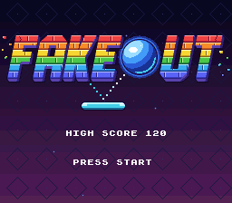
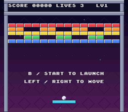
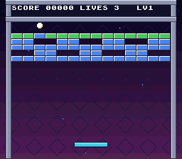
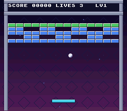
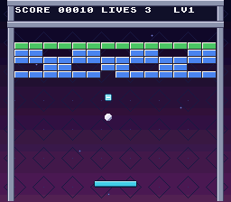

# Part 4: Scrolling, levels, and power-ups

This is **Part 4** of the build-it-yourself Breakout tutorial. Start with the
game you finished in [Part 3](README-part3.md), write each edit yourself, build,
and try the checkpoint before moving on.

<div class="rom-download-panel" data-part="4">
  <p class="rom-download-heading"><strong>Try the completed Part 4 game!</strong></p>
  <a class="rom-download-button" href="part4/breakout.sfc" download>Download the Part 4 ROM</a>
</div>

Left/Right moves, B or Start launches, and Start pauses during play.
The SNES Mouse from Part 3 still works.

By the end your game will:

- slowly **scroll the title backdrop** behind a stationary logo;
- load **three different levels** from a small table;
- **slide the playfield into view**, without scrolling the HUD;
- carry score and lives through a **level-clear screen**;
- show **two- and three-hit bricks** changing appearance as they weaken;
- offer **five rebound angles**, including smooth half-pixel horizontal motion;
- drop **collectible capsules** from destroyed bricks;
- temporarily grow a **four-piece wide paddle**.


## Before you start

You need your finished Part 3 project at
`<SDK root>\snes-examples\breakout`, using PVSnesLib **4.6.0**. Build and test it
first. Save a copy outside your SDK, or commit your working project to Git.

Keep all five Part 3 graphics files (`paddle.png`, `ball.png`, `playfield.png`,
`backdrop.png`, and `title-logo.png`) and both audio modules. Section 6 adds
one original image: [capsule.png](part4/capsule.png). You do not need a new
SDK, library, editor, or Python to follow the tutorial.

The gameplay code still knows nothing about the SNES. Positions, collisions,
levels, and power-up timers live in `src\game.c`; backgrounds, sprites, input,
sound, and saving stay in `src\main.c`.

## Contents

1. [Scroll the title backdrop](#1-scroll-the-title-backdrop)
2. [Load levels from data](#2-load-levels-from-data)
3. [Slide the playfield into view](#3-slide-the-playfield-into-view)
4. [Add tougher bricks](#4-add-tougher-bricks)
5. [Give the ball finer rebound angles](#5-give-the-ball-finer-rebound-angles)
6. [Drop collectible capsules](#6-drop-collectible-capsules)
7. [Grow a wide paddle](#7-grow-a-wide-paddle)

See also [troubleshooting](#troubleshooting) and
[official references](#official-references).

---

## 1. Scroll the title backdrop

### Move the view, not the tiles

The SNES has independent scroll registers for each background. In our Mode 1
setup, background 1 is console text, background 2 is the logo or playfield,
and background 3 is the starfield. The library numbers these **0, 1, 2**.
`bgSetScroll(2, x, y)` therefore moves the starfield, not the logo.

Scrolling changes which part of a tile map the PPU displays. It does not copy
the image again. Our starfield map is 32 by 32 eight-pixel tiles: **256 by 256
pixels**. Horizontal offsets wrap around that width. The supplied artwork has
a black edge, so its repeated boundary does not create a cut-off star.
For your own art, make the two edges meet.

### Advance once every four frames

Add a counter to `src\main.c`. Advance it on the title only, and use its upper
bits as the pixel offset: `0, 0, 0, 1, 1, 1, 1, 2, ...`.
Masking to 1023 keeps it bounded; after division by four the visible offset is
0 through 255. This is a simple introduction to storing subpixel progress.

---

### Open `src\main.c`

Reset the counter when entering gameplay so the existing backdrop stays still
there. Write the scroll registers immediately after `WaitForVBlank`, with the
other PPU updates:

**Goal:** Retain fractional progress for a slowly scrolling title backdrop.

<!-- tutorial-edit: {"file":"src/main.c","op":"diff-region","scope_before":"prepare_bricks","context":3} -->
**`src\main.c` — in file-scope declarations before `prepare_bricks`, apply these changes:**

```c
static int mouse_port;
static int mouse_dx;
static int shown_mouse;
static int backdrop_scroll; // [!code ++]

```

The counter stores quarter-pixel progress rather than moving one pixel every frame.

**Goal:** Begin each visit to the title at the backdrop's original position.

<!-- tutorial-edit: {"file":"src/main.c","op":"diff-region","function":"show_title","context":3} -->
**`src\main.c` — in `show_title`, apply these changes:**

```c
static void show_title(void)
{
    screen = SCREEN_TITLE;
    backdrop_scroll = 0; // [!code ++]
    clear_text();
    bgSetGfxPtr(1, 0x2000);
    bgSetMapPtr(1, 0x7400, SC_32x32);
```

Resetting the counter prevents a previous title visit from changing the starting offset.

**Goal:** Keep the gameplay backdrop stationary at its original position.

<!-- tutorial-edit: {"file":"src/main.c","op":"diff-region","function":"show_game","context":3} -->
**`src\main.c` — in `show_game`, apply these changes:**

```c
static void show_game(void)
{
    screen = SCREEN_GAME;
    backdrop_scroll = 0; // [!code ++]
    clear_text();
    bgSetGfxPtr(1, 0x4000);
    bgSetMapPtr(1, PLAYFIELD_MAP, SC_32x32);
```

The gameplay screen resets the same counter and does not advance it.

**Goal:** Advance and wrap the scrolling counter while the title is active.

<!-- tutorial-edit: {"file":"src/main.c","op":"diff-region","function":"update_title","context":3} -->
**`src\main.c` — in `update_title`, apply these changes:**

```c
{
    int connected;

    backdrop_scroll = (backdrop_scroll + 1) & 1023; // [!code ++]
    connected = mouse_port >= 0;
    if (shown_mouse != connected)
    {
```

Masking to 1023 bounds quarter-pixel progress to one 256-pixel map width.

**Goal:** Apply the backdrop's horizontal scroll during VBlank.

<!-- tutorial-edit: {"file":"src/main.c","op":"diff-region","function":"main","context":3} -->
**`src\main.c` — in `main`, apply these changes:**

```c
        spcProcess();
        oamInitDynamicSpriteEndFrame();
        WaitForVBlank();
        bgSetScroll(2, backdrop_scroll >> 2, 0); // [!code ++]
        setBrightness(brightness);
        update_mosaic();
        oamVramQueueUpdate();
```

Shifting by two converts the counter to whole pixels; background index 2 leaves
the logo and text untouched.

**Checkpoint:** Build and run. Leave the title open for several seconds.
The stars drift while the logo, high score, and prompts stay still. Start a
game: the starfield returns to its original position and stops drifting.
The controls, fades, mouse, and saved high score still work.



---

## 2. Load levels from data

### Describe a wall as rows of characters

The old reset function fills every brick slot with `1`. Instead, give it a
table of three layouts. Each layout has five rows of fourteen characters:
`0` means empty and `1` means a brick. Subtracting `'0'` converts a character
to its numeric value.

The extra column in `BRICK_COLS + 1` is for the string's terminating zero.
It is **not** an extra brick. Every row must contain exactly fourteen digits.
The loader counts occupied cells, not every cell in the rectangle.

`Game.level` is zero-based; the HUD adds one for the player. There is a new
state, `STATE_LEVEL_CLEAR`, between levels. Only the last layout leads to
`STATE_WON`. `game_next_level` only advances from the level-clear state, so
calling it during play cannot accidentally skip a level.

### Separate a new game from a new level

`game_reset` resets score, lives, and the level index. `load_level` resets the
paddle, ball, and bricks without touching score or lives. `game_next_level`
loads the next layout. Both the D-pad and mouse should ignore a completed
level while its message is showing.

---

### Open `src\game.h`

Make these edits to `src\game.h` and `src\game.c`:

**Goal:** Define a campaign containing three layouts.

<!-- tutorial-edit: {"file":"src/game.h","op":"diff-region","context":3} -->
**`src\game.h` — in the file, apply these changes:**

```c
#define BRICK_WIDTH  16
#define BRICK_HEIGHT 8

#define HIT_WALL   1 // [!code --]
#define HIT_WALL    1 // [!code ++]
#define HIT_PADDLE 2 // [!code --]
#define HIT_PADDLE  2 // [!code ++]
#define HIT_BRICK  4 // [!code --]
#define HIT_BRICK   4 // [!code ++]
#define LEVEL_COUNT 3 // [!code ++]

enum GameState
{
```

`LEVEL_COUNT` bounds the layout table and identifies the final level.

**Goal:** Distinguish clearing a level from winning the entire campaign.

<!-- tutorial-edit: {"file":"src/game.h","op":"diff-region","context":3} -->
**`src\game.h` — in the file, apply these changes:**

```c
    STATE_READY,
    STATE_PLAYING,
    STATE_GAME_OVER,
    STATE_WON // [!code --]
    STATE_WON, // [!code ++]
    STATE_LEVEL_CLEAR // [!code ++]
};

typedef struct Game
```

The new interlude state stops play while waiting for the next-level action.

**Goal:** Store the current zero-based level index with the game.

<!-- tutorial-edit: {"file":"src/game.h","op":"diff-region","context":3} -->
**`src\game.h` — in the file, apply these changes:**

```c
    int bricks_left;
    int state;
    int hits;
    int level; // [!code ++]
    unsigned char bricks[BRICK_COUNT];
} Game;

```

The index selects the layout; the HUD will display it plus one.

**Goal:** Expose guarded progression to the next level.

<!-- tutorial-edit: {"file":"src/game.h","op":"diff-region","context":3} -->
**`src\game.h` — in the file, apply these changes:**

```c
} Game;

void game_reset(Game *game);
void game_next_level(Game *game); // [!code ++]
void game_move_paddle(Game *game, int dx);
void game_tick(Game *game, int movement, int action_pressed);

```


The new declaration lets the screen controller advance without resetting the campaign.

---

### Open `src\game.c`

**Goal:** Describe all three brick walls as compact rows of characters.

<!-- tutorial-edit: {"file":"src/game.c","op":"diff-region","scope_before":"magnitude","context":3} -->
**`src\game.c` — in file-scope declarations before `magnitude`, apply these changes:**

```c
#include "game.h"
 // [!code ++]
static const char levels[LEVEL_COUNT][BRICK_ROWS][BRICK_COLS + 1] = { // [!code ++]
    {"11111111111111", "11001100110011", "11111111111111", "00110011001100", // [!code ++]
     "11111111111111"}, // [!code ++]
    {"00000111100000", "00011111111000", "01111111111110", "00011111111000", // [!code ++]
     "00000111100000"}, // [!code ++]
    {"11111111111111", "10010011001001", "11111111111111", "00110100101100", // [!code ++]
     "11111111111111"}}; // [!code ++]

```

Each fourteen-character row includes a terminating zero; `0` cells are holes.

**Goal:** Load one layout while preserving campaign score and lives.

<!-- tutorial-edit: {"file":"src/game.c","op":"add-function","name":"load_level","before":"game_reset"} -->
**`src\game.c` — add this complete `load_level` function immediately before `game_reset`:**

```c
static void load_level(Game *game) // [!code ++]
{ // [!code ++]
    int row; // [!code ++]
    int col; // [!code ++]
    int i; // [!code ++]
 // [!code ++]
    game->paddle_x = (FIELD_LEFT + FIELD_RIGHT - PADDLE_WIDTH) / 2; // [!code ++]
    game->bricks_left = 0; // [!code ++]
    game->state = STATE_READY; // [!code ++]
    game->hits = 0; // [!code ++]
    i = 0; // [!code ++]
    for (row = 0; row < BRICK_ROWS; ++row) // [!code ++]
    { // [!code ++]
        for (col = 0; col < BRICK_COLS; ++col) // [!code ++]
        { // [!code ++]
            game->bricks[i] = levels[game->level][row][col] - '0'; // [!code ++]
            if (game->bricks[i]) // [!code ++]
            { // [!code ++]
                ++game->bricks_left; // [!code ++]
            } // [!code ++]
            ++i; // [!code ++]
        } // [!code ++]
    } // [!code ++]
    attach_ball(game); // [!code ++]
} // [!code ++]
```

The loader converts characters to cell values, counts occupied bricks, and
resets the paddle, attachment, state, and hit flags.

**Goal:** Remove setup now performed by the level loader.

<!-- tutorial-edit: {"file":"src/game.c","op":"diff-region","function":"game_reset","context":3} -->
**`src\game.c` — in `game_reset`, apply these changes:**

```c
void game_reset(Game *game)
{
    int i; // [!code --]
 // [!code --]
    game->paddle_x = (FIELD_LEFT + FIELD_RIGHT - PADDLE_WIDTH) / 2; // [!code --]
    game->score = 0;
    game->lives = 3;
    game->bricks_left = BRICK_COUNT;
```

`game_reset` no longer needs a brick-loop index or its own paddle centering.

**Goal:** Begin a new campaign on level zero using the shared loader.

<!-- tutorial-edit: {"file":"src/game.c","op":"diff-region","function":"game_reset","context":3} -->
**`src\game.c` — in `game_reset`, apply these changes:**

```c
{
    game->score = 0;
    game->lives = 3;
    game->bricks_left = BRICK_COUNT; // [!code --]
    game->state = STATE_READY; // [!code --]
    game->hits = 0; // [!code --]
    game->level = 0; // [!code ++]
    load_level(game); // [!code ++]
    for (i = 0; i < BRICK_COUNT; ++i) // [!code --]
    { // [!code --]
        game->bricks[i] = 1; // [!code --]
    } // [!code --]
    attach_ball(game); // [!code --]
}
```

Resetting still clears score and restores lives; `load_level` supplies all per-level state.

**Goal:** Advance only from a cleared level when another layout exists.

<!-- tutorial-edit: {"file":"src/game.c","op":"add-function","name":"game_next_level","before":"hit_brick"} -->
**`src\game.c` — add this complete `game_next_level` function immediately before `hit_brick`:**

```c
void game_next_level(Game *game) // [!code ++]
{ // [!code ++]
    if (game->state == STATE_LEVEL_CLEAR && game->level + 1 < LEVEL_COUNT) // [!code ++]
    { // [!code ++]
        ++game->level; // [!code ++]
        load_level(game); // [!code ++]
    } // [!code ++]
} // [!code ++]
```

The guard prevents skipping during play or indexing beyond the final layout.

**Goal:** Show a level-clear interlude unless the final wall has been destroyed.

<!-- tutorial-edit: {"file":"src/game.c","op":"diff-region","function":"hit_brick","context":3} -->
**`src\game.c` — in `hit_brick`, apply these changes:**

```c
                --game->bricks_left;
                if (game->bricks_left == 0)
                {
                    if (game->level + 1 == LEVEL_COUNT) // [!code ++]
                    { // [!code ++]
                    game->state = STATE_WON; // [!code --]
                        game->state = STATE_WON; // [!code ++]
                    } // [!code ++]
                    else // [!code ++]
                    { // [!code ++]
                        game->state = STATE_LEVEL_CLEAR; // [!code ++]
                    } // [!code ++]
                }
                return 1;
            }
```

Only the final level enters `STATE_WON`; earlier levels enter `STATE_LEVEL_CLEAR`.

**Goal:** Ignore paddle input whenever the game is outside ready or playing states.

<!-- tutorial-edit: {"file":"src/game.c","op":"diff-region","function":"game_move_paddle","context":3} -->
**`src\game.c` — in `game_move_paddle`, apply these changes:**

```c
void game_move_paddle(Game *game, int dx)
{
    if (game->state == STATE_GAME_OVER || game->state == STATE_WON) // [!code --]
    if (game->state != STATE_READY && game->state != STATE_PLAYING) // [!code ++]
    {
        return;
    }
```

The broader guard also freezes mouse movement during the new interlude.

**Goal:** Let a fresh action press load the next level without launching its ball.

<!-- tutorial-edit: {"file":"src/game.c","op":"diff-region","function":"game_tick","context":3} -->
**`src\game.c` — in `game_tick`, apply these changes:**

```c
    int step;

    game->hits = 0;
    if (game->state == STATE_LEVEL_CLEAR) // [!code ++]
    { // [!code ++]
        if (action_pressed) // [!code ++]
        { // [!code ++]
            game_next_level(game); // [!code ++]
        } // [!code ++]
        return; // [!code ++]
    } // [!code ++]
    if (game->state == STATE_GAME_OVER || game->state == STATE_WON)
    {
        if (action_pressed)
```

Returning immediately after progression leaves the new ball in `STATE_READY`
until a separate launch press.

### Draw the new layout and messages

There are more than 999 points across the three levels, so make both score
displays **five digits**. The save format stays the same: its score was already
an unsigned 16-bit value. An existing Part 3 record remains valid. Our finite
campaign awards at most 1460 points; there is no endless score accumulation.

Keep a cached level number for the HUD. Add a level-clear prompt and a sound,
but do **not** stop the music or save a final high score at each interlude.
The existing high-score code still records only a game over or final win.

The old `shown_bricks` early exit compares only the number of live bricks.
Two layouts can have the same count but different occupied cells, so remove
that shortcut. Keep comparing the individual cells, and upload only changed
rows as before. Initialize their cached values to `255`, an impossible health
value, so the first level also erases holes from the original full tile map.

---

### Open `src\main.c`

Update `src\main.c`:

**Goal:** Allow the gameplay HUD to display campaign scores above 999.

<!-- tutorial-edit: {"file":"src/main.c","op":"diff-region","scope_before":"prepare_bricks","context":3} -->
**`src\main.c` — in file-scope declarations before `prepare_bricks`, apply these changes:**

```c
static unsigned char row_changed[BRICK_ROWS];
static unsigned char shown_alive[BRICK_COUNT];
static u8 gradient_table[GRADIENT_BANDS * 5 + 1];
static char score_text[] = "000"; // [!code --]
static char score_text[] = "00000"; // [!code ++]
static char lives_text[] = "3";
static char high_score_text[] = "HIGH SCORE 000";
static int shown_bricks = -1;
```

Five digits fit every unsigned 16-bit score without changing the score's storage type.

**Goal:** Add level text, widen the title record, and retire the count-only brick cache.

<!-- tutorial-edit: {"file":"src/main.c","op":"diff-region","scope_before":"prepare_bricks","context":3} -->
**`src\main.c` — in file-scope declarations before `prepare_bricks`, apply these changes:**

```c
static u8 gradient_table[GRADIENT_BANDS * 5 + 1];
static char score_text[] = "00000";
static char lives_text[] = "3";
static char level_text[] = "1"; // [!code ++]
static char high_score_text[] = "HIGH SCORE 000"; // [!code --]
static char high_score_text[] = "HIGH SCORE 00000"; // [!code ++]
static int shown_bricks = -1; // [!code --]
static int shown_level = -1; // [!code ++]
static int shown_score = -1;
static int shown_lives = -1;
static int shown_state = -1;
```

`shown_level` tracks the HUD; individual cell comparisons now drive brick rendering.

**Goal:** Check brick cells even when two layouts have the same occupied count.

<!-- tutorial-edit: {"file":"src/main.c","op":"diff-region","function":"prepare_bricks","context":3} -->
**`src\main.c` — in `prepare_bricks`, apply these changes:**

```c
    int row;
    int col;
    int tile;
 // [!code --]
    if (shown_bricks == game.bricks_left) // [!code --]
    { // [!code --]
        return; // [!code --]
    } // [!code --]

    index = 0;
    for (row = 0; row < BRICK_ROWS; ++row)
```

Removing the count-based early return prevents old holes from surviving a layout change.

**Goal:** Remove the final assignment to the obsolete brick-count cache.

<!-- tutorial-edit: {"file":"src/main.c","op":"diff-region","function":"prepare_bricks","context":3} -->
**`src\main.c` — in `prepare_bricks`, apply these changes:**

```c
    for (row = 0; row < BRICK_ROWS; ++row)
    {
        tile = (BRICK_TILE_Y + row) * 32 + BRICK_TILE_X;
        for (col = 0; col < BRICK_COLS * 2; col += 2)
        {
            if (shown_alive[index] != game.bricks[index])
            {
                shown_alive[index] = game.bricks[index];
                if (game.bricks[index])
                {
                    brick_map[row][col] = playfield_map[tile + col];
                    brick_map[row][col + 1] = playfield_map[tile + col + 1];
                }
                else
                {
                    brick_map[row][col] = EMPTY_TILE;
                    brick_map[row][col + 1] = EMPTY_TILE;
                }
                row_changed[row] = 1;
            }
            ++index;
        }
    }
    shown_bricks = game.bricks_left; // [!code --]
}
```

The per-cell cache and dirty-row flags remain responsible for detecting map changes.

**Goal:** Format five score digits for both the HUD and title.

<!-- tutorial-edit: {"file":"src/main.c","op":"diff-region","function":"format_score","context":3} -->
**`src\main.c` — in `format_score`, apply these changes:**

```c
static void format_score(char *text, unsigned int score)
{
    text[0] = '0' + score / 100; // [!code --]
    text[0] = '0' + score / 10000; // [!code ++]
    text[1] = '0' + (score / 10) % 10; // [!code --]
    text[1] = '0' + (score / 1000) % 10; // [!code ++]
    text[2] = '0' + score % 10; // [!code --]
    text[2] = '0' + (score / 100) % 10; // [!code ++]
    text[3] = '0' + (score / 10) % 10; // [!code ++]
    text[4] = '0' + score % 10; // [!code ++]
}
```

Division and remainder select each decimal place without altering the string terminator.

**Goal:** Display the current level as a one-based HUD number.

<!-- tutorial-edit: {"file":"src/main.c","op":"diff-region","function":"draw_text","context":3} -->
**`src\main.c` — in `draw_text`, apply these changes:**

```c
    if (shown_lives != game.lives)
    {
        lives_text[0] = '0' + game.lives;
        consoleDrawText(20, 1, lives_text);
        shown_lives = game.lives;
    }
    if (shown_level != game.level) // [!code ++]
    { // [!code ++]
        level_text[0] = '1' + game.level; // [!code ++]
        consoleDrawText(26, 1, level_text); // [!code ++]
        shown_level = game.level; // [!code ++]
    } // [!code ++]

    if (shown_state == game.state && shown_paused == paused)
    {
```

Adding to character `'1'` converts level indices 0–2 into displayed digits 1–3.

**Goal:** Explain how to continue after clearing a nonfinal level.

<!-- tutorial-edit: {"file":"src/main.c","op":"diff-region","function":"draw_text","context":3} -->
**`src\main.c` — in `draw_text`, apply these changes:**

```c
    else if (game.state == STATE_GAME_OVER)
    {
        consoleDrawText(11, 18, "GAME OVER");
        consoleDrawText(7, 20, "B / START: CONTINUE");
    }
    else if (game.state == STATE_LEVEL_CLEAR) // [!code ++]
    { // [!code ++]
        consoleDrawText(10, 18, "LEVEL CLEAR!"); // [!code ++]
        consoleDrawText(7, 20, "B / START: NEXT LEVEL"); // [!code ++]
    } // [!code ++]
    else if (game.state == STATE_WON)
    {
        consoleDrawText(12, 18, "YOU WIN!");
```

The interlude gets its own message while victory retains the existing terminal prompt.

**Goal:** Celebrate a level clear without stopping the campaign music.

<!-- tutorial-edit: {"file":"src/main.c","op":"diff-region","function":"play_sounds","context":3} -->
**`src\main.c` — in `play_sounds`, apply these changes:**

```c
        else if (game.state == STATE_WON)
        {
            spcStop();
            play_effect(SFX_TADA, 4);
        }
        else if (game.state == STATE_LEVEL_CLEAR) // [!code ++]
        { // [!code ++]
            play_effect(SFX_TADA, 4); // [!code ++]
        } // [!code ++]
        else if (old_state == STATE_PLAYING)
        {
            play_effect(SFX_STRINGS, 3);
```

This transition plays the tada effect without the final-win branch's `spcStop`.

**Goal:** Force the first layout to overwrite every original full-wall map cell.

<!-- tutorial-edit: {"file":"src/main.c","op":"diff-region","function":"init_video","context":3} -->
**`src\main.c` — in `init_video`, apply these changes:**

```c
    }
    for (i = 0; i < BRICK_COUNT; ++i)
    {
        shown_alive[i] = 1; // [!code --]
        shown_alive[i] = 255; // [!code ++]
    }
    shown_bricks = BRICK_COUNT; // [!code --]
}
```

Cached value 255 cannot match a real brick, so preparation also erases initial holes.

**Goal:** Center the wider high-score string on the title.

<!-- tutorial-edit: {"file":"src/main.c","op":"diff-region","function":"show_title","context":3} -->
**`src\main.c` — in `show_title`, apply these changes:**

```c
    bgSetMapPtr(1, 0x7400, SC_32x32);
    bgSetEnable(1);
    format_score(high_score_text + 11, high_score);
    consoleDrawText(9, 18, high_score_text); // [!code --]
    consoleDrawText(6, 18, high_score_text); // [!code ++]
    consoleDrawText(10, 22, "PRESS START");
    shown_mouse = -1;
    start_music();
```

Moving the text's starting column leaves room for its two additional digits.

**Goal:** Draw a fresh level number beside the score and lives.

<!-- tutorial-edit: {"file":"src/main.c","op":"diff-region","function":"show_game","context":3} -->
**`src\main.c` — in `show_game`, apply these changes:**

```c
    shown_score = -1;
    shown_lives = -1;
    shown_state = -1;
    shown_level = -1; // [!code ++]
    consoleDrawText(2, 1, "SCORE       LIVES"); // [!code --]
    consoleDrawText(2, 1, "SCORE       LIVES     LV"); // [!code ++]
    draw_text();
}
```

The label adds `LV`; resetting its cache to -1 forces the current level's digit to draw.

**Checkpoint:** Build and run. The ready screen shows `SCORE 00000`, `LIVES 3`,
and `LV 1`, with holes in the wall and **56** bricks. Clear it: `LEVEL CLEAR!`
appears. B or Start loads the 36-brick diamond, preserving score and lives.
The third level has 54 bricks; only clearing that one shows `YOU WIN!`.
Returning to the title shows a five-digit high score.



---

## 3. Slide the playfield into view

### Why not slide directly from the logo?

The logo and playfield share background 2, but use different graphics and maps.
Displaying them simultaneously would require a more elaborate arrangement.
Instead, reuse the existing fade: fade the title out, prepare the level while
black, and fade in as the playfield rises into place.

Background 1 keeps the HUD still. Background 3 stays at its gameplay position.
Only background 2 moves. Sprites do not inherit background scrolling, so keep
the paddle, ball, and launch prompts hidden until the entrance finishes.
Do not run gameplay or accept launch input during the entrance.

### Give the map a blank half

A 32 by 32 map wraps after 256 pixels. Scrolling it by 224 pixels would expose
the bottom of the same playfield instead of a clean empty screen.
Change the playfield to **32 by 64 tiles**, or 256 by 512 pixels, with a second
32 by 32 screen filled with the same transparent `EMPTY_TILE` used for erased
bricks.

The taller map needs **0x800 VRAM words**, twice its old allocation.
Its old location, `0x6C00`, would overlap the backdrop at `0x7000`.
Move it to the free space at `0x6000`:

| Content | VRAM word addresses |
|---|---|
| Playfield map, upper screen | `0x6000`-`0x63FF` |
| Playfield map, blank lower screen | `0x6400`-`0x67FF` |
| Console text map | `0x6800`-`0x6BFF` |
| Starfield map | `0x7000`-`0x73FF` |
| Title map | `0x7400`-`0x77FF` |

These are **word addresses**; the DMA lengths are in **bytes**. Do not double
the destination addresses. There is no change to the graphics tile addresses.

### Run the entrance without running the game

`entrance_offset` starts at 224 and drops by 4 each frame, taking **56 frames**.
The hardware scroll is `(512 - entrance_offset) & 511`: it starts at 288,
showing only the blank half, and ends at 0, showing the normal playfield.
Playfield features initially sit below the screen and rise into place.

`SCREEN_NEXT_LEVEL` is a transition target, not a third playable screen.
At full black, `show_game(1)` advances the existing game;
`show_game(0)` starts a new one. Both reset the entrance.
Explicit forced blank permits all five brick rows to be uploaded before they
become visible. Brightness zero alone is **not** permission to DMA into VRAM
outside VBlank. The regular frame-end brightness write releases forced blank.

---

### Open `src\main.c`

Replace the screen-switching and loop code in `src\main.c` as follows:

**Goal:** Reserve enough non-overlapping VRAM for a double-height playfield map.

<!-- tutorial-edit: {"file":"src/main.c","op":"diff-region","scope_before":"prepare_bricks","context":3} -->
**`src\main.c` — in file-scope declarations before `prepare_bricks`, apply these changes:**

```c
#include "game.h"
#include "res/soundbank.h"

#define PLAYFIELD_MAP 0x6C00 // [!code --]
#define PLAYFIELD_MAP 0x6000 // [!code ++]
#define BACKDROP_MAP  0x7000
#define EMPTY_TILE    0x0800
#define BRICK_TILE_X  (BRICK_X / 8)
```

Starting at `0x6000` leaves space for both 32-by-32 map screens before the text map.

**Goal:** Define the entrance's starting offset and four-pixel-per-frame speed.

<!-- tutorial-edit: {"file":"src/main.c","op":"diff-region","scope_before":"prepare_bricks","context":3} -->
**`src\main.c` — in file-scope declarations before `prepare_bricks`, apply these changes:**

```c
#define GRADIENT_BANDS 28
#define GRADIENT_LINES 8

#define MOSAIC_FRAMES 30 // [!code --]
#define MOSAIC_FRAMES   30 // [!code ++]
#define ENTRANCE_HEIGHT 224 // [!code ++]
#define ENTRANCE_SPEED  4 // [!code ++]

#define SAVE_MAGIC 0x4B42

```

An offset of 224 takes 56 frames to reach zero at this speed.

**Goal:** Distinguish advancing a level from starting a fresh campaign during fades.

<!-- tutorial-edit: {"file":"src/main.c","op":"diff-region","scope_before":"prepare_bricks","context":3} -->
**`src\main.c` — in file-scope declarations before `prepare_bricks`, apply these changes:**

```c
enum Screen
{
    SCREEN_TITLE,
    SCREEN_GAME // [!code --]
    SCREEN_GAME, // [!code ++]
    SCREEN_NEXT_LEVEL // [!code ++]
};

typedef struct SaveData
```

`SCREEN_NEXT_LEVEL` is a transition target, not another playable screen.

**Goal:** Retain entrance progress and a transparent second map screen.

<!-- tutorial-edit: {"file":"src/main.c","op":"diff-region","scope_before":"prepare_bricks","context":3} -->
**`src\main.c` — in file-scope declarations before `prepare_bricks`, apply these changes:**

```c
static int mouse_dx;
static int shown_mouse;
static int backdrop_scroll;
static int entrance_offset; // [!code ++]
static u16 entrance_blank[32 * 32]; // [!code ++]

```

The array contains 1024 map entries; the offset tracks how far the field must still rise.

**Goal:** Keep launch and state prompts hidden until the playfield reaches its final position.

<!-- tutorial-edit: {"file":"src/main.c","op":"diff-region","function":"draw_text","context":3} -->
**`src\main.c` — in `draw_text`, apply these changes:**

```c
        shown_level = game.level;
    }

    if (entrance_offset != 0) // [!code ++]
    { // [!code ++]
        return; // [!code ++]
    } // [!code ++]
    if (shown_state == game.state && shown_paused == paused)
    {
        return;
    }
```

The early return occurs after HUD updates, so score, lives, and level remain stationary.

**Goal:** Fill the lower half of the taller map with transparent entries.

<!-- tutorial-edit: {"file":"src/main.c","op":"diff-region","function":"init_video","context":3} -->
**`src\main.c` — in `init_video`, apply these changes:**

```c
                  playfield_tiles_end - playfield_tiles, 16 * 2, BG_16COLORS,
                  0x4000);
    bgInitMapSet(1, (u8 *)playfield_map, 32 * 32 * 2, SC_32x32, PLAYFIELD_MAP);
    for (i = 0; i < 32 * 32; ++i) // [!code ++]
    { // [!code ++]
        entrance_blank[i] = EMPTY_TILE; // [!code ++]
    } // [!code ++]
    dmaCopyVram((u8 *)entrance_blank, PLAYFIELD_MAP + 0x400, 32 * 32 * 2); // [!code ++]
    bgInitTileSet(2, backdrop_tiles, backdrop_palette, 0,
                  backdrop_tiles_end - backdrop_tiles, 4 * 2, BG_4COLORS,
                  0x5000);
```

Uploading at `PLAYFIELD_MAP + 0x400` fills the second screen without changing the first.

**Goal:** Restore the title's normal vertical position after a gameplay entrance.

<!-- tutorial-edit: {"file":"src/main.c","op":"diff-region","function":"show_title","context":3} -->
**`src\main.c` — in `show_title`, apply these changes:**

```c
{
    screen = SCREEN_TITLE;
    backdrop_scroll = 0;
    entrance_offset = 0; // [!code ++]
    bgSetScroll(1, 0, 0); // [!code ++]
    clear_text();
    bgSetGfxPtr(1, 0x2000);
    bgSetMapPtr(1, 0x7400, SC_32x32);
```

The title cancels any entrance progress and resets BG2's scroll to zero.

**Goal:** Let gameplay setup choose between campaign reset and level advancement.

<!-- tutorial-edit: {"file":"src/main.c","op":"diff-region","function":"show_game","context":3} -->
**`src\main.c` — in `show_game`, apply these changes:**

```c
static void show_game(void) // [!code --]
static void show_game(int advance) // [!code ++]
{
    screen = SCREEN_GAME;
    backdrop_scroll = 0;
```

The `advance` argument carries the fade target's intent into screen setup.

**Goal:** Iterate through every brick row when preparing a new screen under forced blank.

<!-- tutorial-edit: {"file":"src/main.c","op":"diff-region","function":"show_game","context":3} -->
**`src\main.c` — in `show_game`, apply these changes:**

```c
static void show_game(int advance)
{
    int row; // [!code ++]
 // [!code ++]
    screen = SCREEN_GAME;
    backdrop_scroll = 0;
    clear_text();
```

The local row index supports a bounded number of immediate row uploads.

**Goal:** Make BG2 use the full 32-by-64 playfield map during gameplay.

<!-- tutorial-edit: {"file":"src/main.c","op":"diff-region","function":"show_game","context":3} -->
**`src\main.c` — in `show_game`, apply these changes:**

```c
    backdrop_scroll = 0;
    clear_text();
    bgSetGfxPtr(1, 0x4000);
    bgSetMapPtr(1, PLAYFIELD_MAP, SC_32x32); // [!code --]
    bgSetMapPtr(1, PLAYFIELD_MAP, SC_32x64); // [!code ++]
    bgSetEnable(1);
    game_reset(&game);
    paused = 0;
```

The map-size flag allows scroll to reveal the transparent lower screen rather
than repeat the original wall.

**Goal:** Prepare the next field while black and begin its entrance with clean effects.

<!-- tutorial-edit: {"file":"src/main.c","op":"diff-region","function":"show_game","context":3} -->
**`src\main.c` — in `show_game`, apply these changes:**

```c
    bgSetGfxPtr(1, 0x4000);
    bgSetMapPtr(1, PLAYFIELD_MAP, SC_32x64);
    bgSetEnable(1);
    if (advance) // [!code ++]
    { // [!code ++]
        game_next_level(&game); // [!code ++]
    } // [!code ++]
    else // [!code ++]
    { // [!code ++]
    game_reset(&game); // [!code --]
        game_reset(&game); // [!code ++]
    } // [!code ++]
    entrance_offset = ENTRANCE_HEIGHT; // [!code ++]
    bgSetScroll(1, 0, (512 - entrance_offset) & 511); // [!code ++]
    paddle_glimmer = 0; // [!code ++]
    ball_glimmer = 0; // [!code ++]
    mosaic_timer = 0; // [!code ++]
    prepare_bricks(); // [!code ++]
    for (row = 0; row < BRICK_ROWS; ++row) // [!code ++]
    { // [!code ++]
        upload_bricks(); // [!code ++]
    } // [!code ++]
    paused = 0;
    new_high_score = 0;
    shown_score = -1;
```

Setup advances or resets the game, positions the map below the view, clears
animation timers, and uploads the prepared brick rows before revealing them.

**Goal:** Explicitly force blank before rebuilding an entire screen's map.

<!-- tutorial-edit: {"file":"src/main.c","op":"diff-region","function":"update_fade","context":3} -->
**`src\main.c` — in `update_fade`, apply these changes:**

```c
{
    if (fade_step < 0 && brightness == 0)
    {
        /* The screen is black, so it is safe to rebuild it. */ // [!code --]
        /* Force blank permits the complete new brick map to be uploaded. */ // [!code ++]
        setScreenOff(); // [!code ++]
        if (next_screen == SCREEN_TITLE)
        {
            show_title();
```

`setScreenOff` permits the multi-row DMA outside the regular frame-end VBlank window.

**Goal:** Preserve score and lives when the fade target requests the next level.

<!-- tutorial-edit: {"file":"src/main.c","op":"diff-region","function":"update_fade","context":3} -->
**`src\main.c` — in `update_fade`, apply these changes:**

```c
        }
        else
        {
            show_game(); // [!code --]
            show_game(next_screen == SCREEN_NEXT_LEVEL); // [!code ++]
        }
        fade_step = 1;
    }
```

The target comparison supplies `advance = 1` only for a next-level transition.

**Goal:** Route level-clear continuation through the fade and entrance sequence.

<!-- tutorial-edit: {"file":"src/main.c","op":"diff-region","function":"update_game","context":3} -->
**`src\main.c` — in `update_game`, apply these changes:**

```c
    int movement;
    int old_state;

    if (game.state == STATE_LEVEL_CLEAR && (pressed & (KEY_B | KEY_START))) // [!code ++]
    { // [!code ++]
        fade_to(SCREEN_NEXT_LEVEL); // [!code ++]
        return; // [!code ++]
    } // [!code ++]
    if ((game.state == STATE_GAME_OVER || game.state == STATE_WON) &&
        (pressed & (KEY_B | KEY_START)))
    {
```

The early return prevents the same press from advancing through the ordinary game tick.

**Goal:** Suppress both controller and mouse actions throughout fades and entrances.

<!-- tutorial-edit: {"file":"src/main.c","op":"diff-region","function":"main","context":3} -->
**`src\main.c` — in `main`, apply these changes:**

```c
        held = padsCurrent(0);
        pressed = padsDown(0);
        read_mouse(&pressed);
        if (fade_step != 0) // [!code --]
        if (fade_step != 0 || entrance_offset != 0) // [!code ++]
        {
            held = 0;
            pressed = 0;
            mouse_dx = 0;
        }
```

The existing input-clearing branch now covers either active transition.

**Goal:** Advance the entrance without running gameplay, then resume on a later frame.

<!-- tutorial-edit: {"file":"src/main.c","op":"diff-region","function":"main","context":3} -->
**`src\main.c` — in `main`, apply these changes:**

```c
        {
            update_title(pressed);
        }
        else if (entrance_offset != 0) // [!code ++]
        else // [!code --]
        { // [!code ++]
            if (fade_step >= 0) // [!code ++]
            { // [!code ++]
                entrance_offset -= ENTRANCE_SPEED; // [!code ++]
            } // [!code ++]
        } // [!code ++]
        else if (fade_step == 0) // [!code ++]
        {
            update_game(held, pressed);
        }
```

The mutually exclusive branches keep gameplay frozen during fade-out and
even on the frame that completes the entrance.

**Goal:** Apply BG2's entrance offset during VBlank while gameplay is displayed.

<!-- tutorial-edit: {"file":"src/main.c","op":"diff-region","function":"main","context":3} -->
**`src\main.c` — in `main`, apply these changes:**

```c
        oamInitDynamicSpriteEndFrame();
        WaitForVBlank();
        bgSetScroll(2, backdrop_scroll >> 2, 0);
        if (screen == SCREEN_GAME) // [!code ++]
        { // [!code ++]
            bgSetScroll(1, 0, (512 - entrance_offset) & 511); // [!code ++]
        } // [!code ++]
        setBrightness(brightness);
        update_mosaic();
        oamVramQueueUpdate();
```

Notice the `else if` structure in the main loop. Even on the frame that reduces
the entrance offset to zero, gameplay does not run. The next frame is the first
one that can accept a new button press. The game also stops updating during
fade-out; merely zeroing input would not stop a moving ball.

**Checkpoint:** Build and run. Start from the title: the playfield rises
through a blank area while the HUD stays in place. There are no repeated
walls or bricks at the bottom. The paddle and ball appear only at the end,
still attached and waiting for a fresh launch press. Clearing a level and
continuing repeats the fade and entrance without resetting score or lives.
Return to the title after game over: the logo is not vertically offset.


---

## 4. Add tougher bricks

### Store remaining hits in the existing grid

Each grid cell is already an unsigned byte. Give the values a richer meaning:
`0` is empty, `1` needs one hit, `2` needs two, and `3` needs three.
The first level's top row becomes two-hit bricks; the third level's becomes
three-hit bricks.

A collision always sets `HIT_BRICK` and bounces. Decrement the health, but
award ten points and decrement `bricks_left` **only when the brick reaches
zero**. `bricks_left` counts bricks, not total remaining hit points.
This keeps sounds and the glimmer animation working on non-destructive hits.

### Reuse existing colored brick tiles

No new artwork is necessary. The supplied playfield has five colored brick
rows. Select a source row by remaining health: the last artwork row for one
hit, the row above for two, and the next for three. Use those source tiles at
the brick's actual destination row.

We already removed the count-only cache in section 2. That matters again:
a health change does not change `bricks_left`, but it must change the picture.
Keep comparing the byte value and marking that row dirty.

---

### Open `src\game.c`

Edit `src\game.c` and `src\main.c`:

**Goal:** Give the first and final levels tougher top-row bricks.

<!-- tutorial-edit: {"file":"src/game.c","op":"diff-region","scope_before":"magnitude","context":3} -->
**`src\game.c` — in file-scope declarations before `magnitude`, apply these changes:**

```c
#include "game.h"

static const char levels[LEVEL_COUNT][BRICK_ROWS][BRICK_COLS + 1] = {
    {"11111111111111", "11001100110011", "11111111111111", "00110011001100", // [!code --]
    {"22222222222222", "11001100110011", "11111111111111", "00110011001100", // [!code ++]
     "11111111111111"},
    {"00000111100000", "00011111111000", "01111111111110", "00011111111000",
     "00000111100000"},
    {"11111111111111", "10010011001001", "11111111111111", "00110100101100", // [!code --]
    {"33333333333333", "10010011001001", "11111111111111", "00110100101100", // [!code ++]
     "11111111111111"}};

```

Layout characters `2` and `3` become remaining-hit counts through the existing loader.

**Goal:** Damage tough bricks without awarding destruction points too early.

<!-- tutorial-edit: {"file":"src/game.c","op":"diff-region","function":"hit_brick","context":3} -->
**`src\game.c` — in `hit_brick`, apply these changes:**

```c
            if (game->bricks[index])
            {
                game->hits |= HIT_BRICK;
                game->bricks[index] = 0; // [!code --]
                --game->bricks[index]; // [!code ++]
                if (game->bricks[index]) // [!code ++]
                { // [!code ++]
                    return 1; // [!code ++]
                } // [!code ++]
                game->score += 10;
                --game->bricks_left;
                if (game->bricks_left == 0)
```


The helper reports an impact after decrementing health; score and live count change
only when the health reaches zero.

---

### Open `src\main.c`

**Goal:** Read each brick's remaining health when selecting its artwork.

<!-- tutorial-edit: {"file":"src/main.c","op":"diff-region","function":"prepare_bricks","context":3} -->
**`src\main.c` — in `prepare_bricks`, apply these changes:**

```c
    int row;
    int col;
    int tile;
    int health; // [!code ++]

    index = 0;
    for (row = 0; row < BRICK_ROWS; ++row)
```

The local value distinguishes an empty cell from its one-, two-, or three-hit appearance.

**Goal:** Choose source tiles by health while retaining each brick's destination row.

<!-- tutorial-edit: {"file":"src/main.c","op":"diff-region","function":"prepare_bricks","context":3} -->
**`src\main.c` — in `prepare_bricks`, apply these changes:**

```c
    index = 0;
    for (row = 0; row < BRICK_ROWS; ++row)
    {
        tile = (BRICK_TILE_Y + row) * 32 + BRICK_TILE_X; // [!code --]
        for (col = 0; col < BRICK_COLS * 2; col += 2)
        {
            if (shown_alive[index] != game.bricks[index])
            {
                shown_alive[index] = game.bricks[index];
                if (game.bricks[index]) // [!code --]
                health = game.bricks[index]; // [!code ++]
                if (health) // [!code ++]
                {
                    tile = (BRICK_TILE_Y + BRICK_ROWS - health) * 32 + // [!code ++]
                           BRICK_TILE_X; // [!code ++]
                    brick_map[row][col] = playfield_map[tile + col];
                    brick_map[row][col + 1] = playfield_map[tile + col + 1];
                }
                else
                {
                    brick_map[row][col] = EMPTY_TILE;
                    brick_map[row][col + 1] = EMPTY_TILE;
                }
                row_changed[row] = 1;
            }
            ++index;
        }
```

Health selects one of the existing colored artwork rows; the destination remains
the changed brick's actual grid position.

**Checkpoint:** Build and run. The first level has a differently colored top
row. A hit changes one of those bricks to the one-hit color without scoring
or removing it. The next hit removes it and awards ten points. The third
level's top row takes three hits. A last surviving tough brick does not end
the level until it is actually destroyed.



---

## 5. Give the ball finer rebound angles

### Keep fractions without floating point

The game already has three paddle zones, but all velocities are whole pixels.
Adding a shallow horizontal component such as half a pixel per frame would
round to zero if stored in an ordinary pixel counter.

Use **sixteenths of a pixel** for velocity. `BALL_UNIT` is 16:

| Stored velocity | Pixels per frame |
|---|---|
| `8` | `0.5` |
| `16` | `1` |
| `24` | `1.5` |
| `40` | `2.5` |
| `48` | `3` |

Keep `ball_x` and `ball_y` in whole pixels, so collision and rendering need no
coordinate conversion. Each axis gets a fractional accumulator. Add the
velocity's magnitude once per frame. Whenever at least 16 units are available,
spend 16 and attempt a one-pixel move in that axis's direction. Keep the
remainder for the next frame.

For example, velocity `8` spends no pixel on its first frame, then one pixel
on its second. Negative velocity uses the same positive remainder, but moves
left. This avoids signed-shift rounding differences.

### Use five paddle zones

The outer zones send the ball outward at `(2.5, -1.5)` pixels per frame.
The next zones use `(1.5, -2.5)`. The middle preserves its horizontal direction
at half a pixel per frame and travels up at three pixels per frame.
These are deliberately chosen arcade angles, not a trigonometry simulation.

Keep the three one-pixel substeps: no component exceeds three pixels per
frame. Do not change only the velocities; the movement loop must spend the
new units too, or the ball will move at the wrong speed. Clear both remainders
when attaching the ball or choosing a fresh paddle angle.

---

### Open `src\game.h`

Edit `src\game.h` and `src\game.c`:

**Goal:** Express velocity in sixteenths of a pixel.

<!-- tutorial-edit: {"file":"src/game.h","op":"diff-region","context":3} -->
**`src\game.h` — in the file, apply these changes:**

```c

#define BALL_SIZE     8
#define BALL_SUBSTEPS 3
#define BALL_UNIT     16 // [!code ++]
#define PADDLE_WIDTH  48
#define PADDLE_HEIGHT 8
#define PADDLE_Y      200
```

`BALL_UNIT` defines how many accumulated velocity units buy one pixel of movement.

**Goal:** Preserve fractional movement separately for the X and Y axes.

<!-- tutorial-edit: {"file":"src/game.h","op":"diff-region","context":3} -->
**`src\game.h` — in the file, apply these changes:**

```c
    int state;
    int hits;
    int level;
    int ball_fraction_x; // [!code ++]
    int ball_fraction_y; // [!code ++]
    unsigned char bricks[BRICK_COUNT];
} Game;

```


The two accumulators retain each axis's unspent fraction between ticks.

---

### Open `src\game.c`

**Goal:** Keep the existing launch speed in the new units and clear old fractions.

<!-- tutorial-edit: {"file":"src/game.c","op":"diff-region","function":"attach_ball","context":3} -->
**`src\game.c` — in `attach_ball`, apply these changes:**

```c
{
    game->ball_x = game->paddle_x + (PADDLE_WIDTH - BALL_SIZE) / 2;
    game->ball_y = PADDLE_Y - BALL_SIZE;
    game->vx = 1; // [!code --]
    game->vx = BALL_UNIT; // [!code ++]
    game->vy = -3; // [!code --]
    game->vy = -3 * BALL_UNIT; // [!code ++]
    game->ball_fraction_x = 0; // [!code ++]
    game->ball_fraction_y = 0; // [!code ++]
}
```

Multiplying by `BALL_UNIT` preserves one horizontal and three upward pixels per frame.

**Goal:** Select five arcade rebound angles, including a half-pixel center drift.

<!-- tutorial-edit: {"file":"src/game.c","op":"diff-region","function":"paddle_bounce","context":3} -->
**`src\game.c` — in `paddle_bounce`, apply these changes:**

```c
    int hit_position;

    hit_position = game->ball_x + BALL_SIZE / 2 - game->paddle_x;
    if (hit_position < PADDLE_WIDTH / 3) // [!code --]
    if (hit_position < PADDLE_WIDTH / 5) // [!code ++]
    {
        game->vx = -2; // [!code --]
        game->vx = -40; // [!code ++]
        game->vy = -2; // [!code --]
        game->vy = -24; // [!code ++]
    }
    else if (hit_position >= 2 * PADDLE_WIDTH / 3) // [!code --]
    else if (hit_position < 2 * PADDLE_WIDTH / 5) // [!code ++]
    {
        game->vx = 2; // [!code --]
        game->vx = -24; // [!code ++]
        game->vy = -2; // [!code --]
        game->vy = -40; // [!code ++]
    } // [!code ++]
    else if (hit_position < 3 * PADDLE_WIDTH / 5) // [!code ++]
    { // [!code ++]
        game->vx = game->vx < 0 ? -8 : 8; // [!code ++]
        game->vy = -48; // [!code ++]
    } // [!code ++]
    else if (hit_position < 4 * PADDLE_WIDTH / 5) // [!code ++]
    { // [!code ++]
        game->vx = 24; // [!code ++]
        game->vy = -40; // [!code ++]
    }
    else
    {
        game->vx = game->vx < 0 ? -1 : 1; // [!code --]
        game->vy = -3; // [!code --]
        game->vx = 40; // [!code ++]
        game->vy = -24; // [!code ++]
    }
    game->ball_fraction_x = 0; // [!code ++]
    game->ball_fraction_y = 0; // [!code ++]
}
```

The zones use velocities measured in sixteenths and clear both remainders on
contact so a new angle starts without leftover movement.

### Spend fractional movement in one-pixel steps

The movement loop must spend a pixel's worth of units before attempting each
axis's move. Apply the following three edits inside `game_tick` in
`src\game.c`; its existing braces and state checks stay in place.

The state handling at the top is unchanged. The two accumulators are updated
only after those early returns, so an attached ball or completed level does not
build up movement. Each axis's move is followed by the existing state check,
and the bottom-of-field check still handles a lost life.

**Goal:** Add the frame's velocity to both fractional movement budgets.

<!-- tutorial-edit: {"file":"src/game.c","op":"diff-region","function":"game_tick","context":3} -->
**`src\game.c` — in `game_tick`, apply these changes:**

```c
        return;
    }

    /* Check each pixel, rather than jumping across a thin brick. */ // [!code --]
    game->ball_fraction_x += magnitude(game->vx); // [!code ++]
    game->ball_fraction_y += magnitude(game->vy); // [!code ++]
    /* Spend sixteenths one pixel at a time, retaining the fractional part. */ // [!code ++]
    for (step = 0; step < BALL_SUBSTEPS; ++step)
    {
        if (step < magnitude(game->vx))
```

Magnitudes add positive budgets; each movement helper still gets direction from the velocity.

**Goal:** Spend one pixel's X budget before attempting horizontal movement.

<!-- tutorial-edit: {"file":"src/game.c","op":"diff-region","function":"game_tick","context":3} -->
**`src\game.c` — in `game_tick`, apply these changes:**

```c
    /* Spend sixteenths one pixel at a time, retaining the fractional part. */
    for (step = 0; step < BALL_SUBSTEPS; ++step)
    {
        if (step < magnitude(game->vx)) // [!code --]
        if (game->ball_fraction_x >= BALL_UNIT) // [!code ++]
        {
            game->ball_fraction_x -= BALL_UNIT; // [!code ++]
            move_ball_x(game);
        }
        if (game->state != STATE_PLAYING)
```

An attempt occurs only with at least sixteen units, retaining any remainder for later frames.

**Goal:** Spend the Y budget through the same one-pixel collision process.

<!-- tutorial-edit: {"file":"src/game.c","op":"diff-region","function":"game_tick","context":3} -->
**`src\game.c` — in `game_tick`, apply these changes:**

```c
        {
            return;
        }
        if (step < magnitude(game->vy)) // [!code --]
        if (game->ball_fraction_y >= BALL_UNIT) // [!code ++]
        {
            game->ball_fraction_y -= BALL_UNIT; // [!code ++]
            move_ball_y(game);
        }
        if (game->state != STATE_PLAYING)
```

Each axis keeps its independent remainder; the existing state and lost-ball
checks still run after its movement attempt.

**Checkpoint:** Build and run. Launching still moves the ball one pixel
sideways and three upward each frame. Bounce it off five different paddle positions:
the outer zones give wider angles and a center hit drifts only half a pixel
sideways per frame. It still bounces off both walls, the ceiling, every brick
face, and the top of the paddle without passing through them.



---

## 6. Drop collectible capsules

### Check the PVSnesLib 4.6.0 mouse workaround

If the screen stays completely black before the title appears after this
section, check your mouse initialization. In **PVSnesLib 4.6.0**,
`initMouse` has an incorrect return instruction; changing the ROM's code
placement can expose the crash. The capsules themselves are not the cause.

Keep the [`init_mouse` workaround from Part 3](README-part3.md#work-around-mouse-initialization-in-pvsneslib-460)
and call `init_mouse()` in `main`, not `initMouse(MOUSE_SLOW)`.
If your project still uses the old call, add that helper now.
Later PVSnesLib versions may fix the SDK routine; this workaround is
specifically for 4.6.0.

### Use a small object pool

A capsule needs an X position, Y position, and active flag. Store three of them
inside `Game`, rather than allocating memory dynamically. An inactive slot is
available for reuse. If all three are occupied, deliberately skip a new drop;
the game still awards its normal brick score.

Drop a capsule for every **fourth destroyed brick**, not every fourth hit.
This deterministic rule makes the lesson easy to reproduce without introducing
a random-number generator. Reset its counter at the start of each level.
Do not spawn a capsule from the level's last brick, and clear existing capsules
on level completion or life loss.

During play, move active capsules down by two pixels per frame. A rectangle
overlapping the paddle collects it and sets `HIT_CAPSULE`; one reaching the
bottom becomes inactive. At this checkpoint collection plays a sound and
removes the capsule. The actual wide-paddle effect comes in section 7.

### Add the capsule artwork

Copy [part4/capsule.png](part4/capsule.png) from your downloaded repository into
your project's root, beside `ball.png`. It is an original indexed 8 by 8 image
using **the same palette indices as the paddle**. Keep the `-p` flag so the
converter does not rearrange those indices. We reuse the sprite palette already
loaded in Part 2; loading a separate capsule palette into that slot would
recolor the ball and paddle too.

### Keep sprite slots separate

The ball uses dynamic slot 0. The normal paddle uses slots 1-3; reserve slot 4
for the extra piece coming next. Capsules use slots **5, 6, 7**.
Initialize those slots as small sprites, draw only active capsules, and let
`oamInitDynamicSpriteEndFrame` hide slots not drawn that frame. Do not clear the
whole OAM buffer each frame or you will discard the dynamic engine's cache.

---

### Open `src\game.h`

Add the conversion rule and binary data, gameplay code, sprite initialization,
drawing, and collection sound:

**Goal:** Define capsule capacity, geometry, speed, drop interval, and collection events.

<!-- tutorial-edit: {"file":"src/game.h","op":"diff-region","context":3} -->
**`src\game.h` — in the file, apply these changes:**

```c
#define BRICK_WIDTH  16
#define BRICK_HEIGHT 8

#define HIT_WALL    1 // [!code --]
#define HIT_WALL         1 // [!code ++]
#define HIT_PADDLE  2 // [!code --]
#define HIT_PADDLE       2 // [!code ++]
#define HIT_BRICK   4 // [!code --]
#define HIT_BRICK        4 // [!code ++]
#define LEVEL_COUNT 3 // [!code --]
#define LEVEL_COUNT      3 // [!code ++]
#define HIT_CAPSULE      8 // [!code ++]
#define CAPSULE_COUNT    3 // [!code ++]
#define CAPSULE_SIZE     8 // [!code ++]
#define CAPSULE_SPEED    2 // [!code ++]
#define CAPSULE_INTERVAL 4 // [!code ++]

enum GameState
{
```

The pool holds three eight-pixel capsules; a fourth event bit reports collection.

**Goal:** Represent a falling capsule with its position and active status.

<!-- tutorial-edit: {"file":"src/game.h","op":"diff-region","context":3} -->
**`src\game.h` — in the file, apply these changes:**

```c
enum GameState
{
    STATE_READY,
    STATE_PLAYING,
    STATE_GAME_OVER,
    STATE_WON,
    STATE_LEVEL_CLEAR
};
 // [!code ++]
typedef struct Capsule // [!code ++]
{ // [!code ++]
    int x; // [!code ++]
    int y; // [!code ++]
    int active; // [!code ++]
} Capsule; // [!code ++]

typedef struct Game
{
```

An inactive slot can be reused without allocating or freeing memory.

**Goal:** Keep the drop counter and capsule pool inside the gameplay state.

<!-- tutorial-edit: {"file":"src/game.h","op":"diff-region","context":3} -->
**`src\game.h` — in the file, apply these changes:**

```c
    int level;
    int ball_fraction_x;
    int ball_fraction_y;
    int drops; // [!code ++]
    Capsule capsules[CAPSULE_COUNT]; // [!code ++]
    unsigned char bricks[BRICK_COUNT];
} Game;

```


The counter tracks destroyed bricks; the fixed array carries all falling objects.

---

### Open `src\game.c`

**Goal:** Reset every capsule slot to an explicitly inactive state.

<!-- tutorial-edit: {"file":"src/game.c","op":"add-function","name":"clear_capsules","before":"load_level"} -->
**`src\game.c` — add this complete `clear_capsules` function immediately before `load_level`:**

```c
static void clear_capsules(Game *game) // [!code ++]
{ // [!code ++]
    int i; // [!code ++]
 // [!code ++]
    for (i = 0; i < CAPSULE_COUNT; ++i) // [!code ++]
    { // [!code ++]
        game->capsules[i].x = 0; // [!code ++]
        game->capsules[i].y = 0; // [!code ++]
        game->capsules[i].active = 0; // [!code ++]
    } // [!code ++]
} // [!code ++]
```

The helper clears positions as well as active flags, avoiding dependence on startup RAM.

**Goal:** Begin each level with no falling capsules and a fresh drop interval.

<!-- tutorial-edit: {"file":"src/game.c","op":"diff-region","function":"load_level","context":3} -->
**`src\game.c` — in `load_level`, apply these changes:**

```c
    game->bricks_left = 0;
    game->state = STATE_READY;
    game->hits = 0;
    game->drops = 0; // [!code ++]
    clear_capsules(game); // [!code ++]
    i = 0;
    for (row = 0; row < BRICK_ROWS; ++row)
    {
```

Both campaign reset and level advancement reuse this cleanup through `load_level`.

**Goal:** Spawn a capsule from every fourth destroyed brick when a slot is available.

<!-- tutorial-edit: {"file":"src/game.c","op":"add-function","name":"drop_capsule","before":"hit_brick"} -->
**`src\game.c` — add this complete `drop_capsule` function immediately before `hit_brick`:**

```c
static void drop_capsule(Game *game, int row, int col) // [!code ++]
{ // [!code ++]
    int i; // [!code ++]
 // [!code ++]
    ++game->drops; // [!code ++]
    if (game->drops % CAPSULE_INTERVAL != 0 || game->bricks_left == 0) // [!code ++]
    { // [!code ++]
        return; // [!code ++]
    } // [!code ++]
    for (i = 0; i < CAPSULE_COUNT; ++i) // [!code ++]
    { // [!code ++]
        if (!game->capsules[i].active) // [!code ++]
        { // [!code ++]
            game->capsules[i].x = // [!code ++]
                BRICK_X + col * BRICK_WIDTH + (BRICK_WIDTH - CAPSULE_SIZE) / 2; // [!code ++]
            game->capsules[i].y = BRICK_Y + row * BRICK_HEIGHT; // [!code ++]
            game->capsules[i].active = 1; // [!code ++]
            return; // [!code ++]
        } // [!code ++]
    } // [!code ++]
} // [!code ++]
```

The helper skips the final brick and a full pool; a free capsule starts centered
under its source brick.

**Goal:** Move active capsules, collect paddle overlaps, and retire offscreen drops.

<!-- tutorial-edit: {"file":"src/game.c","op":"add-function","name":"update_capsules","before":"hit_brick"} -->
**`src\game.c` — add this complete `update_capsules` function immediately before `hit_brick`:**

```c
static void update_capsules(Game *game) // [!code ++]
{ // [!code ++]
    int i; // [!code ++]
    Capsule *capsule; // [!code ++]
 // [!code ++]
    for (i = 0; i < CAPSULE_COUNT; ++i) // [!code ++]
    { // [!code ++]
        capsule = &game->capsules[i]; // [!code ++]
        if (!capsule->active) // [!code ++]
        { // [!code ++]
            continue; // [!code ++]
        } // [!code ++]
        capsule->y += CAPSULE_SPEED; // [!code ++]
        if (capsule->y < PADDLE_Y + PADDLE_HEIGHT && // [!code ++]
            capsule->y + CAPSULE_SIZE > PADDLE_Y && // [!code ++]
            capsule->x < game->paddle_x + PADDLE_WIDTH && // [!code ++]
            capsule->x + CAPSULE_SIZE > game->paddle_x) // [!code ++]
        { // [!code ++]
            capsule->active = 0; // [!code ++]
            game->hits |= HIT_CAPSULE; // [!code ++]
        } // [!code ++]
        else if (capsule->y >= FIELD_BOTTOM) // [!code ++]
        { // [!code ++]
            capsule->active = 0; // [!code ++]
        } // [!code ++]
    } // [!code ++]
} // [!code ++]
```

Collection clears the active flag and sets `HIT_CAPSULE`; missed drops deactivate
at the bottom of the field.

**Goal:** Count and consider a drop only when a brick is actually destroyed.

<!-- tutorial-edit: {"file":"src/game.c","op":"diff-region","function":"hit_brick","context":3} -->
**`src\game.c` — in `hit_brick`, apply these changes:**

```c
                }
                game->score += 10;
                --game->bricks_left;
                drop_capsule(game, row, col); // [!code ++]
                if (game->bricks_left == 0)
                {
                    if (game->level + 1 == LEVEL_COUNT)
```

The call follows health reaching zero and the live-count decrement, not a damaging hit.

**Goal:** Remove all falling objects when the level ends.

<!-- tutorial-edit: {"file":"src/game.c","op":"diff-region","function":"hit_brick","context":3} -->
**`src\game.c` — in `hit_brick`, apply these changes:**

```c
                drop_capsule(game, row, col);
                if (game->bricks_left == 0)
                {
                    clear_capsules(game); // [!code ++]
                    if (game->level + 1 == LEVEL_COUNT)
                    {
                        game->state = STATE_WON;
                    }
```

Clearing at zero bricks prevents capsules from carrying into the interlude or victory.

**Goal:** Clear falling capsules when a life is lost.

<!-- tutorial-edit: {"file":"src/game.c","op":"diff-region","function":"lose_life","context":3} -->
**`src\game.c` — in `lose_life`, apply these changes:**

```c
static void lose_life(Game *game)
{
    clear_capsules(game); // [!code ++]
    --game->lives;
    if (game->lives == 0)
    {
```

Cleanup applies to both a replacement ball and final game over.

**Goal:** Advance capsules once per active gameplay frame.

<!-- tutorial-edit: {"file":"src/game.c","op":"diff-region","function":"game_tick","context":3} -->
**`src\game.c` — in `game_tick`, apply these changes:**

```c
        return;
    }

    update_capsules(game); // [!code ++]
    game->ball_fraction_x += magnitude(game->vx);
    game->ball_fraction_y += magnitude(game->vy);
    /* Spend sixteenths one pixel at a time, retaining the fractional part. */
```


The update runs only after ready and terminal-state returns, so capsules stop
when normal gameplay stops.

---

### Open `src\main.c`

**Goal:** Expose the capsule's ROM graphics to the sprite renderer.

<!-- tutorial-edit: {"file":"src/main.c","op":"diff-region","scope_before":"prepare_bricks","context":3} -->
**`src\main.c` — in file-scope declarations before `prepare_bricks`, apply these changes:**

```c

extern u8 paddle_tiles[];
extern u8 ball_tiles[];
extern u8 capsule_tiles[]; // [!code ++]
extern u8 sprite_palette[];
extern u8 backdrop_tiles[], backdrop_tiles_end[];
extern u8 backdrop_map[];
```

The declaration matches the new assembly label for `capsule.pic`.

**Goal:** Iterate through the fixed capsule pool while drawing sprites.

<!-- tutorial-edit: {"file":"src/main.c","op":"diff-region","function":"draw_sprites","context":3} -->
**`src\main.c` — in `draw_sprites`, apply these changes:**

```c
{
    int paddle_frame;
    int ball_frame;
    int i; // [!code ++]

    if (game.hits & HIT_PADDLE)
    {
```

The local index visits all three slots without changing paddle or ball slot assignments.

**Goal:** Draw only active capsules in reserved dynamic slots 5–7.

<!-- tutorial-edit: {"file":"src/main.c","op":"diff-region","function":"draw_sprites","context":3} -->
**`src\main.c` — in `draw_sprites`, apply these changes:**

```c
    oamMetaDrawDyn16(1, game.paddle_x, PADDLE_Y,
                     (u8 *)paddle_frames[paddle_frame], paddle_tiles,
                     OBJ_LARGE);
    for (i = 0; i < CAPSULE_COUNT; ++i) // [!code ++]
    { // [!code ++]
        if (game.capsules[i].active) // [!code ++]
        { // [!code ++]
            oambuffer[5 + i].oamx = game.capsules[i].x; // [!code ++]
            oambuffer[5 + i].oamy = game.capsules[i].y; // [!code ++]
            oamDynamic8Draw(5 + i); // [!code ++]
        } // [!code ++]
    } // [!code ++]
}
```

Inactive objects are not submitted, so the dynamic engine hides them at frame end.

**Goal:** Give capsule collection a distinct sound.

<!-- tutorial-edit: {"file":"src/main.c","op":"diff-region","function":"play_sounds","context":3} -->
**`src\main.c` — in `play_sounds`, apply these changes:**

```c
    if (game.state != old_state)
    {
        if (game.state == STATE_PLAYING)
        {
            play_effect(SFX_PIANO, 4);
        }
        else if (game.state == STATE_GAME_OVER)
        {
            spcStop();
            play_effect(SFX_STRINGS, 2);
        }
        else if (game.state == STATE_WON)
        {
            spcStop();
            play_effect(SFX_TADA, 4);
        }
        else if (game.state == STATE_LEVEL_CLEAR)
        {
            play_effect(SFX_TADA, 4);
        }
        else if (old_state == STATE_PLAYING)
        {
            play_effect(SFX_STRINGS, 3);
        }
    }
    else if (game.hits & HIT_CAPSULE) // [!code ++]
    { // [!code ++]
        play_effect(SFX_PIANO, 6); // [!code ++]
    } // [!code ++]
    else if (game.hits & HIT_BRICK)
    {
        play_effect(SFX_COWBELL, 4);
```

The collection flag selects a higher-pitched piano effect after state-transition sounds.

**Goal:** Initialize capsule slots as small sprites using their shared-palette artwork.

<!-- tutorial-edit: {"file":"src/main.c","op":"diff-region","function":"init_video","context":3} -->
**`src\main.c` — in `init_video`, apply these changes:**

```c
    ball_glimmer = 0;
    shown_paddle_frame = -1;
    init_sprite(0, ball_tiles, 0, OBJ_SIZES);
    for (i = 0; i < CAPSULE_COUNT; ++i) // [!code ++]
    { // [!code ++]
        init_sprite(5 + i, capsule_tiles, 0, OBJ_SIZES); // [!code ++]
    } // [!code ++]

    setMode(BG_MODE1, 0);
    init_gradient();
```


The three slots all use capsule frame 0 and the already loaded sprite palette.

---

### Open `Makefile`

**Goal:** Convert the capsule artwork while preserving its palette indices.

<!-- tutorial-edit: {"file":"Makefile","op":"diff-region","context":3} -->
**`Makefile` — in the file, apply these changes:**

```make
ball.pic: ball.png
	$(GFXCONV) -s 8 -R -o 16 -u 16 -p -t png -i $<

capsule.pic: capsule.png # [!code ++]
	$(GFXCONV) -s 8 -R -o 16 -u 16 -p -t png -i $< # [!code ++]
 # [!code ++]
playfield.pic: playfield.png
	$(GFXCONV) -s 8 -o 16 -u 16 -e 2 -p -m -t png -i $<

```

The options retain the eight-pixel tile layout and the shared sixteen-color palette.

**Goal:** Generate capsule graphics before assembling the game's asset object.

<!-- tutorial-edit: {"file":"Makefile","op":"diff-region","context":3} -->
**`Makefile` — in the file, apply these changes:**

```make
title-logo.pic: title-logo.png
	$(GFXCONV) -s 8 -o 64 -u 16 -e 3 -p -m -t png -i $<

src/data.obj: paddle.pic ball.pic playfield.pic backdrop.pic title-logo.pic # [!code --]
src/data.obj: paddle.pic ball.pic capsule.pic playfield.pic backdrop.pic title-logo.pic # [!code ++]
src/main.obj src/game.obj: src/game.h

clean: cleanBuildRes cleanRom cleanGfx cleanAudio
```


---

### Open `src\data.asm`

Adding `capsule.pic` to the dependency ensures its binary exists for `.incbin`.

**Goal:** Include the converted capsule tile in the ROM.

<!-- tutorial-edit: {"file":"src/data.asm","op":"diff-region","context":3} -->
**`src\data.asm` — in the file, apply these changes:**

```asm
ball_tiles:
.incbin "ball.pic"

capsule_tiles: ; [!code ++]
.incbin "capsule.pic" ; [!code ++]
 ; [!code ++]
sprite_palette:
.incbin "paddle.pal"

```

The new label gives dynamic sprite initialization access to the capsule's graphics.

**Checkpoint:** Build and run. Destroy four bricks: a small capsule drops
from the fourth. Catch it to hear the collection sound; at this stage the
paddle does not grow. Miss another capsule: it disappears below the field.
Pausing freezes capsules too. Losing a life removes every falling capsule.
Bricks taking two hits do not drop anything on their first hit.



---

## 7. Grow a wide paddle

### One width for drawing and collision

Add `paddle_width` and `wide_ticks` to `Game`. Start each level with the
48-pixel normal paddle. A collected capsule changes it to **64 pixels** for
**600 active gameplay frames**: about ten seconds at 60 Hz, or twelve at 50 Hz.
Another capsule refreshes that time instead of stacking widths.

When resizing, preserve the center where possible, then clamp the paddle
inside both walls. Use the runtime width in attachment, movement limits,
capsule collection, paddle collision, and rebound zones. Changing only its
drawing would produce a paddle with an invisible or non-colliding end.

Decrement the timer only while playing. Pausing and screen transitions must
not spend it. Life loss and a new level restore the normal width, clear the
timer, and remove falling capsules.

### Add a fourth metasprite piece

The art already has a left cap, middle, and right cap. The wide version simply
repeats the middle: left at 0, middles at 16 and 32, right at 48.
Create wide variants for all six glimmer frames.

Select the normal or wide metasprite table when drawing. Refresh the dynamic
graphics when **either** animation frame **or width** changes. Without the
width check, the new fourth piece can retain the wrong tiles when the paddle
grows without an animation change. When shrinking, the dynamic engine hides
the unused fourth slot.

---

### Open `src\game.h`

Add a small `WIDE` status label on text row 3. Include that row in `clear_text`
so it cannot remain on the title. Here are all the edits:

**Goal:** Define the wide paddle's sixty-four-pixel width and six-hundred-frame duration.

<!-- tutorial-edit: {"file":"src/game.h","op":"diff-region","context":3} -->
**`src\game.h` — in the file, apply these changes:**

```c
#define FIELD_TOP    32
#define FIELD_BOTTOM 224

#define BALL_SIZE     8 // [!code --]
#define BALL_SIZE         8 // [!code ++]
#define BALL_SUBSTEPS 3 // [!code --]
#define BALL_SUBSTEPS     3 // [!code ++]
#define BALL_UNIT     16 // [!code --]
#define BALL_UNIT         16 // [!code ++]
#define PADDLE_WIDTH  48 // [!code --]
#define PADDLE_WIDTH      48 // [!code ++]
#define WIDE_PADDLE_WIDTH 64 // [!code ++]
#define WIDE_FRAMES       600 // [!code ++]
#define PADDLE_HEIGHT 8 // [!code --]
#define PADDLE_HEIGHT     8 // [!code ++]
#define PADDLE_Y      200 // [!code --]
#define PADDLE_Y          200 // [!code ++]
#define PADDLE_SPEED  3 // [!code --]
#define PADDLE_SPEED      3 // [!code ++]

#define BRICK_COLS   14
#define BRICK_ROWS   5
```

The normal width remains the reset size; only the power-up uses the wider constant.

**Goal:** Track the actual paddle width and remaining power-up time.

<!-- tutorial-edit: {"file":"src/game.h","op":"diff-region","context":3} -->
**`src\game.h` — in the file, apply these changes:**

```c
    int ball_fraction_x;
    int ball_fraction_y;
    int drops;
    int paddle_width; // [!code ++]
    int wide_ticks; // [!code ++]
    Capsule capsules[CAPSULE_COUNT];
    unsigned char bricks[BRICK_COUNT];
} Game;
```


These runtime fields keep drawing, collisions, and expiration tied to the same width.

---

### Open `src\game.c`

**Goal:** Center an attached ball over either paddle width.

<!-- tutorial-edit: {"file":"src/game.c","op":"diff-region","function":"attach_ball","context":3} -->
**`src\game.c` — in `attach_ball`, apply these changes:**

```c
static void attach_ball(Game *game)
{
    game->ball_x = game->paddle_x + (PADDLE_WIDTH - BALL_SIZE) / 2; // [!code --]
    game->ball_x = game->paddle_x + (game->paddle_width - BALL_SIZE) / 2; // [!code ++]
    game->ball_y = PADDLE_Y - BALL_SIZE;
    game->vx = BALL_UNIT;
    game->vy = -3 * BALL_UNIT;
```

Attachment now calculates its offset from `paddle_width`, not the normal-width constant.

**Goal:** Start each level with a normal-width paddle and no active power-up.

<!-- tutorial-edit: {"file":"src/game.c","op":"diff-region","function":"load_level","context":3} -->
**`src\game.c` — in `load_level`, apply these changes:**

```c
    int i;

    game->paddle_x = (FIELD_LEFT + FIELD_RIGHT - PADDLE_WIDTH) / 2;
    game->paddle_width = PADDLE_WIDTH; // [!code ++]
    game->wide_ticks = 0; // [!code ++]
    game->bricks_left = 0;
    game->state = STATE_READY;
    game->hits = 0;
```

Initialization occurs before attachment so the centering calculation uses a valid width.

**Goal:** Resize around the paddle's center while keeping both ends within the field.

<!-- tutorial-edit: {"file":"src/game.c","op":"add-function","name":"resize_paddle","before":"update_capsules"} -->
**`src\game.c` — add this complete `resize_paddle` function immediately before `update_capsules`:**

```c
static void resize_paddle(Game *game, int width) // [!code ++]
{ // [!code ++]
    game->paddle_x -= (width - game->paddle_width) / 2; // [!code ++]
    game->paddle_width = width; // [!code ++]
    if (game->paddle_x < FIELD_LEFT) // [!code ++]
    { // [!code ++]
        game->paddle_x = FIELD_LEFT; // [!code ++]
    } // [!code ++]
    if (game->paddle_x + width > FIELD_RIGHT) // [!code ++]
    { // [!code ++]
        game->paddle_x = FIELD_RIGHT - width; // [!code ++]
    } // [!code ++]
} // [!code ++]
```

Half the width difference adjusts X; wall clamps handle cases where the old center
cannot be preserved.

**Goal:** Allow capsules to be caught by the paddle's wider right edge.

<!-- tutorial-edit: {"file":"src/game.c","op":"diff-region","function":"update_capsules","context":3} -->
**`src\game.c` — in `update_capsules`, apply these changes:**

```c
        capsule->y += CAPSULE_SPEED;
        if (capsule->y < PADDLE_Y + PADDLE_HEIGHT &&
            capsule->y + CAPSULE_SIZE > PADDLE_Y &&
            capsule->x < game->paddle_x + PADDLE_WIDTH && // [!code --]
            capsule->x < game->paddle_x + game->paddle_width && // [!code ++]
            capsule->x + CAPSULE_SIZE > game->paddle_x)
        {
            capsule->active = 0;
```

The horizontal overlap test now uses the actual runtime width.

**Goal:** Widen the paddle on collection and refresh the full power-up duration.

<!-- tutorial-edit: {"file":"src/game.c","op":"diff-region","function":"update_capsules","context":3} -->
**`src\game.c` — in `update_capsules`, apply these changes:**

```c
        {
            capsule->active = 0;
            game->hits |= HIT_CAPSULE;
            resize_paddle(game, WIDE_PADDLE_WIDTH); // [!code ++]
            game->wide_ticks = WIDE_FRAMES; // [!code ++]
        }
        else if (capsule->y >= FIELD_BOTTOM)
        {
```

Every pickup sets the same target width and resets the timer rather than stacking widths.

**Goal:** Scale the two left-side rebound zones to the current paddle width.

<!-- tutorial-edit: {"file":"src/game.c","op":"diff-region","function":"paddle_bounce","context":3} -->
**`src\game.c` — in `paddle_bounce`, apply these changes:**

```c
    int hit_position;

    hit_position = game->ball_x + BALL_SIZE / 2 - game->paddle_x;
    if (hit_position < PADDLE_WIDTH / 5) // [!code --]
    if (hit_position < game->paddle_width / 5) // [!code ++]
    {
        game->vx = -40;
        game->vy = -24;
    }
    else if (hit_position < 2 * PADDLE_WIDTH / 5) // [!code --]
    else if (hit_position < 2 * game->paddle_width / 5) // [!code ++]
    {
        game->vx = -24;
        game->vy = -40;
```

The leftmost boundaries now use one and two fifths of the runtime width.

**Goal:** Keep the shallow center rebound centered on either paddle size.

<!-- tutorial-edit: {"file":"src/game.c","op":"diff-region","function":"paddle_bounce","context":3} -->
**`src\game.c` — in `paddle_bounce`, apply these changes:**

```c
        game->vx = -24;
        game->vy = -40;
    }
    else if (hit_position < 3 * PADDLE_WIDTH / 5) // [!code --]
    else if (hit_position < 3 * game->paddle_width / 5) // [!code ++]
    {
        game->vx = game->vx < 0 ? -8 : 8;
        game->vy = -48;
```

The middle zone ends at three fifths of the actual width.

**Goal:** Scale the intermediate right-side zone before the outer-edge rebound.

<!-- tutorial-edit: {"file":"src/game.c","op":"diff-region","function":"paddle_bounce","context":3} -->
**`src\game.c` — in `paddle_bounce`, apply these changes:**

```c
        game->vx = game->vx < 0 ? -8 : 8;
        game->vy = -48;
    }
    else if (hit_position < 4 * PADDLE_WIDTH / 5) // [!code --]
    else if (hit_position < 4 * game->paddle_width / 5) // [!code ++]
    {
        game->vx = 24;
        game->vy = -40;
```

The four-fifths boundary preserves the same five proportional zones when widened.

**Goal:** Let the extra paddle piece collide with descending balls.

<!-- tutorial-edit: {"file":"src/game.c","op":"diff-region","function":"move_ball_y","context":3} -->
**`src\game.c` — in `move_ball_y`, apply these changes:**

```c
    else if (game->vy > 0 && game->ball_y + BALL_SIZE <= PADDLE_Y &&
             next_y + BALL_SIZE > PADDLE_Y &&
             game->ball_x + BALL_SIZE > game->paddle_x &&
             game->ball_x < game->paddle_x + PADDLE_WIDTH) // [!code --]
             game->ball_x < game->paddle_x + game->paddle_width) // [!code ++]
    {
        game->hits |= HIT_PADDLE;
        game->ball_y = PADDLE_Y - BALL_SIZE;
```

The top-contact test now extends to the actual right edge of the paddle.

**Goal:** Cancel the wide power-up when a life is lost.

<!-- tutorial-edit: {"file":"src/game.c","op":"diff-region","function":"lose_life","context":3} -->
**`src\game.c` — in `lose_life`, apply these changes:**

```c
static void lose_life(Game *game)
{
    clear_capsules(game);
    resize_paddle(game, PADDLE_WIDTH); // [!code ++]
    game->wide_ticks = 0; // [!code ++]
    --game->lives;
    if (game->lives == 0)
    {
```

Resizing restores normal collision geometry and clears the timer before a ball reattaches.

**Goal:** Clamp either paddle size at the right wall for controller and mouse movement.

<!-- tutorial-edit: {"file":"src/game.c","op":"diff-region","function":"game_move_paddle","context":3} -->
**`src\game.c` — in `game_move_paddle`, apply these changes:**

```c
    {
        game->paddle_x = FIELD_LEFT;
    }
    if (game->paddle_x + PADDLE_WIDTH > FIELD_RIGHT) // [!code --]
    if (game->paddle_x + game->paddle_width > FIELD_RIGHT) // [!code ++]
    {
        game->paddle_x = FIELD_RIGHT - PADDLE_WIDTH; // [!code --]
        game->paddle_x = FIELD_RIGHT - game->paddle_width; // [!code ++]
    }
}
```

Both the edge test and corrected X position use `paddle_width`, preventing overhang.

**Goal:** Spend power-up time only during play and shrink exactly when it expires.

<!-- tutorial-edit: {"file":"src/game.c","op":"diff-region","function":"game_tick","context":3} -->
**`src\game.c` — in `game_tick`, apply these changes:**

```c
        return;
    }

    if (game->wide_ticks > 0) // [!code ++]
    { // [!code ++]
        --game->wide_ticks; // [!code ++]
        if (game->wide_ticks == 0) // [!code ++]
        { // [!code ++]
            resize_paddle(game, PADDLE_WIDTH); // [!code ++]
        } // [!code ++]
    } // [!code ++]
    update_capsules(game);
    game->ball_fraction_x += magnitude(game->vx);
    game->ball_fraction_y += magnitude(game->vy);
```


The timer runs after nonplaying-state returns; zero triggers a single resize back to normal.

---

### Open `src\main.c`

**Goal:** Describe a wide paddle by repeating the existing middle sprite piece.

<!-- tutorial-edit: {"file":"src/main.c","op":"diff-region","scope_before":"prepare_bricks","context":3} -->
**`src\main.c` — in file-scope declarations before `prepare_bricks`, apply these changes:**

```c
    METASPR_ITEM(0, 0, (frame), PADDLE_ATTR),                                  \
        METASPR_ITEM(16, 0, 8 + (frame), PADDLE_ATTR),                         \
        METASPR_ITEM(32, 0, 16 + (frame), PADDLE_ATTR), METASPR_TERM
#define WIDE_PIECES(frame)                                                     \ // [!code ++]
    METASPR_ITEM(0, 0, (frame), PADDLE_ATTR),                                  \ // [!code ++]
        METASPR_ITEM(16, 0, 8 + (frame), PADDLE_ATTR),                         \ // [!code ++]
        METASPR_ITEM(32, 0, 8 + (frame), PADDLE_ATTR),                         \ // [!code ++]
        METASPR_ITEM(48, 0, 16 + (frame), PADDLE_ATTR), METASPR_TERM // [!code ++]

#define SFX_TADA    0
#define SFX_STRINGS 1
```

Offsets 0, 16, 32, and 48 assemble four pieces without new artwork.

**Goal:** Provide a wide metasprite for each normal and glimmer animation frame.

<!-- tutorial-edit: {"file":"src/main.c","op":"diff-region","scope_before":"prepare_bricks","context":3} -->
**`src\main.c` — in file-scope declarations before `prepare_bricks`, apply these changes:**

```c
    paddle_frame0, paddle_frame1, paddle_frame2,
    paddle_frame3, paddle_frame4, paddle_frame5};

const t_metasprite wide_frame0[] = {WIDE_PIECES(0)}; // [!code ++]
const t_metasprite wide_frame1[] = {WIDE_PIECES(1)}; // [!code ++]
const t_metasprite wide_frame2[] = {WIDE_PIECES(2)}; // [!code ++]
const t_metasprite wide_frame3[] = {WIDE_PIECES(3)}; // [!code ++]
const t_metasprite wide_frame4[] = {WIDE_PIECES(4)}; // [!code ++]
const t_metasprite wide_frame5[] = {WIDE_PIECES(5)}; // [!code ++]
 // [!code ++]
const t_metasprite *wide_frames[GLIMMER_FRAMES + 1] = { // [!code ++]
    wide_frame0, wide_frame1, wide_frame2, // [!code ++]
    wide_frame3, wide_frame4, wide_frame5}; // [!code ++]
 // [!code ++]
Game game;

static u16 brick_map[BRICK_ROWS][BRICK_COLS * 2];
```

The second pointer table mirrors the normal paddle's six animation phases.

**Goal:** Track width changes for sprite refreshes and power-up status text.

<!-- tutorial-edit: {"file":"src/main.c","op":"diff-region","scope_before":"prepare_bricks","context":3} -->
**`src\main.c` — in file-scope declarations before `prepare_bricks`, apply these changes:**

```c
static int paddle_glimmer;
static int ball_glimmer;
static int shown_paddle_frame;
static int shown_paddle_width; // [!code ++]
static int shown_wide = -1; // [!code ++]
static int screen;
static int next_screen;
static int brightness;
```

One cache records rendered geometry; the other records whether `WIDE` is displayed.

**Goal:** Show the power-up label only while its timer is active.

<!-- tutorial-edit: {"file":"src/main.c","op":"diff-region","function":"draw_text","context":3} -->
**`src\main.c` — in `draw_text`, apply these changes:**

```c
    if (shown_level != game.level)
    {
        level_text[0] = '1' + game.level;
        consoleDrawText(26, 1, level_text);
        shown_level = game.level;
    }
    if (shown_wide != (game.wide_ticks > 0)) // [!code ++]
    { // [!code ++]
        consoleDrawText(14, 3, game.wide_ticks > 0 ? "WIDE" : "    "); // [!code ++]
        shown_wide = game.wide_ticks > 0; // [!code ++]
    } // [!code ++]

    if (entrance_offset != 0)
    {
```

The label uses row 3 and erases itself with spaces when the effect ends.

**Goal:** Select a paddle metasprite from either the normal or wide table.

<!-- tutorial-edit: {"file":"src/main.c","op":"diff-region","function":"draw_sprites","context":3} -->
**`src\main.c` — in `draw_sprites`, apply these changes:**

```c
    int paddle_frame;
    int ball_frame;
    int i;
    const t_metasprite *paddle; // [!code ++]

    if (game.hits & HIT_PADDLE)
    {
```

The local pointer holds the complete piece list chosen for this frame.

**Goal:** Refresh graphics when width or animation changes and draw the selected shape.

<!-- tutorial-edit: {"file":"src/main.c","op":"diff-region","function":"draw_sprites","context":3} -->
**`src\main.c` — in `draw_sprites`, apply these changes:**

```c
    show_frame(0, ball_frame);
    oamDynamic8Draw(0);

    if (shown_paddle_frame != paddle_frame) // [!code --]
    if (shown_paddle_frame != paddle_frame || // [!code ++]
        shown_paddle_width != game.paddle_width) // [!code ++]
    {
        shown_paddle_frame = paddle_frame;
        shown_paddle_width = game.paddle_width; // [!code ++]
        oambuffer[1].oamrefresh = 1;
    }
    if (game.paddle_width == WIDE_PADDLE_WIDTH) // [!code ++]
    { // [!code ++]
        paddle = wide_frames[paddle_frame]; // [!code ++]
    } // [!code ++]
    else // [!code ++]
    { // [!code ++]
        paddle = paddle_frames[paddle_frame]; // [!code ++]
    } // [!code ++]
    oamMetaDrawDyn16(1, game.paddle_x, PADDLE_Y, // [!code --]
    oamMetaDrawDyn16(1, game.paddle_x, PADDLE_Y, (u8 *)paddle, paddle_tiles, // [!code ++]
                     (u8 *)paddle_frames[paddle_frame], paddle_tiles, // [!code --]
                     OBJ_LARGE);
    for (i = 0; i < CAPSULE_COUNT; ++i)
    {
```

The width check refreshes the new fourth piece even without an animation change.
The dynamic engine hides that slot again when the selected list shrinks.

**Goal:** Force the paddle's first width-dependent graphics refresh.

<!-- tutorial-edit: {"file":"src/main.c","op":"diff-region","function":"init_video","context":3} -->
**`src\main.c` — in `init_video`, apply these changes:**

```c
    paddle_glimmer = 0;
    ball_glimmer = 0;
    shown_paddle_frame = -1;
    shown_paddle_width = -1; // [!code ++]
    init_sprite(0, ball_tiles, 0, OBJ_SIZES);
    for (i = 0; i < CAPSULE_COUNT; ++i)
    {
```

The -1 width cache cannot match either valid paddle size on the first draw.

**Goal:** Remove the power-up label when changing screens.

<!-- tutorial-edit: {"file":"src/main.c","op":"diff-region","function":"clear_text","context":3} -->
**`src\main.c` — in `clear_text`, apply these changes:**

```c

    /* consoleDrawText is slow, so only clear the rows we write to. */
    consoleDrawText(0, 1, "                                ");
    consoleDrawText(0, 3, "                                "); // [!code ++]
    for (row = 8; row <= 24; row += 2)
    {
        consoleDrawText(0, row, "                                ");
```

Clearing row 3 prevents `WIDE` from lingering on the title.

**Goal:** Redraw power-up status when entering a fresh level or campaign.

<!-- tutorial-edit: {"file":"src/main.c","op":"diff-region","function":"show_game","context":3} -->
**`src\main.c` — in `show_game`, apply these changes:**

```c
    shown_lives = -1;
    shown_state = -1;
    shown_level = -1;
    shown_wide = -1; // [!code ++]
    consoleDrawText(2, 1, "SCORE       LIVES     LV");
    draw_text();
}
```

Resetting the status cache forces the next HUD update to match the new gameplay state.

**Checkpoint:** Build and run. Catch a capsule: the paddle grows to four
pieces and `WIDE` appears. The ball bounces off its new outer portion. Move to
both walls: no piece extends through them. Pause for several seconds and
resume: the effect has not expired while paused. After 600 active frames it
shrinks cleanly. Collecting another capsule refreshes the duration. Losing a
life or entering the next level restores three pieces and removes `WIDE`.


<details class="troubleshooting">
<summary><h2 id="troubleshooting">Troubleshooting</h2></summary>

| Symptom | Check |
|---|---|
| Logo or HUD drifts with the stars | The backdrop is background index `2`; text is `0`, logo/playfield is `1`. |
| Stars jump at the edge | Scroll wraps at 256 pixels; make custom artwork tile seamlessly. |
| Game reports a full wall despite holes | Count nonzero cells when loading, rather than assigning `BRICK_COUNT`. |
| Old holes or brick colors remain | Compare every cell's health, not just `bricks_left`; initialize cached values to 255. |
| Text breaks the backdrop during entrance | The taller playfield map must start at `0x6000`, not `0x6C00`. |
| Duplicate bricks enter from the bottom | Use `SC_32x64`, initialize its blank second screen, and wrap scroll at 512, not 256. |
| Logo remains offset on return | Reset background 2's scroll in `show_title`, and restore its `SC_32x32` map. |
| Ball moves during the fade or entrance | Skip `update_game`, not merely input, until both effects finish. |
| Bricks flicker when loading levels | Force blank before the five immediate row uploads. Keep normal uploads after VBlank. |
| Tough bricks score on every hit | Return after decrementing nonzero health; award points only when it reaches zero. |
| Ball becomes much too fast or stops moving | Convert launch velocities and the movement loop together; velocities now use sixteenths. |
| Capsule art is missing or recolored | Copy `capsule.png`, keep `-p`, include its `.pic` in `data.asm`, and retain the shared sprite palette. |
| Capsule overlaps a paddle piece | Reserve slot 4; start the three capsule slots at 5. |
| Extra paddle piece has wrong tiles | Refresh when width changes, even if the glimmer frame did not. |
| Wide paddle misses balls at its right end | Replace gameplay uses of constant `PADDLE_WIDTH` with `game->paddle_width`; retain the constant only for the normal/reset width. |
| `WIDE` remains on the title | Clear text row 3 when changing screens. |
| Score shows punctuation above 999 | Use five characters and update `format_score` and both score buffers together. |
| Other problems | See [Part 3 troubleshooting](README-part3.md#troubleshooting). |

</details>

## Official references

- [Background sizes and scrolling API (`background.h`)][backgrounds]
- [Forced blank and brightness (`video.h`)][video]
- [Dynamic sprites and metasprites (`sprite.h`)][sprites]
- [VRAM DMA (`dma.h`)][dma]
- [Mode 1 scrolling example][ex-scroll]
- [Dynamic metasprite example][ex-meta]

These links are pinned to PVSnesLib 4.6.0. The same headers and examples are
inside your SDK. The level table, fixed-point accumulator, object pool, and
power-up rules are ordinary C gameplay code, not additional SDK facilities.

[backgrounds]: https://github.com/alekmaul/pvsneslib/blob/4.6.0/pvsneslib/include/snes/background.h
[video]: https://github.com/alekmaul/pvsneslib/blob/4.6.0/pvsneslib/include/snes/video.h
[sprites]: https://github.com/alekmaul/pvsneslib/blob/4.6.0/pvsneslib/include/snes/sprite.h
[dma]: https://github.com/alekmaul/pvsneslib/blob/4.6.0/pvsneslib/include/snes/dma.h
[ex-scroll]: https://github.com/alekmaul/pvsneslib/tree/4.6.0/snes-examples/graphics/Backgrounds/Mode1Scroll
[ex-meta]: https://github.com/alekmaul/pvsneslib/tree/4.6.0/snes-examples/graphics/Sprites/DynamicEngineMetaSprite

**Previous:** [Part 3 — screens, effects, saving, and the mouse](README-part3.md)
· **Next:** [What's Next](README-whats-next.md)
or [the tutorial site](https://mhughson.github.io/mbh-pvsneslib-breakout-tutorial/).
