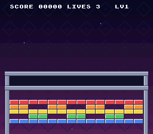
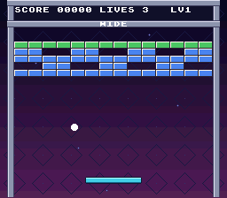
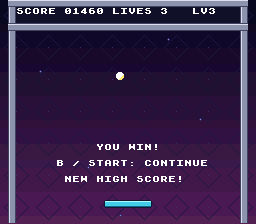

# Part 4: Scrolling, levels, and power-ups

This is **Part 4** of the build-it-yourself Breakout tutorial. Start with the
game you finished in [Part 3](README-part3.md), write each edit yourself, build,
and try the checkpoint before moving on.

**Want to see where you're going first?** Download the finished ROM,
[part4/breakout.sfc](part4/breakout.sfc), and open it in your emulator.
Left/Right moves, B or Start launches, and Start pauses during play.
The SNES Mouse from Part 3 still works.

By the end your game will:

- slowly **scroll the title backdrop** behind a stationary logo;
- load **three different levels** from a small table;
- **slide the playfield into view**, without scrolling the HUD;
- carry score and lives through a **level-clear screen**;
- show **two- and three-hit bricks** changing appearance as they weaken;
- offer **five rebound angles**, including smooth half-pixel horizontal motion;
- drop **collectible capsules** from destroyed bricks;
- temporarily grow a **four-piece wide paddle**.


## Before you start

You need your finished Part 3 project at
`<SDK root>\snes-examples\breakout`, using PVSnesLib **4.6.0**. Build and test it
first. Save a copy outside your SDK, or commit your working project to Git.

Keep all five Part 3 graphics files (`paddle.png`, `ball.png`, `playfield.png`,
`backdrop.png`, and `title-logo.png`) and both audio modules. Section 6 adds
one original image: [capsule.png](part4/capsule.png). You do not need a new
SDK, library, editor, or Python to follow the tutorial.

## Tutorial versus finished reference

**Do not copy this repository's `part4\src` folder into your project.**
It is the finished reference for comparison after completing the steps.
Your learner Makefile keeps the SDK default from Part 1.
The [reference Makefile](part4/Makefile) instead looks in `vendor/pvsneslib`,
like the earlier reference projects.

The gameplay code still knows nothing about the SNES. Positions, collisions,
levels, and power-up timers live in `src\game.c`; backgrounds, sprites, input,
sound, and saving stay in `src\main.c`.

## How to follow the code edits

The diff blocks work exactly as in earlier parts. Keep unmarked context,
remove `-` lines, and add `+` lines. Do not type the markers, filenames, or
`@@` lines. Apply the blocks in order. Separate `@@` hunks are separate edits
in the named file; each block includes the surrounding code.

After each numbered section, build from your project folder in the
**MSYS2 UCRT64 terminal**:

```sh
make
```

Reload `breakout.sfc` in your emulator. Screenshots show actual emulator output
from that section's build, not a mock-up. Scrolling and fractional movement
need to be watched in motion; a still image only shows one instant.

## Contents

1. [Scroll the title backdrop](#1-scroll-the-title-backdrop)
2. [Load levels from data](#2-load-levels-from-data)
3. [Slide the playfield into view](#3-slide-the-playfield-into-view)
4. [Add tougher bricks](#4-add-tougher-bricks)
5. [Give the ball finer rebound angles](#5-give-the-ball-finer-rebound-angles)
6. [Drop collectible capsules](#6-drop-collectible-capsules)
7. [Grow a wide paddle](#7-grow-a-wide-paddle)
8. [Test the finished game](#8-test-the-finished-game)

See also [troubleshooting](#troubleshooting),
[gameplay tests](#running-the-gameplay-tests),
[reference validation](#validating-the-tutorial-checkpoints),
[licensing](#licensing), and [official references](#official-references).

---

## 1. Scroll the title backdrop

### Move the view, not the tiles

The SNES has independent scroll registers for each background. In our Mode 1
setup, background 1 is console text, background 2 is the logo or playfield,
and background 3 is the starfield. The library numbers these **0, 1, 2**.
`bgSetScroll(2, x, y)` therefore moves the starfield, not the logo.

Scrolling changes which part of a tile map the PPU displays. It does not copy
the image again. Our starfield map is 32 by 32 eight-pixel tiles: **256 by 256
pixels**. Horizontal offsets wrap around that width. The supplied artwork has
a black edge, so its repeated boundary does not create a cut-off star.
For your own art, make the two edges meet.

### Advance once every four frames

Add a counter to `src\main.c`. Advance it on the title only, and use its upper
bits as the pixel offset: `0, 0, 0, 1, 1, 1, 1, 2, ...`.
Masking to 1023 keeps it bounded; after division by four the visible offset is
0 through 255. This is a simple introduction to storing subpixel progress.

Reset the counter when entering gameplay so the existing backdrop stays still
there. Write the scroll registers immediately after `WaitForVBlank`, with the
other PPU updates:

```diff
--- a/src/main.c
+++ b/src/main.c
@@ -97,6 +97,7 @@
 static int mouse_port;
 static int mouse_dx;
 static int shown_mouse;
+static int backdrop_scroll;
 
 static void prepare_bricks(void)
 {
@@ -385,6 +386,7 @@
 static void show_title(void)
 {
     screen = SCREEN_TITLE;
+    backdrop_scroll = 0;
     clear_text();
     bgSetGfxPtr(1, 0x2000);
     bgSetMapPtr(1, 0x7400, SC_32x32);
@@ -399,6 +401,7 @@
 static void show_game(void)
 {
     screen = SCREEN_GAME;
+    backdrop_scroll = 0;
     clear_text();
     bgSetGfxPtr(1, 0x4000);
     bgSetMapPtr(1, PLAYFIELD_MAP, SC_32x32);
@@ -492,6 +495,7 @@
 {
     int connected;
 
+    backdrop_scroll = (backdrop_scroll + 1) & 1023;
     connected = mouse_port >= 0;
     if (shown_mouse != connected) {
         if (connected)
@@ -575,6 +579,7 @@
         spcProcess();
         oamInitDynamicSpriteEndFrame();
         WaitForVBlank();
+        bgSetScroll(2, backdrop_scroll >> 2, 0);
         setBrightness(brightness);
         update_mosaic();
         oamVramQueueUpdate();
```

**Checkpoint:** Build and run. Leave the title open for several seconds.
The stars drift while the logo, high score, and prompts stay still. Start a
game: the starfield returns to its original position and stops drifting.
The controls, fades, mouse, and saved high score still work.


---

## 2. Load levels from data

### Describe a wall as rows of characters

The old reset function fills every brick slot with `1`. Instead, give it a
table of three layouts. Each layout has five rows of fourteen characters:
`0` means empty and `1` means a brick. Subtracting `'0'` converts a character
to its numeric value.

The extra column in `BRICK_COLS + 1` is for the string's terminating zero.
It is **not** an extra brick. Every row must contain exactly fourteen digits.
The loader counts occupied cells, not every cell in the rectangle.

`Game.level` is zero-based; the HUD adds one for the player. There is a new
state, `STATE_LEVEL_CLEAR`, between levels. Only the last layout leads to
`STATE_WON`. `game_next_level` only advances from the level-clear state, so
calling it during play cannot accidentally skip a level.

### Separate a new game from a new level

`game_reset` resets score, lives, and the level index. `load_level` resets the
paddle, ball, and bricks without touching score or lives. `game_next_level`
loads the next layout. Both the D-pad and mouse should ignore a completed
level while its message is showing.

Make these edits to `src\game.h` and `src\game.c`:

```diff
--- a/src/game.h
+++ b/src/game.h
@@ -24,12 +24,14 @@
 #define HIT_WALL 1
 #define HIT_PADDLE 2
 #define HIT_BRICK 4
+#define LEVEL_COUNT 3
 
 enum GameState {
     STATE_READY,
     STATE_PLAYING,
     STATE_GAME_OVER,
-    STATE_WON
+    STATE_WON,
+    STATE_LEVEL_CLEAR
 };
 
 typedef struct Game {
@@ -43,10 +45,12 @@
     int bricks_left;
     int state;
     int hits;
+    int level;
     unsigned char bricks[BRICK_COUNT];
 } Game;
 
 void game_reset(Game *game);
+void game_next_level(Game *game);
 void game_move_paddle(Game *game, int dx);
 void game_tick(Game *game, int movement, int action_pressed);
 
```

```diff
--- a/src/game.c
+++ b/src/game.c
@@ -1,4 +1,28 @@
 #include "game.h"
+
+static const char levels[LEVEL_COUNT][BRICK_ROWS][BRICK_COLS + 1] = {
+    {
+        "11111111111111",
+        "11001100110011",
+        "11111111111111",
+        "00110011001100",
+        "11111111111111"
+    },
+    {
+        "00000111100000",
+        "00011111111000",
+        "01111111111110",
+        "00011111111000",
+        "00000111100000"
+    },
+    {
+        "11111111111111",
+        "10010011001001",
+        "11111111111111",
+        "00110100101100",
+        "11111111111111"
+    }
+};
 
 static int magnitude(int value)
 {
@@ -15,19 +39,42 @@
     game->vy = -3;
 }
 
+static void load_level(Game *game)
+{
+    int row;
+    int col;
+    int i;
+
+    game->paddle_x = (FIELD_LEFT + FIELD_RIGHT - PADDLE_WIDTH) / 2;
+    game->bricks_left = 0;
+    game->state = STATE_READY;
+    game->hits = 0;
+    i = 0;
+    for (row = 0; row < BRICK_ROWS; ++row) {
+        for (col = 0; col < BRICK_COLS; ++col) {
+            game->bricks[i] = levels[game->level][row][col] - '0';
+            if (game->bricks[i])
+                ++game->bricks_left;
+            ++i;
+        }
+    }
+    attach_ball(game);
+}
+
 void game_reset(Game *game)
 {
-    int i;
-
-    game->paddle_x = (FIELD_LEFT + FIELD_RIGHT - PADDLE_WIDTH) / 2;
     game->score = 0;
     game->lives = 3;
-    game->bricks_left = BRICK_COUNT;
-    game->state = STATE_READY;
-    game->hits = 0;
-    for (i = 0; i < BRICK_COUNT; ++i)
-        game->bricks[i] = 1;
-    attach_ball(game);
+    game->level = 0;
+    load_level(game);
+}
+
+void game_next_level(Game *game)
+{
+    if (game->state == STATE_LEVEL_CLEAR && game->level + 1 < LEVEL_COUNT) {
+        ++game->level;
+        load_level(game);
+    }
 }
 
 static int hit_brick(Game *game, int x, int y)
@@ -65,8 +112,12 @@
                 game->bricks[index] = 0;
                 game->score += 10;
                 --game->bricks_left;
-                if (game->bricks_left == 0)
-                    game->state = STATE_WON;
+                if (game->bricks_left == 0) {
+                    if (game->level + 1 == LEVEL_COUNT)
+                        game->state = STATE_WON;
+                    else
+                        game->state = STATE_LEVEL_CLEAR;
+                }
                 return 1;
             }
         }
@@ -142,7 +193,7 @@
 
 void game_move_paddle(Game *game, int dx)
 {
-    if (game->state == STATE_GAME_OVER || game->state == STATE_WON)
+    if (game->state != STATE_READY && game->state != STATE_PLAYING)
         return;
     game->paddle_x += dx;
     if (game->paddle_x < FIELD_LEFT)
@@ -156,6 +207,11 @@
     int step;
 
     game->hits = 0;
+    if (game->state == STATE_LEVEL_CLEAR) {
+        if (action_pressed)
+            game_next_level(game);
+        return;
+    }
     if (game->state == STATE_GAME_OVER || game->state == STATE_WON) {
         if (action_pressed)
             game_reset(game);
```

### Draw the new layout and messages

There are more than 999 points across the three levels, so make both score
displays **five digits**. The save format stays the same: its score was already
an unsigned 16-bit value. An existing Part 3 record remains valid. Our finite
campaign awards at most 1460 points; there is no endless score accumulation.

Keep a cached level number for the HUD. Add a level-clear prompt and a sound,
but do **not** stop the music or save a final high score at each interlude.
The existing high-score code still records only a game over or final win.

The old `shown_bricks` early exit compares only the number of live bricks.
Two layouts can have the same count but different occupied cells, so remove
that shortcut. Keep comparing the individual cells, and upload only changed
rows as before. Initialize their cached values to `255`, an impossible health
value, so the first level also erases holes from the original full tile map.

Update `src\main.c`:

```diff
--- a/src/main.c
+++ b/src/main.c
@@ -74,10 +74,11 @@
 static unsigned char row_changed[BRICK_ROWS];
 static unsigned char shown_alive[BRICK_COUNT];
 static u8 gradient_table[GRADIENT_BANDS * 5 + 1];
-static char score_text[] = "000";
+static char score_text[] = "00000";
 static char lives_text[] = "3";
-static char high_score_text[] = "HIGH SCORE 000";
-static int shown_bricks = -1;
+static char level_text[] = "1";
+static char high_score_text[] = "HIGH SCORE 00000";
+static int shown_level = -1;
 static int shown_score = -1;
 static int shown_lives = -1;
 static int shown_state = -1;
@@ -106,9 +107,6 @@
     int col;
     int tile;
 
-    if (shown_bricks == game.bricks_left)
-        return;
-
     index = 0;
     for (row = 0; row < BRICK_ROWS; ++row) {
         tile = (BRICK_TILE_Y + row) * 32 + BRICK_TILE_X;
@@ -127,7 +125,6 @@
             ++index;
         }
     }
-    shown_bricks = game.bricks_left;
 }
 
 static void upload_bricks(void)
@@ -148,9 +145,11 @@
 
 static void format_score(char *text, unsigned int score)
 {
-    text[0] = '0' + score / 100;
-    text[1] = '0' + (score / 10) % 10;
-    text[2] = '0' + score % 10;
+    text[0] = '0' + score / 10000;
+    text[1] = '0' + (score / 1000) % 10;
+    text[2] = '0' + (score / 100) % 10;
+    text[3] = '0' + (score / 10) % 10;
+    text[4] = '0' + score % 10;
 }
 
 static void draw_text(void)
@@ -164,6 +163,11 @@
         lives_text[0] = '0' + game.lives;
         consoleDrawText(20, 1, lives_text);
         shown_lives = game.lives;
+    }
+    if (shown_level != game.level) {
+        level_text[0] = '1' + game.level;
+        consoleDrawText(26, 1, level_text);
+        shown_level = game.level;
     }
 
     if (shown_state == game.state && shown_paused == paused)
@@ -180,6 +184,9 @@
     } else if (game.state == STATE_GAME_OVER) {
         consoleDrawText(11, 18, "GAME OVER");
         consoleDrawText(7, 20, "B / START: CONTINUE");
+    } else if (game.state == STATE_LEVEL_CLEAR) {
+        consoleDrawText(10, 18, "LEVEL CLEAR!");
+        consoleDrawText(7, 20, "B / START: NEXT LEVEL");
     } else if (game.state == STATE_WON) {
         consoleDrawText(12, 18, "YOU WIN!");
         consoleDrawText(7, 20, "B / START: CONTINUE");
@@ -258,6 +265,8 @@
             play_effect(SFX_STRINGS, 2);
         } else if (game.state == STATE_WON) {
             spcStop();
+            play_effect(SFX_TADA, 4);
+        } else if (game.state == STATE_LEVEL_CLEAR) {
             play_effect(SFX_TADA, 4);
         } else if (old_state == STATE_PLAYING) {
             play_effect(SFX_STRINGS, 3);
@@ -369,8 +378,7 @@
                 playfield_map[(BRICK_TILE_Y + row) * 32 + BRICK_TILE_X + col];
     }
     for (i = 0; i < BRICK_COUNT; ++i)
-        shown_alive[i] = 1;
-    shown_bricks = BRICK_COUNT;
+        shown_alive[i] = 255;
 }
 
 static void clear_text(void)
@@ -392,7 +400,7 @@
     bgSetMapPtr(1, 0x7400, SC_32x32);
     bgSetEnable(1);
     format_score(high_score_text + 11, high_score);
-    consoleDrawText(9, 18, high_score_text);
+    consoleDrawText(6, 18, high_score_text);
     consoleDrawText(10, 22, "PRESS START");
     shown_mouse = -1;
     start_music();
@@ -412,7 +420,8 @@
     shown_score = -1;
     shown_lives = -1;
     shown_state = -1;
-    consoleDrawText(2, 1, "SCORE       LIVES");
+    shown_level = -1;
+    consoleDrawText(2, 1, "SCORE       LIVES     LV");
     draw_text();
 }
 
```

**Checkpoint:** Build and run. The ready screen shows `SCORE 00000`, `LIVES 3`,
and `LV 1`, with holes in the wall and **56** bricks. Clear it: `LEVEL CLEAR!`
appears. B or Start loads the 36-brick diamond, preserving score and lives.
The third level has 54 bricks; only clearing that one shows `YOU WIN!`.
Returning to the title shows a five-digit high score.


---

## 3. Slide the playfield into view

### Why not slide directly from the logo?

The logo and playfield share background 2, but use different graphics and maps.
Displaying them simultaneously would require a more elaborate arrangement.
Instead, reuse the existing fade: fade the title out, prepare the level while
black, and fade in as the playfield rises into place.

Background 1 keeps the HUD still. Background 3 stays at its gameplay position.
Only background 2 moves. Sprites do not inherit background scrolling, so keep
the paddle, ball, and launch prompts hidden until the entrance finishes. Do not run gameplay
or accept launch input during the entrance.

### Give the map a blank half

A 32 by 32 map wraps after 256 pixels. Scrolling it by 224 pixels would expose
the bottom of the same playfield instead of a clean empty screen.
Change the playfield to **32 by 64 tiles**, or 256 by 512 pixels, with a second
32 by 32 screen filled with the same transparent `EMPTY_TILE` used for erased
bricks.

The taller map needs **0x800 VRAM words**, twice its old allocation.
Its old location, `0x6C00`, would overlap the backdrop at `0x7000`.
Move it to the free space at `0x6000`:

| Content | VRAM word addresses |
|---|---|
| Playfield map, upper screen | `0x6000`-`0x63FF` |
| Playfield map, blank lower screen | `0x6400`-`0x67FF` |
| Console text map | `0x6800`-`0x6BFF` |
| Starfield map | `0x7000`-`0x73FF` |
| Title map | `0x7400`-`0x77FF` |

These are **word addresses**; the DMA lengths are in **bytes**. Do not double
the destination addresses. There is no change to the graphics tile addresses.

### Run the entrance without running the game

`entrance_offset` starts at 224 and drops by 4 each frame, taking **56 frames**.
The hardware scroll is `(512 - entrance_offset) & 511`: it starts at 288,
showing only the blank half, and ends at 0, showing the normal playfield.
Playfield features initially sit below the screen and rise into place.

`SCREEN_NEXT_LEVEL` is a transition target, not a third playable screen.
At full black, `show_game(1)` advances the existing game;
`show_game(0)` starts a new one. Both reset the entrance.
Explicit forced blank permits all five brick rows to be uploaded before they
become visible. Brightness zero alone is **not** permission to DMA into VRAM
outside VBlank. The regular frame-end brightness write releases forced blank.

Replace the screen-switching and loop code in `src\main.c` as follows:

```diff
--- a/src/main.c
+++ b/src/main.c
@@ -2,7 +2,7 @@
 #include "game.h"
 #include "res/soundbank.h"
 
-#define PLAYFIELD_MAP 0x6C00
+#define PLAYFIELD_MAP 0x6000
 #define BACKDROP_MAP 0x7000
 #define EMPTY_TILE 0x0800
 #define BRICK_TILE_X (BRICK_X / 8)
@@ -15,6 +15,8 @@
 #define GRADIENT_LINES 8
 
 #define MOSAIC_FRAMES 30
+#define ENTRANCE_HEIGHT 224
+#define ENTRANCE_SPEED 4
 
 #define SAVE_MAGIC 0x4B42
 
@@ -33,7 +35,8 @@
 
 enum Screen {
     SCREEN_TITLE,
-    SCREEN_GAME
+    SCREEN_GAME,
+    SCREEN_NEXT_LEVEL
 };
 
 typedef struct SaveData {
@@ -99,6 +102,8 @@
 static int mouse_dx;
 static int shown_mouse;
 static int backdrop_scroll;
+static int entrance_offset;
+static u16 entrance_blank[32 * 32];
 
 static void prepare_bricks(void)
 {
@@ -170,6 +175,8 @@
         shown_level = game.level;
     }
 
+    if (entrance_offset != 0)
+        return;
     if (shown_state == game.state && shown_paused == paused)
         return;
 
@@ -356,6 +363,9 @@
                   BG_16COLORS, 0x4000);
     bgInitMapSet(1, (u8 *)playfield_map, 32 * 32 * 2, SC_32x32,
                  PLAYFIELD_MAP);
+    for (i = 0; i < 32 * 32; ++i)
+        entrance_blank[i] = EMPTY_TILE;
+    dmaCopyVram((u8 *)entrance_blank, PLAYFIELD_MAP + 0x400, 32 * 32 * 2);
     bgInitTileSet(2, backdrop_tiles, backdrop_palette, 0,
                   backdrop_tiles_end - backdrop_tiles, 4 * 2,
                   BG_4COLORS, 0x5000);
@@ -395,6 +405,8 @@
 {
     screen = SCREEN_TITLE;
     backdrop_scroll = 0;
+    entrance_offset = 0;
+    bgSetScroll(1, 0, 0);
     clear_text();
     bgSetGfxPtr(1, 0x2000);
     bgSetMapPtr(1, 0x7400, SC_32x32);
@@ -406,15 +418,28 @@
     start_music();
 }
 
-static void show_game(void)
-{
+static void show_game(int advance)
+{
+    int row;
+
     screen = SCREEN_GAME;
     backdrop_scroll = 0;
     clear_text();
     bgSetGfxPtr(1, 0x4000);
-    bgSetMapPtr(1, PLAYFIELD_MAP, SC_32x32);
+    bgSetMapPtr(1, PLAYFIELD_MAP, SC_32x64);
     bgSetEnable(1);
-    game_reset(&game);
+    if (advance)
+        game_next_level(&game);
+    else
+        game_reset(&game);
+    entrance_offset = ENTRANCE_HEIGHT;
+    bgSetScroll(1, 0, (512 - entrance_offset) & 511);
+    paddle_glimmer = 0;
+    ball_glimmer = 0;
+    mosaic_timer = 0;
+    prepare_bricks();
+    for (row = 0; row < BRICK_ROWS; ++row)
+        upload_bricks();
     paused = 0;
     new_high_score = 0;
     shown_score = -1;
@@ -434,11 +459,12 @@
 static void update_fade(void)
 {
     if (fade_step < 0 && brightness == 0) {
-        /* The screen is black, so it is safe to rebuild it. */
+        /* Force blank permits the complete new brick map to be uploaded. */
+        setScreenOff();
         if (next_screen == SCREEN_TITLE)
             show_title();
         else
-            show_game();
+            show_game(next_screen == SCREEN_NEXT_LEVEL);
         fade_step = 1;
     } else if (fade_step != 0) {
         brightness += fade_step;
@@ -523,6 +549,10 @@
     int movement;
     int old_state;
 
+    if (game.state == STATE_LEVEL_CLEAR && (pressed & (KEY_B | KEY_START))) {
+        fade_to(SCREEN_NEXT_LEVEL);
+        return;
+    }
     if ((game.state == STATE_GAME_OVER || game.state == STATE_WON) &&
         (pressed & (KEY_B | KEY_START))) {
         fade_to(SCREEN_TITLE);
@@ -574,7 +604,7 @@
         held = padsCurrent(0);
         pressed = padsDown(0);
         read_mouse(&pressed);
-        if (fade_step != 0) {
+        if (fade_step != 0 || entrance_offset != 0) {
             held = 0;
             pressed = 0;
             mouse_dx = 0;
@@ -582,13 +612,18 @@
         update_fade();
         if (screen == SCREEN_TITLE)
             update_title(pressed);
-        else
+        else if (entrance_offset != 0) {
+            if (fade_step >= 0)
+                entrance_offset -= ENTRANCE_SPEED;
+        } else if (fade_step == 0)
             update_game(held, pressed);
 
         spcProcess();
         oamInitDynamicSpriteEndFrame();
         WaitForVBlank();
         bgSetScroll(2, backdrop_scroll >> 2, 0);
+        if (screen == SCREEN_GAME)
+            bgSetScroll(1, 0, (512 - entrance_offset) & 511);
         setBrightness(brightness);
         update_mosaic();
         oamVramQueueUpdate();
```

Notice the `else if` structure in the main loop. Even on the frame that reduces
the entrance offset to zero, gameplay does not run. The next frame is the first
one that can accept a new button press. The game also stops updating during
fade-out; merely zeroing input would not stop a moving ball.

**Checkpoint:** Build and run. Start from the title: the playfield rises
through a blank area while the HUD stays in place. There are no repeated
walls or bricks at the bottom. The paddle and ball appear only at the end,
still attached and waiting for a fresh launch press. Clearing a level and
continuing repeats the fade and entrance without resetting score or lives.
Return to the title after game over: the logo is not vertically offset.



---

## 4. Add tougher bricks

### Store remaining hits in the existing grid

Each grid cell is already an unsigned byte. Give the values a richer meaning:
`0` is empty, `1` needs one hit, `2` needs two, and `3` needs three.
The first level's top row becomes two-hit bricks; the third level's becomes
three-hit bricks.

A collision always sets `HIT_BRICK` and bounces. Decrement the health, but
award ten points and decrement `bricks_left` **only when the brick reaches
zero**. `bricks_left` counts bricks, not total remaining hit points.
This keeps sounds and the glimmer animation working on non-destructive hits.

### Reuse existing colored brick tiles

No new artwork is necessary. The supplied playfield has five colored brick
rows. Select a source row by remaining health: the last artwork row for one
hit, the row above for two, and the next for three. Use those source tiles at
the brick's actual destination row.

We already removed the count-only cache in section 2. That matters again:
a health change does not change `bricks_left`, but it must change the picture.
Keep comparing the byte value and marking that row dirty.

Edit `src\game.c` and `src\main.c`:

```diff
--- a/src/game.c
+++ b/src/game.c
@@ -2,7 +2,7 @@
 
 static const char levels[LEVEL_COUNT][BRICK_ROWS][BRICK_COLS + 1] = {
     {
-        "11111111111111",
+        "22222222222222",
         "11001100110011",
         "11111111111111",
         "00110011001100",
@@ -16,7 +16,7 @@
         "00000111100000"
     },
     {
-        "11111111111111",
+        "33333333333333",
         "10010011001001",
         "11111111111111",
         "00110100101100",
@@ -109,7 +109,9 @@
             index = row * BRICK_COLS + col;
             if (game->bricks[index]) {
                 game->hits |= HIT_BRICK;
-                game->bricks[index] = 0;
+                --game->bricks[index];
+                if (game->bricks[index])
+                    return 1;
                 game->score += 10;
                 --game->bricks_left;
                 if (game->bricks_left == 0) {
```

```diff
--- a/src/main.c
+++ b/src/main.c
@@ -111,14 +111,17 @@
     int row;
     int col;
     int tile;
+    int health;
 
     index = 0;
     for (row = 0; row < BRICK_ROWS; ++row) {
-        tile = (BRICK_TILE_Y + row) * 32 + BRICK_TILE_X;
         for (col = 0; col < BRICK_COLS * 2; col += 2) {
             if (shown_alive[index] != game.bricks[index]) {
                 shown_alive[index] = game.bricks[index];
-                if (game.bricks[index]) {
+                health = game.bricks[index];
+                if (health) {
+                    tile = (BRICK_TILE_Y + BRICK_ROWS - health) * 32
+                           + BRICK_TILE_X;
                     brick_map[row][col] = playfield_map[tile + col];
                     brick_map[row][col + 1] = playfield_map[tile + col + 1];
                 } else {
```

**Checkpoint:** Build and run. The first level has a differently colored top
row. A hit changes one of those bricks to the one-hit color without scoring
or removing it. The next hit removes it and awards ten points. The third
level's top row takes three hits. A last surviving tough brick does not end
the level until it is actually destroyed.


---

## 5. Give the ball finer rebound angles

### Keep fractions without floating point

The game already has three paddle zones, but all velocities are whole pixels.
Adding a shallow horizontal component such as half a pixel per frame would
round to zero if stored in an ordinary pixel counter.

Use **sixteenths of a pixel** for velocity. `BALL_UNIT` is 16:

| Stored velocity | Pixels per frame |
|---|---|
| `8` | `0.5` |
| `16` | `1` |
| `24` | `1.5` |
| `40` | `2.5` |
| `48` | `3` |

Keep `ball_x` and `ball_y` in whole pixels, so collision and rendering need no
coordinate conversion. Each axis gets a fractional accumulator. Add the
velocity's magnitude once per frame. Whenever at least 16 units are available,
spend 16 and attempt a one-pixel move in that axis's direction. Keep the
remainder for the next frame.

For example, velocity `8` spends no pixel on its first frame, then one pixel
on its second. Negative velocity uses the same positive remainder, but moves
left. This avoids signed-shift rounding differences.

### Use five paddle zones

The outer zones send the ball outward at `(2.5, -1.5)` pixels per frame.
The next zones use `(1.5, -2.5)`. The middle preserves its horizontal direction
at half a pixel per frame and travels up at three pixels per frame.
These are deliberately chosen arcade angles, not a trigonometry simulation.

Keep the three one-pixel substeps: no component exceeds three pixels per
frame. Do not change only the velocities; the movement loop must spend the
new units too, or the ball will move at the wrong speed. Clear both remainders
when attaching the ball or choosing a fresh paddle angle.

Edit `src\game.h` and `src\game.c`:

```diff
--- a/src/game.h
+++ b/src/game.h
@@ -8,6 +8,7 @@
 
 #define BALL_SIZE 8
 #define BALL_SUBSTEPS 3
+#define BALL_UNIT 16
 #define PADDLE_WIDTH 48
 #define PADDLE_HEIGHT 8
 #define PADDLE_Y 200
@@ -46,6 +47,8 @@
     int state;
     int hits;
     int level;
+    int ball_fraction_x;
+    int ball_fraction_y;
     unsigned char bricks[BRICK_COUNT];
 } Game;
 
```

```diff
--- a/src/game.c
+++ b/src/game.c
@@ -35,8 +35,10 @@
 {
     game->ball_x = game->paddle_x + (PADDLE_WIDTH - BALL_SIZE) / 2;
     game->ball_y = PADDLE_Y - BALL_SIZE;
-    game->vx = 1;
-    game->vy = -3;
+    game->vx = BALL_UNIT;
+    game->vy = -3 * BALL_UNIT;
+    game->ball_fraction_x = 0;
+    game->ball_fraction_y = 0;
 }
 
 static void load_level(Game *game)
@@ -147,16 +149,24 @@
     int hit_position;
 
     hit_position = game->ball_x + BALL_SIZE / 2 - game->paddle_x;
-    if (hit_position < PADDLE_WIDTH / 3) {
-        game->vx = -2;
-        game->vy = -2;
-    } else if (hit_position >= 2 * PADDLE_WIDTH / 3) {
-        game->vx = 2;
-        game->vy = -2;
-    } else {
-        game->vx = game->vx < 0 ? -1 : 1;
-        game->vy = -3;
-    }
+    if (hit_position < PADDLE_WIDTH / 5) {
+        game->vx = -40;
+        game->vy = -24;
+    } else if (hit_position < 2 * PADDLE_WIDTH / 5) {
+        game->vx = -24;
+        game->vy = -40;
+    } else if (hit_position < 3 * PADDLE_WIDTH / 5) {
+        game->vx = game->vx < 0 ? -8 : 8;
+        game->vy = -48;
+    } else if (hit_position < 4 * PADDLE_WIDTH / 5) {
+        game->vx = 24;
+        game->vy = -40;
+    } else {
+        game->vx = 40;
+        game->vy = -24;
+    }
+    game->ball_fraction_x = 0;
+    game->ball_fraction_y = 0;
 }
 
 static void move_ball_y(Game *game)
@@ -229,14 +239,20 @@
         return;
     }
 
-    /* Check each pixel, rather than jumping across a thin brick. */
+    game->ball_fraction_x += magnitude(game->vx);
+    game->ball_fraction_y += magnitude(game->vy);
+    /* Spend sixteenths one pixel at a time, retaining the fractional part. */
     for (step = 0; step < BALL_SUBSTEPS; ++step) {
-        if (step < magnitude(game->vx))
+        if (game->ball_fraction_x >= BALL_UNIT) {
+            game->ball_fraction_x -= BALL_UNIT;
             move_ball_x(game);
+        }
         if (game->state != STATE_PLAYING)
             return;
-        if (step < magnitude(game->vy))
+        if (game->ball_fraction_y >= BALL_UNIT) {
+            game->ball_fraction_y -= BALL_UNIT;
             move_ball_y(game);
+        }
         if (game->state != STATE_PLAYING)
             return;
         if (game->ball_y >= FIELD_BOTTOM) {
```

**Checkpoint:** Build and run. Launching still moves the ball one pixel
sideways and three upward each frame. Catch it at five different positions:
the outer zones give wider angles and a center catch drifts only half a pixel
sideways per frame. It still bounces off both walls, the ceiling, every brick
face, and the top of the paddle without passing through them.


---

## 6. Drop collectible capsules

### Use a small object pool

A capsule needs an X position, Y position, and active flag. Store three of them
inside `Game`, rather than allocating memory dynamically. An inactive slot is
available for reuse. If all three are occupied, deliberately skip a new drop;
the game still awards its normal brick score.

Drop a capsule for every **fourth destroyed brick**, not every fourth hit.
This deterministic rule makes the lesson easy to reproduce without introducing
a random-number generator. Reset its counter at the start of each level.
Do not spawn a capsule from the level's last brick, and clear existing capsules
on level completion or life loss.

During play, move active capsules down by two pixels per frame. A rectangle
overlapping the paddle collects it and sets `HIT_CAPSULE`; one reaching the
bottom becomes inactive. At this checkpoint collection plays a sound and
removes the capsule. The actual wide-paddle effect comes in section 7.

### Add the capsule artwork

Copy [part4/capsule.png](part4/capsule.png) from your downloaded repository into
your project's root, beside `ball.png`. It is an original indexed 8 by 8 image
using **the same palette indices as the paddle**. Keep the `-p` flag so the
converter does not rearrange those indices. We reuse the sprite palette already
loaded in Part 2; loading a separate capsule palette into that slot would
recolor the ball and paddle too.

The optional [art generator](tools/make_part4_capsule.py) recreates the PNG,
but is not part of the learner build.

### Keep sprite slots separate

The ball uses dynamic slot 0. The normal paddle uses slots 1-3; reserve slot 4
for the extra piece coming next. Capsules use slots **5, 6, 7**.
Initialize those slots as small sprites, draw only active capsules, and let
`oamInitDynamicSpriteEndFrame` hide slots not drawn that frame. Do not clear the
whole OAM buffer each frame or you will discard the dynamic engine's cache.

Add the conversion rule and binary data, gameplay code, sprite initialization,
drawing, and collection sound:

```diff
--- a/src/game.h
+++ b/src/game.h
@@ -26,6 +26,11 @@
 #define HIT_PADDLE 2
 #define HIT_BRICK 4
 #define LEVEL_COUNT 3
+#define HIT_CAPSULE 8
+#define CAPSULE_COUNT 3
+#define CAPSULE_SIZE 8
+#define CAPSULE_SPEED 2
+#define CAPSULE_INTERVAL 4
 
 enum GameState {
     STATE_READY,
@@ -34,6 +39,12 @@
     STATE_WON,
     STATE_LEVEL_CLEAR
 };
+
+typedef struct Capsule {
+    int x;
+    int y;
+    int active;
+} Capsule;
 
 typedef struct Game {
     int paddle_x;
@@ -49,6 +60,8 @@
     int level;
     int ball_fraction_x;
     int ball_fraction_y;
+    int drops;
+    Capsule capsules[CAPSULE_COUNT];
     unsigned char bricks[BRICK_COUNT];
 } Game;
 
```

```diff
--- a/src/game.c
+++ b/src/game.c
@@ -41,6 +41,17 @@
     game->ball_fraction_y = 0;
 }
 
+static void clear_capsules(Game *game)
+{
+    int i;
+
+    for (i = 0; i < CAPSULE_COUNT; ++i) {
+        game->capsules[i].x = 0;
+        game->capsules[i].y = 0;
+        game->capsules[i].active = 0;
+    }
+}
+
 static void load_level(Game *game)
 {
     int row;
@@ -51,6 +62,8 @@
     game->bricks_left = 0;
     game->state = STATE_READY;
     game->hits = 0;
+    game->drops = 0;
+    clear_capsules(game);
     i = 0;
     for (row = 0; row < BRICK_ROWS; ++row) {
         for (col = 0; col < BRICK_COLS; ++col) {
@@ -76,6 +89,46 @@
     if (game->state == STATE_LEVEL_CLEAR && game->level + 1 < LEVEL_COUNT) {
         ++game->level;
         load_level(game);
+    }
+}
+
+static void drop_capsule(Game *game, int row, int col)
+{
+    int i;
+
+    ++game->drops;
+    if (game->drops % CAPSULE_INTERVAL != 0 || game->bricks_left == 0)
+        return;
+    for (i = 0; i < CAPSULE_COUNT; ++i) {
+        if (!game->capsules[i].active) {
+            game->capsules[i].x = BRICK_X + col * BRICK_WIDTH
+                                 + (BRICK_WIDTH - CAPSULE_SIZE) / 2;
+            game->capsules[i].y = BRICK_Y + row * BRICK_HEIGHT;
+            game->capsules[i].active = 1;
+            return;
+        }
+    }
+}
+
+static void update_capsules(Game *game)
+{
+    int i;
+    Capsule *capsule;
+
+    for (i = 0; i < CAPSULE_COUNT; ++i) {
+        capsule = &game->capsules[i];
+        if (!capsule->active)
+            continue;
+        capsule->y += CAPSULE_SPEED;
+        if (capsule->y < PADDLE_Y + PADDLE_HEIGHT &&
+            capsule->y + CAPSULE_SIZE > PADDLE_Y &&
+            capsule->x < game->paddle_x + PADDLE_WIDTH &&
+            capsule->x + CAPSULE_SIZE > game->paddle_x) {
+            capsule->active = 0;
+            game->hits |= HIT_CAPSULE;
+        } else if (capsule->y >= FIELD_BOTTOM) {
+            capsule->active = 0;
+        }
     }
 }
 
@@ -116,7 +169,9 @@
                     return 1;
                 game->score += 10;
                 --game->bricks_left;
+                drop_capsule(game, row, col);
                 if (game->bricks_left == 0) {
+                    clear_capsules(game);
                     if (game->level + 1 == LEVEL_COUNT)
                         game->state = STATE_WON;
                     else
@@ -194,6 +249,7 @@
 
 static void lose_life(Game *game)
 {
+    clear_capsules(game);
     --game->lives;
     if (game->lives == 0) {
         game->state = STATE_GAME_OVER;
@@ -239,6 +295,7 @@
         return;
     }
 
+    update_capsules(game);
     game->ball_fraction_x += magnitude(game->vx);
     game->ball_fraction_y += magnitude(game->vy);
     /* Spend sixteenths one pixel at a time, retaining the fractional part. */
```

```diff
--- a/src/main.c
+++ b/src/main.c
@@ -49,6 +49,7 @@
 
 extern u8 paddle_tiles[];
 extern u8 ball_tiles[];
+extern u8 capsule_tiles[];
 extern u8 sprite_palette[];
 extern u8 backdrop_tiles[], backdrop_tiles_end[];
 extern u8 backdrop_map[];
@@ -227,6 +228,7 @@
 {
     int paddle_frame;
     int ball_frame;
+    int i;
 
     if (game.hits & HIT_PADDLE)
         paddle_glimmer = GLIMMER_FRAMES * GLIMMER_TICKS;
@@ -247,6 +249,13 @@
     oamMetaDrawDyn16(1, game.paddle_x, PADDLE_Y,
                      (u8 *)paddle_frames[paddle_frame], paddle_tiles,
                      OBJ_LARGE);
+    for (i = 0; i < CAPSULE_COUNT; ++i) {
+        if (game.capsules[i].active) {
+            oambuffer[5 + i].oamx = game.capsules[i].x;
+            oambuffer[5 + i].oamy = game.capsules[i].y;
+            oamDynamic8Draw(5 + i);
+        }
+    }
 }
 
 static void play_effect(int sound, int pitch)
@@ -281,6 +290,8 @@
         } else if (old_state == STATE_PLAYING) {
             play_effect(SFX_STRINGS, 3);
         }
+    } else if (game.hits & HIT_CAPSULE) {
+        play_effect(SFX_PIANO, 6);
     } else if (game.hits & HIT_BRICK) {
         play_effect(SFX_COWBELL, 4);
     } else if (game.hits & HIT_PADDLE) {
@@ -380,6 +391,8 @@
     ball_glimmer = 0;
     shown_paddle_frame = -1;
     init_sprite(0, ball_tiles, 0, OBJ_SIZES);
+    for (i = 0; i < CAPSULE_COUNT; ++i)
+        init_sprite(5 + i, capsule_tiles, 0, OBJ_SIZES);
 
     setMode(BG_MODE1, 0);
     init_gradient();
```

```diff
--- a/Makefile
+++ b/Makefile
@@ -35,6 +35,9 @@
 ball.pic: ball.png
 	$(GFXCONV) -s 8 -R -o 16 -u 16 -p -t png -i $<
 
+capsule.pic: capsule.png
+	$(GFXCONV) -s 8 -R -o 16 -u 16 -p -t png -i $<
+
 playfield.pic: playfield.png
 	$(GFXCONV) -s 8 -o 16 -u 16 -e 2 -p -m -t png -i $<
 
@@ -44,7 +47,7 @@
 title-logo.pic: title-logo.png
 	$(GFXCONV) -s 8 -o 64 -u 16 -e 3 -p -m -t png -i $<
 
-src/data.obj: paddle.pic ball.pic playfield.pic backdrop.pic title-logo.pic
+src/data.obj: paddle.pic ball.pic capsule.pic playfield.pic backdrop.pic title-logo.pic
 src/main.obj src/game.obj: src/game.h
 
 clean: cleanBuildRes cleanRom cleanGfx cleanAudio
```

```diff
--- a/src/data.asm
+++ b/src/data.asm
@@ -7,6 +7,9 @@
 
 ball_tiles:
 .incbin "ball.pic"
+
+capsule_tiles:
+.incbin "capsule.pic"
 
 sprite_palette:
 .incbin "paddle.pal"
```

**Checkpoint:** Build and run. Destroy four bricks: a small capsule drops
from the fourth. Catch it to hear the collection sound; at this stage the
paddle does not grow. Miss another capsule: it disappears below the field.
Pausing freezes capsules too. Losing a life removes every falling capsule.
Bricks taking two hits do not drop anything on their first hit.


---

## 7. Grow a wide paddle

### One width for drawing and collision

Add `paddle_width` and `wide_ticks` to `Game`. Start each level with the
48-pixel normal paddle. A collected capsule changes it to **64 pixels** for
**600 active gameplay frames**: about ten seconds at 60 Hz, or twelve at 50 Hz.
Another capsule refreshes that time instead of stacking widths.

When resizing, preserve the center where possible, then clamp the paddle
inside both walls. Use the runtime width in attachment, movement limits,
capsule collection, paddle collision, and rebound zones. Changing only its
drawing would produce a paddle with an invisible or non-colliding end.

Decrement the timer only while playing. Pausing and screen transitions must
not spend it. Life loss and a new level restore the normal width, clear the
timer, and remove falling capsules.

### Add a fourth metasprite piece

The art already has a left cap, middle, and right cap. The wide version simply
repeats the middle: left at 0, middles at 16 and 32, right at 48.
Create wide variants for all six glimmer frames.

Select the normal or wide metasprite table when drawing. Refresh the dynamic
graphics when **either** animation frame **or width** changes. Without the
width check, the new fourth piece can retain the wrong tiles when the paddle
grows without an animation change. When shrinking, the dynamic engine hides
the unused fourth slot.

Add a small `WIDE` status label on text row 3. Include that row in `clear_text`
so it cannot remain on the title. Here are all the edits:

```diff
--- a/src/game.h
+++ b/src/game.h
@@ -10,6 +10,8 @@
 #define BALL_SUBSTEPS 3
 #define BALL_UNIT 16
 #define PADDLE_WIDTH 48
+#define WIDE_PADDLE_WIDTH 64
+#define WIDE_FRAMES 600
 #define PADDLE_HEIGHT 8
 #define PADDLE_Y 200
 #define PADDLE_SPEED 3
@@ -61,6 +63,8 @@
     int ball_fraction_x;
     int ball_fraction_y;
     int drops;
+    int paddle_width;
+    int wide_ticks;
     Capsule capsules[CAPSULE_COUNT];
     unsigned char bricks[BRICK_COUNT];
 } Game;
```

```diff
--- a/src/game.c
+++ b/src/game.c
@@ -33,7 +33,7 @@
 
 static void attach_ball(Game *game)
 {
-    game->ball_x = game->paddle_x + (PADDLE_WIDTH - BALL_SIZE) / 2;
+    game->ball_x = game->paddle_x + (game->paddle_width - BALL_SIZE) / 2;
     game->ball_y = PADDLE_Y - BALL_SIZE;
     game->vx = BALL_UNIT;
     game->vy = -3 * BALL_UNIT;
@@ -59,6 +59,8 @@
     int i;
 
     game->paddle_x = (FIELD_LEFT + FIELD_RIGHT - PADDLE_WIDTH) / 2;
+    game->paddle_width = PADDLE_WIDTH;
+    game->wide_ticks = 0;
     game->bricks_left = 0;
     game->state = STATE_READY;
     game->hits = 0;
@@ -110,6 +112,16 @@
     }
 }
 
+static void resize_paddle(Game *game, int width)
+{
+    game->paddle_x -= (width - game->paddle_width) / 2;
+    game->paddle_width = width;
+    if (game->paddle_x < FIELD_LEFT)
+        game->paddle_x = FIELD_LEFT;
+    if (game->paddle_x + width > FIELD_RIGHT)
+        game->paddle_x = FIELD_RIGHT - width;
+}
+
 static void update_capsules(Game *game)
 {
     int i;
@@ -122,10 +134,12 @@
         capsule->y += CAPSULE_SPEED;
         if (capsule->y < PADDLE_Y + PADDLE_HEIGHT &&
             capsule->y + CAPSULE_SIZE > PADDLE_Y &&
-            capsule->x < game->paddle_x + PADDLE_WIDTH &&
+            capsule->x < game->paddle_x + game->paddle_width &&
             capsule->x + CAPSULE_SIZE > game->paddle_x) {
             capsule->active = 0;
             game->hits |= HIT_CAPSULE;
+            resize_paddle(game, WIDE_PADDLE_WIDTH);
+            game->wide_ticks = WIDE_FRAMES;
         } else if (capsule->y >= FIELD_BOTTOM) {
             capsule->active = 0;
         }
@@ -204,16 +218,16 @@
     int hit_position;
 
     hit_position = game->ball_x + BALL_SIZE / 2 - game->paddle_x;
-    if (hit_position < PADDLE_WIDTH / 5) {
+    if (hit_position < game->paddle_width / 5) {
         game->vx = -40;
         game->vy = -24;
-    } else if (hit_position < 2 * PADDLE_WIDTH / 5) {
+    } else if (hit_position < 2 * game->paddle_width / 5) {
         game->vx = -24;
         game->vy = -40;
-    } else if (hit_position < 3 * PADDLE_WIDTH / 5) {
+    } else if (hit_position < 3 * game->paddle_width / 5) {
         game->vx = game->vx < 0 ? -8 : 8;
         game->vy = -48;
-    } else if (hit_position < 4 * PADDLE_WIDTH / 5) {
+    } else if (hit_position < 4 * game->paddle_width / 5) {
         game->vx = 24;
         game->vy = -40;
     } else {
@@ -236,7 +250,7 @@
                game->ball_y + BALL_SIZE <= PADDLE_Y &&
                next_y + BALL_SIZE > PADDLE_Y &&
                game->ball_x + BALL_SIZE > game->paddle_x &&
-               game->ball_x < game->paddle_x + PADDLE_WIDTH) {
+               game->ball_x < game->paddle_x + game->paddle_width) {
         game->hits |= HIT_PADDLE;
         game->ball_y = PADDLE_Y - BALL_SIZE;
         paddle_bounce(game);
@@ -250,6 +264,8 @@
 static void lose_life(Game *game)
 {
     clear_capsules(game);
+    resize_paddle(game, PADDLE_WIDTH);
+    game->wide_ticks = 0;
     --game->lives;
     if (game->lives == 0) {
         game->state = STATE_GAME_OVER;
@@ -266,8 +282,8 @@
     game->paddle_x += dx;
     if (game->paddle_x < FIELD_LEFT)
         game->paddle_x = FIELD_LEFT;
-    if (game->paddle_x + PADDLE_WIDTH > FIELD_RIGHT)
-        game->paddle_x = FIELD_RIGHT - PADDLE_WIDTH;
+    if (game->paddle_x + game->paddle_width > FIELD_RIGHT)
+        game->paddle_x = FIELD_RIGHT - game->paddle_width;
 }
 
 void game_tick(Game *game, int movement, int action_pressed)
@@ -295,6 +311,11 @@
         return;
     }
 
+    if (game->wide_ticks > 0) {
+        --game->wide_ticks;
+        if (game->wide_ticks == 0)
+            resize_paddle(game, PADDLE_WIDTH);
+    }
     update_capsules(game);
     game->ball_fraction_x += magnitude(game->vx);
     game->ball_fraction_y += magnitude(game->vy);
```

```diff
--- a/src/main.c
+++ b/src/main.c
@@ -25,6 +25,12 @@
     METASPR_ITEM(0, 0, (frame), PADDLE_ATTR),      \
     METASPR_ITEM(16, 0, 8 + (frame), PADDLE_ATTR), \
     METASPR_ITEM(32, 0, 16 + (frame), PADDLE_ATTR), \
+    METASPR_TERM
+#define WIDE_PIECES(frame)                         \
+    METASPR_ITEM(0, 0, (frame), PADDLE_ATTR),       \
+    METASPR_ITEM(16, 0, 8 + (frame), PADDLE_ATTR),  \
+    METASPR_ITEM(32, 0, 8 + (frame), PADDLE_ATTR),  \
+    METASPR_ITEM(48, 0, 16 + (frame), PADDLE_ATTR), \
     METASPR_TERM
 
 #define SFX_TADA 0
@@ -70,6 +76,18 @@
 const t_metasprite *paddle_frames[GLIMMER_FRAMES + 1] = {
     paddle_frame0, paddle_frame1, paddle_frame2,
     paddle_frame3, paddle_frame4, paddle_frame5
+};
+
+const t_metasprite wide_frame0[] = { WIDE_PIECES(0) };
+const t_metasprite wide_frame1[] = { WIDE_PIECES(1) };
+const t_metasprite wide_frame2[] = { WIDE_PIECES(2) };
+const t_metasprite wide_frame3[] = { WIDE_PIECES(3) };
+const t_metasprite wide_frame4[] = { WIDE_PIECES(4) };
+const t_metasprite wide_frame5[] = { WIDE_PIECES(5) };
+
+const t_metasprite *wide_frames[GLIMMER_FRAMES + 1] = {
+    wide_frame0, wide_frame1, wide_frame2,
+    wide_frame3, wide_frame4, wide_frame5
 };
 
 Game game;
@@ -90,6 +108,8 @@
 static int paddle_glimmer;
 static int ball_glimmer;
 static int shown_paddle_frame;
+static int shown_paddle_width;
+static int shown_wide = -1;
 static int screen;
 static int next_screen;
 static int brightness;
@@ -178,6 +198,10 @@
         consoleDrawText(26, 1, level_text);
         shown_level = game.level;
     }
+    if (shown_wide != (game.wide_ticks > 0)) {
+        consoleDrawText(14, 3, game.wide_ticks > 0 ? "WIDE" : "    ");
+        shown_wide = game.wide_ticks > 0;
+    }
 
     if (entrance_offset != 0)
         return;
@@ -229,6 +253,7 @@
     int paddle_frame;
     int ball_frame;
     int i;
+    const t_metasprite *paddle;
 
     if (game.hits & HIT_PADDLE)
         paddle_glimmer = GLIMMER_FRAMES * GLIMMER_TICKS;
@@ -242,12 +267,18 @@
     show_frame(0, ball_frame);
     oamDynamic8Draw(0);
 
-    if (shown_paddle_frame != paddle_frame) {
+    if (shown_paddle_frame != paddle_frame ||
+        shown_paddle_width != game.paddle_width) {
         shown_paddle_frame = paddle_frame;
+        shown_paddle_width = game.paddle_width;
         oambuffer[1].oamrefresh = 1;
     }
+    if (game.paddle_width == WIDE_PADDLE_WIDTH)
+        paddle = wide_frames[paddle_frame];
+    else
+        paddle = paddle_frames[paddle_frame];
     oamMetaDrawDyn16(1, game.paddle_x, PADDLE_Y,
-                     (u8 *)paddle_frames[paddle_frame], paddle_tiles,
+                     (u8 *)paddle, paddle_tiles,
                      OBJ_LARGE);
     for (i = 0; i < CAPSULE_COUNT; ++i) {
         if (game.capsules[i].active) {
@@ -390,6 +421,7 @@
     paddle_glimmer = 0;
     ball_glimmer = 0;
     shown_paddle_frame = -1;
+    shown_paddle_width = -1;
     init_sprite(0, ball_tiles, 0, OBJ_SIZES);
     for (i = 0; i < CAPSULE_COUNT; ++i)
         init_sprite(5 + i, capsule_tiles, 0, OBJ_SIZES);
@@ -413,6 +445,7 @@
 
     /* consoleDrawText is slow, so only clear the rows we write to. */
     consoleDrawText(0, 1, "                                ");
+    consoleDrawText(0, 3, "                                ");
     for (row = 8; row <= 24; row += 2)
         consoleDrawText(0, row, "                                ");
 }
@@ -462,6 +495,7 @@
     shown_lives = -1;
     shown_state = -1;
     shown_level = -1;
+    shown_wide = -1;
     consoleDrawText(2, 1, "SCORE       LIVES     LV");
     draw_text();
 }
```

**Checkpoint:** Build and run. Catch a capsule: the paddle grows to four
pieces and `WIDE` appears. Its new outer portion catches the ball. Move to
both walls: no piece extends through them. Pause for several seconds and
resume: the effect has not expired while paused. After 600 active frames it
shrinks cleanly. Collecting another capsule refreshes the duration. Losing a
life or entering the next level restores three pieces and removes `WIDE`.



---

## 8. Test the finished game

Your project has the same files as at the end of Part 3, plus `capsule.png`.
No new C source file or music module is needed. Make a clean build:

```sh
make clean
make
```

Test in this order:

1. **Title:** the stars scroll, but the logo and five-digit high score do not.
2. **Entrance:** Start fades out, the playfield rises from blank, and the HUD
   stays put. Pressing launch during the entrance does not launch the ball.
3. **Level 1:** 56 occupied cells, including a two-hit top row. A damaging hit
   changes appearance but does not score. Destruction awards ten points.
4. **Angles:** try center, intermediate, and edge catches on both sides.
   The center angle moves horizontally on alternate frames.
5. **Capsules:** every fourth destroyed brick drops one, unless the pool is
   full or it was the last brick. Collection widens; missing safely removes it.
6. **Wide paddle:** both walls clamp correctly, the fourth piece catches balls,
   further pickups refresh the timer, and expiration hides the extra piece.
7. **Pause:** the ball, capsules, and power-up timer freeze. The dimmed overlay,
   music pause, and resume still work.
8. **Life loss:** the mosaic and sound still play. The normal-width paddle
   returns with an attached ball and no capsules.
9. **Level clear:** the music continues, the ball stops, and the next-level
   prompt appears. Score and lives survive the next fade and entrance.
10. **Level 2:** the diamond has 36 bricks. The third level has 54 bricks,
    including a three-hit top row. Their layouts do not retain old holes.
11. **Campaign win:** clearing all three levels awards **01460** points in total
    and shows `YOU WIN!`. Non-destructive hits do not inflate that total.
12. **Restart and save:** return to the title, then reload the ROM. A newly
    earned record remains. A lower-scoring run does not overwrite it. Existing
    Part 3 saves are still valid; keep a copy before testing if you want to
    preserve a personal record.
13. **Mouse:** with a SNES Mouse connected to port 2, repeat start, launch,
    movement, and pause. Both paddle widths stop at the walls. The D-pad works
    with or without a mouse.

Only **now**, compare your code with the finished reference
[main.c](part4/src/main.c), [game.h](part4/src/game.h),
[game.c](part4/src/game.c), [data.asm](part4/src/data.asm), and
[Makefile](part4/Makefile).

**Checkpoint:** The clean ROM passes the checklist, and the optional native
tests below report eleven passing groups. The screenshot shows the final
victory state. Test on an accurate emulator and real hardware before releasing
a game; emulator checks are not a physical-SNES certification.



## Troubleshooting

| Symptom | Check |
|---|---|
| Logo or HUD drifts with the stars | The backdrop is background index `2`; text is `0`, logo/playfield is `1`. |
| Stars jump at the edge | Scroll wraps at 256 pixels; make custom artwork tile seamlessly. |
| Game reports a full wall despite holes | Count nonzero cells when loading, rather than assigning `BRICK_COUNT`. |
| Old holes or brick colors remain | Compare every cell's health, not just `bricks_left`; initialize cached values to 255. |
| Text breaks the backdrop during entrance | The taller playfield map must start at `0x6000`, not `0x6C00`. |
| Duplicate bricks enter from the bottom | Use `SC_32x64`, initialize its blank second screen, and wrap scroll at 512, not 256. |
| Logo remains offset on return | Reset background 2's scroll in `show_title`, and restore its `SC_32x32` map. |
| Ball moves during the fade or entrance | Skip `update_game`, not merely input, until both effects finish. |
| Bricks flicker when loading levels | Force blank before the five immediate row uploads. Keep normal uploads after VBlank. |
| Tough bricks score on every hit | Return after decrementing nonzero health; award points only when it reaches zero. |
| Ball becomes much too fast or stops moving | Convert launch velocities and the movement loop together; velocities now use sixteenths. |
| Capsule art is missing or recolored | Copy `capsule.png`, keep `-p`, include its `.pic` in `data.asm`, and retain the shared sprite palette. |
| Capsule overlaps a paddle piece | Reserve slot 4; start the three capsule slots at 5. |
| Extra paddle piece has wrong tiles | Refresh when width changes, even if the glimmer frame did not. |
| Wide paddle misses balls at its right end | Replace gameplay uses of constant `PADDLE_WIDTH` with `game->paddle_width`; retain the constant only for the normal/reset width. |
| `WIDE` remains on the title | Clear text row 3 when changing screens. |
| Score shows punctuation above 999 | Use five characters and update `format_score` and both score buffers together. |
| Other problems | See [Part 3 troubleshooting](README-part3.md#troubleshooting). |

## Running the gameplay tests

The Part 3 tests assume one full wall, whole-pixel velocities, and an immediate
win after clearing it. Those expectations intentionally change here.
Replace your optional `tests\test_game.c` with
[part4/tests/test_game.c](part4/tests/test_game.c), then run from your
**learner project** in MSYS2 UCRT64:

```sh
mkdir -p build
gcc -std=c99 -Wall -Wextra -Werror -pedantic -O2 -Isrc tests/test_game.c src/game.c -o build/test_game
./build/test_game
```

If GCC is missing, use the
[Part 1 compiler setup](README.md#running-the-gameplay-tests).
The expected output is:

```text
PASS: 11 gameplay test groups
```

The tests cover level counts and progression, final victory, damage and scoring,
fractional movement in both directions, five rebound zones, wall and brick
collisions, capsule capacity and collection, exact timer expiration, refreshing,
width-dependent collision and clamping, and life/level cleanup.
They do not emulate the PPU, sound processor, SRAM, or mouse hardware.

## Validating the tutorial checkpoints

This section is for contributors working in **this repository**, not a learner
working inside their SDK. The standard-library-only
[checkpoint verifier](tools/verify_part4.py) applies the actual diff blocks
above to the Part 3 source, checks that the result matches the finished Part 4
source, and can build all seven intermediate ROMs. It does not read a second,
hidden set of implementation snippets.

In MSYS2 UCRT64, with Python and the SDK installed:

```sh
python tools/verify_part4.py --output build/part4-checkpoints
python tools/verify_part4.py --output build/part4-checkpoints --build --sdk /path/to/pvsneslib
```

For a normal build of the finished reference, from this repository's root:

```sh
make -C part4 PVSNESLIB_HOME=/path/to/pvsneslib
gcc -std=c99 -Wall -Wextra -Werror -pedantic -O2 -Ipart4/src part4/tests/test_game.c part4/src/game.c -o build/test_part4
./build/test_part4
```

Use the existing SDK path conventions from Part 1. On Windows, an MSYS path
such as `/c/snesdev/pvsneslib` avoids native-drive-letter parsing differences in
older SDK make rules.

The optional [Mesen verification script](tools/verify_part4.lua) takes
`PART4_STAGE` (1-7, or 8 for the final checks), `PART4_SYMBOLS` (that build's
`breakout.sym`), and `PART4_OUTPUT` (an existing output directory) from the
environment. Run it with Mesen 2's `--testRunner`, `--enableStdout`, and
`--debug.scriptWindow.allowIoOsAccess=true` flags, followed by the ROM and Lua
paths. It exits nonzero on assertion failure and writes a checkpoint PNG.
Use a **separate emulator profile**: its end-game and save tests intentionally
modify that profile's record.

For reproducible late-game pictures, this script uses explicitly marked WRAM
fixtures to position a ball or capsule and reach a final-brick situation.
The game then performs the collision, rendering, state transition, and saving.
The captures are real emulator frames, but are not evidence of an unassisted
full-campaign playthrough. Manual play, listening to audio, and checking the
mouse remain part of the checklist.

## Licensing

[THIRD_PARTY_NOTICES.txt](THIRD_PARTY_NOTICES.txt) retains the notice for
PVSnesLib and its linked font. Part 4 reuses the earlier original artwork and
adds an original capsule. No project-wide license has been selected for the
tutorial, source, or artwork.

The music and effects come from the SDK's sound example and are included in
the finished ROM. Check their terms before redistributing a ROM containing
them, as in Parts 2 and 3.

## Official references

- [Background sizes and scrolling API (`background.h`)][backgrounds]
- [Forced blank and brightness (`video.h`)][video]
- [Dynamic sprites and metasprites (`sprite.h`)][sprites]
- [VRAM DMA (`dma.h`)][dma]
- [Mode 1 scrolling example][ex-scroll]
- [Dynamic metasprite example][ex-meta]

These links are pinned to PVSnesLib 4.6.0. The same headers and examples are
inside your SDK. The level table, fixed-point accumulator, object pool, and
power-up rules are ordinary C gameplay code, not additional SDK facilities.

[backgrounds]: https://github.com/alekmaul/pvsneslib/blob/4.6.0/pvsneslib/include/snes/background.h
[video]: https://github.com/alekmaul/pvsneslib/blob/4.6.0/pvsneslib/include/snes/video.h
[sprites]: https://github.com/alekmaul/pvsneslib/blob/4.6.0/pvsneslib/include/snes/sprite.h
[dma]: https://github.com/alekmaul/pvsneslib/blob/4.6.0/pvsneslib/include/snes/dma.h
[ex-scroll]: https://github.com/alekmaul/pvsneslib/tree/4.6.0/snes-examples/graphics/Backgrounds/Mode1Scroll
[ex-meta]: https://github.com/alekmaul/pvsneslib/tree/4.6.0/snes-examples/graphics/Sprites/DynamicEngineMetaSprite
