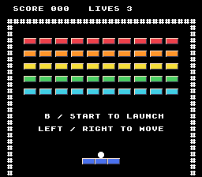
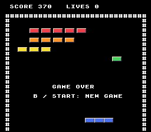

# Make a Breakout-style SNES game with PVSnesLib

## Who this tutorial is for

You know the basics of C: variables, functions, loops, arrays, pointers, and
perhaps structs. You know what a Super Nintendo is, but have never programmed
one. You do **not** need to know assembly, graphics registers, or cartridge
hardware.

We will make a small, complete game with:

- A paddle controlled with the D-pad.
- A ball that bounces off walls, bricks, and the paddle.
- Fifty colored bricks, ten points per brick, and three lives.
- A launch prompt, a game-over screen, a win screen, and restarting.

The first version deliberately has one level and no sound. It is an original
Breakout-style exercise, not a reproduction of Atari's program or artwork.



**Version:** this project targets **PVSnesLib 4.6.0**. Older tutorials sometimes
use different build steps. In particular, this version generates its ROM header
automatically.

The complete source accompanies this tutorial. Read the steps in order, then
open the linked files as each subsystem is introduced. The excerpts explain the
important pieces; the linked source files are the complete, buildable program.

## Quick start

Unpack the PVSnesLib 4.6.0 release for your operating system into
`vendor/pvsneslib` inside this repository (see step 1 below). No SDK environment
variable is required. Open the repository in your build terminal (MSYS2 UCRT64
on Windows), then run:

```sh
make
```

Open the generated `breakout.sfc` in your emulator. Use Left/Right to move and
B or Start to launch. The ROM and intermediate files are intentionally ignored
by Git; the repository contains the source needed to rebuild them.

SDK files are ignored by Git; SDK binaries are not checked into the repository.
A [setup README](vendor/pvsneslib/README.md) keeps the SDK directory visible in
fresh checkouts. If this is your first SNES project, start with step 1 below.

## Tutorial contents

1. [Install the tools](#1-install-the-tools-and-prove-that-they-work)
2. [Understand the graphics](#2-learn-just-enough-snes-graphics-to-make-this-game)
3. [Create the project](#3-create-the-project)
4. [Prepare the artwork](#4-prepare-the-artwork)
5. [Initialize the screen and sprites](#5-initialize-the-screen-and-sprites)
6. [Store the game data](#6-store-the-game-as-ordinary-c-data)
7. [Read the controller](#7-read-the-controller-and-move-the-paddle)
8. [Launch the ball](#8-attach-and-launch-the-ball)
9. [Build collisions](#9-build-collisions-from-rectangles)
10. [Create and remove bricks](#10-create-hit-and-remove-the-bricks)
11. [Bounce off the paddle](#11-bounce-off-the-top-of-the-paddle)
12. [Handle lives and restarting](#12-handle-lives-winning-and-restarting)
13. [Draw the HUD](#13-draw-the-hud-without-unnecessary-work)
14. [Build and play](#14-build-and-play-your-rom)
15. [Troubleshoot](#15-troubleshooting)
16. [Extend the game](#16-extend-one-thing-at-a-time)

See also [running the gameplay tests](#running-the-gameplay-tests),
[licensing](#licensing), and the [official references](#official-references).

---

## 1. Install the tools and prove that they work

PVSnesLib includes a C compiler, assembler, linker, graphics converter, and the
library we will call from C.

Follow the official [installation guide][installation] and download the
[4.6.0 release][release] for your operating system. You also need a SNES emulator;
[Mesen](https://www.mesen.ca/) is one option recommended by the installation
guide. Configure its first controller so you can press the D-pad, B, and Start.

### Windows setup

Use **MSYS2 UCRT64**, as the official guide recommends. This gives the build
system the shell utilities it expects. You can still edit the code in VS Code.

1. Install MSYS2 using the instructions linked from the PVSnesLib guide.
2. Update MSYS2, following any instructions to close and reopen its terminal.
3. Install GNU Make if it is not already installed:

   ```sh
   pacman -S make
   ```

4. Clone or download this repository if you have not already. Download the
    **Windows release archive**, not GitHub's source-code archive. Extract its
    `pvsneslib` folder into the repository's `vendor` directory, so that
    `vendor/pvsneslib` contains the three directories named `devkitsnes`,
    `pvsneslib`, and `snes-examples`.

Keep the project and SDK paths free of spaces. The Makefile finds the local SDK
automatically, so you do not need to set `PVSNESLIB_HOME` in your terminal.
Moving the whole project, including `vendor/pvsneslib`, keeps this setup working.

An SDK installed elsewhere is still supported. Pass its path when building:

```sh
make PVSNESLIB_HOME=/c/snesdev/pvsneslib
```

On macOS or Linux, download the matching release archive and use the same
`vendor/pvsneslib` layout. Follow the official guide for other prerequisites;
the game source and Makefile are the same.

### Build the library's Hello World first

Before touching our game, build the official example. From the repository root
in MSYS2 UCRT64:

```sh
make -C vendor/pvsneslib/snes-examples/hello_world \
    PVSNESLIB_HOME="$(pwd)/vendor/pvsneslib"
```

The official example has its own Makefile, so we pass its SDK path as a Make
argument rather than exporting an environment variable. Our game's Makefile
already supplies this path automatically.

Open the resulting Hello World ROM from the example directory in your emulator.

**Checkpoint:** you should see the example's text on the screen. If this does not
work, fix the installation before proceeding. Otherwise, an installation problem
can look like a problem in your game.

The official [Hello World walkthrough][hello] explains this first build.

---

## 2. Learn just enough SNES graphics to make this game

On a modern computer, you might draw a rectangle by coloring pixels in a screen
buffer. That is not the normal way to draw a SNES game.

For our purposes, think of the SNES as assembling the picture from small pieces:

| Term | Meaning in this project |
|---|---|
| **Tile** | An 8-by-8-pixel piece of artwork. |
| **Palette** | A table of colors. Artwork stores color numbers, not full RGB values. |
| **Background** | A grid of tiles. We use one for text and the border. |
| **Sprite** | A movable object made from tiles. The ball, paddle, and bricks use these. |
| **VRAM** | The SNES graphics memory, where we load tiles and background maps. |
| **OAM** | The hardware's table describing sprites: position, artwork, size, and palette. |
| **VBlank** | The pause between drawing one screen and the next, when graphics updates can be transferred safely. |

PVSnesLib hides most of the hardware details behind functions.

We use a **256-by-224-pixel** screen. Coordinates start at the top-left:

```text
(0, 0) ----------------------> X increases
|
|
v
Y increases
```

Thus, moving upward means subtracting from Y.

There are two coordinate systems to keep straight:

- Sprite positions are in **pixels**.
- The text console uses **8-by-8 character cells**.

For example, `consoleDrawText(2, 1, "HELLO")` starts at pixel position `(16, 8)`.

### Our drawing plan

- Background 0: score, lives, prompts, and a border made from `#` characters.
- One 8-by-8 sprite: the ball.
- Three 16-by-16 sprites: the paddle.
- Fifty 16-by-16 sprites: the bricks.

The paddle and brick artwork only fills the top eight pixels of its 16-by-16
sprite. The lower half is transparent. Their **collision rectangles** are
therefore 8 pixels high, not 16.

That gives us a 48-by-8 paddle and 16-by-8 bricks without requiring an unsupported
16-by-8 hardware sprite size.

---

## 3. Create the project

Clone or download this repository into a space-free location. The examples use
`C:\snesdev\mbh-pvsneslib-breakout-tutorial`; substitute your own checkout path
when running the commands.

The important files are:

```text
mbh-pvsneslib-breakout-tutorial\
    README.md
    Makefile
    THIRD_PARTY_NOTICES.txt
    sprites.png
    src\
        data.asm
        game.h
        game.c
        main.c
    tests\
        test_game.c
    tools\
        make_sprites.py
    vendor\
        pvsneslib\
    screenshots\
```

The `vendor/pvsneslib` directory contains a tracked setup README. Downloaded SDK
files stay local and are ignored by Git.

Their responsibilities are deliberately separated:

| File | Responsibility |
|---|---|
| [Makefile](Makefile) | Convert the artwork and build the ROM. |
| [sprites.png](sprites.png) | Our original, indexed-color sprite sheet. |
| [data.asm](src/data.asm) | Include the converted graphics in the cartridge. |
| [game.h](src/game.h) | Dimensions, game states, and the game-data struct. |
| [game.c](src/game.c) | Movement, collisions, scoring, and lives. |
| [main.c](src/main.c) | SNES setup, controller input, and drawing. |

Keeping the rules in ordinary C makes them easier to understand and test. Only
the presentation layer needs to know about PVSnesLib.

### The Makefile

Use the supplied [Makefile](Makefile):

```make
export PVSNESLIB_HOME ?= $(CURDIR)/vendor/pvsneslib

ifeq ($(wildcard $(PVSNESLIB_HOME)/devkitsnes/snes_rules),)
$(error PVSnesLib 4.6.0 not found at $(PVSNESLIB_HOME). Extract the SDK into vendor/pvsneslib or set PVSNESLIB_HOME)
endif

export ROMNAME := breakout
export ROMTITLE := BREAKOUT TUTORIAL

include $(PVSNESLIB_HOME)/devkitsnes/snes_rules

.PHONY: all clean

all: $(ROMNAME).sfc

sprites.pic: sprites.png
	$(GFXCONV) -s 8 -R -o 16 -u 16 -p -t png -i $<

src/data.obj: sprites.pic
src/main.obj src/game.obj: src/game.h

clean: cleanBuildRes cleanRom cleanGfx
```

**Makefile trap:** the command beginning with `$(GFXCONV)` must start with a real
**tab**, not spaces. Target lines such as `clean:` start at the left edge.

The supplied library rules find our C and assembly sources, compile them, and
link the result into the ROM. `ROMNAME` controls the output filename, while
`ROMTITLE` sets the cartridge title.

`PVSNESLIB_HOME` is now a Make variable with a project-local default. The `?=`
allows a command-line or existing environment setting to override it, while
`export` makes the resolved path available to SDK tools during the build.

**Do not create your own ROM header for this project.** PVSnesLib 4.6.0 generates
it from the Makefile settings. See the official [ROM-header guide][header].

---

## 4. Prepare the artwork

Use the supplied [sprite sheet](sprites.png) for the first build. No graphics
editor or Python installation is required.

It is a **128-by-16, 256-entry indexed PNG**. Only the first sixteen palette
entries matter to our sprites.

Across the top are:

```text
red | orange | yellow | green | cyan | paddle | ball | unused
```

Each section is 16 pixels wide. The lower eight rows are completely blank.
Palette index 0 means transparent when used by a sprite.

The graphics converter creates two binary files:

- Tile pixels in SNES format.
- Sixteen SNES colors, using two bytes per color.

The command in the Makefile means:

| Option | Purpose |
|---|---|
| `-s 8` | Process the image as 8-by-8 tiles. |
| `-R` | Keep tile positions instead of reducing duplicates. |
| `-o 16` | Output sixteen palette colors. |
| `-u 16` | Use sixteen colors: the SNES 4-bits-per-pixel format. |
| `-p` | Include palette output. |
| `-t png` | Read a PNG file. |

Do not enable tile deduplication for this sheet. Our code deliberately refers to
specific tile numbers.

### Why those tile numbers matter

There are sixteen 8-pixel tiles across a 128-pixel sheet:

```text
top row:       0  1  2  3  4  5  6  7  8  9 10 11 12 13 14 15
bottom row:   16 17 18 19 20 21 22 23 24 25 26 27 28 29 30 31
```

A 16-by-16 sprite starting at tile 0 uses tiles **0, 1, 16, and 17**.
The next brick color starts at tile 2, not tile 4.

Consequently:

| Artwork | Starting tile |
|---|---:|
| Red brick | 0 |
| Orange brick | 2 |
| Yellow brick | 4 |
| Green brick | 6 |
| Cyan brick | 8 |
| Paddle segment | 10 |
| Ball | 12 |

There are 32 tiles, each taking 32 bytes in this format: **1,024 bytes** total.
The palette is **32 bytes**.

The converter's official [option reference][gfx] describes these settings.
The optional [asset-generation script](tools/make_sprites.py) lets you regenerate
the original sheet using Python's standard library, but is not part of a normal
build.

### Include the graphics in the cartridge

Copy [data.asm](src/data.asm):

```asm
.include "hdr.asm"

.section ".breakout_assets" superfree

sprite_tiles:
.incbin "sprites.pic"

sprite_palette:
.incbin "sprites.pal"

.ends
```

You do not need to learn assembly to use this. The two labels give the binary
data names that our C code can reference.

The Makefile makes this assembly file's object depend on graphics conversion.
That is important: it prevents the assembler from trying to include artwork
before the converter has created it.

---

## 5. Initialize the screen and sprites

Open [main.c](src/main.c), starting with `init_video`.

The library's startup code initializes the console before entering `main`.
We first keep the screen blank while loading our graphics:

```c
setScreenOff();
consoleInitDefaultText(0);
bgSetGfxPtr(0, 0x3000);
bgSetMapPtr(0, 0x6800, SC_32x32);
oamInitGfxSet(sprite_tiles, 1024, sprite_palette, 32,
              0, 0x0000, OBJ_SIZE8_L16);
```

Here is what matters:

- `consoleInitDefaultText(0)` loads the built-in font.
- The next two calls position the text graphics and text map in VRAM.
- `oamInitGfxSet` loads our sprite tiles and palette.
- `OBJ_SIZE8_L16` selects a pair of hardware sprite sizes: 8-by-8 and 16-by-16.

The address constants are a small allocation plan, not magic drawing
coordinates:

| Data | VRAM word address |
|---|---:|
| Sprite graphics | `0x0000` |
| Text graphics | `0x3000` |
| Text map | `0x6800` |

These do not overlap. These PVSnesLib VRAM arguments use **word addresses**;
graphics upload lengths such as 1,024 are in **bytes**. Keep this plan unchanged
for the first version.

Next:

```c
setMode(BG_MODE1, 0);
bgSetDisable(1);
bgSetDisable(2);
oamClear(0, 0);
```

Mode 1 is a normal tiled-background mode. We leave background 0 available for
text, disable the other backgrounds used by this mode, and hide unused sprites.

The ball is defined like this:

```c
oamSet(0, game.ball_x, game.ball_y, 3, 0, 0, 12, 0);
oamSetEx(0, OBJ_SMALL, OBJ_SHOW);
```

The arguments to `oamSet` are:

```text
OAM offset, X, Y, priority, flip X, flip Y, starting tile, palette
```

Priority 3 puts our game sprites in front of ordinary background text.
`OBJ_SMALL` means 8-by-8 because of the size pair selected earlier.
For a paddle segment or brick, use `OBJ_LARGE`, meaning 16-by-16.

**Important PVSnesLib convention:** these functions take an OAM **byte offset**,
not just a sprite number. The first four sprite entries use offsets
**0, 4, 8, and 12**.

Our ball uses entry 0, the paddle uses entries 1 through 3, and the bricks use
entries 4 through 53.

Finally, call `setScreenOn()` after the first scene has been prepared.
The [sprite API documentation][sprites] is the reference for these functions.

---

## 6. Store the game as ordinary C data

Open [game.h](src/game.h).

The `Game` struct holds everything needed to describe a play session:

```c
typedef struct Game {
    int paddle_x;
    int ball_x;
    int ball_y;
    int vx;
    int vy;
    unsigned int score;
    int lives;
    int bricks_left;
    int state;
    unsigned char bricks[BRICK_COUNT];
} Game;
```

`vx` and `vy` are the ball's horizontal and vertical velocities.
A positive `vy` moves downward.

Each element of `bricks` is 1 when the brick exists and 0 after it is destroyed.
The constants define a ten-column, five-row wall.

The playfield extends from X 16 to X 240, excluding the right-hand edge.
The top wall ends at Y 32. The paddle sits at Y 200.

We also define four states:

```c
enum GameState {
    STATE_READY,
    STATE_PLAYING,
    STATE_GAME_OVER,
    STATE_WON
};
```

This is clearer than a collection of loosely related flags such as
`ball_is_moving`, `is_dead`, and `has_won`.

The game's `game_reset` function sets every field, restores all fifty bricks,
sets three lives and zero points, and enters `STATE_READY`.

Use signed values for positions and velocities. With unsigned values,
subtracting from zero can wrap around to a very large positive number.
All our values are small enough for the SNES compiler's 16-bit `int`.

---

## 7. Read the controller and move the paddle

The main loop in [main.c](src/main.c) does three things:

1. Wait for the next frame.
2. Read input and update the game.
3. Prepare the next picture.

Its essential structure is:

```c
while (1) {
    WaitForVBlank();
    held = padsCurrent(0);
    pressed = padsDown(0);
    movement = 0;
    if (held & KEY_LEFT)
        --movement;
    if (held & KEY_RIGHT)
        ++movement;
    game_tick(&game, movement, pressed & (KEY_B | KEY_START));
    draw_game();
}
```

Controller 0 is the first player.

- `padsCurrent(0)` reports buttons currently held down. Use it for movement.
- `padsDown(0)` reports buttons newly pressed this frame. Use it for launching
  and restarting.
- The bitwise `&` tests a button flag.
- Pressing Left and Right together produces movement 0.

Inside `game_tick`, movement becomes:

```c
game->paddle_x += movement * PADDLE_SPEED;
if (game->paddle_x < FIELD_LEFT)
    game->paddle_x = FIELD_LEFT;
if (game->paddle_x + PADDLE_WIDTH > FIELD_RIGHT)
    game->paddle_x = FIELD_RIGHT - PADDLE_WIDTH;
```

Clamping the paddle prevents it from leaving the playfield.

### What VBlank is doing for us

PVSnesLib keeps sprite descriptions in a RAM buffer and transfers completed
sprite data to hardware during its VBlank handling. The default console handling
also transfers dirty text data. Our drawing functions prepare those buffers;
they are not painting pixels directly onto the display.

Do not add an `oamUpdate()` call in the middle of the loop. Do not replace the
frame wait with an arbitrary delay.

Controller input is also refreshed by the library's VBlank handling. A loop
waiting for input must continue calling `WaitForVBlank`; otherwise, it can keep
checking input that never changes.

See the official [input][input] and [interrupt][interrupts] documentation.

**Checkpoint:** before concentrating on ball physics, run the complete project
and leave the ball unlaunched. Move the paddle from wall to wall. The ball should
stay attached to its center.

---

## 8. Attach and launch the ball

In `STATE_READY`, [game.c](src/game.c) positions the ball just above the paddle:

```c
game->ball_x = game->paddle_x + (PADDLE_WIDTH - BALL_SIZE) / 2;
game->ball_y = PADDLE_Y - BALL_SIZE;
game->vx = 1;
game->vy = -3;
```

This centers an 8-pixel ball on a 48-pixel paddle.

A new B or Start press changes the state to `STATE_PLAYING`.
On following updates the ball travels right and upward.

There is no floating-point math, allocation, or variable time step.
One call to `game_tick` represents one game update.

This introductory version is tuned for a 60 Hz NTSC system. On a 50 Hz PAL
system, the same per-update speeds make it slower in real time. Frame-rate
compensation is a useful later exercise, not something hidden by the library.

---

## 9. Build collisions from rectangles

Think of every object as an invisible rectangle around its visible artwork.

For a ball at `(x, y)` and a brick at `(brick_x, brick_y)`, overlap means:

```c
x + BALL_SIZE > brick_x &&
x < brick_x + BRICK_WIDTH &&
y + BALL_SIZE > brick_y &&
y < brick_y + BRICK_HEIGHT
```

All four conditions must be true.

The strict inequalities are deliberate: rectangles that merely touch at an edge
are not yet overlapping.

### Do not just move, overlap, and reverse forever

A common beginner bug is:

1. Move the ball into a brick.
2. Reverse its direction.
3. Leave it inside the brick.
4. Reverse it again next frame.

Our solution is to test a **candidate position**. If it would hit something,
reverse that axis and keep the previous position.

We also move **one pixel at a time**, with at most three substeps:

```c
for (step = 0; step < BALL_SUBSTEPS; ++step) {
    if (step < magnitude(game->vx))
        move_ball_x(game);
    /* Check whether the level ended here. */
    if (step < magnitude(game->vy))
        move_ball_y(game);
    /* Check whether the level ended or a life was lost here. */
}
```

This excerpt omits the state checks for readability; use the complete
`game_tick` implementation in [game.c](src/game.c).

Handling X and Y separately tells us which velocity component to reverse.
Checking every pixel prevents the ball from jumping through a thin brick.
The order is deterministic at corners: horizontal movement is handled first.
This is simple arcade physics, not a continuous circle-versus-polygon solver.

**Keep every velocity component within `BALL_SUBSTEPS`.** In this project, that
means a maximum magnitude of 3. If you increase speeds later, update the
substep limit and retest collisions and frame timing.

The left, right, and top walls follow the same rule: reject an out-of-bounds
candidate position and reverse the corresponding velocity.

---

## 10. Create, hit, and remove the bricks

The grid constants in [game.h](src/game.h) are:

```c
#define BRICK_COLS 10
#define BRICK_ROWS 5
#define BRICK_X 30
#define BRICK_Y 48
#define BRICK_WIDTH 16
#define BRICK_HEIGHT 8
#define BRICK_PITCH_X 20
#define BRICK_PITCH_Y 16
```

The **pitch** is the distance between neighboring starting positions, including
the gap.

For a row and column:

```c
index = row * BRICK_COLS + col;
brick_x = BRICK_X + col * BRICK_PITCH_X;
brick_y = BRICK_Y + row * BRICK_PITCH_Y;
```

When a candidate ball position overlaps a live brick:

```c
game->bricks[index] = 0;
game->score += 10;
--game->bricks_left;
if (game->bricks_left == 0)
    game->state = STATE_WON;
```

The movement function then reverses the appropriate velocity component.
Destroyed bricks are skipped by future collision checks.

The implementation rejects rows outside the ball's vertical range before
examining individual bricks. This avoids doing all fifty rectangle checks for
every tiny movement when the ball is nowhere near the wall.

### Make the picture match the data

`draw_bricks` in [main.c](src/main.c) remembers which bricks it last displayed.
When a brick changes from alive to destroyed, it hides that sprite:

```c
oamSetVisible((index + 4) * 4, OBJ_HIDE);
```

When bricks are restored for a new game, it defines their positions and artwork
again. This matters because PVSnesLib's hide operation moves a sprite offscreen;
showing it later also requires restoring its coordinates.

The renderer's cache is explicitly initialized. Do not rely on the contents of
uninitialized hardware RAM happening to match what an emulator provided.

### Stay within the SNES sprite limits

The SNES supports 128 sprite entries, but it also has per-scanline limits:
32 sprites and 34 eight-pixel sprite tile slivers.

Our scene uses 54 entries in total. On a brick row there are at most ten
16-pixel-wide bricks plus the ball: eleven sprites and 21 slivers.

The 16-pixel row pitch is important. A brick's transparent lower half still
belongs to its 16-by-16 hardware sprite. Transparent pixels do not exempt it
from the hardware's scanline budgeting.

For a bigger wall, backgrounds would usually be a better representation.
Sprites make this small first game easier to follow.

**Checkpoint:** launch the ball. A brick should disappear when hit, the score
should increase by ten, and that brick should not score again.

---

## 11. Bounce off the top of the paddle

The paddle collision has extra conditions:

- The ball must be traveling downward.
- Its bottom was at or above the paddle's top.
- Its new bottom would cross that top.
- Its horizontal range must overlap the paddle.

These checks prevent a ball that already missed the paddle from being caught
from underneath.

On contact, place the ball above the paddle:

```c
game->ball_y = PADDLE_Y - BALL_SIZE;
```

Then divide the paddle into three zones:

| Hit zone | New horizontal velocity | New vertical velocity |
|---|---:|---:|
| Left third | -2 | -2 |
| Middle third | -1 or +1, preserving horizontal direction | -3 |
| Right third | +2 | -2 |

The calculation uses the ball's center relative to the paddle:

```c
hit_position = game->ball_x + BALL_SIZE / 2 - game->paddle_x;
```

This gives the player control over the next shot without introducing
trigonometry. It intentionally approximates angles rather than keeping exactly
the same mathematical speed for every rebound.

**Checkpoint:** move the paddle so the ball lands near either end. Its outgoing
direction should change accordingly.

---

## 12. Handle lives, winning, and restarting

If the ball's top reaches Y 224, it has left the bottom of the visible screen.
There is deliberately no bottom wall.

The logic is:

```text
READY --new B/Start press--> PLAYING

PLAYING --miss, lives remain--> READY
PLAYING --miss, no lives remain--> GAME_OVER
PLAYING --last brick destroyed--> WON

GAME_OVER or WON --new B/Start press--> READY, with a fresh game
```

Losing a life:

- Decreases the life count once.
- Preserves the score and remaining bricks.
- Reattaches the ball if lives remain.

Starting a new game:

- Restores three lives.
- Resets the score to zero.
- Restores all fifty bricks.
- Waits for a separate launch press.

The update function returns as soon as the game leaves `STATE_PLAYING`.
That prevents later substeps from continuing to move the ball or modify the
score after the last brick or last life.



---

## 13. Draw the HUD without unnecessary work

The text console provides the score, lives, and prompts; no custom font is
required.

`draw_text` in [main.c](src/main.c) remembers the last score, life count, and
state. It only changes text when the corresponding value changes.

For the three-digit score, it creates a short string:

```c
score_text[0] = '0' + game.score / 100;
score_text[1] = '0' + (game.score / 10) % 10;
score_text[2] = '0' + game.score % 10;
consoleDrawText(8, 1, score_text);
```

`score_text` starts as `"000"`, so it already has room for the terminating zero
byte. The maximum score in our single level is 500.

This also avoids doing full printf-style integer formatting in the game loop.
That operation was expensive enough to cause a one-frame hitch on brick hits in
an earlier version of this example.

State messages are cleared with spaces before a new message is written. Without
that step, a shorter message can leave characters from the old one on screen.

Keep text output out of the innermost collision loops. A debugging print on
every pixel movement can become the reason the game runs slowly.

---

## 14. Build and play your ROM

Open an MSYS2 UCRT64 terminal in the repository root, then run:

```sh
make clean
make
```

Open the generated `breakout.sfc` in the emulator. This project produces a
256 KiB LoROM with an NTSC-region header. The ROM is a local build output, not a
file checked into the repository.

### Controls

| Button | Action |
|---|---|
| Left / Right | Move the paddle. |
| B or Start, while waiting | Launch the ball. |
| B or Start, after a win or game over | Start a new game. |

There is no pause button in this first version. Silence is expected: we have not
added a sound driver or sound effects.

### Test in this order

1. **Before launching:** move from wall to wall. The paddle stops at the edges
   and the ball follows it.
2. **Launch:** release and press B. The ball leaves the paddle.
3. **Walls:** watch left, right, and top rebounds.
4. **Brick:** check that one destroyed brick adds ten points.
5. **Paddle:** try left-, middle-, and right-third rebounds.
6. **Miss:** deliberately move away. Exactly one life is lost.
7. **Continue:** relaunch. Earlier damage to the wall remains.
8. **Game over:** lose the last life. Movement stops until a new-game press.
9. **Restart:** verify three lives, zero score, and all fifty bricks.
10. **Win:** remove the wall. The final score is 500, and a new game is possible.

The optional [C gameplay tests](tests/test_game.c) exercise the rules without
requiring SNES graphics. They cover reset/launch, paddle limits, walls, brick
faces and corners, rebound zones, lives, scoring, winning, and restarting.

**Validation of the supplied example:** it was built with the Windows PVSnesLib
4.6.0 toolchain, passed eight native C gameplay test groups, and was exercised
as a compiled ROM in SNES9x. Emulator checks covered controller input, launching,
actual brick hits, and controlled test states for winning, game over, and both
restart paths. The converted artwork was also checked pixel-for-pixel against
the PNG.

Emulator testing is valuable but is not proof of behavior on a physical console.
Before publishing a game, test multiple accurate emulators and real hardware
when available.

---

## 15. Troubleshooting

| Symptom | Check |
|---|---|
| `PVSnesLib 4.6.0 not found` | Extract the release into `vendor/pvsneslib`. That directory must contain `devkitsnes`, `pvsneslib`, and `snes-examples`, not another outer SDK folder. An explicit `PVSNESLIB_HOME` override must also point at this outer SDK directory. |
| Build cannot find shell utilities | On Windows, use the documented MSYS2 UCRT64 environment and install GNU Make. |
| `missing separator` from Make | The graphics conversion recipe needs a tab, not spaces. |
| A Windows library path looks malformed during linking | Keep the project and SDK paths free of spaces. The local default uses a drive-based MSYS path; explicit Windows overrides should use the same form, such as `/c/snesdev/pvsneslib`. |
| You see old behavior | Rebuild and confirm that the emulator opened the new ROM, not an older copy elsewhere. |
| The controller does nothing | Configure the emulator's first controller, give its window focus, and verify the frame loop still calls `WaitForVBlank`. |
| Artwork is scrambled | Keep the sheet indexed, preserve tile order, and use the supplied converter options. |
| A sprite has an unexpected lower half | Tiles 16 through 31 must remain transparent. |
| A shown-again brick stays offscreen | Restore its coordinates as well as its visibility. |
| Parts of a larger wall disappear | Check per-scanline sprite limits, including transparent parts of hardware sprites. |
| Text or sprites become corrupt after moving graphics | Recheck the VRAM allocation plan for overlap. |
| The game runs slower on PAL | This version uses frame-based NTSC-tuned speeds; PAL compensation is not implemented. |

If you change the sprite sheet's dimensions or palette size, update the upload
sizes in [main.c](src/main.c) too. Do not keep uploading a hard-coded 1,024 bytes
from a differently sized asset.

---

## 16. Extend one thing at a time

Once this version is working, useful next steps are:

1. **Multiple levels:** replace the all-alive initialization with level arrays.
2. **Pause:** add a paused state and decide how Start interacts with launching
   and restarting.
3. **Better artwork:** preserve the palette and tile layout first, then learn
   a more flexible asset pipeline.
4. **Sound effects:** work through the library's sound examples and SPC700
   facilities. Sound is a separate subsystem, not a call to a PC speaker.
5. **Background-based bricks:** use a background tilemap for the wall, freeing
   sprite entries for power-ups and effects.
6. **PAL timing:** compensate for display frequency and retest collision speed
   limits and frame budgets.

Make one change, rebuild, and rerun the relevant checkpoints before moving on.

---

## Running the gameplay tests

The rules in [game.c](src/game.c) can be tested without the SNES toolchain or an
emulator. Run the following commands from the repository root.

### Linux or macOS

Use a C compiler available as `cc`:

```sh
mkdir -p build
cc -std=c89 -pedantic -Wall -Wextra -Werror -Isrc \
  tests/test_game.c src/game.c -o build/test_game
./build/test_game
```

### Windows

Open an **x64 Native Tools Command Prompt for Visual Studio**, then change into
the repository directory and run:

```bat
if not exist build mkdir build
cl /nologo /W4 /WX /Isrc /Fobuild\ /Febuild\test_game.exe tests\test_game.c src\game.c
build\test_game.exe
```

The expected output is:

```text
PASS: 8 gameplay test groups
```

Test binaries go into the Git-ignored build directory. The
[GitHub Actions workflow](.github/workflows/test.yml) runs these gameplay tests
on pushes and pull requests. It does not build the SNES ROM or replace emulator
and hardware testing.

## Licensing

[THIRD_PARTY_NOTICES.txt](THIRD_PARTY_NOTICES.txt) preserves the PVSnesLib notice
for the library and built-in font linked into the ROM. It is not a license for
the original tutorial, game source, or artwork. No project-wide license has been
selected for those files.

---

## Official references

The installation, build conventions, and library calls in this tutorial are
based on these primary sources. The game rules and artwork are original to
this example.

- [PVSnesLib 4.6.0 release][release]
- [Installation guide][installation]
- [Compiling the Hello World example][hello]
- [SNES ROM header configuration][header]
- [Sprite and OAM API][sprites]
- [Background API][backgrounds]
- [Text console API][text]
- [Controller input API][input]
- [VBlank and interrupt behavior][interrupts]
- [gfx4snes options, pinned to 4.6.0][gfx]
- [Official SimpleSprite example, pinned to 4.6.0][sprite-example]

The project includes [third-party notices](THIRD_PARTY_NOTICES.txt) for the
PVSnesLib code linked into the ROM.

[release]: https://github.com/alekmaul/pvsneslib/releases/tag/4.6.0
[installation]: https://github.com/alekmaul/pvsneslib/wiki/Installation
[hello]: https://github.com/alekmaul/pvsneslib/wiki/Compiling-helloworld-example
[header]: https://github.com/alekmaul/pvsneslib/wiki/SNES-ROM-Header
[sprites]: https://alekmaul.github.io/pvsneslib/sprite_8h.html
[backgrounds]: https://alekmaul.github.io/pvsneslib/background_8h.html
[text]: https://alekmaul.github.io/pvsneslib/textfont_8h.html
[input]: https://alekmaul.github.io/pvsneslib/input_8h.html
[interrupts]: https://alekmaul.github.io/pvsneslib/interrupt_8h.html
[gfx]: https://github.com/alekmaul/pvsneslib/blob/4.6.0/tools/gfx4snes/readme.md
[sprite-example]: https://github.com/alekmaul/pvsneslib/tree/4.6.0/snes-examples/graphics/Sprites/SimpleSprite
