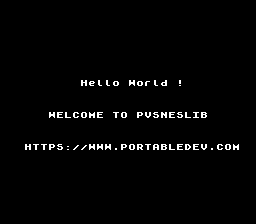
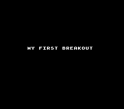
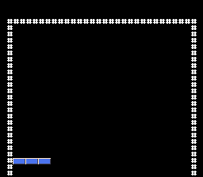
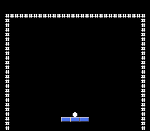
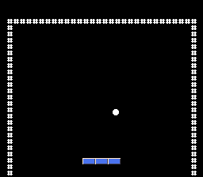
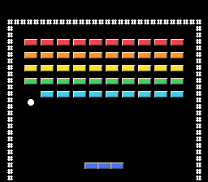
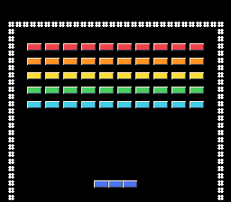
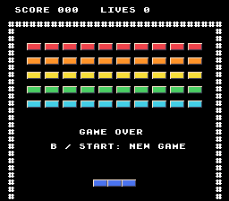

# SNES Breakout Tutorial

Build a complete SNES game in C with PVSnesLib. Here's the finished game after
Part 4:

<video class="final-game-preview" controls muted loop playsinline preload="metadata" width="512" poster="screenshots/part4-playing.png" src="videos/part4-preview.mp4">Your browser does not support video playback. <a href="videos/part4-preview.mp4">Download the preview video</a>.</video>

Along the way, you'll use:

- **Graphics:** tile-map backgrounds, animated sprites and metasprites.
- **Effects:** scrolling, fades, mosaic, and HDMA color gradients.
- **Hardware:** SPC700 music and sound effects, SRAM saves, and SNES Mouse input.

<div class="rom-download-panel" data-part="4">
  <p class="rom-download-heading"><strong>Try the finished game!</strong></p>
  <a class="rom-download-button" href="part4/breakout.sfc" download>Download the finished Part 4 ROM</a>
</div>

[Read on the tutorial site](https://mhughson.github.io/mbh-pvsneslib-breakout-tutorial/)
· **Part 1: The Core Mechanics** · [Part 2](README-part2.md) · [Part 3](README-part3.md) · [Part 4](README-part4.md)

## Part 1: The Core Mechanics

<div class="rom-download-panel" data-part="1">
  <p class="rom-download-heading"><strong>Play the game you're about to build!</strong></p>
  <a class="rom-download-button" href="breakout.sfc" download>Download the Part 1 ROM</a>
  <p class="rom-download-note">Launch the completed game in a SNES emulator, then build your own from scratch.</p>
</div>

You should know basic C: variables, functions, loops, arrays, pointers, and
structs. You do not need assembly or prior SNES programming experience.

By the end of Part 1 you will have a paddle, a bouncing ball, fifty colored bricks,
scoring, three lives, and win/game-over screens with restarting. This first
version has one level and no sound. It is an original Breakout-style exercise.


## Contents

1. [Install PVSnesLib and run Hello World](#1-install-pvsneslib-and-run-hello-world)
2. [Draw a paddle and move it](#2-draw-a-paddle-and-move-it)
3. [Attach a ball and launch it](#3-attach-a-ball-and-launch-it)
4. [Move the ball and bounce off walls](#4-move-the-ball-and-bounce-off-walls)
5. [Bounce off the paddle](#5-bounce-off-the-paddle)
6. [Add a wall of destructible bricks](#6-add-a-wall-of-destructible-bricks)
7. [Add lives, winning, and restarting](#7-add-lives-winning-and-restarting)
8. [Draw the score, lives, and prompts](#8-draw-the-score-lives-and-prompts)

See also [troubleshooting](#troubleshooting) and
[official references](#official-references).

---

## 1. Install PVSnesLib and run Hello World

<!-- tutorial-setup: sdk-hello-world -->

Follow the official [PVSnesLib installation guide][installation] for your
operating system. This tutorial uses [PVSnesLib 4.6.0][release].

Before continuing, compile the SDK's `snes-examples\hello_world` example and
run it in a SNES emulator.

**Checkpoint:** Hello World compiles and displays its message in the emulator.
You're ready for step 2.



---

## 2. Draw a paddle and move it

### Create your project inside the installation

Create an empty `breakout` folder inside your SDK's `snes-examples` folder.
For an SDK installed at `C:\snesdev\pvsneslib`, the full project path is
`C:\snesdev\pvsneslib\snes-examples\breakout`.

Create a `src` folder inside it:
`C:\snesdev\pvsneslib\snes-examples\breakout\src`.
Use your own SDK location if it differs from this example. Open the `breakout`
folder in your editor and run the build commands from there.

---

### Open `Makefile`

Create `Makefile` in that directory. Its name is exactly `Makefile`, with no
extension (some editors, such as Notepad, quietly add `.txt`):

**Goal:** Configure a ROM build that uses the surrounding SDK installation.

<!-- tutorial-edit: {"file":"Makefile","op":"write"} -->
**`Makefile` — create or replace the entire file:**

```make
export PVSNESLIB_HOME ?= $(abspath $(CURDIR)/../..)

ifeq ($(wildcard $(PVSNESLIB_HOME)/devkitsnes/snes_rules),)
$(error PVSnesLib not found at $(PVSNESLIB_HOME). Place this project in snes-examples/breakout or set PVSNESLIB_HOME)
endif

export ROMNAME := breakout
export ROMTITLE := BREAKOUT TUTORIAL

include $(PVSNESLIB_HOME)/devkitsnes/snes_rules

.PHONY: all clean

all: $(ROMNAME).sfc

clean: cleanBuildRes cleanRom cleanGfx
```

The Makefile is your game's build script. It defines what gets built and how
PVSnesLib turns your code and artwork into `breakout.sfc`.

---

### Open `src\main.c`

Create `src\main.c` with this entire program:

**Goal:** Display a text message before adding gameplay or graphics assets.

<!-- tutorial-edit: {"file":"src/main.c","op":"write"} -->
**`src\main.c` — create or replace the entire file:**

```c
#include <snes.h>

int main(void)
{
    setScreenOff();
    consoleInitDefaultText(0);
    bgSetGfxPtr(0, 0x3000);
    bgSetMapPtr(0, 0x6800, SC_32x32);
    setMode(BG_MODE1, 0);
    bgSetDisable(1);
    bgSetDisable(2);
    consoleDrawText(7, 12, "MY FIRST BREAKOUT");
    setScreenOn();

    while (1)
    {
        WaitForVBlank();
    }
    return 0;
}
```

The program initializes the font and text map while the screen is off, selects
Mode 1, and writes the message into the console buffer. `WaitForVBlank` lets
the library transfer that buffer each frame.

Build:

```sh
make
```

The output is long, and the linker prints harmless messages such as
`Label "SECTIONSTART_.rodata" was defined more than once` and
`DISCARD: ... was discarded`. The build worked if the output ends with
`Build finished successfully !` and `breakout.sfc` now exists. A real failure
stops with an error message and never prints that line.

Open **your new project's** `breakout.sfc` in the emulator.

### SNES Terminology

The SNES assembles its picture from tiles, rather than drawing arbitrary
rectangles into a modern framebuffer:

| Term | What we will use it for |
|---|---|
| Tile | An 8-by-8 piece of artwork. |
| Palette | Colors selected by the artwork's color indices. |
| Background | A tile grid; ours holds text and a border. |
| Sprite | A movable object: paddle, ball, or brick. |
| VRAM | Graphics memory holding tiles and background maps. |
| OAM | The table of sprite positions, sizes, and artwork. |
| VBlank | The pause between frames when the library transfers graphics updates. |

Our screen is 256 by 224 pixels. X increases rightward; Y increases downward.
Sprites use pixel coordinates, but console text uses 8-by-8 character cells.
`consoleDrawText(2, 1, "HELLO")` starts at pixel `(16, 8)`.

**Checkpoint:** Build and open `breakout.sfc`. The screen displays
`MY FIRST BREAKOUT`, confirming that the compiler, ROM build, and text layer work.



### Adding graphics

Copy [sprites.png](sprites.png) from your repository copy into your new project's
root, beside `Makefile`.


The original sheet is a 128-by-16 indexed PNG. Across the top are five brick
colors, a paddle segment, and a ball. The lower eight rows are transparent.

---

### Open `Makefile`

Add the conversion rule to **your** `Makefile`, between `all` and `clean`:

**Goal:** Convert the indexed sprite artwork before assembling its ROM data.

<!-- tutorial-edit: {"file":"Makefile","op":"diff-region","context":3} -->
**`Makefile` — in the file, apply these changes:**

```make

all: $(ROMNAME).sfc

sprites.pic: sprites.png # [!code ++]
	$(GFXCONV) -s 8 -R -o 16 -u 16 -p -t png -i $< # [!code ++]
 # [!code ++]
src/data.obj: sprites.pic # [!code ++]
 # [!code ++]
clean: cleanBuildRes cleanRom cleanGfx
```

The new `$(GFXCONV)` command must start with a real **tab**, not spaces.

The converter will generate two files for you: `sprites.pic`, containing the
tile graphics, and `sprites.pal`, containing their colors. It also writes `sprites.inc` and `sprites_data.as`,
which this tutorial does not use. `-R` preserves tile order, `-u 16` selects
4-bit pixels, `-o 16` outputs sixteen colors, and `-p` requests a palette.

---

### Open `src\data.asm`

Create `src\data.asm`:

**Goal:** Include the converted sprite tiles and palette in the ROM.

<!-- tutorial-edit: {"file":"src/data.asm","op":"write"} -->
**`src\data.asm` — create or replace the entire file:**

```asm
.include "hdr.asm"

.section ".breakout_assets" superfree

sprite_tiles:
.incbin "sprites.pic"

sprite_palette:
.incbin "sprites.pal"

.ends
```

These labels let C refer to the binary graphics.

### Keep gameplay separate from SNES drawing

Gameplay files track what the game does; `main.c` handles SNES input and
drawing. Put rules and state changes in `game.c`, and their shared types and
function declarations in `game.h`. If a function needs PVSnesLib hardware
calls, it belongs in `main.c`.

---

### Open `src\game.h`

Create `src\game.h`. For now, the game contains **only a paddle position**:

**Goal:** Define a hardware-independent interface for paddle movement.

<!-- tutorial-edit: {"file":"src/game.h","op":"write"} -->
**`src\game.h` — create or replace the entire file:**

```c
#ifndef BREAKOUT_GAME_H
#define BREAKOUT_GAME_H

#define FIELD_LEFT  16
#define FIELD_RIGHT 240

#define PADDLE_WIDTH  48
#define PADDLE_HEIGHT 8
#define PADDLE_Y      200
#define PADDLE_SPEED  3

typedef struct Game
{
    int paddle_x;
} Game;

void game_reset(Game *game);
void game_tick(Game *game, int movement, int action_pressed);

#endif
```

`Game` is the shared state connecting gameplay to drawing: `game.c` updates
its fields, and `main.c` reads them to decide what to draw. For now it stores
only the paddle's horizontal position; later we'll add the ball, bricks, and
score. Constants define the paddle's size, speed, and bounds; resetting and
ticking are separate operations.

---

### Open `src\game.c`

Create `src\game.c`:

**Goal:** Move the paddle without allowing either end to cross a wall.

<!-- tutorial-edit: {"file":"src/game.c","op":"write"} -->
**`src\game.c` — create or replace the entire file:**

```c
#include "game.h"

void game_reset(Game *game)
{
    game->paddle_x = (FIELD_LEFT + FIELD_RIGHT - PADDLE_WIDTH) / 2;
}

void game_tick(Game *game, int movement, int action_pressed)
{
    (void)action_pressed; /* Silence the unused-parameter warning for now. */
    game->paddle_x += movement * PADDLE_SPEED;
    if (game->paddle_x < FIELD_LEFT)
    {
        game->paddle_x = FIELD_LEFT;
    }
    if (game->paddle_x + PADDLE_WIDTH > FIELD_RIGHT)
    {
        game->paddle_x = FIELD_RIGHT - PADDLE_WIDTH;
    }
}
```

`movement` will be -1, 0, or 1. The unused action parameter is reserved for
launching in the next step. Signed positions allow subtraction without unsigned
wraparound; our values fit the SNES compiler's 16-bit `int`.

---

### Open `Makefile`

Add the header dependency to your `Makefile`:

**Goal:** Rebuild both C files when their shared gameplay header changes.

<!-- tutorial-edit: {"file":"Makefile","op":"diff-region","context":3} -->
**`Makefile` — in the file, apply these changes:**

```make
	$(GFXCONV) -s 8 -R -o 16 -u 16 -p -t png -i $<

src/data.obj: sprites.pic
src/main.obj src/game.obj: src/game.h # [!code ++]

clean: cleanBuildRes cleanRom cleanGfx
```

This dependency makes both object files rebuild when `src\game.h` changes.

---

### Open `src\main.c`

Now replace the text-only `src\main.c` with this complete paddle version:

**Goal:** Draw the three-piece paddle and translate controller input into gameplay.

<!-- tutorial-edit: {"file":"src/main.c","op":"write"} -->
**`src\main.c` — create or replace the entire file:**

```c
#include <snes.h>
#include "game.h"

extern u8 sprite_tiles[];
extern u8 sprite_palette[];

Game game;

static void draw_game(void)
{
    int i;

    for (i = 0; i < 3; ++i)
    {
        oamSetXY((i + 1) * 4, game.paddle_x + i * 16, PADDLE_Y);
    }
}

static void init_video(void)
{
    int row;
    int i;

    setScreenOff();
    consoleInitDefaultText(0);
    bgSetGfxPtr(0, 0x3000);
    bgSetMapPtr(0, 0x6800, SC_32x32);
    oamInitGfxSet(sprite_tiles, 1024, sprite_palette, 32, 0, 0x0000,
                  OBJ_SIZE8_L16);

    setMode(BG_MODE1, 0);
    bgSetDisable(1);
    bgSetDisable(2);
    oamClear(0, 0);
    for (i = 0; i < 3; ++i)
    {
        oamSet((i + 1) * 4, game.paddle_x + i * 16, PADDLE_Y, 3, 0, 0, 10, 0);
        oamSetEx((i + 1) * 4, OBJ_LARGE, OBJ_SHOW);
    }

    consoleDrawText(1, 3, "##############################");
    for (row = 4; row < 28; ++row)
    {
        consoleDrawText(1, row, "#");
        consoleDrawText(30, row, "#");
    }
    draw_game();
    setScreenOn();
}

int main(void)
{
    u16 held;
    u16 pressed;
    int movement;

    game_reset(&game);
    init_video();

    while (1)
    {
        WaitForVBlank();
        held = padsCurrent(0);
        pressed = padsDown(0);
        movement = 0;
        if (held & KEY_LEFT)
        {
            --movement;
        }
        if (held & KEY_RIGHT)
        {
            ++movement;
        }
        game_tick(&game, movement, pressed & (KEY_B | KEY_START));
        draw_game();
    }
    return 0;
}
```

The paddle is three 16-by-16 sprites. Only their top eight pixels are visible,
so its collision rectangle will be 48 by 8. The SNES does not offer a 16-by-8
hardware sprite size.

`oamSet` takes an OAM **byte offset**, X, Y, priority, flip X, flip Y, tile
number, and palette. Entries 1, 2, and 3 use offsets 4, 8, and 12. Entry 0 is
reserved for our future ball. `OBJ_SIZE8_L16` selects 8-by-8 small sprites and
16-by-16 large sprites.

There are sixteen tiles per row in this sheet. A large sprite starting at tile
10 uses tiles 10, 11, 26, and 27. The transparent bottom row keeps the paddle
eight pixels tall.

Our VRAM plan uses word addresses: sprite tiles at `0x0000`, font at `0x3000`,
and text map at `0x6800`. Upload lengths, such as 1,024, are in **bytes**.
Keep these non-overlapping allocations unchanged for now.

`padsCurrent(0)` reads held buttons; `padsDown(0)` reads newly pressed buttons.
Left and Right together cancel out. `WaitForVBlank()` keeps input refreshing
and lets the library transfer its sprite/text buffers. Do not add an
`oamUpdate()` call or replace the frame wait with a delay.

```sh
make
```

**Checkpoint:** only a border and paddle appear. Left/Right moves the paddle,
and it stops at both walls. There is still no ball and nothing to launch. If the
paddle does not move, map controller 1 (the D-pad, B, and Start) in your
emulator's input settings and click its window so that it receives the input.




---

## 3. Attach a ball and launch it

We will first implement the ball's **state**, without motion. That gives us a
small testable change before physics.

---

### Open `src\game.h`

Edit `src\game.h`:

**Goal:** Give the ball an 8-by-8 collision rectangle.

<!-- tutorial-edit: {"file":"src/game.h","op":"diff-region","context":3} -->
**`src\game.h` — in the file, apply these changes:**

```c
#define FIELD_LEFT  16
#define FIELD_RIGHT 240

#define BALL_SIZE     8 // [!code ++]
#define PADDLE_WIDTH  48
#define PADDLE_HEIGHT 8
#define PADDLE_Y      200
```

`BALL_SIZE` will be shared by positioning, rendering, and collision checks.

**Goal:** Define names for the ready and playing game states.

<!-- tutorial-edit: {"file":"src/game.h","op":"diff-region","context":3} -->
**`src\game.h` — in the file, apply these changes:**

```c
#define PADDLE_Y      200
#define PADDLE_SPEED  3

enum GameState // [!code ++]
{ // [!code ++]
    STATE_READY, // [!code ++]
    STATE_PLAYING // [!code ++]
}; // [!code ++]
 // [!code ++]
typedef struct Game
{
    int paddle_x;
```

The enum names the two states; motion will later run only in `STATE_PLAYING`.

**Goal:** Store the ball's position, velocity, and launch state.

<!-- tutorial-edit: {"file":"src/game.h","op":"diff-region","context":3} -->
**`src\game.h` — in the file, apply these changes:**

```c
typedef struct Game
{
    int paddle_x;
    int ball_x; // [!code ++]
    int ball_y; // [!code ++]
    int vx; // [!code ++]
    int vy; // [!code ++]
    int state; // [!code ++]
} Game;

void game_reset(Game *game);
```

The coordinates locate the ball, velocities describe its movement, and `state`
determines whether it remains attached.

---

### Open `src\game.c`

Add `attach_ball` immediately after the include in `src\game.c`, then update
the two existing functions:

**Goal:** Center the ball above the paddle and prepare its launch velocity.

<!-- tutorial-edit: {"file":"src/game.c","op":"add-function","name":"attach_ball","before":"game_reset"} -->
**`src\game.c` — add this complete `attach_ball` function immediately before `game_reset`:**

```c
static void attach_ball(Game *game) // [!code ++]
{ // [!code ++]
    game->ball_x = game->paddle_x + (PADDLE_WIDTH - BALL_SIZE) / 2; // [!code ++]
    game->ball_y = PADDLE_Y - BALL_SIZE; // [!code ++]
    game->vx = 1; // [!code ++]
    game->vy = -3; // [!code ++]
} // [!code ++]
```

The helper derives both coordinates from the paddle rather than storing a
separate attachment offset.

**Goal:** Start each game with the ball attached and waiting to launch.

<!-- tutorial-edit: {"file":"src/game.c","op":"diff-region","function":"game_reset","context":3} -->
**`src\game.c` — in `game_reset`, apply these changes:**

```c
void game_reset(Game *game)
{
    game->paddle_x = (FIELD_LEFT + FIELD_RIGHT - PADDLE_WIDTH) / 2;
    game->state = STATE_READY; // [!code ++]
    attach_ball(game); // [!code ++]
}
```

Resetting selects `STATE_READY` before positioning the ball.

**Goal:** Let the tick function use its action-button argument.

<!-- tutorial-edit: {"file":"src/game.c","op":"diff-region","function":"game_tick","context":3} -->
**`src\game.c` — in `game_tick`, apply these changes:**

```c
void game_tick(Game *game, int movement, int action_pressed)
{
    (void)action_pressed; /* Silence the unused-parameter warning for now. */ // [!code --]
    game->paddle_x += movement * PADDLE_SPEED;
    if (game->paddle_x < FIELD_LEFT)
    {
```

The unused-argument cast is no longer needed because the next branch reads it.

**Goal:** Keep the ball attached until a fresh action press launches it.

<!-- tutorial-edit: {"file":"src/game.c","op":"diff-region","function":"game_tick","context":3} -->
**`src\game.c` — in `game_tick`, apply these changes:**

```c
    if (game->paddle_x + PADDLE_WIDTH > FIELD_RIGHT)
    {
        game->paddle_x = FIELD_RIGHT - PADDLE_WIDTH;
    }
 // [!code ++]
    if (game->state == STATE_READY) // [!code ++]
    { // [!code ++]
        attach_ball(game); // [!code ++]
        if (action_pressed) // [!code ++]
        { // [!code ++]
            game->state = STATE_PLAYING; // [!code ++]
        } // [!code ++]
        return; // [!code ++]
    } // [!code ++]
}
```

The centering offset is `(48 - 8) / 2`, or 20 pixels. `vx` and `vy` are
velocities; negative Y will mean upward movement. A new B/Start press launches,
not a continuously held button.

---

### Open `src\main.c`

Add the ball's drawing and initial sprite definition in `src\main.c`:

**Goal:** Make the ball sprite follow the ball's gameplay coordinates.

<!-- tutorial-edit: {"file":"src/main.c","op":"diff-region","function":"draw_game","context":3} -->
**`src\main.c` — in `draw_game`, apply these changes:**

```c
{
    int i;

    oamSetXY(0, game.ball_x, game.ball_y); // [!code ++]
    for (i = 0; i < 3; ++i)
    {
        oamSetXY((i + 1) * 4, game.paddle_x + i * 16, PADDLE_Y);
    }
```

Updating OAM entry 0 changes the ball's displayed position each frame.

**Goal:** Give the ball its artwork and small hardware sprite size.

<!-- tutorial-edit: {"file":"src/main.c","op":"diff-region","function":"init_video","context":3} -->
**`src\main.c` — in `init_video`, apply these changes:**

```c
    bgSetDisable(1);
    bgSetDisable(2);
    oamClear(0, 0);
    oamSet(0, game.ball_x, game.ball_y, 3, 0, 0, 12, 0); // [!code ++]
    oamSetEx(0, OBJ_SMALL, OBJ_SHOW); // [!code ++]
    for (i = 0; i < 3; ++i)
    {
        oamSet((i + 1) * 4, game.paddle_x + i * 16, PADDLE_Y, 3, 0, 0, 10, 0);
```

The ball uses tile 12, offset 0, and the small 8-by-8 sprite size.

```sh
make
```

**Checkpoint:** the ball follows the paddle. Press B or Start: it stays at its
launch position while the paddle can move away. This frozen launched ball is
intentional; we have not written its movement yet.




---

## 4. Move the ball and bounce off walls

---

### Open `src\game.h`

Add the vertical bounds and substep limit in `src\game.h`:

**Goal:** Define the top wall and the bottom boundary where the ball is lost.

<!-- tutorial-edit: {"file":"src/game.h","op":"diff-region","context":3} -->
**`src\game.h` — in the file, apply these changes:**

```c
#ifndef BREAKOUT_GAME_H
#define BREAKOUT_GAME_H

#define FIELD_LEFT  16 // [!code --]
#define FIELD_LEFT   16 // [!code ++]
#define FIELD_RIGHT 240 // [!code --]
#define FIELD_RIGHT  240 // [!code ++]
#define FIELD_TOP    32 // [!code ++]
#define FIELD_BOTTOM 224 // [!code ++]

#define BALL_SIZE     8
#define PADDLE_WIDTH  48
```

`FIELD_TOP` is a reflecting boundary; `FIELD_BOTTOM` is an offscreen loss
threshold, not a wall.

**Goal:** Limit each frame to three one-pixel movement attempts per axis.

<!-- tutorial-edit: {"file":"src/game.h","op":"diff-region","context":3} -->
**`src\game.h` — in the file, apply these changes:**

```c
#define FIELD_BOTTOM 224

#define BALL_SIZE     8
#define BALL_SUBSTEPS 3 // [!code ++]
#define PADDLE_WIDTH  48
#define PADDLE_HEIGHT 8
#define PADDLE_Y      200
```

Instead of jumping several pixels and then checking overlap, test each
one-pixel **candidate position**. If it crosses a wall, reverse the velocity
and keep the old position. This will also prevent jumping through thin bricks
later. X and Y are handled separately, with X first at corners.

---

### Open `src\game.c`

In `src\game.c`, insert `magnitude` before `attach_ball`, and the movement
helpers between `game_reset` and `game_tick`:

**Goal:** Count movement steps independently of the velocity's direction.

<!-- tutorial-edit: {"file":"src/game.c","op":"add-function","name":"magnitude","before":"attach_ball"} -->
**`src\game.c` — add this complete `magnitude` function immediately before `attach_ball`:**

```c
static int magnitude(int value) // [!code ++]
{ // [!code ++]
    if (value < 0) // [!code ++]
    { // [!code ++]
        return -value; // [!code ++]
    } // [!code ++]
    return value; // [!code ++]
} // [!code ++]
```

`magnitude` returns the positive size of a signed velocity.

**Goal:** Reject horizontal positions beyond the walls and reverse direction.

<!-- tutorial-edit: {"file":"src/game.c","op":"add-function","name":"move_ball_x","before":"game_tick"} -->
**`src\game.c` — add this complete `move_ball_x` function immediately before `game_tick`:**

```c
static void move_ball_x(Game *game) // [!code ++]
{ // [!code ++]
    int next_x; // [!code ++]
 // [!code ++]
    next_x = game->ball_x + (game->vx > 0 ? 1 : -1); // [!code ++]
    if (next_x < FIELD_LEFT || next_x + BALL_SIZE > FIELD_RIGHT) // [!code ++]
    { // [!code ++]
        game->vx = -game->vx; // [!code ++]
    } // [!code ++]
    else // [!code ++]
    { // [!code ++]
        game->ball_x = next_x; // [!code ++]
    } // [!code ++]
} // [!code ++]
```

The helper attempts one pixel in the velocity's direction. A collision reverses
`vx` without moving into the wall.

**Goal:** Reflect the ball from the ceiling while leaving the bottom open.

<!-- tutorial-edit: {"file":"src/game.c","op":"add-function","name":"move_ball_y","before":"game_tick"} -->
**`src\game.c` — add this complete `move_ball_y` function immediately before `game_tick`:**

```c
static void move_ball_y(Game *game) // [!code ++]
{ // [!code ++]
    int next_y; // [!code ++]
 // [!code ++]
    next_y = game->ball_y + (game->vy > 0 ? 1 : -1); // [!code ++]
    if (next_y < FIELD_TOP) // [!code ++]
    { // [!code ++]
        game->vy = -game->vy; // [!code ++]
    } // [!code ++]
    else // [!code ++]
    { // [!code ++]
        game->ball_y = next_y; // [!code ++]
    } // [!code ++]
} // [!code ++]
```

The Y helper tests one candidate pixel and reverses `vy` only at the ceiling.

**Goal:** Track the current one-pixel substep in the tick function.

<!-- tutorial-edit: {"file":"src/game.c","op":"diff-region","function":"game_tick","context":3} -->
**`src\game.c` — in `game_tick`, apply these changes:**

```c
void game_tick(Game *game, int movement, int action_pressed)
{
    int step; // [!code ++]
 // [!code ++]
    game->paddle_x += movement * PADDLE_SPEED;
    if (game->paddle_x < FIELD_LEFT)
    {
```

**Goal:** Move both axes at their configured speeds and recover an offscreen ball.

<!-- tutorial-edit: {"file":"src/game.c","op":"diff-region","function":"game_tick","context":3} -->
**`src\game.c` — in `game_tick`, apply these changes:**

```c
    if (game->state == STATE_READY)
    {
        attach_ball(game);
        if (action_pressed)
        {
            game->state = STATE_PLAYING;
        }
        return;
    }
 // [!code ++]
    for (step = 0; step < BALL_SUBSTEPS; ++step) // [!code ++]
    { // [!code ++]
        if (step < magnitude(game->vx)) // [!code ++]
        { // [!code ++]
            move_ball_x(game); // [!code ++]
        } // [!code ++]
        if (step < magnitude(game->vy)) // [!code ++]
        { // [!code ++]
            move_ball_y(game); // [!code ++]
        } // [!code ++]
        if (game->ball_y >= FIELD_BOTTOM) // [!code ++]
        { // [!code ++]
            game->state = STATE_READY; // [!code ++]
            attach_ball(game); // [!code ++]
            return; // [!code ++]
        } // [!code ++]
    } // [!code ++]
}
```

There is no bottom wall. For now, falling offscreen simply reattaches the ball
so you can launch again. Lives will replace that temporary behavior in step 7.

Keep every velocity component's magnitude at most `BALL_SUBSTEPS` (currently
3). The loop deliberately skips an axis when its velocity is zero.

```sh
make
```

**Checkpoint:** Move the paddle to the right wall, then launch with B or Start.
The ball rebounds off the right and top walls, falls offscreen, and reattaches.
It still ignores the paddle, and there are no bricks yet.



---

## 5. Bounce off the paddle

A paddle contact must be downward, cross the paddle's top from above, and
overlap horizontally. Otherwise a missed ball could bounce off the paddle from underneath.

---

### Open `src\game.c`

Add `paddle_bounce` between `move_ball_x` and `move_ball_y` in `src\game.c`,
then extend the existing Y movement's `if`/`else` chain:

**Goal:** Select an upward rebound from the ball's contact point on the paddle.

<!-- tutorial-edit: {"file":"src/game.c","op":"add-function","name":"paddle_bounce","before":"move_ball_y"} -->
**`src\game.c` — add this complete `paddle_bounce` function immediately before `move_ball_y`:**

```c
static void paddle_bounce(Game *game) // [!code ++]
{ // [!code ++]
    int hit_position; // [!code ++]
 // [!code ++]
    hit_position = game->ball_x + BALL_SIZE / 2 - game->paddle_x; // [!code ++]
    if (hit_position < PADDLE_WIDTH / 3) // [!code ++]
    { // [!code ++]
        game->vx = -2; // [!code ++]
        game->vy = -2; // [!code ++]
    } // [!code ++]
    else if (hit_position >= 2 * PADDLE_WIDTH / 3) // [!code ++]
    { // [!code ++]
        game->vx = 2; // [!code ++]
        game->vy = -2; // [!code ++]
    } // [!code ++]
    else // [!code ++]
    { // [!code ++]
        game->vx = game->vx < 0 ? -1 : 1; // [!code ++]
        game->vy = -3; // [!code ++]
    } // [!code ++]
} // [!code ++]
```

The ball center selects the left, middle, or right third; the middle keeps its
horizontal direction.

**Goal:** Bounce descending balls off the paddle's top, never from underneath.

<!-- tutorial-edit: {"file":"src/game.c","op":"diff-region","function":"move_ball_y","context":3} -->
**`src\game.c` — in `move_ball_y`, apply these changes:**

```c
    if (next_y < FIELD_TOP)
    {
        game->vy = -game->vy;
    }
    else if (game->vy > 0 && game->ball_y + BALL_SIZE <= PADDLE_Y && // [!code ++]
             next_y + BALL_SIZE > PADDLE_Y && // [!code ++]
             game->ball_x + BALL_SIZE > game->paddle_x && // [!code ++]
             game->ball_x < game->paddle_x + PADDLE_WIDTH) // [!code ++]
    { // [!code ++]
        game->ball_y = PADDLE_Y - BALL_SIZE; // [!code ++]
        paddle_bounce(game); // [!code ++]
    } // [!code ++]
    else
    {
        game->ball_y = next_y;
```

We place the ball just above the paddle on contact. Its center determines the
rebound zone:

| Paddle zone | `vx` | `vy` |
|---|---:|---:|
| Left third | -2 | -2 |
| Middle third | -1 or +1, keeping its horizontal direction | -3 |
| Right third | +2 | -2 |

This approximates shot angles without trigonometry. It does not preserve
identical mathematical speed in every zone.

```sh
make
```

**Checkpoint:** let a descending ball hit the paddle. It bounces upward; hits near the
left/right ends send it in those directions. Deliberately miss and verify
that it still reattaches for another launch.


---

## 6. Add a wall of destructible bricks

### Store the grid

---

### Open `src\game.h`

Extend `src\game.h` with brick dimensions and data:

**Goal:** Define the brick grid's dimensions, position, and spacing.

<!-- tutorial-edit: {"file":"src/game.h","op":"diff-region","context":3} -->
**`src\game.h` — in the file, apply these changes:**

```c
#define PADDLE_Y      200
#define PADDLE_SPEED  3

#define BRICK_COLS    10 // [!code ++]
#define BRICK_ROWS    5 // [!code ++]
#define BRICK_COUNT   (BRICK_COLS * BRICK_ROWS) // [!code ++]
#define BRICK_X       30 // [!code ++]
#define BRICK_Y       48 // [!code ++]
#define BRICK_WIDTH   16 // [!code ++]
#define BRICK_HEIGHT  8 // [!code ++]
#define BRICK_PITCH_X 20 // [!code ++]
#define BRICK_PITCH_Y 16 // [!code ++]
 // [!code ++]
enum GameState
{
    STATE_READY,
```

The pitch measures the distance between brick origins, including the gap.

**Goal:** Track live bricks and score independently of their graphics.

<!-- tutorial-edit: {"file":"src/game.h","op":"diff-region","context":3} -->
**`src\game.h` — in the file, apply these changes:**

```c
    int ball_y;
    int vx;
    int vy;
    unsigned int score; // [!code ++]
    int bricks_left; // [!code ++]
    int state;
    unsigned char bricks[BRICK_COUNT]; // [!code ++]
} Game;

void game_reset(Game *game);
```

`bricks[index]` is 1 when alive and 0 when destroyed. The pitch includes the gap:
`index = row * BRICK_COLS + col`, X is `BRICK_X + col * BRICK_PITCH_X`, and
Y is `BRICK_Y + row * BRICK_PITCH_Y`.

---

### Open `src\game.c`

Initialize all bricks and score in `src\game.c`:

**Goal:** Restore all fifty bricks and clear the score on a new game.

<!-- tutorial-edit: {"file":"src/game.c","op":"diff-region","function":"game_reset","context":3} -->
**`src\game.c` — in `game_reset`, apply these changes:**

```c
void game_reset(Game *game)
{
    int i; // [!code ++]
 // [!code ++]
    game->paddle_x = (FIELD_LEFT + FIELD_RIGHT - PADDLE_WIDTH) / 2;
    game->score = 0; // [!code ++]
    game->bricks_left = BRICK_COUNT; // [!code ++]
    game->state = STATE_READY;
    for (i = 0; i < BRICK_COUNT; ++i) // [!code ++]
    { // [!code ++]
        game->bricks[i] = 1; // [!code ++]
    } // [!code ++]
    attach_ball(game);
}
```

The loop marks every brick alive while `bricks_left` caches the total.

### Test candidate rectangles against live bricks

Two rectangles overlap only when all four inequalities hold:

**Collision example — no file edit; read these inequalities:**

```c
x + BALL_SIZE > brick_x &&
x < brick_x + BRICK_WIDTH &&
y + BALL_SIZE > brick_y &&
y < brick_y + BRICK_HEIGHT
```

Merely touching an edge is not overlap. We reject non-overlapping rows first
to avoid examining every brick when the ball is far from the wall.

Insert this complete helper **between `game_reset` and `move_ball_x`** in
`src\game.c`. Then add its calls to the existing X/Y collision chains:

**Goal:** Remove the first live brick overlapping a candidate ball rectangle.

<!-- tutorial-edit: {"file":"src/game.c","op":"add-function","name":"hit_brick","before":"move_ball_x"} -->
**`src\game.c` — add this complete `hit_brick` function immediately before `move_ball_x`:**

```c
static int hit_brick(Game *game, int x, int y) // [!code ++]
{ // [!code ++]
    int row; // [!code ++]
    int col; // [!code ++]
    int brick_x; // [!code ++]
    int brick_y; // [!code ++]
    int index; // [!code ++]
 // [!code ++]
    if (y + BALL_SIZE <= BRICK_Y || // [!code ++]
        y >= BRICK_Y + (BRICK_ROWS - 1) * BRICK_PITCH_Y + BRICK_HEIGHT) // [!code ++]
    { // [!code ++]
        return 0; // [!code ++]
    } // [!code ++]
 // [!code ++]
    for (row = 0; row < BRICK_ROWS; ++row) // [!code ++]
    { // [!code ++]
        brick_y = BRICK_Y + row * BRICK_PITCH_Y; // [!code ++]
        if (y + BALL_SIZE <= brick_y || y >= brick_y + BRICK_HEIGHT) // [!code ++]
        { // [!code ++]
            continue; // [!code ++]
        } // [!code ++]
 // [!code ++]
        for (col = 0; col < BRICK_COLS; ++col) // [!code ++]
        { // [!code ++]
            index = row * BRICK_COLS + col; // [!code ++]
            if (!game->bricks[index]) // [!code ++]
            { // [!code ++]
                continue; // [!code ++]
            } // [!code ++]
            brick_x = BRICK_X + col * BRICK_PITCH_X; // [!code ++]
            if (x + BALL_SIZE > brick_x && x < brick_x + BRICK_WIDTH) // [!code ++]
            { // [!code ++]
                game->bricks[index] = 0; // [!code ++]
                game->score += 10; // [!code ++]
                --game->bricks_left; // [!code ++]
                return 1; // [!code ++]
            } // [!code ++]
        } // [!code ++]
    } // [!code ++]
    return 0; // [!code ++]
} // [!code ++]
```

The helper rejects distant rows, skips destroyed bricks, and awards ten points
when it finds the first overlap.

**Goal:** Bounce horizontally when the next X position would enter a brick.

<!-- tutorial-edit: {"file":"src/game.c","op":"diff-region","function":"move_ball_x","context":3} -->
**`src\game.c` — in `move_ball_x`, apply these changes:**

```c
    if (next_x < FIELD_LEFT || next_x + BALL_SIZE > FIELD_RIGHT)
    {
        game->vx = -game->vx;
    }
    else if (hit_brick(game, next_x, game->ball_y)) // [!code ++]
    { // [!code ++]
        game->vx = -game->vx; // [!code ++]
    } // [!code ++]
    else
    {
        game->ball_x = next_x;
```

A hit reverses `vx` and rejects that candidate coordinate.

**Goal:** Apply the same brick collision test to vertical movement.

<!-- tutorial-edit: {"file":"src/game.c","op":"diff-region","function":"move_ball_y","context":3} -->
**`src\game.c` — in `move_ball_y`, apply these changes:**

```c
    else if (game->vy > 0 && game->ball_y + BALL_SIZE <= PADDLE_Y &&
             next_y + BALL_SIZE > PADDLE_Y &&
             game->ball_x + BALL_SIZE > game->paddle_x &&
             game->ball_x < game->paddle_x + PADDLE_WIDTH)
    {
        game->ball_y = PADDLE_Y - BALL_SIZE;
        paddle_bounce(game);
    }
    else if (hit_brick(game, game->ball_x, next_y)) // [!code ++]
    { // [!code ++]
        game->vy = -game->vy; // [!code ++]
    } // [!code ++]
    else
    {
        game->ball_y = next_y;
```

Each hit removes one live brick, adds ten points, and reverses the tested axis.
The candidate position is rejected, so the ball is not left inside the brick.

### Draw only changed bricks

---

### Open `src\main.c`

Add the cache and renderer **above `draw_game`** in `src\main.c`, then call
it after drawing the paddle. The initialization edit is next to `oamClear`:

**Goal:** Cache displayed brick states to avoid redundant sprite updates.

<!-- tutorial-edit: {"file":"src/main.c","op":"diff-region","scope_before":"draw_game","context":3} -->
**`src\main.c` — in file-scope declarations before `draw_game`, apply these changes:**

```c
extern u8 sprite_palette[];

Game game;
 // [!code ++]
static unsigned char shown_alive[BRICK_COUNT]; // [!code ++]
static int shown_bricks = -1; // [!code ++]

```

The array tracks individual sprite visibility; the count detects changes in
this single-level game.

**Goal:** Show restored bricks and hide destroyed ones when their state changes.

<!-- tutorial-edit: {"file":"src/main.c","op":"add-function","name":"draw_bricks","before":"draw_game"} -->
**`src\main.c` — add this complete `draw_bricks` function immediately before `draw_game`:**

```c
static void draw_bricks(void) // [!code ++]
{ // [!code ++]
    int index; // [!code ++]
    int id; // [!code ++]
 // [!code ++]
    if (shown_bricks == game.bricks_left) // [!code ++]
    { // [!code ++]
        return; // [!code ++]
    } // [!code ++]
 // [!code ++]
    for (index = 0; index < BRICK_COUNT; ++index) // [!code ++]
    { // [!code ++]
        if (shown_alive[index] == game.bricks[index]) // [!code ++]
        { // [!code ++]
            continue; // [!code ++]
        } // [!code ++]
 // [!code ++]
        id = (index + 4) * 4; // [!code ++]
        if (game.bricks[index]) // [!code ++]
        { // [!code ++]
            oamSet(id, BRICK_X + (index % BRICK_COLS) * BRICK_PITCH_X, // [!code ++]
                   BRICK_Y + (index / BRICK_COLS) * BRICK_PITCH_Y, 3, 0, 0, // [!code ++]
                   (index / BRICK_COLS) * 2, 0); // [!code ++]
            oamSetEx(id, OBJ_LARGE, OBJ_SHOW); // [!code ++]
        } // [!code ++]
        else // [!code ++]
        { // [!code ++]
            oamSetVisible(id, OBJ_HIDE); // [!code ++]
        } // [!code ++]
        shown_alive[index] = game.bricks[index]; // [!code ++]
    } // [!code ++]
    shown_bricks = game.bricks_left; // [!code ++]
} // [!code ++]
```

Brick slots follow the ball and paddle. Restoring a brick resets its position,
tile, size, and visibility; destroying it hides its slot.

**Goal:** Synchronize brick sprites after drawing the moving objects.

<!-- tutorial-edit: {"file":"src/main.c","op":"diff-region","function":"draw_game","context":3} -->
**`src\main.c` — in `draw_game`, apply these changes:**

```c
    for (i = 0; i < 3; ++i)
    {
        oamSetXY((i + 1) * 4, game.paddle_x + i * 16, PADDLE_Y);
    }
    draw_bricks(); // [!code ++]
}
```

Calling `draw_bricks` keeps visibility in step with the latest collisions.

**Goal:** Initialize the brick cache to match the initially hidden sprite table.

<!-- tutorial-edit: {"file":"src/main.c","op":"diff-region","function":"init_video","context":3} -->
**`src\main.c` — in `init_video`, apply these changes:**

```c
    bgSetDisable(1);
    bgSetDisable(2);
    oamClear(0, 0);
    for (i = 0; i < BRICK_COUNT; ++i) // [!code ++]
    { // [!code ++]
        shown_alive[i] = 0; // [!code ++]
    } // [!code ++]
 // [!code ++]
    oamSet(0, game.ball_x, game.ball_y, 3, 0, 0, 12, 0);
    oamSetEx(0, OBJ_SMALL, OBJ_SHOW);
    for (i = 0; i < 3; ++i)
```

Brick rows start at tiles 0, 2, 4, 6, and 8. A 16-by-16 sprite at tile 0 uses
tiles 0, 1, 16, and 17; it does not use four consecutive tile numbers.

The cache starts at zero because all sprites are initially hidden. Defining a
restored brick with `oamSet` also restores its position: hiding a sprite moves
it offscreen, so simply showing it again is insufficient.

The scene uses 54 of the SNES's 128 sprite entries. On a brick scanline there
are at most eleven sprites and 21 eight-pixel tile slivers, below the limits
of 32 sprites and 34 slivers. Transparent lower halves still count toward
hardware limits; the 16-pixel vertical pitch keeps rows from overlapping.

```sh
make
```

**Checkpoint:** fifty bricks appear in five colored rows. Hits remove bricks
and rebound the ball; misses preserve the damage. Score is being accumulated,
but is not displayed yet. Clearing the wall does not end play yet either.




---

## 7. Add lives, winning, and restarting

---

### Open `src\game.h`

Add the game-over and win states and life count in `src\game.h`:

**Goal:** Represent game over and victory as states that stop normal play.

<!-- tutorial-edit: {"file":"src/game.h","op":"diff-region","context":3} -->
**`src\game.h` — in the file, apply these changes:**

```c
enum GameState
{
    STATE_READY,
    STATE_PLAYING // [!code --]
    STATE_PLAYING, // [!code ++]
    STATE_GAME_OVER, // [!code ++]
    STATE_WON // [!code ++]
};

typedef struct Game
```

The enum now includes game-over and win states alongside ready and playing.

**Goal:** Store the number of remaining lives across individual misses.

<!-- tutorial-edit: {"file":"src/game.h","op":"diff-region","context":3} -->
**`src\game.h` — in the file, apply these changes:**

```c
    int vx;
    int vy;
    unsigned int score;
    int lives; // [!code ++]
    int bricks_left;
    int state;
    unsigned char bricks[BRICK_COUNT];
```

`lives` persists when a new ball is attached; only a new game resets it.

---

### Open `src\game.c`

In `src\game.c`, initialize lives, detect the last brick, and add `lose_life`
**between `move_ball_y` and `game_tick`**. Finally replace the temporary
offscreen reset and add state checks inside the substep loop:

**Goal:** Give each new game three lives.

<!-- tutorial-edit: {"file":"src/game.c","op":"diff-region","function":"game_reset","context":3} -->
**`src\game.c` — in `game_reset`, apply these changes:**

```c

    game->paddle_x = (FIELD_LEFT + FIELD_RIGHT - PADDLE_WIDTH) / 2;
    game->score = 0;
    game->lives = 3; // [!code ++]
    game->bricks_left = BRICK_COUNT;
    game->state = STATE_READY;
    for (i = 0; i < BRICK_COUNT; ++i)
```

Resetting restores lives along with score and bricks.

**Goal:** End play as soon as the last brick is destroyed.

<!-- tutorial-edit: {"file":"src/game.c","op":"diff-region","function":"hit_brick","context":3} -->
**`src\game.c` — in `hit_brick`, apply these changes:**

```c
                game->bricks[index] = 0;
                game->score += 10;
                --game->bricks_left;
                if (game->bricks_left == 0) // [!code ++]
                { // [!code ++]
                    game->state = STATE_WON; // [!code ++]
                } // [!code ++]
                return 1;
            }
        }
```

A zero live count switches the game to `STATE_WON`.

**Goal:** Charge one life per miss and either reattach the ball or end the game.

<!-- tutorial-edit: {"file":"src/game.c","op":"add-function","name":"lose_life","before":"game_tick"} -->
**`src\game.c` — add this complete `lose_life` function immediately before `game_tick`:**

```c
static void lose_life(Game *game) // [!code ++]
{ // [!code ++]
    --game->lives; // [!code ++]
    if (game->lives == 0) // [!code ++]
    { // [!code ++]
        game->state = STATE_GAME_OVER; // [!code ++]
    } // [!code ++]
    else // [!code ++]
    { // [!code ++]
        game->state = STATE_READY; // [!code ++]
        attach_ball(game); // [!code ++]
    } // [!code ++]
} // [!code ++]
```

Only a nonfinal miss attaches another ball; both paths preserve score and bricks.

**Goal:** Keep the game-over or win screen visible until a new B or Start press restarts the game.

<!-- tutorial-edit: {"file":"src/game.c","op":"diff-region","function":"game_tick","context":3} -->
**`src\game.c` — in `game_tick`, apply these changes:**

```c
void game_tick(Game *game, int movement, int action_pressed)
{
    int step;
 // [!code ++]
    if (game->state == STATE_GAME_OVER || game->state == STATE_WON) // [!code ++]
    { // [!code ++]
        if (action_pressed) // [!code ++]
        { // [!code ++]
            game_reset(game); // [!code ++]
        } // [!code ++]
        return; // [!code ++]
    } // [!code ++]

    game->paddle_x += movement * PADDLE_SPEED;
    if (game->paddle_x < FIELD_LEFT)
```

Returning immediately prevents paddle movement and keeps the restart press
from launching the newly attached ball.

**Goal:** Stop substeps on victory and deduct a life when the ball falls offscreen.

<!-- tutorial-edit: {"file":"src/game.c","op":"diff-region","function":"game_tick","context":3} -->
**`src\game.c` — in `game_tick`, apply these changes:**

```c
        return;
    }

    /* Check each pixel, rather than jumping across a thin brick. */ // [!code ++]
    for (step = 0; step < BALL_SUBSTEPS; ++step)
    {
        if (step < magnitude(game->vx))
        {
            move_ball_x(game);
        }
        if (game->state != STATE_PLAYING) // [!code ++]
        { // [!code ++]
            return; // [!code ++]
        } // [!code ++]
        if (step < magnitude(game->vy))
        {
            move_ball_y(game);
        }
        if (game->state != STATE_PLAYING) // [!code ++]
        { // [!code ++]
            return; // [!code ++]
        } // [!code ++]
        if (game->ball_y >= FIELD_BOTTOM)
        {
            lose_life(game); // [!code ++]
            game->state = STATE_READY; // [!code --]
            attach_ball(game); // [!code --]
            return;
        }
    }
```

Those early returns matter: once the last brick is destroyed, remaining
substeps must not keep moving or changing the score.

```text
READY --new B/Start press--> PLAYING
PLAYING --miss with lives left--> READY
PLAYING --last miss--> GAME_OVER
PLAYING --last brick--> WON
GAME_OVER or WON --new B/Start press--> fresh READY
```

A missed ball costs one life and preserves score/bricks. A new game restores
everything, including the centered paddle. Restarting returns immediately,
so a **separate** button press is needed to launch again.

```sh
make
```

**Checkpoint:** miss three times, relaunching between misses. After the third,
paddle movement stops. Release and press B/Start: all bricks return and the
ball reattaches. Release and press again to launch. There are no status messages
yet; we will make these states visible next.



---

## 8. Draw the score, lives, and prompts

Text should update when values change, not on every pixel movement. The maximum
score is 50 times 10, or 500, so a three-digit string is enough.

---

### Open `src\main.c`

In `src\main.c`, add the text buffers and caches next to the brick cache:

**Goal:** Hold printable score and life digits and track when they need redrawing.

<!-- tutorial-edit: {"file":"src/main.c","op":"diff-region","scope_before":"draw_bricks","context":3} -->
**`src\main.c` — in file-scope declarations before `draw_bricks`, apply these changes:**

```c
Game game;

static unsigned char shown_alive[BRICK_COUNT];
static char score_text[] = "000"; // [!code ++]
static char lives_text[] = "3"; // [!code ++]
static int shown_bricks = -1;
static int shown_score = -1; // [!code ++]
static int shown_lives = -1; // [!code ++]
static int shown_state = -1; // [!code ++]

```

The buffers include their terminating zero byte; -1 cache values force the
first HUD update.

Now insert `draw_text` **between `draw_bricks` and `draw_game`**, call it at
the end of `draw_game`, and add the HUD labels above the border:

**Goal:** Display changed score and lives and choose prompts from the game state.

<!-- tutorial-edit: {"file":"src/main.c","op":"add-function","name":"draw_text","before":"draw_game"} -->
**`src\main.c` — add this complete `draw_text` function immediately before `draw_game`:**

```c
static void draw_text(void) // [!code ++]
{ // [!code ++]
    if (shown_score != game.score) // [!code ++]
    { // [!code ++]
        score_text[0] = '0' + game.score / 100; // [!code ++]
        score_text[1] = '0' + (game.score / 10) % 10; // [!code ++]
        score_text[2] = '0' + game.score % 10; // [!code ++]
        consoleDrawText(8, 1, score_text); // [!code ++]
        shown_score = game.score; // [!code ++]
    } // [!code ++]
    if (shown_lives != game.lives) // [!code ++]
    { // [!code ++]
        lives_text[0] = '0' + game.lives; // [!code ++]
        consoleDrawText(20, 1, lives_text); // [!code ++]
        shown_lives = game.lives; // [!code ++]
    } // [!code ++]
 // [!code ++]
    if (shown_state == game.state) // [!code ++]
    { // [!code ++]
        return; // [!code ++]
    } // [!code ++]
 // [!code ++]
    consoleDrawText(3, 18, "                          "); // [!code ++]
    consoleDrawText(3, 20, "                          "); // [!code ++]
    if (game.state == STATE_READY) // [!code ++]
    { // [!code ++]
        consoleDrawText(7, 18, "B / START TO LAUNCH"); // [!code ++]
        consoleDrawText(6, 20, "LEFT / RIGHT TO MOVE"); // [!code ++]
    } // [!code ++]
    else if (game.state == STATE_GAME_OVER) // [!code ++]
    { // [!code ++]
        consoleDrawText(11, 18, "GAME OVER"); // [!code ++]
        consoleDrawText(7, 20, "B / START: NEW GAME"); // [!code ++]
    } // [!code ++]
    else if (game.state == STATE_WON) // [!code ++]
    { // [!code ++]
        consoleDrawText(12, 18, "YOU WIN!"); // [!code ++]
        consoleDrawText(7, 20, "B / START: NEW GAME"); // [!code ++]
    } // [!code ++]
    shown_state = game.state; // [!code ++]
} // [!code ++]
```

The renderer writes decimal digits directly and clears old messages with spaces
before selecting the new state's prompts.

**Goal:** Keep the HUD synchronized with the latest gameplay tick.

<!-- tutorial-edit: {"file":"src/main.c","op":"diff-region","function":"draw_game","context":3} -->
**`src\main.c` — in `draw_game`, apply these changes:**

```c
        oamSetXY((i + 1) * 4, game.paddle_x + i * 16, PADDLE_Y);
    }
    draw_bricks();
    draw_text(); // [!code ++]
}
```

Calling `draw_text` every frame avoids unnecessary transfers when its cache matches.

**Goal:** Label the score and lives above the playfield.

<!-- tutorial-edit: {"file":"src/main.c","op":"diff-region","function":"init_video","context":3} -->
**`src\main.c` — in `init_video`, apply these changes:**

```c
        oamSetEx((i + 1) * 4, OBJ_LARGE, OBJ_SHOW);
    }

    consoleDrawText(2, 1, "SCORE       LIVES"); // [!code ++]
    consoleDrawText(1, 3, "##############################");
    for (row = 4; row < 28; ++row)
    {
```

The string initializers already include the terminating zero byte. Writing
digits directly avoids printf-style formatting in the game loop. Clearing
messages with spaces prevents remnants when a new message is shorter.

The existing `draw_game()` call in `init_video` now draws the initial HUD
before turning the screen on. The main loop already calls it each frame;
no other call sites need to change.

```sh
make
```

**Checkpoint:** the ready screen shows score `000`, lives `3`, and launch/move
prompts. Launching clears the prompts. Hits add ten points; misses decrease
lives. Game over displays a restart prompt.



<details class="troubleshooting">
<summary><h2 id="troubleshooting">Troubleshooting</h2></summary>

| Symptom | Check |
|---|---|
| SDK not found | Your project belongs at `<SDK root>\snes-examples\breakout`. The SDK root (the folder that directly contains `devkitsnes`) must also contain `pvsneslib` and `snes-examples`. If `PVSNESLIB_HOME` is set in your environment, it overrides the Makefile default and must name that folder in `/c/...` form. |
| Build cannot find shell utilities | Use MSYS2 UCRT64 on Windows and install GNU Make. |
| `No targets specified and no makefile found` | Run `make` from your project directory; `ls` should list `Makefile`. Check that your editor did not save it as `Makefile.txt`. |
| Many `Label ... defined more than once` or `DISCARD` lines | Harmless linker messages. The build succeeded if it ends with `Build finished successfully !`. |
| `missing separator` | Makefile command recipes need tabs; do not paste diff markers. |
| A malformed library path during linking | Keep paths free of spaces. Use an absolute MSYS2 SDK path, such as `/c/snesdev/pvsneslib`, not Windows backslashes in `PVSNESLIB_HOME`. |
| Undefined function/field | Apply the steps in order; check the file and neighboring code named in the diff. |
| Old behavior after rebuilding | Open the ROM from your new learner project, not the reference repository or Hello World directory. |
| No controller response | Configure controller 1, focus the emulator, and keep `WaitForVBlank` in the loop. |
| Ball freezes after launching in step 3 | Expected until step 4 adds movement. |
| Ball passes through paddle in step 4 | Expected until step 5 adds paddle collisions. |
| Bricks disappear but no score is visible in step 6 | Expected until step 8 adds the HUD. |
| Scrambled artwork | Preserve the indexed sheet and tile order; use the specified converter options. |
| Unexpected sprite lower half | Tiles 16 through 31 should be transparent. |
| Restored bricks stay offscreen | Restore positions with `oamSet`, not visibility alone. |
| Parts of a larger wall disappear | Check scanline sprite/sliver limits, including transparent sprite areas. |
| Corrupt text/sprites after moving graphics | Check for overlapping VRAM allocations. |
| Slower on PAL | Speeds are frame-based and NTSC-tuned; compensation is not implemented. |

If you change the sheet dimensions or palette size, change the upload lengths
in your `init_video` too. Do not upload 1,024 bytes from a smaller asset.

</details>

## Continue the series

Once all checkpoints pass, continue with [Part 2](README-part2.md), which adds
background layers, bricks stored in the tile map, animated dynamic sprites,
music, and sound effects. After that, try multiple level arrays, a paused
state, or PAL timing compensation. Make one change, rebuild, and repeat
relevant tests.

## Official references

- [PVSnesLib 4.6.0 release][release]
- [Installation guide][installation]
- [Compiling Hello World][hello]
- [ROM header configuration][header]
- [Sprite and OAM API (`sprite.h`)][sprites]
- [Background API (`background.h`)][backgrounds]
- [Text console API (`textfont.h`)][text]
- [Controller input API (`input.h`)][input]
- [VBlank and interrupts (`interrupt.h`)][interrupts]
- [gfx4snes options, pinned to 4.6.0][gfx]
- [SimpleSprite example, pinned to 4.6.0][sprite-example]

The header links are pinned to 4.6.0. The same headers are installed in
`pvsneslib\include\snes` inside your SDK root. The generated
[online API documentation](https://alekmaul.github.io/pvsneslib/api/)
describes the latest release, which may differ from 4.6.0.

[release]: https://github.com/alekmaul/pvsneslib/releases/tag/4.6.0
[windows-zip]: https://github.com/alekmaul/pvsneslib/releases/download/4.6.0/pvsneslib_460_64b_windows_release.zip
[linux-zip]: https://github.com/alekmaul/pvsneslib/releases/download/4.6.0/pvsneslib_460_64b_linux_release.zip
[macos-zip]: https://github.com/alekmaul/pvsneslib/releases/download/4.6.0/pvsneslib_460_64b_darwin_release.zip
[installation]: https://github.com/alekmaul/pvsneslib/wiki/Installation
[hello]: https://github.com/alekmaul/pvsneslib/wiki/Compiling-helloworld-example
[header]: https://github.com/alekmaul/pvsneslib/wiki/SNES-ROM-Header
[sprites]: https://github.com/alekmaul/pvsneslib/blob/4.6.0/pvsneslib/include/snes/sprite.h
[backgrounds]: https://github.com/alekmaul/pvsneslib/blob/4.6.0/pvsneslib/include/snes/background.h
[text]: https://github.com/alekmaul/pvsneslib/blob/4.6.0/pvsneslib/include/snes/textfont.h
[input]: https://github.com/alekmaul/pvsneslib/blob/4.6.0/pvsneslib/include/snes/input.h
[interrupts]: https://github.com/alekmaul/pvsneslib/blob/4.6.0/pvsneslib/include/snes/interrupt.h
[gfx]: https://github.com/alekmaul/pvsneslib/blob/4.6.0/tools/gfx4snes/readme.md
[sprite-example]: https://github.com/alekmaul/pvsneslib/tree/4.6.0/snes-examples/graphics/Sprites/SimpleSprite

**Next:** [Part 2 — backgrounds, dynamic sprites, and sound](README-part2.md)
· [Series site](https://mhughson.github.io/mbh-pvsneslib-breakout-tutorial/)
